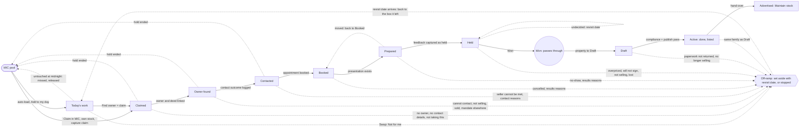

# Road to Sold v2 (and Road to Rented) — the recipe for a successful agent

**Jira: AT-454** (one ticket for the whole build; commits prefixed `AT-454:`).
Status: **APPROVED (20 Oct 2026) — approved by the conductor on Johan's delegation, 20 Oct 2026.** Spec v2.2, 20 Oct 2026 — Johan's answers 1–7 and the conductor's ruling on question 8 are recorded in section 15 (nothing open). Spec only — no code, no data, no menu changes were made writing this.**
Governing rulings: Johan, 20 Oct 2026 (section 1, verbatim — lanes do not edit it).
Verified against `QA1` at `8ee4fb502` (read-only), 20 Oct 2026. Every `path:line` was read from that tree. Anything not read is marked **UNVERIFIED**.
Supersedes: v1 of this file (13 Oct 2026). **v1 is kept whole, unedited, in Appendix A** (including Johan's original business rules of 13 Oct 2026 07:19). Section 2 says which v1 rulings still stand.
Companion spec: `agency-tracker-rehome.md` (taking Agency Tracker apart). Where the two touch (budgets, targets, daily activity, Worksheet), section 3.5 and section 9 say who owns what.

Words: always **evaluation**, never "valuation" (v1 §12, Johan's standing rule). The legacy column `rts_contact_outcomes.valuation_booked` keeps its name; nothing user-visible says it.
Abbreviations: `RW` = `routes/web.php`; `SB` = `resources/views/layouts/corex-sidebar.blade.php`; `ASP` = `app/Providers/AppServiceProvider.php`; `CIAL` = `app/Listeners/Activity/CreditInstantActionListener.php`.
Roles: Ag agent, BM branch manager, Ad admin, Ow owner.

---

## 0. Read this first — what the code says that shapes the build

1. **Road to Sold v1 is built and live on QA1, and v2 reuses it — it does not start a parallel engine.** Page `GET /road-to-sold` (`RW:6402-6430`), list builder, nine selections, outcomes, holds, summary bar, report, settings hub, areas, weekday targets, wizard step. Detailed inventory in section 3.6. QA1 rows are test data only (166 open list items, 1 outcome).
2. **The six-step summary bar is real, not event-driven.** Every actual is a query run on page load (`DrilldownService.php:71-87`, `SummaryBarService.php:26-33`). v2's recipe needs the 13 steps measured the same way *and* auto-completed from events. Both mechanisms are specced (section 5): the query is the **truth for the funnel**, the event is the **trigger for the task tick and the celebration**.
3. **Seven of the 13 steps have no usable auto-detect event today** (section 6 is the gap register). The biggest: nothing fires when a **Road to Sold outcome is recorded**, when an **evaluation is booked or done** (only a calendar observer and a calendar-class mapping), when an **owner is linked on the deeds path**, when a **listing goes live on P24/Private Property**, when a **presentation is presented**, when a **seller live link or viewing pack is sent**, when a **paper OTP/mandate is signed**, and when a **payslip is generated**. Aftercare/referrals does not exist at all.
4. **Two dead events are registered but never raised:** `MandateSigned` and `DocumentSigned` (zero raise sites; `ASP:802, :822` register listeners to nothing). Mandates are credited by a direct call (`SignatureService.php:4003-4004`). The real e-sign completion hook is `SignatureEnvelopeFinalized` (`SignatureService.php:4141`), whose only listener today is lease-only (`ASP:338-345`).
5. **The points engine v2 replaces is double-weighted for calendar credit — verified.** `value_per_event` was seeded *from the weight* (`database/migrations/2026_06_20_120000_seed_hfc_activity_calendar_mappings.php:76`) and every reader multiplies `value × weight` (e.g. QA1: "Presentation" 5 confirmed rows score 200,000 instead of 1,000). v2 stores a **snapshotted `points_awarded`** per completion and never joins a live weight (section 7.4). Existing confirmed points are not rewritten without Johan's go. **Decided (Johan, 20 Oct 2026, answer 6): past months keep their old totals; the corrected rule applies from the cut-over date, with a before/after report (section 7.4).**
6. **There is no level, rank or sign-off concept for agents anywhere** (`users.agent_tier` is an unused column; "tier" in commission code means revenue-share depth). Levels are new. The best reusable BM sign-off shape is the syndication approval service (section 8.3).
7. **No funnel ratio is computed anywhere today.** All numerators/denominators exist as counts through `DrilldownService::count()` (`:71`). Caution: mandates and evaluations are keyed by *document owner / calendar user*, outcomes by `rts_contact_outcomes.user_id` — a ratio across them is not on the same population (section 9.2 states the fix).
8. **Celebration infrastructure is thin.** No confetti/badge/achievement concept; `window.showToast` (`resources/views/components/toast-notifications.blade.php:120`) is the only success-styled toast; persistent alert toasts style only `warning`/`critical` (`resources/views/components/alert-popups.blade.php:177`). A 360-minute per-type-per-subject alert cooldown drops repeats (memory note `alert-cooldown-swallows-same-type-alerts.md`; **figure not re-verified in code**). The only existing "congratulations" precedent is `WonMandateNotification` (`app/Notifications/Presentations/WonMandateNotification.php:14-17`, dispatched `PresentationOutcomeService.php:251`).
9. **Road to Rented does not exist** — no route, feature key, permission, sidebar link or catalogue. Only the `track` column everywhere, `Support/Routing.php:17-20`, and a remountable settings file. Section 12.
10. **Listing Stock is frozen data** (`listing_stocks`, 213 Propcon rows, last updated 2026-08-14) — v2 must read CoreX `properties` for stock, never `listing_stocks` (see `agency-tracker-rehome.md` finding 7).
11. **Multi-agency:** the activity catalogue (41 manual definitions, calendar mappings) is HFC's — seeded for slug `hfc-coastal` only (`ActivityCalendarMappingSeeder.php:49`; the migration likewise). A second agency gets none. v2 ships a **neutral default recipe** (section 5.5) and migrates HFC's list as HFC's *own custom tasks*.

---

## 1. Johan's rulings — 20 Oct 2026, verbatim as relayed

Pasted to this lane by Johan's side. Copied exactly; do not edit.

```
JOHAN'S RULINGS (20 Oct 2026):
1. Purpose: Road to Sold is the recipe for an agent to become successful (get stock, sell stock). CoreX shows "do this now / do this next". Agent, BM and agency measure progress AND where the agent needs training.
2. Steps (map each to its CoreX screen and its auto-detect event):
   GET STOCK: 1 find (MIC lists: new on market, long on market, price drops, expired, my buyers / agency buyers sourcing; drive your area) → 2 find owner (deeds/CMA Info capture, link contact) → 3 contact + outcome → 4 evaluation booked (calendar; never "valuation") → 5 presentation created / presented / feedback → 6 mandate signed (e-sign) → 7 listing loaded, compliant, live on P24/PP.
   SELL STOCK: 8 marketing (social shares, seller live link, viewing pack) → 9 buyers (leads, response time, Core Matches, buyer pipeline) → 10 viewings + feedback → 11 OTP signed → 12 DR2 deal pending → granted → registered → payslip → 13 aftercare / referrals.
3. Two task types: (a) CoreX tasks, auto-completed from the event in CoreX (today's auto points); (b) agency custom tasks, recurring per hour / day / week / month (e.g. "drive your area once a week"). Custom tasks are NOT a tickbox: they capture what was found (stock and contacts made, as real CoreX records, e.g. properties and contacts created from the drive), and those leads then flow into the next steps. Each task has a target per period, points, and feedback/evidence. This REPLACES today's daily activity setup and capture (migrate existing activity types and points; keep the history).
4. Levels: a new agent starts at level 1 (small tasks). The BM checks, coaches and signs off, which unlocks the next level. The agency builds its recipe per level. Targets and budgets per user are Road to Sold settings (from the agency-tracker spec: company requirement, per-user budgets, targets).
5. Intelligence: from the data, CoreX predicts, advises and auto-fills (e.g. suggested next targets), and shows training flags from the funnel ratios (e.g. many calls, no evaluations → "needs training: evaluation pitch"). The Road to Sold stats are what the BM and admin use to set the next targets. The more it's used, the better the data.
6. Motivation: congratulate on each target hit, celebrate a DR2 deal, show progress so the agent is pulled to the next task. Johan wants to play with colours. Spec the states (behind / on track / ahead / achieved / celebration) with the CoreX components, and leave the colours to a later mockup round with Johan.
7. Views: agent (today's list, next action first, progress vs target); BM (team funnel, training flags, sign-offs); agency (recipe/level builder, targets, reports). Full CRUD, search, sort, filter and own/branch/agency scoping on every list.
8. Road to Rented: same engine and process, with the sales steps swapped for rental steps (to-let stock, applications, leases, inspections, renewals). Spec it as a section that reuses everything.
9. Settings live under Road to Sold settings, and every threshold is an agency setting with a default.
```

---

## 2. v1 rulings that still stand (nothing here is re-litigated)

v1 §1 (Johan, 13 Oct 2026 07:19) and the conductor decisions of 13–14 Oct stay in force unless the right-hand column says otherwise. The text is in Appendix A; do not duplicate it.

| v1 ruling (Appendix A ref) | v2 status |
|---|---|
| One new page "Road to Sold" with its own sidebar link; does not replace the Today page (§1) | **Stands.** The page grows the recipe/next-action layer (section 10.1); same route `road-to-sold.index` |
| Everything built with a `track` dimension (sales now, rentals later), no sales-only hardcoding (§1) | **Stands, and is now enforced** — section 12 lists the sales-only spots that must be made track-aware |
| Every threshold/window/rule is an agency setting with a default; multi-agency safe; `agency_id` on every table; soft delete only; own/branch/agency at the query layer (`PermissionService::getDataScope` + `scopeVisibleTo` + `EnforcesRecordVisibility`; "own" uses `User::dataIdentityIds()`) (§1) | **Stands** and is Johan's ruling 9 above |
| Areas: derived from the agency's own stock + MIC data, not Prospecting Setup (§1 replaced by §13, Johan 13 Oct 16:03) | **Stands** (v1 §13, built) |
| Areas come first, not a fence; "Lock agents to their areas" default OFF (§1) | **Stands** |
| Targets per agent per weekday, agency default Mon–Fri 5; public holidays and approved leave carry no target; "Add to my day" over-and-above; missed items show-as-missed or roll over (§1, §3.3, §5.3) | **Stands** — these are the *daily call targets* for step 1/3. The new per-task period targets (section 5.2) sit beside them, not in place of them |
| The daily list: built overnight, fill order (follow-ups, selections, address-first, never suggest held/do-not-contact/another agent's stock), nine selections switchable and ordered, "an agent NEVER gets another agent's stock" (§1, §9) | **Stands** — this *is* step 1 (FIND) |
| Other feeds shown as separate blocks (buyer follow-ups, lead follow-ups, expiring mandates), not counted against the call target (§1) | **Stands**; these blocks become the "next action" feeds for steps 9 and 6 (section 10.1) |
| Working a property: "Contacted client" popup, agency-defined outcome list with attempt/conversation, next action, hold 30 days, N no-answers drop (§1, §10) | **Stands** — this *is* step 3 (CONTACT + OUTCOME) |
| Summary bar: per step should-be vs actual, green ≥ 90 / amber < 90 / red < 70 (agency setting), click a step to see rows; "Social shares OFF — do not build"; "Financial line later" (§1) | **Stands, widened:** the bar now spans the recipe's steps (section 10.1). **"Social shares OFF" is overturned** by Johan's step 8 (marketing includes social shares); it becomes a recipe step, auto-detected from `MarketingPostPublished` (section 6) |
| One interactive report reusing PeriodResolver/Period/PeriodComparison/`x-performance-delta`, drill-down on every figure, print/PDF/XLSX (§1, §10.6) | **Stands** and is extended with the funnel (section 9) |
| Settings: one Road to Sold settings page + wizard step; role-manager keys + corex-features row + sidebar link + sync-permissions (§1, §4) | **Stands**; v2 adds tabs and keys (section 13) |
| Assistants: work the list owner's list; outcomes/holds/targets/report figures belong to the agent; an assistant is never a report row (§11.1) | **Stands.** Levels, sign-off and training flags attach to the **agent (list owner)** only; assistant activity already counts under the agent, so funnel ratios include assistant calls — **decided (Johan, 20 Oct 2026, answer 4): yes, an assistant's work counts under the agent, but every action records who did it (assistant or agent) and the reports can split them** (sections 5.4, 9.2, 10.4) |
| Properties the agent parked with their own outcome are not offered back as new (§11.2) | **Stands** |
| The word is "evaluation", never "valuation" (§12) | **Stands** |
| Screen-text rule: data and controls only, no intro paragraphs, every button same height (§5.0, 13 Oct) | **Stands** for every v2 screen |
| Wizard: main settings in the wizard step; advanced thresholds on the settings page only, recorded in the "Deliberately NOT in the wizard" list (§8) | **Stands as the method**; v2's new settings are classified in section 13.3 |
| Only cc1 writes to `origin/QA1` (STANDARDS −1l) vs conductor's 13 Oct "each lane lands its own work" (§8) | v1's note stands as recorded; **this spec makes no change to it** — the conductor decides which applies to the v2 build |
| v1 §2.1 summary-step catalogue (six steps), selection keys, `SettingsService` getters, `WorkdayService`, `AreaService` | **Stand as built.** v2 adds a task/step layer on top (section 5); nothing renamed (the keys are stored) |

What v2 **replaces from the old system** (not from v1 Road to Sold): the daily-activity setup and capture screens and the points engine behind them (Johan's ruling 3). Section 7.

---

## 3. The model in one page

### 3.1 The recipe

The recipe is an **ordered list of 13 steps** (Get Stock 1–7, Sell Stock 8–13). A *step* is a milestone in an agent's work with a stock lead or a buyer. A *task* is something an agent does inside a step. The agency builds its recipe **per level** (section 8): level 1 uses only small tasks; higher levels add tasks, raise targets, and add whole steps.

| Concept | Meaning | Where it lives (new) |
|---|---|---|
| Step | One of the 13 recipe steps (fixed catalogue, labels agency-editable). Per track (sales/rentals) | `rts_steps` (seeded neutral; agency may switch off, rename, reorder within its group) |
| Task | A thing to do in a step. **Type A — CoreX task:** completed automatically from a CoreX event. **Type B — agency custom task:** recurring, captures real records, needs evidence | `rts_tasks` |
| Task in a level | Which tasks an agent sees at level N, the target per period, the points | `rts_level_tasks` |
| Completion | One occurrence of a task (auto or captured), points snapshotted | `rts_task_completions` |
| Level | An agency-named stage; a new agent starts at level 1 | `rts_levels`, `rts_agent_levels`, `rts_level_signoffs` |

### 3.2 How the current Road to Sold maps onto this

- Step 1 (FIND) = today's daily call list with its nine selections (v1 §9).
- Step 3 (CONTACT + OUTCOME) = today's outcome capture (v1 §10).
- The six summary-bar steps (`calls_made`, `conversations`, `evaluations_booked`, `evaluations_done`, `mandates_signed`, `listings_live`, `RtsSetting.php:173-182`) are the **funnel measures for steps 3–7**. They stay as the always-on funnel. The recipe adds steps 2 and 5, and the whole Sell Stock half (8–13).
- The existing per-weekday call target (v1 `rts_weekday_targets`) remains the daily target for step 1/3 work. Per-task period targets (section 5.2) cover everything else.

### 3.3 The two truths — never confuse them

1. **Funnel truth (the numbers):** counts computed by query from the source records (outcomes, calendar feedback, signed documents, properties, deals). These drive ratios, training flags, reports and the summary bar. No tickbox can move them.
2. **Task truth (the tick):** a `rts_task_completions` row — written by an event listener (Type A) or by a captured form (Type B). It drives the agent's "done today", points, celebration and level progress.
The two should agree. A reconciliation report (section 14.2) flags drift (e.g. a task ticked "evaluation booked" with no calendar event).

### 3.4 Points

`points_awarded` is a **snapshot** written at completion (agency task points × quantity). Readers sum `points_awarded`; they never join a live weight. Editing a task's points changes the future only. This removes the weight² defect (section 7.4) and the retroactive re-scoring the old engine does (`daily_activity_entries` readers join live `activity_definitions.weight` — verified, e.g. `CompanyPerformanceService.php:134-148`).

### 3.5 Budgets and targets (the interface owned by the agency-tracker spec)

`agency-tracker-rehome.md` §4.3 defines the interface My Portal reads: `RoadToSold\BudgetService::forUser / requirementFor` and `RoadToSold\TargetService::monthlyFor` (monthly deals/value/listings/points), plus two settings tabs "Budgets & requirements" and "Targets". **v2 adopts that interface unchanged and does not redefine it.** v2 adds one thing to it: the *per-task period targets* and *level* belong to the same Targets area (section 5.2). Who builds what:

| Item | Spec | Built by |
|---|---|---|
| Company requirement, per-user personal/business budget, monthly points/deals/value/listings targets, the Targets-zeroing fix | `agency-tracker-rehome.md` §4.3, §5.7 | the rehome lane (step 4 there) |
| Task catalogue, per-task period targets, levels, sign-off, funnel, flags, celebration | this spec | the v2 lanes |
| Daily activity screens/menu merge | `agency-tracker-rehome.md` §5 (interim) | rehome step 3, then **absorbed** by v2 phase 3 (section 7.6) |

### 3.6 What exists today (reuse, do not rebuild)

**Routes** — page group `RW:6402-6430` (`permission:access_road_to_sold`, `agency.required`, `feature:road-to-sold`): `GET /road-to-sold` `index` (`RoadToSoldController@index` :36), `POST /outcomes` (`@recordOutcome` :131), `POST /add-to-day` (`@addToDay` :176), `GET /drilldown`, `GET /report` + `print/pdf/xlsx` (`ReportController` :41, :73, :79, :89, :243), outcome settings `settings/outcomes*` (`OutcomeSettingsController`, `manage_settings`; mounted inside the sales group, **not** in the remountable file). Settings group `RW:8153-8158` loads `routes/road-to-sold-settings.php` (closure, remountable): hub `/`, `general`, `areas.*`, `targets.*`. Nightly build `rts:build-lists` 04:30 (`routes/console.php:470`, `Console/Commands/RoadToSold/BuildLists.php`). Sidebar `SB:1069-1072`, settings link `SB:1101-1106`; group opener `SB:292`.
**Services** (`app/Services/RoadToSold/`): `SettingsService` (typed getters; `forAgency` :36, `forUser` :58, `statusForPct` :329), `WorkdayService` (:51-99), `TargetService` (`weekFor` :29, `saveWeek` :99, `clear` :149, `restore` :160), `AreaService` (:49-477), `ListBuilderService` (`buildFor` :109, `addToDay` :349, `markWorked` :467), `CallListService` (`viewableAgents` :41), `OutcomeService` (`record` :44), `OutcomeDefinitionService`, `HoldService`, `SummaryBarService` (`forAgent` :44), `ReportService` (`build` :49), `DrilldownService` (`supports` :34, `count` :71), `FeedService`, `HotPocketService`, `Scope`, `VisibleAgents`, `Track`. Selections in `Selections/` (registry `SelectionRegistry.php:24-34`).
**Models** (`app/Models/RoadToSold/`): `RtsSetting`, `RtsSettingAuditEntry`, `RtsAgentArea`, `RtsHiddenArea`, `RtsWeekdayTarget`, `RtsListItem`, `RtsOutcomeDefinition`, `RtsContactOutcome`, `RtsHold`, `RtsPropertyFlag`. Views `resources/views/road-to-sold/*` (index 399 lines, report, settings tabs).
**Permissions** `config/corex-permissions.php:617-623` (`access_road_to_sold`, `road_to_sold.view`, `.manage_settings`, `.manage_areas`, `.manage_targets`). **Feature row** `config/corex-features.php:214-224` (`road-to-sold`, `depends_on ['prospecting']`). **Wizard step** `road_to_sold` (`config/agency-onboarding-copy.php:1656-~1740`; saver `SettingsController@saveFromWizard` :110).

---

## 4. The 13 steps — screen, model, and auto-detect event (verified)

Legend for "Auto-detect": **EXISTS** = a domain event/observer fires today; **PARTIAL** = something fires but not at the right moment or not as an event; **GAP** = nothing, with the nearest hook. "Points slug" = an existing instant-action key (`database/seeders/ActivityInstantActionsSeeder.php`, credited via `CIAL` and the map at `ASP:646-679`). The listing of every raised event is in section 6.3.

### GET STOCK

**Step 1 — FIND**
- Screens: Road to Sold index (`road-to-sold.index`, `RoadToSoldController@index`, view `road-to-sold/index.blade.php`); MIC Work tab (`market-intelligence.work`, `GET /corex/market-intelligence`, `CoreX\MarketIntelligenceController@work` :60, `RW:7830/7834`, `access_prospecting` + `feature:prospecting`). Selections (registry `SelectionRegistry.php:24-34`): 1 `my_buyers_sourcing` / 2 `agency_buyers_sourcing` (`BuyerSourcingSelection.php:16`, reads `prospecting_buyer_matches`⨝`contacts`), 3 `hot_pockets` (`HotPocketSelection.php:13`, `HotPocketService::rank`), 4 `price_drops` (`PriceDropSelection.php:12`, `prospecting_price_history`), 5 `new_on_market` (`NewOnMarketSelection.php:16`, `listed_date` else `first_seen_at`), 6 `long_on_market` (`LongOnMarketSelection.php:14`), 7 `owner_known` (`OwnerKnownSelection.php:17`), 8 `my_expired_stock` (`MyExpiredStockSelection.php:13`), 9 `my_stock_not_selling` (`MyStockNotSellingSelection.php:24`). Shared MIC query `MicPoolSelection.php:150-203`; own-stock base `OwnStockSelection.php:21`.
- **Note vs the ruling:** Johan's list says "expired". The only expired selection is the agent's **own** expired mandates (#8). There is **no "expired competitor listing" selection**. MIC Work presets are `pitch_now_high, pitch_now, log_outcomes, my_claims, expiring (claim expiry), new_today` (`ProspectingActionPresetService.php:56-135`) — the new/long/price-drop lists exist only as Road to Sold selections. **Decided (Johan, 20 Oct 2026, answer 1): yes — add other agencies' expired listings, wherever we have dates to track them on.** Spec: a tenth selection, stable key `expired_competitor` (appended after the nine in the default order, so no stored key changes; `ExpiredCompetitorSelection` in `app/Services/RoadToSold/Selections/`, extending the shared MIC query `MicPoolSelection.php:150-203`, which already excludes the agency's own on-market stock, other agents' linked properties and claimed/pitched listings). A competitor listing qualifies **only when CoreX holds a dated signal that it expired** — a captured mandate/listing end date, or a dated removal/expiry status from the portal capture; a listing with no such date never appears under this selection (nothing is guessed). The lane first verifies, per portal (P24, Private Property), which captured fields carry a date (`prospecting_listings`, `prospecting_price_history`; **UNVERIFIED today**) and reports the coverage. Agency settings: selection on/off and order (as the other nine), `expired_competitor_lookback_days` (default 30: how recently it expired). Selection #8 (`my_expired_stock`) stays for the agent's own mandates.
- Models: `tracked_properties` (canonical key, v1 ruling), `prospecting_listings`, `prospecting_claims`, `rts_list_items`.
- **Drive your area: GAP (no concept in code).** Closest capture points: Map module (`corex.map.*`, `RW:6221-6237`; `MapActivityController.php:362-370` `matchOrCreate` source `map_prospect_launch`), Chrome extension import (`POST /api/v1/prospecting/import`, `routes/api.php:646`, `ProspectingApiController@import`; `ProspectingListing::create` :241; `linkToTrackedProperty` :544-560), manual add (`EntryPointController@storeFromProspecting` / `storeFromTrackedProperty`, `RW:5102, :5169`; source `manual_prospect_entry` `:499-516`). **A "drive your area" custom task (type B) is the answer:** it creates real tracked properties (via `TrackedPropertyMatchOrCreateService::matchOrCreate`, `:145`, with a new source type `area_drive`) and contacts (section 5.3).
- Auto-detect (existing):
  - List item worked → `ListBuilderService::markWorked` :467 sets `rts_list_items.status='worked'` (no domain event).
  - MIC claim taken → `ClaimCreated` (`ProspectingClaimObserver.php:58`) → `CIAL::handleClaimCreated` :261 → slug `mic.claim_taken`.
  - Tracked property created → `TrackedPropertyCreated` (`TrackedPropertyMatchOrCreateService.php:1659-1664`); only listener `LogAgentActivity` (`ASP:541`); **no points slug**.
  - Matched existing → `TrackedPropertyEnriched` (`:1777`).
- Verdict: **EXISTS for claim; GAP for "drive an area" and for "tracked property captured" (event fires, no task/points binding).**

**Step 2 — FIND OWNER**
- Screens: Deeds Capture (`corex.deeds-capture.*`, `GET /corex/deeds-capture`, `CoreX\DeedsCaptureController@index` :28, `RW:7765-7799`, `deeds_capture.access`); browser-extension ingress `POST /api/v1/deeds-capture` (`routes/api.php:653`, `Api\DeedsCaptureController@store`; `matchOrCreate` :668; `capture_kind='deeds_capture'` :691); `promote` (`DeedsCaptureController.php:694`, links current owners via `ContactPropertyLinker::link($contactId,$property->id,'owner')` :1133). Other owner paths: TVA capture (`TvaCompanyDirectorsController.php:154`), Map scheme owner (`MapController.php:682-697`), seller outreach link (`EntryPointController@linkSellerToProspecting` :1477, `RW:5121`, sets `owner_contact_id` :809), CMA Info capture (`PropagateCmaToProperty.php:129`, `ParseMarketReportJob.php:266`, source `cmainfo`). Owner persistence: `OwnerContactResolver::persist` (`Services/Prospecting/OwnerContactResolver.php:67`) → `tracked_property_owners` + `Contact`; `tracked_properties.owner_contact_id` written at `Api/DeedsCaptureController.php:750`.
- Auto-detect: `TrackedPropertyEnriched` (sourceType `deeds_capture`/`cmainfo`; log only); `ContactCreated` → slug `contact.captured` (cap 50/day, `CIAL::handleContactCreated` :99); `TrackedPropertyPromotedToStock` → `tracked_property.promoted_to_stock` (`CIAL` :200).
- **GAP — the moment the owner is linked on the deeds path.** `ContactPropertyLinker::link` fires no event; `ContactLinkedToProperty` is raised from 8 other sites only (`PropertyContactController.php:237,307,376`, `ContactPropertyController.php:91`, `PropertyWizardController.php:348`, `PropertyController.php:1626`, `DealRegisterController.php:1523`, `LeaseCaptureService.php:976`), not from `DeedsCaptureController.php:1133` nor `linkSellerToProspecting`. Nearest hooks: the single writer of `tracked_property_owners` (`OwnerContactResolver.php:83-91`, model has no observer) or `tracked_properties.owner_contact_id` null→set (3 write sites: `Api/DeedsCaptureController.php:750`, `EntryPointController.php:809`, `MapController.php:697`). `OwnerContactResolver::linkCurrentOwners` (:106) has no callers (dead).

**Step 3 — CONTACT + OUTCOME**
- Screen: `road-to-sold.outcomes.record` (`POST …/road-to-sold/outcomes`, `RW:6407`, `RoadToSoldController@recordOutcome` :131) → `OutcomeService::record` (`OutcomeService.php:44`), one DB transaction: holds check, next-action, no-answer streak/drop, resolves `tp.owner_contact_id`, optional calendar event for "evaluation booked" (`CalendarEventCreator::create` :121-129, category `property_evaluation`), flips earlier outcomes `is_current=false`, inserts `rts_contact_outcomes` (`:138-162`), hold (`:165-169`), `writeContactSide` (`:252-271`: `ContactNote`, `markContacted` for conversations, consent for do-not-contact), then `markListItemWorked` (:274). Seeded outcomes `OutcomeDefinitionService.php:27-41` (no_answer, spoke_evaluation_booked, spoke_call_back, spoke_not_interested, listed_other_agency_open, mandated_other_agency_sole, wrong_number, do_not_contact). Tables `rts_outcome_definitions`, `rts_contact_outcomes`, `rts_holds`, `rts_property_flags`.
- Auto-detect: **GAP.** `record()` dispatches **no event** and `RtsContactOutcome` has no observer. Hook: after the transaction at `OutcomeService.php:171`, or the create at :138. Indirect only: for conversation outcomes with an owner contact, `Contact::markContacted` (`Contact.php:2002`) fires `ContactContactedByAgent` (channel `contacted_action`, `Contact.php:2015`); its listener `RecordLeadFirstResponse` handles lead-response time and awards no points. It does not fire for attempts or when the property has no owner contact.
- v2 adds `RoadToSoldOutcomeRecorded` (a real domain event, `AbstractDomainEvent`), carrying outcome key, kind, track, tracked property id, actor.

**Step 4 — EVALUATION BOOKED (calendar; never "valuation")**
- Screens: Command Center calendar (`command-center.calendar`, `RW:2318`, `CalendarController@index`); create `command-center.calendar.store` (`RW:2417`, `CalendarController@store` :1853, `CalendarEventService::createManual` :34); complete `…calendar.complete` (`RW:2420`, `@complete` :2250); feedback `…feedback.show/store` (`RW:2429-2430`, `@storeFeedback` :1499). Model `CommandCenter\CalendarEvent`; related `calendar_event_feedback`. Class `property_evaluation` is manual-creatable (`CalendarEventService.php:26-28`; seed `CalendarEventClassSeeder.php:118`, `completion_behaviour require_feedback`). Links to the property/contact via `calendar_events.property_id`/`contact_id`.
- Auto-detect (PARTIAL, observer-based, **no domain event**):
  - Booked: `CalendarEventObserver::created` (`ASP:267`) → `ProvisionalPointService::credit` (`Services/Activity/ProvisionalPointService.php:47`) resolving `activity_definition_calendar_classes` by `event_class`. QA1 agency 1: `property_evaluation` → "Appointments" (weight 200), `listing_presentation` → "Presentation" (weight 200); provisional with back-date window, daily cap, duplicate-in-week gate; cancel/dismiss revokes it.
  - Done: `CalendarEventFeedbackObserver::saved` (`ASP:266`, `app/Observers/CalendarEventFeedbackObserver.php:17`) confirms the provisional points (`PointStateService::confirm` :32) and fires `ContactContactedByAgent('appointment_feedback')`; feedback capture sets `calendar_events.status='completed'` (`CalendarController.php:1395, :1745`).
  - A skipped feedback leaves a missed-feedback task (`source_type='calendar:missed_feedback'`, `CalendarController.php:1735`).
- **GAP:** no calendar domain event class exists (`ls app/Events | grep -i calend` empty). v2 adds `EvaluationBooked` and `EvaluationCompleted`, raised from the two observers above (filtered to `category='property_evaluation'`, completed only when feedback `captured_at != null`).
- **Double-credit risk (inferred, UNVERIFIED by execution):** `OutcomeService` creates the evaluation calendar event; the calendar observer then credits the "Appointments" mapping. If a v2 task also awards for the same booking, one side must be off. Rule in section 7.5: the calendar mapping is retired in favour of the task; a single completion per (agent, evaluation event).

**Step 5 — PRESENTATION created / presented / feedback**
- Screens: `presentations.index` (`/presentations`, `RW:6639`, `Presentation\PresentationController@index` :78); create/store (:140/:162, status `draft` :212); `show` :295, `analysis` :382, `confirmAndGenerate` :496; delivery `presentations.deliveries.send` (`RW:6746`, `PresentationDeliveryController@send`, `PresentationDeliveryService.php:257`, statuses `queued, sent, failed, delivered, opened, bounced` `PresentationDelivery.php:32-37`); public view `GET /p/{token}` (`PublicPresentationController@show`, writes `PresentationSnapshotView` :116 and `snapshot_link.first_viewed_at`); outcome `presentations.outcome.record` (`RW:6732`, `PresentationOutcomeController@record`, outcomes `won_mandate, won_sale, lost_to_competitor, lost_to_no_decision, lost_to_price_dispute, lost_to_no_response, still_pending, other`). Gate `access_presentations` + `feature:presentations`. Tables `presentations` (has `property_id`, `tracked_property_id`, `seller_contact_id`, `deal_id`), `presentation_versions`, `presentation_deliveries`, `presentation_snapshot_links`, `presentation_snapshot_views`, `presentation_outcomes`.
- Auto-detect:
  - **Created: EXISTS.** `PresentationGenerated` (`PresentationGeneratorService.php:366`) → `CIAL::handlePresentationGenerated` :161 → `presentation.generated`.
  - **Feedback / outcome: EXISTS.** `PresentationOutcomeRecorded` (`PresentationOutcomeService.php:233`) → `CIAL` :171 credits `presentation.won` for won outcomes only. `presentation.lost` is seeded and active but never credited (`CIAL.php:66-70, :172-176`). Also `PresentationOutcomePrompted` (`Jobs/PromptOutcomeCaptureJob.php:101`), `PresentationOutcomeLocked` (`Jobs/LockOldOutcomesJob.php:46`, after 90 days).
  - **Presented: GAP.** `presentations.status` documents `draft|presented|locked` (`Presentation.php:14`) but only `draft` is ever written. Hooks: `PresentationDelivery` created/sent (`PresentationDeliveryService.php:257`), `PresentationSnapshotLink.first_viewed_at` null→set (`PublicPresentationController.php:~130`, "the seller opened it"), or a booked `listing_presentation` calendar event (mapped, weight 200).

**Step 6 — MANDATE SIGNED (e-sign)**
- Screens: DocuPerfect e-sign wizard (`docuperfect.esign.create`, `GET /docuperfect/esign/create`, `Docuperfect\ESignWizardController@create`; steps `docuperfect.esign.step`; `myDocuments`; group `RW:6895`, `access_docuperfect` + `feature:docuperfect`; view `docuperfect.esign.wizard`). Engine `Services/Docuperfect/SignatureService.php`; models `Docuperfect\SignatureTemplate` (`STATUS_COMPLETED` :92), `SignatureRequest`, `Document`. **There is no `Mandate` model** — a mandate is the property (`expiry_date`, status) plus a document whose template/document-type slug is `mandate`.
- Auto-detect:
  - **E-signed: PARTIAL.** `SignatureService::completeDocument` (:3866, from `approveAndAdvance` :1680 → :1658, :1825, and :2120) credits `mandate.signed` **directly** (`:3994-4005`, only when doc type is `mandate`, `DB::afterCommit`), not through a listener. The right hook for tasks is `SignatureEnvelopeFinalized` (`recordFinalizationSucceeded` :4130-4141 via `announceEnvelope` :5015; payload `signatureTemplateId, documentId, agencyId`, **no document type**; only listener is lease-only `Rentals\UpdateLeaseSigningState`, `ASP:338-345`).
  - `MandateSigned` / `DocumentSigned` (`app/Events/Mandate/MandateSigned.php`): registered (`ASP:802, :822`), **never dispatched**.
  - **Paper / wet-ink mandate: DECIDED (Johan, 20 Oct 2026, answer 2).** The step ticks EITHER when a document of the mandate type is **uploaded onto the property** OR when an e-sign document of that type is **completed and filed** (`SignatureEnvelopeFinalized`, which fires only after signed, approved AND filed). Both tick the step; one real mandate never ticks it twice (idempotent on property + document type + period). Today `DocumentUploaded` is raised only from `ContactDocumentController.php:63` and `LeaseCaptureService.php:923` — **not when a document is filed to a property**. The hook is the moment a `Document` is linked to a property (the `document_properties` pivot, `Document.php:~58`) with a document type in the agency's "counts as a signed mandate" list — one new event, `DocumentFiledToProperty`, raised at the link point so it catches every upload path (the exact upload paths — Filing Register `DocumentFilingController@store` `RW:2134`, the PDF splitter `PdfSplitterController.php:1581/:2276`, deal documents `Dr2\DealDocumentController@store` `RW:1200` — and the pivot write site are **UNVERIFIED**; the lane lists every path that links a document to a property).
  - Manual "mandate won" button `corex.properties.convert-from-prospecting` (`RW:5957`, `PropertyController@convertFromProspecting` :2405) sets prospecting→draft with no event; also `MandateConverted` (`TrackedPropertyMatchOrCreateService.php:2354`) on promotion.
- The "open pending cc6 hook: all parties signed" in memory is **rental inspections**, not mandates (`RentalPortalDocumentService::inspectionIsShareable()`); the mandate equivalent is `SignatureTemplate` status `completed`.

**Step 7 — LISTING LOADED, COMPLIANT, LIVE on P24/PP**
- Screens: Properties (`corex.properties.*`, group `RW:5761`, `access_properties`, `agency.required`, `deny_assistant_property_write`): create `RW:5900` → `PropertyController@create` :1091 / store :1326; wizard `PropertyWizardController` (`createDraft` :167, `finalize` :489); show `PropertyController@show` :841; go-live `corex.properties.go-live` (`POST …/{property}/go-live`, `RW:5763`, `PropertyController@goLive` :3708). P24: `corex.properties.p24-syndication.{toggle,submit,deactivate,reactivate,status,readiness}` (`RW:6085-6091`, `P24SyndicationController` submit :75); PP: `PrivateProperty\SyndicationController` submit :83. Table `properties`.
- Auto-detect:
  - **Loaded: EXISTS.** `PropertyCaptured` (`PropertyObserver.php:394/:416`) → `CIAL` :296 → `property.captured`. **Caveat:** the wizard `createDraft` also creates a property row, so the credit fires at *draft creation*, not at finalize.
  - **Compliant: EXISTS.** `go-live` → `MarketingReadinessService::snapshotCompliance` (:160) sets `compliance_snapshot_at`; `PropertyObserver` sees null→set → `PropertyCompliancePassed` (:605) → `CIAL` :306 → `property.compliance_passed`.
  - **Live on the website: EXISTS but is not the portal.** `PropertyPublished` (:620, `published_at` null→set) → `property.published`. `published_at` is the website publish flag (`Property.php:2441-2450` says syndication does not touch it).
  - **Live on P24/PP: GAP.** "Live" is derived (`isLiveOnAnyPortal` `Property.php:2441`; `scopeLiveOnAnyPortal` :2476): P24 = `p24_syndication_enabled` + `p24_ref` + `p24_syndication_status='active'`; PP = `pp_syndication_enabled` + `pp_ref` + status. First-go-live writers raise no event: `Property24SyndicationService.php:441-449` (`p24_activated_at`, plus `listed_date` via `listedDateStampOnGoLive` `Property.php:586`), `syncActivationStatus` :839/:869, `P24ListingNumberReconciler.php:170`, `PrivatePropertySyndicationService.php:253-258` (`pp_activated_at`). Hook: observer rule on `p24_activated_at`/`pp_activated_at` null→set, or a new `PropertyWentLiveOnPortal` at those lines. `listed_date` is already the "real listed date" (v1 §9.3) and is what `listings_live` counts today.
  - Syndication approval events do exist (`SyndicationApprovalRequested/Approved/Rejected/Revoked`, `SyndicationApprovalService.php:330/:419/:446/:487`).

### SELL STOCK

**Step 8 — MARKETING**
- 8a **Social shares (Ad Manager).** Screens: bulk `tools.ad-manager` (`GET /tools/ad-manager`, `AdManagerController@index`, `RW:1633`); scheduled list `tools.ad-manager.scheduled` (`RW:1665`, `.update/.cancel/.reschedule` `RW:1666-1668`, `ScheduledPostsController`); create schedule JSON `ad-manager.scheduled.store` (`RW:557`, `@store` :171; modes `at|daily|now`); single-listing publish `marketing.publish` (`RW:6064`, `PropertyMarketingController@publish`). Model `PropertyMarketingPost` / `property_marketing_posts` (statuses draft, scheduled, publishing, published, failed, cancelled, `:15-21`) — there is **no** `ScheduledPost` model. Publisher `ScheduledPostPublisher` (`claim()` :106-111, `recordPublished()` :175-198). **Listing "Post now" (AT-456 §D.10, commit e34caa9bb) is on Staging, not on QA1**; on QA1 `ScheduledPostService::schedule` refuses `mode='now'` unless every item is a company ad (:235-240).
  - Auto-detect: **EXISTS.** `MarketingPostPublished` (`PropertyMarketingPostObserver.php:39`, registered `ASP:710`) → `CIAL::handleMarketingPostPublished` :320-324 → slug `marketing.published` (`ActivityInstantActionsSeeder.php:178`). Failure: `MarketingPostScheduleFailed` (`ScheduledPostPublisher.php:295`). Caveats: it is per platform post (an ad on two platforms = two events); the raw `DB::table()->update` fallbacks (`:192, :282`) bypass the observer.
- 8b **Seller live link.** Screens: generate `corex.properties.seller-links.generate` (`POST /corex/properties/seller-links/generate`, `SellerLinkController@generate` :372-403, `RW:5797`), revoke (`RW:5798`), public `seller-link.show` (`GET /property/live/{token}`, `RW:44`, view `seller-link/live.blade.php`, seller-safe buyer feedback `buildSellerSafeFeedback` :202-205). Model `PropertySellerLink` (`generated_at, last_accessed_at, access_count, revoked_at`).
  - Auto-detect: **GAP.** No event; "sent" is never recorded. Hooks: created `SellerLinkController.php:385`; seller opened `:83-84` (the only proof the seller saw it).
- 8c **Viewing pack.** Screens: `corex.viewing-packs.index/store/show` (`RW:2580-2586`, `ViewingPackController`), buyer PDF `.buyer-pack` (`RW:2597`, `@downloadBuyerPack` :355), agent sheet (`RW:2599`), launch from a calendar viewing `command-center.calendar.viewing-pack.launch` (`RW:2423`, `launchFromEvent` :540). Model `ViewingPack` (status only `draft|ready`, `ViewingPack.php:46-48`, `calendar_event_id`).
  - Auto-detect: **GAP.** No "sent" state, no event, no observer. Hooks: created `launchFromEvent` :540 / `store` :414; buyer pack downloaded `downloadBuyerPack` :355 (a download is not proof of sending).

**Step 9 — BUYERS (leads, response time, Core Matches, buyer pipeline)**
- Leads: inbox `corex.portal-leads.index` (`RW:6359-6363`, `PortalLeadController@index` :14); model `PortalLead` (`received_at, contact_id, first_response_at, first_response_by_user_id, first_response_channel, response_tracked`). **EXISTS (arrival):** `NewPortalLeadReceived` raised at `P24LeadService.php:212`, `PpLeadService.php:222`, `WebsiteLeadService.php:117`, `SharedLinkReengagementService.php:72`, `CommandTaskPortalLeadObserver.php:120`; listeners `LogPortalLeadReceived`, `EmailPortalLeadToAgent` (`ASP:302, :318`); **no points slug**. Each arrival also seeds the buyer pipeline (`BuyerLeadCascadeService::seedFromListing`, `app/Services/Buyers/BuyerLeadCascadeService.php:47`).
- Response time: report `lead-response-report.index` (`GET /corex/lead-response-report`, `RW:1848`, `LeadResponseReportController@index` :27, `view_buyers_report`, feature `lead-response-report`). **EXISTS:** `ContactContactedByAgent` (`app/Events/Contact/ContactContactedByAgent.php`; channels `contacted_action, message, shared_link, appointment_feedback`) → `RecordLeadFirstResponse` (`ASP:441`) → `LeadResponseRecorder::record` (`Services/LeadResponse/LeadResponseRecorder.php:22-37`). Counted minutes = business-hours minutes between `received_at` and `first_response_at` (`LeadResponseService::results` `:87`, `:117-122`; target and hours are agency settings, `command-center.settings.lead-response.update` `RW:2564`). Raised via `Contact::recordAgentContact` (`Contact.php:2013-2016`) from `markContacted`, `ContactMatchShare::confirmSent` (:123), `CalendarEventFeedbackObserver`, `EmailArchiveIngestor.php:168`, `WaArchiveIngestor.php:312`, `ProvisionalReconciler.php:130`, `PendingAttachmentService.php:65`. Caveat: the `message` channel fires when an outbound email/WhatsApp is *ingested*, not at the click of send; timing may lag (**UNVERIFIED how much**).
- Core Matches: `corex.core-matches.index` (`RW:6256`, `ContactMatchController@index` :73, feature `core-matches`), `.all` (`RW:6261`, `core_matches.all_view`), share confirm `corex.core-matches.shares.confirm` (`RW:6319`, `ContactMatchShareController@confirm`), convert to deal `matches.convertToDeal` (`RW:6526`, `@convertToDeal` :789). Models `ContactMatch` (table `contact_matches`; there is **no** `CoreMatch` model), `ContactMatchShare`, `ContactMatchShareProperty`. **"Sent a property": EXISTS** — `ContactMatchShare::confirmSent` (`ContactMatchShare.php:~95-125`) writes `ContactMatchShareProperty` rows and fires `ContactContactedByAgent('shared_link')`. **"Match created": GAP** — `ContactMatchObserver` (`ASP:275`, `landOnPipeline` `ContactMatchObserver.php:101`) only; no domain event.
- Buyer pipeline: `command-center.buyers.pipeline` (`RW:2516`, `BuyerPipelineController@index` :18; deliberately no permission key, comment `RW:6209-6215`); `buyer_pipeline.view` gates only the rentals pipeline (`RW:6216-6218`). Fields on `contacts`: `buyer_state` (`new|warm|cold|lost|won`, `BuyerStateService.php:19`), `buyer_pipeline_entered_at`, `last_activity_at`; rows `BuyerStateTransition`, `BuyerActivityLog`. **EXISTS:** `ContactMarkedLostInBuyerPipeline` / `…RestoredFromLost…` (`BuyerStateService.php:94, :96`); won via `MarkBuyerWonOnPropertyLink` on `ContactLinkedToProperty` (buyer/purchaser roles) → `BuyerStateService::markWon` (:286).

**Step 10 — VIEWINGS + FEEDBACK**
- Scheduling: `command-center.calendar.store` (class `viewing`; `PropertyViewings.php:49` categories `viewing, viewings, buyer_viewing`). **PARTIAL:** `CalendarEventObserver::created` → `ProvisionalPointService::credit`; mapping `viewing`→"Take out Buyers" (`ActivityCalendarMappingSeeder.php:67`); gates: back-date limit, daily cap, no duplicate buyer+property in a week (`ProvisionalPointService.php:63-150`).
- Feedback: read `command-center.calendar.feedback.show` (`RW:2429`, `CalendarController@showFeedback` :1102); write `…feedback.store` (`RW:2430`, `@storeFeedback` :1499 → `storeViewingFeedback` :1331); `ViewingFeedbackService` (`app/Services/Properties/ViewingFeedbackService.php`; visibility `public_to_seller` :109, :148 → shown on the seller live link via `PropertyViewings::sellerNotes`). Model `CalendarEventFeedback` (`viewing_status viewed|did_not_happen|declined_on_arrival`, `captured_at`, `seller_visible_notes`, `internal_notes`, `next_action_notes`).
- Auto-detect: **PARTIAL.** `CalendarEventFeedbackObserver::saved` (`ASP:266`) confirms the provisional points, fires `ContactContactedByAgent('appointment_feedback')`, and for buyer-facing classes calls `BuyerStateService::markActivity('viewing_completed')`. **No domain event class** for viewing held / feedback captured. A step tick must count only `viewing_status='viewed'` with `captured_at != null` (blank rows exist). v2 adds `ViewingHeld`. "Feedback shared with seller" has no event either (same observer, `visibility='public_to_seller'`).

**Step 11 — OTP SIGNED**
- There is **no OTP/offer model.** The "offer" is a `Deal` (`deals.accepted_status='P'`) created by `deals-dr2.store` (`DealRegisterController@store` :374, `RW:1075`) or from a Core Match (`convertToDeal`). Document type `otp` (id 23, `esign_warning_required=1`); old `offer_to_purchase` (id 10) inactive. QA1 OTP templates (ids 11–14, 25, 26, 43) all `is_esign=0`. Classifier `DocumentTypeClassifier.php:41-45, :82`. `Document` carries `deal_id` (`Document.php:24`), `document_properties`, `document_contacts`. The e-sign floor is an acknowledgement gate (`Template::booted()` `Docuperfect/Template.php:~543-575`); `Template::isEsignBlocked()` no longer exists (the memory note is stale).
- Auto-detect:
  - **E-signed OTP: PARTIAL (signal exists, nobody listens).** `SignatureEnvelopeFinalized` fires for every completed envelope (`SignatureService.php:4141`); for an OTP nothing reacts. `completeDocument` explicitly excludes OTP from the mandate credit (`:3991-4010`, `$docType === 'mandate'`). Hook: a listener on `SignatureEnvelopeFinalized` that resolves `document_type='otp'`, then the document's property and deal.
  - **Paper OTP: DECIDED (Johan, 20 Oct 2026, answer 2) — same rule as the mandate:** the step ticks when a document of the OTP type is uploaded onto the property (same `DocumentFiledToProperty` event, document type `otp`, with the deal resolved from the document's `deal_id` or the property's open deal) OR when the e-sign OTP is completed and filed (`SignatureEnvelopeFinalized` filtered to document type `otp`). The DR2 pipeline's first step is `otp` "Deal Signed" with `completion='date_input'` (`Dr2ConditionCatalog.php:489`) — typed in by hand; it stays the date anchor for every other step and the lane does not change it.
  - `SignatureEnvelopeSent` (`SignatureService.php:1137`) exists.

**Step 12 — DR2 DEAL: pending → granted → registered → payslip**
- Screens (`/deals-dr2`, `RW:1072-1220`): `deals-dr2.index` :1073, `create/store` :1074-1075, `quickUpdate` (`DealRegisterController@quickUpdate` :202, `RW:1124`), `pipeline` (`Dr2\PipelineController@show`, `RW:~1146`), `settle`/`settle.save` (`DealSettlementController` :43/:76, `RW:1138-1139`, `settle_deals`), payslip `deals-dr2.settle.print.agent` (`@printAgentPayslip` :401, `RW:1141`, view `dr2.print.payslip`). Model `Deal`/`deals`: `accepted_status` P/G/D/R (`Services/Deal/DealPipelineLockService.php:20-26`), `commission_status` Not Paid/Paid/Loss, `granted_at`, `registration_date`. (Reality check: the DR2 screens run on the same `deals` table as the old register — `agency-tracker-rehome.md` finding 1.)
- Auto-detect: **EXISTS for pending/granted/registered**, all from `DealObserver` (`app/Observers/DealObserver.php`): `DealCreated` :19, `DealStatusChanged` :32, `DealClosed` :41 (R=won, D=lost), `DealStageAdvanced` :50 (forward-only P→G→R), `DealCommissionFinalised` :64. Pipeline steps drive status through `Dr1PipelineService::completeStep` :293 → `applyStatusTrigger` :417 (forward-only), which saves the deal and so raises the observer events; step completion itself raises no event (only `logActivity`). Points listeners: `CIAL` credits `deal.created`, `deal.stage_advanced`, `deal.registered` (won only), and per-side slugs (`ActivityInstantActionsSeeder.php:201-213`); reversal when R→not-R (`CIAL` :145-158). Property-status listeners `ASP:504-516`.
- **Payslip: GAP (confirmed) — DECIDED for now (Johan, 20 Oct 2026, answer 3): "commission paid" is the pipeline exit.** The deal leaves the pipeline, and the step ticks, when `DealCommissionFinalised` fires (`mark_paid`). Payslips exist but have bugs; **a separate payslip clean-up day will get payslips done for all deals, and only then does the signal switch to "payslip generated"** — until then no lane builds a generated-payslip event. `printAgentPayslip` (:401-461) renders a view and writes nothing — no event, no stamp. The only proof of "paid" is `mark_paid` in `saveSettlement` (`DealSettlementController.php:240-268`, sets `commission_status='Paid'`, `deal_settlements.paid_at`, `deal_user.paid_at`, raising `DealCommissionFinalised`). Use `DealCommissionFinalised` as the "payslip" signal until a real generated-payslip event exists (this is what Johan's "once a payslip is generated from DR2, that deal leaves the pipeline" will need). The slug `deal.commission_finalised` is seeded (`ActivityInstantActionsSeeder.php:147`) but **not wired** in `$spineCredits` (`ASP:646-679`), so it credits nothing today.
- Caution: `DealCreated` and `DealStageAdvanced` are raised both by `DealObserver` and again by `DealRegisterController.php:621-624, :1777-1780` (the second `DealStageAdvanced` passes the same status as from/to). Points are idempotent per deal/day/user but anything that counts *events* sees duplicates (**not confirmed whether `handleDealStageAdvanced` filters same-status — UNVERIFIED**). The task listener must be idempotent on (agent, deal, stage).
- Money rule (rehome spec §4.2): deal money for My Portal and any "commission earned" celebration comes from `DealMoney`/`deal_money_lines` — never `commission_ledger` (flagged wrong; separate money spec, needs Johan).

**Step 13 — AFTERCARE / REFERRALS**
- **Nothing step-specific exists.** What exists: contact birthdays (`contacts.birthday` + `birthday_reminder`; computed calendar class `contact_birthday`, `PeopleCalendarSource.php:67-86`, off by default `CalendarLayers.php:34`); referral source data (`contact_sources` per agency; `contacts.contact_source_id` `Contact.php:42`, `source()` :164; QA1 agency 1 has "Referral" id 13, "Old Client" id 11) — not a referral-tracking model; manual counters `DailyActivity.referrals_asked`/`referral_leads` (`DailyActivity.php:30, :39`) on the dead v1 table; `ContactTestimonialSubmitted` (`ClientPortalController.php:448`, listener `NotifyAgentOfClientTestimonial`); `TitleDeedCollected` (`TitleDeedHandoverService.php:105`, deed handover).
- **GAP, whole step:** no post-sale tasks (`AutoEventService` has only `onPropertyCreated/Updated`, `onDealCreated`, `app/Services/CommandCenter/AutoEventService.php:17, :93, :101`), no referral model/routes, no client-for-life or anniversary concept (grep of `aftercare|client.for.life|anniversar|post.sale` finds employment anniversaries only). Hook to start from: `DealClosed(won)` (`DealObserver.php:41`) or `DealStageAdvanced→R` (`:50`). v2 builds step 13 as a type-B custom-task family plus a small referral record (section 5.6).

---

## 5. The task engine

### 5.1 Task types

**Type A — CoreX task (auto).** Completed by a domain event. The task row stores `event_key` (the event class) and an optional filter (e.g. `document_type = otp`, `category = property_evaluation`, `outcome = won`). A **single generic listener on the `DomainEvent` interface** (the mechanism already used by the audit logger: `Event::listen(DomainEvent::class, RecordDomainEvent::class)`, `ASP:483`) looks up which active tasks of the actor's agency that event completes, then calls one `TaskCompletionService::complete($task, $user, $subject, $context)`. This keeps task definitions per-agency **data**, not code (the per-agency pattern of `activity_definition_calendar_classes`). Registration is mandatory because listener auto-discovery is **off** (`ASP:62-86`; `EventServiceProvider::disableEventDiscovery()`; a deploy that adds a listener must run `composer dump-autoload` and `php artisan event:clear`). Copy the safety rules of `CIAL`: never throw to the caller; skip when `environment('testing')`; skip a null actor; swallow-and-log (`CIAL.php:354-382`); reverse only on genuine reversals (`PointStateService::revoke`).
Idempotency key: (user, period window, task, subject_type, subject_id) — the same shape as `InstantPointService.php:119-126`. One real record never credits the same task twice in a period.

**Type B — agency custom task (recurring, captures records).**
- Defined by the agency: label, step, recurrence unit (**hour / day / week / month**), target per period, points per unit, evidence rule, and a **capture kind**.
- Not a tickbox. Completing it opens a short capture form that creates real CoreX records:
  - `capture_kind = property` → one or more tracked properties through `matchOrCreate` (source type from the task: e.g. `area_drive`; the call appends to `source_chain`, universal Match-or-Create Rule, `CLAUDE.md` non-negotiable 10) — never a bare insert;
  - `capture_kind = contact` → contact(s) through the normal contact creation path (fires `ContactCreated` → `contact.captured` as today);
  - `capture_kind = both` → property + owner/contact linked to it (linking via the same path that fires `ContactLinkedToProperty`, so downstream step 2 detection works);
  - `capture_kind = none` → feedback/notes only (for tasks that are genuinely an activity, e.g. "attend sales meeting"); still requires a text note or a photo if the agency sets evidence required.
- Every record created carries a back-reference: `rts_task_completions.subject_type/subject_id` points at the first record created and `rts_task_completion_records` lists all (section 5.4), so "what did the drive produce?" is a list of real properties and contacts. Those records **flow into the next steps**: new tracked properties enter the agent's step-1/2/3 funnel (they appear as "found by you" in the daily list source and in the owner-known/owner-needed pools); new contacts land with the correct owner link for step 3.
- Evidence: free-text feedback (what was found), optional photos, optional GPS/area label, and the linked records. Evidence-required is a per-task setting.
- Review: BM can open a completion, accept or send it back with a comment (reuse of the provisional→confirmed/revoked lifecycle, section 8.3).

### 5.2 Targets, periods, points

Every task has, **per level**: `target` (a whole number ≥ 0) per `period_unit` (`hour|day|week|month`), and `points` (decimal ≥ 0). Periods are calendar-aligned in the agency's timezone and respect `WorkdayService` (public holidays and approved leave carry no target; a weekly target is not pro-rated for leave unless the existing half-day setting says so — reuse, do not reinvent). A per-user override of a task target is allowed (BM/Admin, within scope), the way `rts_weekday_targets` overrides the agency default. Progress for a period = confirmed completions in the period vs target. "Hourly" tasks (e.g. "10 calls in the next hour") are timeboxed counters that the page shows as a live challenge; their completions are timestamped.
Existing weekday call targets (`rts_weekday_targets`, v1 §3.3) remain; they are the daily target for step 1/3 and feed the existing summary bar.

### 5.3 What "captures what was found" means in practice

- "Drive your area once a week" → opens a map/area capture form: choose area, add found properties (address/erf, optional photo, optional owner name/phone). Each submitted property becomes a tracked property via `matchOrCreate` (matched ones enrich instead — `TrackedPropertyEnriched`), each owner/contact a contact. The completion records counts: `properties_found`, `contacts_made`. Points can be per task or per record (setting).
- The same pattern serves "knock doors", "network event", "FSBO sweep".

### 5.4 Data model (proposed, all `agency_id` NOT NULL + `BelongsToAgency`; `track` varchar(20) default `'sales'`; soft deletes; no hard deletes; prefix `rts_`)

| Table | Key columns |
|---|---|
| `rts_steps` | agency_id, track, key (stable: `find, find_owner, contact_outcome, evaluation_booked, presentation, mandate, listing_live, marketing, buyers, viewings, otp, deal, aftercare` for sales; rental keys in §12), group (`get_stock`\|`sell_stock`), position, label, is_enabled |
| `rts_tasks` | agency_id, track, step_id, key, label, type (`core`\|`custom`), `event_key` (nullable; core only), `event_filter` json (nullable), recurrence_unit (`hour\|day\|week\|month`), capture_kind (`none\|property\|contact\|both`), evidence_required (`none\|note\|note_or_photo`), is_system (seeded neutral default), is_active, sort_order, legacy_activity_definition_id (nullable; section 7) |
| `rts_levels` | agency_id, track, number, name, description, is_active |
| `rts_level_tasks` | level_id, task_id, target (int), points (decimal), required_for_signoff (bool) |
| `rts_user_task_overrides` | user_id, task_id, level_id nullable, target nullable, points nullable, set_by_user_id |
| `rts_task_completions` | agency_id, branch_id, user_id (the list owner), `recorded_by_user_id` (**who actually did it — always set**, equal to `user_id` when the agent did it), `recorded_by_kind` (`agent\|assistant\|system`, snapshotted so a later role change does not rewrite history), track, task_id, step_id, level_id, occurred_at, period_unit, period_start, quantity, `points_awarded` (snapshot), `points_legacy` (migration only), state (`provisional\|confirmed\|revoked\|overridden`), source (`auto_event\|captured\|manual\|migrated`), subject_type, subject_id, evidence_note, evidence json (photo paths, area label, gps), confirmed_by_user_id, confirmed_at, revoked_at, revoke_reason, override audit json (reuse `PointStateService` shape) |
| `rts_task_completion_records` | completion_id, record_type (`TrackedProperty\|Contact\|Property\|Deal…`), record_id — the real CoreX records the completion produced |
| `rts_agent_levels` | agency_id, track, user_id, level_id, status (`active\|awaiting_signoff\|signed_off`), started_at, requested_signoff_at |
| `rts_level_signoffs` | **append-only** (same rule as `rts_settings_audit`): agency_id, user_id, from_level_id, to_level_id, decided_by_user_id, decision (`requested\|approved\|returned`), comment, decided_at |
| `rts_funnel_settings` | (or columns on `rts_settings`) ratio floors, sample sizes, windows, training links — section 9.3 |
| `rts_referrals` | agency_id, user_id, source_contact_id, referred_contact_id nullable, property_id nullable, deal_id nullable, status, created_at — step 13 |

All unique indexes follow BUILD_STANDARD §5a (`withTrashed()->firstOrNew` + `restore()`; never a bare create). `points_awarded` and all money are decimal(12,2). `rts_settings` keeps existing columns; new settings go in section 13.

### 5.5 The neutral default recipe (multi-agency rule — non-negotiable 9)

A new agency gets a seeded **neutral** recipe: the 13 steps with generic labels, the Type-A tasks bound to the events that exist (section 4), **level 1** containing a small set (e.g. "Work N properties from your list" (step 1/3), "Record a result for each call" (step 3), "Complete your profile" (neutral)), levels 2–3 empty shells the agency fills. **No HFC wording, weights, or areas.** The seeding is per-agency at first use (read-time defaults, never writing on read — STANDARDS Rule 17 pattern from `SettingsService::forAgency`), not a global catalogue. Today's calendar mappings and the 41 manual definitions are HFC data and migrate as HFC's own custom tasks (section 7).

### 5.6 Step 13 aftercare — a small build, honestly scoped

Because nothing exists, step 13 ships as: (1) a Type-A task bound to `DealClosed(won)` that creates a **follow-up task for the agent N days after registration** (`N` an agency setting, default a conservative neutral value) using the existing Command Center task system (`command_tasks`); (2) a **referral record** (`rts_referrals`) the agent can log from the contact page ("asked for referral" / "received referral"); referrals created become contacts that enter step 9. No client-for-life programme, anniversaries or testimonial automation unless Johan asks (section 15).

---

## 6. Gap register — steps with no matching CoreX event

### 6.1 Steps (or sub-steps) with **no usable event today**

| Step | Moment | Status | Nearest hook (file:line) |
|---|---|---|---|
| 1 | Expired competitor listings | new selection `expired_competitor` (answer 1) — only where CoreX holds a dated expiry signal | `prospecting_listings` / `prospecting_price_history` fields (**UNVERIFIED which carry dates**) |
| 1 | Drive your area | **GAP — no concept** | Type-B custom task + `matchOrCreate` source `area_drive`; no existing hook |
| 1 | Tracked property captured | event fires, **no points/task binding** | `TrackedPropertyCreated` `TrackedPropertyMatchOrCreateService.php:1659-1664` |
| 2 | Owner linked (deeds/CMA/seller-link paths) | **GAP** | `OwnerContactResolver.php:83-91`; `owner_contact_id` writes `Api/DeedsCaptureController.php:750`, `EntryPointController.php:809`, `MapController.php:697`; `DeedsCaptureController.php:1133` |
| 3 | Outcome recorded | **GAP** | `OutcomeService.php:138` / after-transaction :171 |
| 4 | Evaluation booked / done | **PARTIAL — observers + calendar mapping, no domain event** | `CalendarEventObserver::created` (`ASP:267`); `CalendarEventFeedbackObserver::saved` (`ASP:266`) |
| 5 | Presentation **presented** | **GAP** (status never written) | `PresentationDeliveryService.php:257`; `PublicPresentationController.php:~130` |
| 6 | Mandate signed **on paper** (document uploaded onto the property) | **DECIDED — counts (answer 2); event to build** | `document_properties` link point; new `DocumentFiledToProperty`; `DocumentUploaded` is not raised for property docs |
| 6 | Mandate signed (e-sign) | **PARTIAL** — direct credit, dead `MandateSigned` | `SignatureService.php:4003-4004`; `SignatureEnvelopeFinalized` :4141 |
| 7 | Listing **live on P24/PP** | **GAP** | `Property24SyndicationService.php:441-449` (`p24_activated_at`), `PrivatePropertySyndicationService.php:253-258` (`pp_activated_at`) |
| 8 | Seller live link created / opened | **GAP** | `SellerLinkController.php:385`; `:83-84` |
| 8 | Viewing pack created / sent | **GAP** | `ViewingPackController.php:540`, `:414`; `:355` |
| 9 | Core Match **created** | **GAP** | `ContactMatchObserver` (`ASP:275`) |
| 9 | Lead arrived | event exists, **no points/task binding** | `NewPortalLeadReceived` raise sites listed in step 9 |
| 10 | Viewing **held** | **PARTIAL** — observer, no domain event | `CalendarEventFeedbackObserver::saved` (`viewing_status='viewed'`) |
| 11 | OTP signed — e-sign | **PARTIAL** — signal exists, no OTP listener | `SignatureEnvelopeFinalized` `SignatureService.php:4141` |
| 11 | OTP signed — paper (document uploaded onto the property) | **DECIDED — counts (answer 2); event to build** | same `DocumentFiledToProperty`, type `otp`; Dr2 step `date_input` (`Dr2ConditionCatalog.php:489`) stays manual |
| 12 | **Payslip generated** | **GAP (confirmed) — "commission paid" is the exit for now (answer 3); "payslip generated" after the payslip clean-up day** | proxy: `DealCommissionFinalised` (`DealObserver.php:64`, from `mark_paid` `DealSettlementController.php:257-268`) |
| 12 | `deal.commission_finalised` points | seeded, **not wired** | `ASP:646-679` |
| 13 | **Whole step** (aftercare, referrals) | **GAP** | `DealClosed(won)` `DealObserver.php:41` |

### 6.2 New events v2 introduces (all `AbstractDomainEvent`, raised after commit, never throwing to the caller)

`RoadToSoldOutcomeRecorded`, `EvaluationBooked`, `EvaluationCompleted`, `OwnerLinkedToTrackedProperty`, `PresentationPresented`, `DocumentFiledToProperty` (a mandate- or OTP-type document linked to a property — Johan's answer 2; replaces the earlier `MandateSignedOnPaper` idea), `PropertyWentLiveOnPortal`, `SellerLinkCreated`, `SellerLinkOpened`, `ViewingPackCreated`, `ContactMatchCreated`, `ViewingHeld`, `OtpSigned` (fan-out from `SignatureEnvelopeFinalized` filtered on document type `otp`), `DealPayslipGenerated` (blocked on the money spec; until then use `DealCommissionFinalised`), `AreaDriveCompleted` (Type B completion). Each is added to `.ai/specs/corex-domain-events-spec.md` §5 in the same change (catalogue = contract; `CLAUDE.md` non-negotiable 9). Fix on the way: wire `MandateSigned` to its real raise site (inside the `completeDocument` afterCommit, `SignatureService.php:3994`) or delete the dead registrations; wire `deal.commission_finalised`; add `presentation.lost` handling or retire the slug.

### 6.3 Domain events actually raised today (so lanes know what exists)

Property: `PropertyCaptured` (`PropertyObserver.php:416`), `PropertyCompliancePassed` (:605), `PropertyPublished` (:620), `PropertySuburbLinked` (6 sites), `SyndicationApprovalRequested/Approved/Rejected/Revoked` (`SyndicationApprovalService.php:330/:419/:446/:487`), `ListingSyndicationChanged` (`WebsiteSyndicationService.php:69/:104/:189`, `PropertyObserver.php:695`), `PropertySoldByThirdParty`. Prospecting: `TrackedPropertyCreated` (:1659), `TrackedPropertyEnriched` (:1777), `TrackedPropertyPromotedToStock` (:2345), `TrackedPropertyAddress*`, `ClaimCreated`/`ClaimReleased` (`ProspectingClaimObserver.php:58/:83`), `ClaimFeedbackRecorded` (`MarketIntelligenceController.php:3846`). Contact: `ContactCreated` (`ContactObserver.php:48`), `ContactContactedByAgent` (`Contact.php:2015`), `ContactLinkedToProperty` (8 sites), `ContactMarkedLostInBuyerPipeline`, `ContactTestimonialSubmitted`. Lead: `NewPortalLeadReceived` (5 sites), seller outreach `PitchSent`/`PitchClicked`/`OptOutRecorded`/`OutreachOutcomeUpdated`. Mandate: `MandateExpired` (`ExpireMandates.php:67`, `PropertyObserver.php:556`), `MandateConverted`. E-sign: `SignatureEnvelopeSent/Finalized/Declined/Cancelled/Expired` (via `announceEnvelope` `SignatureService.php:5022`). Deal: `DealCreated`, `DealStatusChanged`, `DealClosed`, `DealStageAdvanced`, `DealCommissionFinalised`, `DealMoneyLineChanged`, `DealStepCompleted` (DealV2 only, `DealPipelineService.php:329/:372`). Marketing: `MarketingPostPublished` (`PropertyMarketingPostObserver.php:39`), `MarketingPostScheduleFailed`. FICA: `FicaSubmitted/Approved/Rejected`. Presentations: `PresentationGenerated`, `PresentationOutcomeRecorded/Prompted/Locked`. **Defined, never raised:** `MandateSigned`, `DocumentSigned`, `FicaExpired`, `ContactMergedInto`, `ClaimAutoReleased`, `ClaimConvertedFromLock`, `TrackedPropertyMerged`, `CallLogged`, `EmailMessageSent`, `WhatsAppMessageSent`, `EmailDraftOpened`, `WhatsAppDraftOpened` (static `new X(`/`::dispatch` search only; dynamic dispatch not ruled out). **No calendar/viewing domain events exist** — calendar runs through observers `CalendarEventObserver`, `CalendarEventFeedbackObserver`, `CalendarEventInvitationObserver`. Catalogue-specified events with **no class**: `PropertyCreated`, `PropertyUpdated`, `PropertyStatusChanged`, `PropertyArchived`, `ContactUpdated`, `ContactMerged`, `MandateWithdrawn`, `DealRegistered`, `ProspectingListing*`, Wishlist events (`.ai/specs/corex-domain-events-spec.md` §5, :297-372).

---

## 7. Replacing today's daily activity (setup + capture) — and migrating the history

### 7.1 What is being replaced

Screens: capture `agent.daily` (`RW:1926`, `Agent/DailyActivityController` `index` :61, `store` :340-479, view `agent/daily-v2.blade.php`), summaries `agent.daily.summary` / `bm.daily.summary` / `admin.daily.summary` (`RW:1927-1938`), setup `admin.daily-activities.setup` (`RW:1970-1978`, `Admin/DailyActivitySetupController`, tabs manual/auto), the legacy mapping screen `admin.activity-mappings.index` (redirects to setup, `RW:5736-5740`). Menu consequences are in `agency-tracker-rehome.md` §5 and §13.
Engine: `activity_definitions`, `daily_activity_entries`, `activity_definition_calendar_classes`; writers `InstantPointService`, `ProvisionalPointService`, `PointStateService`, `AutoRevokeStaleProvisionalPoints` (hourly, `routes/console.php:166`), `CIAL`, `SignatureService.php:4003`, `DealObserver.php:106-107`; readers (nine sites that each compute `SUM(value × weight)`): `Agent/DailyActivityController.php:120-129`, `AgentPerformanceService.php:165-207`, `CompanyPerformanceService.php:134-148, :633-649, :678-695, :817-833, :911-922`, `Admin/PerformanceController.php:99-107`, the three summary controllers, `CoreX/DashboardController.php:31-41`, `CommandCenter/DashboardController.php:104-114, :287-297`, `Api/CommandCenterApiController.php:112-117`, `AgentScorecardCalculator.php:75-86`, `CommandCenterService.php:737-738`.

### 7.2 QA1 baseline to migrate (read-only counts, 20 Oct 2026; **production counts UNVERIFIED — read Prod before any promotion**)

| Item | Count |
|---|---|
| `activity_definitions` | 204 rows = 3 copies of the same 68 (system NULL agency 68; agency 20 68; agency 205 68). 41 manual + 27 "[Auto]" each. 60 definitions have history; 144 rows have none |
| `daily_activity_entries` | 19,205 — all agency 1, 42 users, 60 distinct definitions, 2026-02-01 → 2026-10-19; **every entry points at a `scope='system'` definition** |
| …by source/state | manual/confirmed 8,340 (Σvalue 14,662); auto_instant/confirmed 10,613; auto_instant/revoked 19; auto_calendar/confirmed 21 (Σvalue 1,800); auto_calendar/provisional 2; auto_calendar/revoked 210 (Σvalue 22,050) |
| Entries with a subject | 10,632 over 9 types: Property 5,829; SellerOutreachSend 1,478; Contact 2,025; TrackedProperty 537; FicaSubmission 311; Deal 194; ProspectingClaim 152; Presentation 104; PropertyMarketingPost 2. 8,573 have none (the manual 8,340 + calendar 233) |
| `activity_definition_calendar_classes` | 31, all agency 1 (4 calendar, 27 instant) |
| Counted points today (confirmed+overridden; sources manual/auto_calendar/auto_instant; Σ value × live weight) | **1,961,094** = manual 954,814 + auto_instant 766,280 + auto_calendar 240,000 |
| Legacy v1 tables | `daily_activities`, `activity_targets`, `activity_point_goals`, `branch_activity_columns`, `activity_columns` — **0 rows** |
| `targets` | 173 rows (134 with `points_target > 0`), all agency 1, 2026-02 → 2026-10 |

### 7.3 Mapping

| Old | New |
|---|---|
| each of the 41 manual definitions (HFC's wording) | an agency **custom task** (`rts_tasks.type='custom'`, `legacy_activity_definition_id` set); points = the definition's weight at migration; recurrence `day`; target from the agency's existing monthly points goal where one exists |
| each of the 27 "[Auto]" definitions / instant slugs | a **core task** bound to the event that already credits it (section 4 and 6.3); the slug → `event_key` map is data; slugs with no firing path stay inactive and are listed in the report |
| calendar mappings (viewing, property_evaluation, listing_presentation, meeting) | core tasks bound to `EvaluationBooked`/`EvaluationCompleted`/`ViewingHeld`; the calendar mapping is retired (no double credit, section 7.5) |
| each `daily_activity_entries` row | one `rts_task_completions` row: `source='migrated'`, same timestamps/user/branch/subject; `points_legacy = value × weight` (what the old engine counted); `points_awarded` as in 7.4 (equal to `points_legacy` for every migrated row) |
| `point_state` | copied 1:1 (provisional/confirmed/revoked/overridden) |
| `targets.points_target` | the user's monthly points target in the Targets area (`agency-tracker-rehome.md` §5.7) — not a completion |
| the three copies of the 68 definitions | only HFC's in-use set migrates as HFC's tasks; agency 20 and 205's unused copies are **not** migrated (they had zero entries); they get the neutral default recipe (5.5) |

### 7.4 The points rule at migration (and the defect)

Verified defect (do not fix by editing history silently): confirmed calendar rows count weight² — QA1 "Take out Buyers" 16 rows × 50 × 50 = 40,000 and "Presentation" 5 rows × 200 × 200 = 200,000 (total 240,000, versus 16×50 + 5×200 = **1,800** if each were one event). Migration:
- `points_legacy` always stores what the old engine counted.
- `points_awarded` for manual and instant rows = `value × weight` at migration (unchanged: manual 954,814, instant 766,280).
- **Decided (Johan, 20 Oct 2026, answer 6): the fix applies from the cut-over date.** `points_awarded` for **every migrated row (including confirmed calendar rows) equals `points_legacy`**, so past months keep their old totals exactly (QA1: 1,961,094). The corrected rule (one event × the task's points; no weight²) applies to every completion **on or after the cut-over date**. The cut-over timestamp is recorded once per agency and track (`rts_cutover_at`, set by the migration run, never edited) so every screen and report knows which side of the line a row is on.
- **Before/after report (delivered with the migration, per agent and per month):** what each agent's history would have been under the corrected rule (QA1: 1,722,894 against 1,961,094 — calendar rows 240,000 → 1,800) beside what is shown. The report is for Johan's information; it changes no number on any screen. No confirmed points are deleted or rewritten.
- A screen total that spans the cut-over date simply adds the two; nothing is re-based.
- Going forward `points_awarded` is a snapshot at completion: edits to a task's points change the future only.

### 7.5 One completion per real-world event

The old engine can credit one real event through several paths (e.g. an evaluation booked from Road to Sold creates a calendar event, which the calendar observer credits as "Appointments", while an event-bound task also fires). Rule: **exactly one completion per (agent, task, subject)** — enforced by the idempotency key (5.1) and by retiring the calendar-class mapping for any class a core task now covers. The reconciliation report (14.2) lists any duplicates.

### 7.6 Sequencing with the agency-tracker spec

`agency-tracker-rehome.md` step 3 relocates the daily-activity screens and fixes the points rule on the **old** tables. v2 phase 3 replaces the engine. **Decided (Johan, 20 Oct 2026, answer 5): the interim points fix goes first.** `agency-tracker-rehome.md` step 3 is now only (a) the menu merge #13→#2 and (b) the shared points service with the defect fixes (corrected rule from the cut-over date, answer 6); the summaries move and the Setup screen are **not** re-homed separately — v2's recipe builder replaces them. Until v2 phase 3 lands the old screens keep working under their current URLs, which then 301 to the new homes (rule J of the rehome spec).

### 7.7 Keeping the history

Old tables are **never dropped or altered destructively**: they become read-only, marked deprecated, and remain readable for audit and for reports that span the migration date. Historic reports read `rts_task_completions` (migrated rows) and, for cross-checks, the old table. The old routes `agent.daily*`, `bm.daily.summary*`, `admin.daily.summary*`, `admin.daily-activities.setup*` keep their names as redirects (the `prospecting.index` pattern, `RW:8069-8078`), so no internal link breaks.

### 7.8 Permissions/features carried over

`access_daily_activity`, `view_daily_activity`, `manage_targets`, `manage_activity_mappings` (`config/corex-permissions.php:45, :97, :90, :397`) map to the new keys in section 13.2; Role Manager grants are reconciled by `corex:sync-permissions` and listed in the lane's report. Pitfall to avoid: the old manual catalogue is global and edited by `isOwnerRole` (`DailyActivitySetupController.php:161-183, :213-221`) — v2 definitions are agency-owned.

---

## 8. Levels and sign-off

### 8.1 Model

- The agency defines **levels** (default names: Level 1, Level 2, … — agency renames). A new agent starts at Level 1 automatically when first given Road to Sold access (`rts_agent_levels` row created lazily, never on read).
- A level = a set of tasks with targets and points (`rts_level_tasks`) plus the steps enabled at that level. Level 1 uses small tasks (the neutral default: work your list, record every result, load your first stock lead). Higher levels add steps/tasks and raise targets.
- An agent **progresses** by meeting the level's required tasks (`required_for_signoff`) for the agency's required number of periods (settings: e.g. consecutive weeks on target; defaults conservative and editable). When met, the agent's status becomes `awaiting_signoff` and the BM is notified. **Completion of tasks never auto-promotes.** Only a BM sign-off unlocks the next level.
- BM sign-off: the BM reviews the agent's evidence and funnel, may **coach** (add a comment, return to the agent with focus areas) or **approve**. Approval writes a `rts_level_signoffs` row (append-only), moves the agent to the next level, and fires the celebration (section 11).
- An agency can set a level to "no sign-off required" (auto-advance) as an agency setting, default **off**.

### 8.2 Scoping (query layer)

Sign-off screens and APIs use `CallListService::viewableAgents($viewer)` (`CallListService.php:41-60`) for the cohort and `VisibleAgents::canSee` (`VisibleAgents.php:46`) for direct-URL blocking (404, not 403, outside scope). **Known inconsistency to fix in the lane:** `VisibleAgents::for()` returns empty when the scope is null (:24-26) whereas `Scope::level()` falls back to `own` (`Scope.php:17-20`) — pick one rule for the new screens and add a test. A BM can only sign off agents in their branch; admin can sign off any agent in the agency; **nobody can sign off themselves** (hard rule, tested).

### 8.3 Reusable pattern (copy, do not reinvent)

`PropertySyndicationApproval` + `SyndicationApprovalService` (`app/Models/PropertySyndicationApproval.php`; `app/Services/Syndication/SyndicationApprovalService.php`): `request` :303, `cancel` :351, `approve` :374, `reject` :424 (reason mandatory), `revoke` :458; each in a `DB::transaction` with a `lockForUpdate` re-read (:376-382); append-only rows, a cancel/revoke writes its own `withdrawn` row; approver roster from `PerformanceSetting::get(SETTING_APPROVERS, [], $agencyId)` (:39, :155) with owner/admin fallback (:177-181); `canApprove` (:199-232) is the single rule shared by list filters, buttons and write endpoints, branch-narrowed (direct-URL by id blocked). Events `SyndicationApprovalRequested/Revoked/Approved/Rejected` (`app/Events/Property/`), listener `NotifySyndicationApprovalDecision`. The audit-trail model for task points is `PointStateService::override` (`:97-132`: `overridden_by_user_id`, `override_reason`, append-only `override_audit_json`) — **it has no caller anywhere in `app/` today** (no manager-override UI exists), and `PointStateService::confirm` records no approver. v2 adds the approver and a "returned with comment" state.

### 8.4 Training flags and sign-off

The BM sign-off screen shows the agent's funnel and training flags (section 9.3) side by side, so the sign-off decision and the coaching are one screen.

---

## 9. Intelligence — predict, advise, auto-fill, train

### 9.1 Principle

AI/analytics **suggest; a person confirms** (CoreX operating principle 5). Everything below is deterministic first. Optional narrative text may use the AI gateway under the existing spend guard; deterministic output is always the fallback.

### 9.2 The funnel (ratios)

Counts come from `DrilldownService::count($metric, $agentIds, $period, $agencyId, $track)` (`:71`), supported metrics: `calls_made, attempts, conversations, evaluations_booked, dropped, outcome:<key>, worked, added_worked, missed, target, evaluations_done, mandates_signed, listings_live` (`supports()` :34-42, `LOG_METRICS` :32). Sources: calls/conversations/evaluations booked → `rts_contact_outcomes` (`ReportService.php:155-170`); evaluations done → `calendar_events.category='property_evaluation'` with captured `calendar_event_feedback` (`DrilldownService.php:248-258`); mandates signed → `signature_templates.status='completed'` for a mandate template/type by `docuperfect_documents.owner_id` (:279-290); listings live → `properties.listed_date` in window by `agent_id` and `listing_type` by track (:311-319). Sell-side counts: viewings held (feedback `viewing_status='viewed'`), leads (`portal_leads`), OTP signed (`SignatureEnvelopeFinalized` for type `otp`), deals by `accepted_status` (`deals`/`deal_user`), registered (`DealsRegisteredProvider.php:13`).

Ratios v2 defines (all computed by one `FunnelService`, none exist today):
`calls→conversations`, `conversations→evaluations booked`, `evaluations booked→done`, `evaluations done→presentation`, `presentation→mandate`, `mandate→listing live`, `listing live→viewings`, `viewings→OTP`, `OTP→registered`, plus buyer-side `leads→first response within target` (reuse `LeadResponseService::results` `:87`, in-target share), `matches sent→viewings`.
**Population fix (required, not optional):** mandates and evaluations are keyed by document owner / calendar user, outcomes by `rts_contact_outcomes.user_id`. The funnel service attributes every count to **one agent identity (the list owner, `User::ownershipUserId()`, `User.php:1630`)** with a documented rule, and each ratio states its denominator population. A ratio whose numerator and denominator come from different populations is not shown.
Assistant work counts under the agent (v1 §11.1) — **decided (Johan, 20 Oct 2026, answer 4)** — **but every action records who did it** (`recorded_by_user_id` and `recorded_by_kind` on every v2 completion; the existing `rts_contact_outcomes.recorded_by_user_id` already does this for calls, v1 §11.1), and **every funnel figure, ratio, flag and report can be split by "done by agent / done by assistant"** (a filter and a column on the funnel grid, the team completions list and the report; drill-down rows show who did each). Training flags and level progress use the agent total by default; the BM can switch to "agent only" to see the agent's own work. Event-derived completions take the actor from the event (`actorUserId()`); where an event has no actor, `recorded_by_kind='system'`. Migrated history: where `created_by`/`on_behalf_of_user_id` are set they are kept (none are set on QA1), otherwise `recorded_by_user_id = user_id` and kind `agent` — recorded as a legacy assumption in the migration report.

### 9.3 Training flags

- A flag = "this agent's ratio at step X is well below the benchmark, with enough data". Example from Johan's ruling: many calls, no evaluations → `needs training: evaluation pitch`.
- **Rule (agency setting, neutral default):** flag when (a) the numerator+denominator sample ≥ `flag_min_sample` (default 20 denominator events in the window), and (b) the agent's ratio < `flag_below_pct` of the **agency median ratio** (default 60%) for the same window and track, or below an absolute floor if the agency sets one. Window `flag_window_days` default 30. Using the agency's own median as the default avoids shipping HFC's absolute conversion expectations to another agency (non-negotiable 9). Flags never show for an agent with no data.
- Each flag maps to a **training pointer** the agency chooses per step/ratio: a `TrainingCourse` (`route('training.show', $course)`, `routes/web.php:2808-2823`, `feature:training`, category `sales`), a `TrainingDoc` (`route('training-help.show', $slug)`, `RW:2827-2836`), a document-library item (`documents.library.*`, `RW:7626-7633`) or a guided tour. **There is no skill/ratio→course mapping anywhere today** — it is a new agency setting; per non-negotiable 10a it reaches the Setup Wizard or Johan records the omission.
- The BM sees: agent × ratio grid with flags, drill to the underlying rows (existing drill-down JSON envelope), and one-click "assign training" (creates a task for the agent and a notification) and "add coaching note".
- No competency or skills-matrix model exists (grep empty); v2 does not build one — flags are derived views, not stored scores (a stored "flag history" is an append-only audit only if the BM acts on it).
- Agency admin sees the same grid rolled up by branch.

### 9.4 Prediction, advice, auto-fill

- **Suggested next targets:** deterministic. For each task/step, from the trailing `suggest_window_weeks` (default 8) of completions and funnel: `suggested = max(current target, round(trailing average × (1 + growth)))` with `growth` an agency setting (default 10%), capped by working-day capacity (`WorkdayService`) and by the next level's required target when one exists. The BM/Admin sees the suggestion with the data behind it and **accepts, edits or ignores**; accepting writes through `TargetService::saveWeek` (audited, `$setByUserId`, `TargetService.php:99`) or the new task-target writer. Nothing auto-writes a target.
- **Advice** ("do this next"): the agent's next-action ranking = (1) things due today (follow-ups, booked evaluations needing feedback, expiring mandates — existing `FeedService`: `buyerFollowUps` :44, `leadFollowUps` :96, `expiringMandates` :125), (2) the unfinished required task nearest to its period deadline, (3) the step with the largest gap to target. Pure rules (like `SuggestedActionResolver`, `app/Services/Prospecting/SuggestedActionResolver.php`, rules R1–R10).
- **Income/forecast context:** the existing projection (`BM/PerformanceController.php:40-48`) is a target roll-up, not a forecast, and uses HFC constants (`config('performance.commission_rate', 0.075)`, `company_share 0.50`, neither key defined in `config/performance.php`). v2 does **not** reuse it; any projection reads agency settings and `DealMoney`.
- **Optional narrative:** a short sentence per agent/BM may be generated with `AnthropicGateway::generate(NarrativeRequest)` (`app/Services/AI/AnthropicGateway.php:62`) following the `ThisWeekTileBuilder`/`StrategicBriefService` pattern (deterministic facts, model writes the sentence, templated fallback `buildTemplatedFallback` `StrategicBriefService.php:229`, 12h cache). Every call is guarded by `AiSpendGuard::assertAllowed($agencyId)` (`app/Services/AI/AiSpendGuard.php`) and recorded by `AiUsageRecorder::record` (`AiUsageRecorder.php:50`), marked with `resources/views/components/ai-badge.blade.php`. Spec `.ai/specs/at456-ai-tools-scheduler-and-spend-safety.md` §A, `.ai/specs/ai-cost-ledger.md`. Ellie's `my_performance` tool (`EllieToolkit.php:192`, impl :559) does not read Road to Sold data; extending it is optional and out of scope here.
- **The more it's used, the better the data:** every number above is computed on the agency's own history; with little data the screens say "not enough data yet" rather than guess.

### 9.5 BM/admin target-setting loop

Road to Sold stats → suggested targets → BM/Admin edits → targets saved (Targets area, `agency-tracker-rehome.md` §5.7) → agent sees new targets next period. The Targets screen's "save only the columns submitted" fix (rehome §5.7) is a prerequisite for this loop.

---

## 10. Views, screens and states

### 10.1 Agent view — "do this now / do this next"

Home: `GET /road-to-sold` (same route `road-to-sold.index`). Layout (top to bottom): (1) **Next action** (one card: the single most important thing now, with the button that does it); (2) **Today's list** (existing daily call list, `RoadToSoldController@index`, unchanged behaviour); (3) **Recipe progress**: the agent's current level, each step with its tasks, progress vs target for the current period, and the state colour (section 11); (4) the existing **summary bar** widened to the funnel steps; (5) feeds (buyer follow-ups, lead follow-ups, expiring mandates — existing `FeedService`); (6) level status ("2 of 3 weeks on target — your BM signs off at level end"). Capture entry points: type-B task buttons open the capture form (section 5.3). The personal activity/points history lives on My Portal (`agency-tracker-rehome.md` §5.2) and links here.

### 10.2 BM view

Team funnel (agent × step, with counts and ratios), training flags, sign-off queue, "tasks needing review" (returned/with evidence), target suggestions (9.4). Scope: branch (own agents) via `viewableAgents`; admin sees the agency. Drill-down on every figure (existing envelope).

### 10.3 Agency view

Recipe/level builder (steps, tasks, levels, targets, points, training pointers), targets and budgets (rehome Targets area), the interactive report (existing, extended with the funnel), agency funnel and flags by branch. Settings under Road to Sold settings (section 13).

### 10.4 Standard for every list (CLAUDE.md non-negotiable 8; BUILD_STANDARD §1a)

Each list ships with search (named fields), sort (stated default), filters (status + date range minimum), pagination, a real empty state, Create/Read/Update/**Archive/Restore** (soft only), and own/branch/agency scoping **enforced in the query** (direct URL by id blocked). v1's screen-text rule applies (data and controls only, one short line per setting). State per list:

| List | Search | Sort (default) | Filters | Scope |
|---|---|---|---|---|
| Recipe steps (settings) | label | position asc | track, enabled | agency |
| Tasks (settings) | label, step | step, sort order | type core/custom, step, active/archived, recurrence | agency |
| Levels & level tasks (settings) | name, task | number asc | active/archived | agency |
| Task targets per user (settings) | agent, task | agent A→Z | branch, level, overridden-only | branch/agency by `manage_targets` breadth |
| My task completions (agent) | task, note | occurred desc | task, step, state, date range | own |
| Team completions / review queue (BM) | agent, task, note | occurred desc | agent, step, state (provisional/returned), **done by (agent / assistant)**, date range | branch (BM) / agency (admin) |
| Sign-off queue (BM) | agent | requested oldest first | status, level, branch | branch / agency |
| Funnel grid (BM/agency) | agent | worst flag first | branch, step, window | branch / agency |
| Training flags | agent, step | severity | step, acknowledged/open | branch / agency |
| Referrals (step 13) | contact, deal | created desc | status, date range | own/branch/agency |

Archive and restore are available on every settings entity (tasks, levels, steps, level-tasks, overrides); completions are not editable by the agent after confirmation except through the BM override path.

### 10.5 Input space (prevent or absorb — BUILD_STANDARD §2/§3)

| Input | Rule |
|---|---|
| Task target blank | Absorb: use the level default; `0` is valid ("nothing required this period") |
| Target/points negative, non-numeric, absurdly large | Prevent with a plain message (range stated per field) |
| Recurrence unit missing/unknown | Prevent: pick from `hour/day/week/month` |
| Type-A task with unknown `event_key` | Prevent: pick from the catalogue of firing events (section 6.3 + 6.2); an event with no raise site is not selectable |
| Capture form: zero records submitted but quantity > 0 | Prevent when `capture_kind ≠ none` |
| Duplicate property/contact in a drive | Absorb: `matchOrCreate` matches and enriches; the completion lists it once |
| Same real event completes a task twice | Absorb: idempotent (5.1) |
| Backdated completion | Prevent beyond the agency's back-date limit, counted in WORKING days (weekends and the agency's public holidays do not count; default 5 - section 21.1) |
| Assistant records on the agent's behalf | Absorb: completion belongs to the list owner; `recorded_by_user_id` = the assistant and `recorded_by_kind='assistant'` (v1 §11.1; Johan's answer 4); reports can split by who did it |
| Level with no tasks / agent with no level | Absorb: show "no tasks set for this level yet" / create Level 1 lazily on first open (never on read) |
| BM signs off self / out-of-scope agent | Prevent / 404 |
| Task points edited after completions exist | Absorb: past `points_awarded` untouched |
| Agent has no working days | Valid; `WorkdayService::nextWorkday` returns null — screens handle it (v1 §6) |
| Second-agency test | A second agency sees none of the first agency's tasks, levels, recipes, definitions or wording |

Test matrix per piece: happy path with all fields; each optional field omitted; the lazy shortcut (open, tick one thing, save); one malformed value per validated field; create → archive → recreate (§5a); deleted-related-record (agent or property soft-deleted); idempotent re-save; cross-agency 404 and out-of-branch 404 by direct URL; the second-agency test.

---

## 11. Motivation — states and components (colours deferred)

### 11.1 The five states

| State | Meaning (per task / step / level, vs period target) | Trigger |
|---|---|---|
| **Behind** | below the agency's red line for time elapsed | `statusForPct` red (< `summary_red_below_pct`, default 70) |
| **Amber / needs a push** | between red and green lines | `statusForPct` amber |
| **On track** | at or above the green line (default 90%) but below target | `statusForPct` green (`SettingsService.php:329`) |
| **Ahead** | at or above 105% of the expected-by-now figure | new; mirrors the existing company-pace rule (Achieved/Ahead ≥ 105%/On pace ≥ 95%/Behind, `CompanyPerformanceService.php:327-340`; repeated :673, :805, :906) |
| **Achieved** | period target met | completions ≥ target |
| **Celebration** | a moment worth marking | below |

(The spec lists the ruling's "behind / on track / ahead / achieved / celebration"; amber is the existing in-between of v1's three-band bar. The lane may fold amber into "behind" or "on track" visually — a colour-round decision with Johan.)

### 11.2 Celebration moments (events that trigger them)

1. A **period target hit** (task, step or the whole recipe for the day/week/month).
2. A **level signed off** (`rts_level_signoffs` approved).
3. A **mandate won** (precedent: `WonMandateNotification`, `PresentationOutcomeService.php:251`; or `mandate.signed`).
4. A **DR2 deal registered** — `DealClosed` with outcome won (`DealObserver.php:41`; "registered" detector `DealRegisteredForOutcomeObserver.php:24`). The money shown, if any, comes from `DealMoney`/`deal_money_lines`, never `commission_ledger`.
5. A **streak** milestone (days/weeks on target). A 30-day consecutive-points-day streak is computed inline in Blade today (`resources/views/agent/dashboard.blade.php:407-413`) — v2 moves it to a service.
Celebration is for the agent (in-page and notification) and also reaches the BM for items 2–4 (precedent: `WonMandateNotification` recipients are the BM and principal).

### 11.3 Components to use (existing) and gaps

| Need | Existing | Gap / note |
|---|---|---|
| Progress bar | `.ds-progress-track` + `.ds-bar-navy\|amber\|crimson\|green` (`resources/css/nexus.css:730-733`; UI_DESIGN_SYSTEM §3.13) | no progress **ring**; add one component (SVG/conic) |
| Status badge | `.ds-badge` + `-success/-warning/-danger/-info/-default` (`nexus.css:785-789`, §3.4); `x-pill` (`resources/views/components/pill.blade.php`) | |
| Summary bar tile | `resources/views/road-to-sold/_summary-bar.blade.php:6-13` (left-border colour from `--ds-green/--ds-amber/--ds-red`; wording On track / Slightly behind / Behind) | uses `--ds-red`, defined at `resources/css/corex.css:1375`, while the design spec lists `--ds-crimson` as the danger token — **reconcile in the colour round** |
| Delta text | `x-performance-delta` (`resources/views/components/performance-delta.blade.php`; classes `report-delta-good\|bad\|neutral`, defined for RTS at `road-to-sold/report/index.blade.php:147`) | colour follows the metric's own direction of good, never the raw sign |
| KPI tile | `x-corex-kpi-card` | |
| Short success toast | `window.showToast(message, type, duration, url)` (`toast-notifications.blade.php:120`) — the only success style that exists | use for in-page "target hit" |
| Persistent alert toast + bell | `components/alert-popups.blade.php`, `components/alert-bell.blade.php`, feed `Api/V1/AlertFeedController.php`, inbox `AlertInboxController` | **`success` severity is not styled** (only `warning`/`critical`, `alert-popups.blade.php:177`) — add it or use the short toast |
| Notification pipe | `NotificationDispatcher::send/fire` (`app/Services/CommandCenter/NotificationDispatcher.php:61, :76`); `eventKey` must exist in `notification_event_types` (registration migration precedent: `2026_10_23_000600_register_owner_query_notification.php`); preferences `NotificationPreferenceService` | **register one event key per celebration kind**, and use a distinct subject per achievement so the 360-minute per-type-per-subject cooldown does not swallow repeats (memory note; figure unverified in code) |
| Confetti/badge/achievement | none | new, small; honour a user preference to switch celebration animation off |
| Streak | inline Blade only | move to a service |

### 11.4 Colours

Colours are **not** specced here. The lane builds the five states against the design-system **semantic tokens** (`UI_DESIGN_SYSTEM.md` §1.5: `--ds-green` #059669, `--ds-amber` #f59e0b, `--ds-orange` #ea580c, `--ds-crimson` #c41e3a, `--ds-navy` #0b2a4a; "never use red for neutral scores"), with every colour behind a CSS variable so the later mockup round with Johan changes values, not markup. Acceptance for that round is a clickable mockup with 2–3 palette options, not code.

---

## 12. Road to Rented — same engine, rental steps

### 12.1 What exists

- The `track` dimension is on every table (`rts_settings`, `rts_outcome_definitions`, `rts_list_items`, `rts_contact_outcomes`, `rts_agent_areas`, `rts_weekday_targets`; migrations `2026_10_29_*`) and every service takes `$track`. `Track::fromRequest` (`Track.php:18-22`), `Support/Routing.php:17-20` (route-name root `road-to-rented` → rentals), remountable `routes/road-to-sold-settings.php`.
- Property side: `Property::isRental()` (`Property.php:2642`, accepts `rental/to_let/to-let/lease`, case-insensitive), write-normalised by `normaliseListingType` (`:2606-2615`, `:2624`); `listing_type` canon `LISTING_TYPES = ['sale','rental']` (:2587). Existing selection/listing queries filter `listing_type = 'rental'` by **exact match** (`DrilldownService.php:316`, `OwnStockSelection.php:26`, `MicPoolSelection.php:26`) — legacy rows with other spellings are **UNVERIFIED**; the lane must use the normalised rule.

### 12.2 What is missing (sales-only today — each is a line item)

No `road-to-rented` route group, feature key, permission key, sidebar entry or wizard copy exists. `RtsSetting::selectionCatalogue($track)` (:152) and `summaryStepCatalogue($track)` (:173) ignore `$track` (sales labels only; docblock :145-146 defers rentals). `HotPocketService::rank` returns `[]` for non-sales (`:39`). The three feed blocks are sales-only (`RoadToSoldController.php:63-64`). `evaluationsDoneQuery` (`DrilldownService.php:248`) and `mandatesQuery` (:279) carry no track filter, so a rentals bar would show sales evaluations/mandates. `listings_live` should-be reads `targets.listings_target` (a sales target; `SummaryBarService.php:79-91`). Seeded outcomes are sales wording ("Mandated with another agency - sole mandate", `OutcomeDefinitionService.php:24-45`). The outcome-settings routes are mounted inside the sales group, not in the remountable file (`RW:6415-6428`). The page group has no `{track}` parameter (rentals today would be `?track=rentals` on the sales URL, `RW:6402-6428`).

### 12.3 The rental recipe (rental steps swapped in)

| # | Rental step | Screen | Auto-detect event | Status |
|---|---|---|---|---|
| R1 | Find landlords / to-let stock leads | Road to Rented list (same builder, track `rentals`); selections need rental catalogues (to-let on market, long on market, price drops for rentals, my expired to-let mandates, agency tenants/applicants sourcing) | list item worked (no event); claim taken (`ClaimCreated`) | needs rental selection catalogue (catalogue `RtsSetting::selectionCatalogue` must honour track) |
| R2 | Find owner / landlord | same as step 2 | same GAP as step 2 | GAP (shared) |
| R3 | Contact + outcome | `OutcomeService::record` with track rentals and rental outcome set | same GAP as step 3 | GAP (shared); seed rental outcomes |
| R4 | Rental appraisal booked (calendar; never "valuation") | calendar | same partial as step 4 (needs a rental appraisal event class; `property_evaluation` is the sales class) | PARTIAL — verify whether a rental class exists (**UNVERIFIED**) |
| R5 | Rental mandate signed (e-sign) | DocuPerfect, document type for a rental mandate (**UNVERIFIED which slug**) | `SignatureEnvelopeFinalized` filtered by type | PARTIAL (shared with step 6) |
| R6 | **To-let listing live** | Properties, rental syndication | **GAP** — `listed_date` stamp only (`Property.php:~592-595`); `PropertyPublished` is website-only (`PropertyObserver.php:620`) | GAP (same hook as step 7: `p24_activated_at`/`pp_activated_at`) |
| R7 | Marketing the to-let | Ad Manager / seller (landlord) link / viewing pack | `MarketingPostPublished`; link/pack GAPs as steps 8b/8c | shared |
| R8 | Applicants / leads | portal leads, tenant applicants | `NewPortalLeadReceived`; response time | shared (buyer pipeline is the *sales* pipeline; rentals pipeline `corex.rentals.pipeline.index`, `buyer_pipeline.view`, `RW:6216-6218`) |
| R9 | Viewings + feedback | calendar viewing | same PARTIAL as step 10 | shared |
| R10 | **Application received** | Rental applications (`RentalApplication`, statuses `draft, sent, in_progress, returned, reopened, under_assessment, approved, declined, withdrawn`, `RentalApplication.php:27`) | **EXISTS:** `RentalApplicationSubmitted` (`RentalApplicationSigningController.php:527`) | EXISTS |
| R11 | **Application approved** | `RentalApplicationAuthorisationController` | **EXISTS:** `RentalApplicationApproved` (`:560`); also Declined/Withdrawn/Reopened/ReopenCancelled in `app/Events/RentalApplication/`; status trail `RentalApplicationStatusHistory` | EXISTS |
| R12 | **Lease signed** | Leases (`Lease`, `signing_status` not_sent…signed_on_paper, `Lease.php:63-72`; `rental_application_id` link :103) | **EXISTS:** `LeaseAgreementSigned` (`LeaseSigningStateService.php:451`, agent's final approval); `LeaseAgreementFailed` | EXISTS |
| R13 | **Inspections** (in / routine / out) | `RentalInspection` (types in, out, ad_hoc Routine, interim; statuses draft, in_progress, awaiting_signature, completed, cancelled, `RentalInspection.php:32-38, :91-95`) | **GAP** — `RentalInspectionCompletionObserver` fires for Out inspections only; no `InspectionCompleted` domain event; a completed In inspection has no hook (`ASP:285`) | GAP |
| R14 | **Renewals** | `LeaseRenewalService` (`createRenewalTerm` :40, `activateRenewalTerm` :105, `recordMonthToMonth` :179, `recordNotice` :259; chain via `previous_lease_id` `Lease.php:105`; specs `rental-renewals.md`, `rental-notices.md`) | **GAP** — audit rows only (`LeaseEvent` `TYPE_RENEWAL_DRAFT_CREATED`/`…ACTIVATED`, `LeaseTermAdvanceService.php:66-67, :168-169`); no domain event for "renewal agreed" | GAP |
| R15 | Aftercare / referrals | as step 13 | GAP | GAP |

Rental deals/fees (a rental equivalent of step 12): **UNVERIFIED** — no separate rental-deal or fee model was located on this path.

### 12.4 How it reuses the engine

Same tables (`track='rentals'`), same task engine, levels, sign-off, funnel service (ratio set swapped: calls→conversations→appraisals→mandates→to-let live→applications→approved→leases→renewals), same celebration, same views (the page is mounted as `road-to-rented.*`). New: a `road-to-rented` feature key (`depends_on` the rentals feature and `road-to-sold`'s engine — a standalone feature row), permission keys (`access_road_to_rented`, mirror of sales), sidebar link inside the Rentals group, wizard step, seeded rental catalogues (selections, outcomes, steps). The lane makes every sales-only spot in 12.2 track-aware **before** the rentals page is switched on, with a test that a rentals bar never counts sales evaluations/mandates.

---

## 13. Settings, permissions, features, wizard

### 13.1 Settings (all agency settings with a default, under Road to Sold settings; v1 settings unchanged)

New tabs in the settings hub (`road-to-sold.settings.index?tab=…`, closure file `routes/road-to-sold-settings.php`, so Road to Rented mounts the same screens): **Recipe** (steps, tasks, levels), **Targets & Budgets** (adopted from the rehome spec §4.3, §5.7, plus per-task targets), **Training & Flags**, **Celebration**. Existing tabs (General, Areas, Targets/weekday, Outcomes) stay.

| Setting | Default | Notes |
|---|---|---|
| Step on/off, label, order (13 + 15 rental) | all on, neutral labels | per track |
| Level names and count | 3 empty-shell levels, Level 1 seeded | agency edits |
| Task catalogue (type A seeded neutral, type B empty) | neutral | per agency |
| Task target / points / period per level | seeded small for level 1 | |
| `levels_signoff_required` | on | off = auto-advance |
| `level_periods_required` | agency-neutral conservative value | consecutive periods on target to request sign-off |
| `flag_min_sample` / `flag_below_pct` / `flag_window_days` | 20 / 60% of agency median / 30 | 9.3 |
| Training pointer per step/ratio | none | course / doc / library / tour |
| `suggest_window_weeks` / `suggest_growth_pct` | 8 / 10% | 9.4 |
| `celebrate_*` toggles and which moments notify the BM | all on | 11.2 |
| `drive_default_area_label` and capture form options | neutral | |
| `back_date_limit_hours` for task capture | neutral | reuse concept |
| `aftercare_followup_days` | neutral conservative | 5.6 |
| `portal_show_agency_commission_totals` | off | rehome spec §4.2 |
| Red/green lines | 90 / 70 | existing |
| `expired_competitor` selection: on/off, order, `expired_competitor_lookback_days` | on, last of the ten, 30 | step 1 (answer 1) |
| Document types that count as a signed mandate / OTP | the CoreX `mandate` and `otp` types | agencies may add their own template types (answer 2) |
| `rts_cutover_at` (per agency and track) | set once by the migration | read-only; marks the points-rule cut-over (answer 6) |
| Funnel "done by" split default | agent total | BM can switch to agent-only (answer 4) |

Every threshold lives in the settings row (`rts_settings` or a sibling `rts_recipe_settings`), is read through `SettingsService`-style typed getters with a 15-second memo (v1 §2.1), is audited in `rts_settings_audit`-style append-only history, and returns defaults without writing when `agency_id <= 0` (STANDARDS Rule 17).

### 13.2 Permissions (`config/corex-permissions.php`, section `road-to-sold`, module `road_to_sold`)

Existing: `access_road_to_sold`, `road_to_sold.view` (data breadth: agent=own, BM=branch, admin=all), `.manage_settings`, `.manage_areas`, `.manage_targets`. New (proposed): `road_to_sold.manage_recipe` (tasks, steps, levels), `road_to_sold.review_completions` (BM reviews/returns captured tasks), `road_to_sold.signoff_levels` (BM sign-off; branch/agency by breadth), `road_to_sold.view_funnel` (team funnel and flags; breadth by `road_to_sold.view`), `access_road_to_rented` (+ mirror keys). Retired (replaced): `access_daily_activity`, `view_daily_activity`, `manage_activity_mappings` map to `access_road_to_sold`/`manage_recipe`; `manage_targets` stays (it already gates the Targets area). Defaults: BM gets review/signoff/view_funnel, admin gets all, agent gets view own. Reconciled by `corex:sync-permissions` (the lane reports which roles got which keys). Role-default seeding only affects fresh installs (config header).

### 13.3 Features

Existing `road-to-sold` (`config/corex-features.php:214-224`). New: `road-to-rented` (own key), plus an optional `rts-recipe` sub-feature if Johan wants recipe/levels switchable independently of the call list. Sidebar links are wrapped in `@feature(...)` per the rule at `config/corex-features.php:44-48`; guards `SidebarNavAuditor`, `FeatureNavGuardCoverageTest`, `CrossLinkFeatureWrapTest`.

### 13.4 Setup Wizard (non-negotiable 10a)

Every new setting above reaches `config/agency-onboarding-copy.php` (step `road_to_sold`, :1656) with `explain` + `affects` and its canonical saver in the step's `savers` (guard every boolean write with `$request->has()` — `agency-onboarding-setup.md` §6.1). Johan's call per setting on what stays out of the wizard; the default proposal, following v1 §8: **in the wizard** — level count/names, sign-off on/off, flag on/off and the minimum sample; **out of the wizard (settings page only; recorded in `agency-onboarding-setup.md` §5.1)** — ratio percentages, suggestion window/growth, training pointers, celebration toggles, per-task points. Per-person data (levels per agent, per-user overrides) are records, not settings.

**Ruling (Johan, 23 Oct 2026): Recipe / Road to Sold settings go into the agency Setup Wizard only once Road to Sold is done and working - NOT before.** This overrides the "every new setting reaches the wizard in the same prompt" default for the whole v2 build: no v2 phase adds a control to `config/agency-onboarding-copy.php`; the settings live on Settings -> Road to Sold until the feature is finished and working, and are then added to the `road_to_sold` wizard step together. Recorded as a decision in `agency-onboarding-setup.md` section 5.1.

---

## 14. Build order, acceptance, reconciliation

Rule for every phase: QA1 only, nothing to Staging (CLAUDE.md #5); one lane at a time; route names kept and old URLs 301'd; sidebar mapping tests and the nav fixture updated in the same change; tests via `scripts/lane-test.sh`, one file at a time; migrations applied by the deploy (STANDARDS −1g); schema snapshot regenerated and DEFINER-stripped per CLAUDE.md 12a. Branch/landing rules per STANDARDS −1l/−1m (the conductor decides which landing rule applies — see Appendix A §8 note).

| Phase | Content | Acceptance |
|---|---|---|
| 0 | **Missing events & defect fixes** (section 6.2): raise the new events at the hooks listed; wire or retire dead registrations; wire `deal.commission_finalised`; fix the wizard-draft `property.captured` credit placement (or document it); fix the `VisibleAgents`/`Scope::level` disagreement; add events to the catalogue | each event fires exactly once per real occurrence (tinker proof per event in a rolled-back transaction); `domain_event_log` shows it; catalogue updated |
| 1 | **Engine:** tables (5.4), `TaskCompletionService`, generic `DomainEvent` listener, idempotency, neutral default recipe, permissions/features, settings tabs Recipe | Type-A task completes from a real event once; duplicate event does not double-complete; second agency sees only its own recipe; lazily created, never on read |
| 2 | **Agent view** (10.1): next action, recipe progress, capture form (Type B) with real `matchOrCreate`/contact creation; states (11.1) with placeholder colours | a drive capture creates tracked properties + contacts that appear in the agent's step 1–3 funnel next build; assistant records under the list owner |
| 3 | **Daily-activity replacement + migration** (7): migrate with `points_legacy`/`points_awarded` (equal for migrated rows), set `rts_cutover_at`, retire old screens (redirects), keep old tables read-only. Runs **after** the interim points fix (answer 5) | counts reconcile exactly: 19,205 entries → 19,205 completions (QA1); screens show 1,961,094 for the migrated history (every migrated row's `points_awarded` = `points_legacy`); the corrected 1,722,894 appears **only** in the before/after report, never on a screen; per-agent before/after table delivered; 0 rows lost; every migrated row has `recorded_by_user_id` and kind; old URLs 301 |
| 4 | **Levels & sign-off** (8): rts_levels etc., BM sign-off screen, notifications | nobody signs off themselves; BM only in branch; append-only history; level 2 unlocks only after sign-off |
| 5 | **Funnel, flags, suggestions** (9) | ratios match `DrilldownService::count` for the same window; populations documented; sample-size gate respected; suggestion accept writes via audited saver; nothing auto-writes |
| 6 | **BM and agency views + reports** (10.2, 10.3); report extended with funnel | scoping proven for agent/BM/admin/second-agency admin; drill-down on every figure; print/PDF/XLSX; every figure splits by who did it (agent vs assistant) and the split adds up to the total |
| 7 | **Motivation:** celebration events + notifications + in-page; colour mockup round with Johan | cooldown trap tested (two achievements in one day both notify); animation can be switched off |
| 8 | **Road to Rented** (12): track-aware fixes first, rental catalogues, mount, feature/permission/sidebar/wizard | a rentals bar never counts sales rows (test); R10–R12 tick from their existing events |
| 9 | **Step 13 aftercare + referrals** (5.6) | follow-up task created N days after a won deal; referral record creates a contact entering step 9 |

**Phase status (26 Oct 2026, QA1 only - nothing on Staging or live).** Updated in the same commit as each build; the section 20 entry named gives the detail.

| Phase | Status | Where it is written down |
|---|---|---|
| 0 | **Landed** on QA1 (20-23 Oct) | section 20, P2 and P8 "phase 0 remainder" |
| 1 | **Landed** (23 Oct) | section 20, P7 |
| 2 | **Landed** (23 Oct) | section 20, P8 "phase 2" |
| 3 | **Landed and APPLIED for HFC (agency 1) on QA1 on 26 Oct 2026**; no other agency moved | section 20, P9 and P10 |
| 4 | **Landed (26 Oct 2026, QA1)** - levels and sign-off | section 20, P12 |
| 5 | **Landed (26 Oct 2026, QA1)** - funnel, training flags, suggested targets | section 20, P13 |
| 6 | **Manager review screen landed (26 Oct 2026)**; **team funnel part landed (26 Oct 2026)**: the grid by agent and by branch, flags, suggestions and the sign-off side-by-side. NOT built: the report extension (funnel in the interactive report) and print / PDF / XLSX of the funnel and review lists | section 20, P11 and P14 |
| 7, 8 | Open | - |
| 9 | Open - next | - |

### 14.1 Dependencies on the agency-tracker spec

Phase 3 follows `agency-tracker-rehome.md` step 3 (now the interim only: menu merge + shared points service, Johan's answer 5) and replaces the Setup screen and summaries (7.6). Phase 4–5 targets writes follow rehome step 4 (Targets save fix). The My Portal Targets & Budget block (rehome §4) and the Overview "where am I vs where I should be" (rehome §6) read the targets/levels defined here.

### 14.2 Reconciliation report (ships with phase 1)

A scheduled and on-demand report listing: completions with no matching source record, source events with no completion (Type-A mapping broken), duplicate completions per (agent, task, subject), and tasks whose `event_key` has no raise site. This is how "the more it's used, the better the data" stays honest.

---

## 15. Johan's answers (20 Oct 2026) and the conductor's ruling on question 8

Numbering follows the list Johan was given. Answers 1–7 are Johan's. **Question 8 is settled** by the conductor on Johan's delegation, 20 Oct 2026 (below). No question is open in this section.

| # | Question | Johan's answer | Where it lands |
|---|---|---|---|
| 1 | A list of other agencies' expired listings to pitch? | **Yes — wherever we have dates to track them on.** | step 1 (new selection `expired_competitor`, only where a dated expiry signal exists), 6.1, 13.1 |
| 2 | Signed paper mandate/OTP: upload, or e-sign only? | **A mandate (or OTP) counts as done EITHER when a document of that type is uploaded onto the property OR when an e-sign document of that type is completed and filed. Both tick the step.** | steps 6 and 11, 6.1, 6.2 (`DocumentFiledToProperty`), 13.1 |
| 3 | Payslip step: is "commission paid" the exit? | **For now, "commission paid" is the pipeline exit. Payslips exist but have bugs; a separate payslip clean-up day will get payslips done for all deals, then the signal switches to "payslip generated".** | step 12, 6.1 |
| 4 | Do assistants' calls count under the agent? | **Yes — an assistant's work counts under the agent, BUT every action records who did it (assistant vs agent) and the reports can split them.** | 5.4, 9.2, 10.4, 10.5, 13.1 |
| 5 | Interim daily-activity move first? | **Yes (interim points fix first).** | 7.6, 14, 14.1; `agency-tracker-rehome.md` step 3 |
| 6 | Correcting old points: change history, or fix from cut-over? | **Yes — fix from the cut-over date, plus a before/after report.** Past months keep their old totals. | 7.3, 7.4, phase 3 |
| 7 | Aftercare (step 13): follow-up reminder + referral log now? | **Yes.** | 5.6 (stays as specced: follow-up task N days after registration + referral record; a fuller client-for-life programme is a later spec) |
| 8 | Level sign-off: only agents/candidates, or owners/principals too? | **Levels and level sign-off apply to agents and candidates only, not to owners or principals.** *(conductor on Johan's delegation, 20 Oct 2026)* | 8.1: no level, no sign-off request and no sign-off screen row exists for an owner or principal; the setting for owners/principals is not built |

---

### 15.1 Rulings of 23 Oct 2026 that touch this spec

- **Budgets and the monthly Targets are not part of the Road to Sold (call list) feature** and do not need Prospecting: a rentals-only agency reaches them. They live in the Road to Sold settings hub only because that is where the re-home put them; the General, Areas, daily call targets and Recipe tabs stay behind the `road-to-sold` switch. *(Johan, 23 Oct 2026; detail in `agency-tracker-rehome.md` section 0.1.)* Anything built here that reads agents for budgets or monthly targets must not require `access_road_to_sold` while the feature is off.
- The five other branch-less R200,000 budget rows (legacy Monthly Goals rows 10, 14, 18, 22, 26) are archived. *(Johan, 23 Oct 2026.)*

## 16. Not verified in code (be honest about it)

- **Production** row counts, grants and settings — all counts here are QA1 (a test copy). Re-read Prod before any promotion.
- Which `document_types` slug a **rental mandate** uses; whether a **rental appraisal** calendar class exists; whether a rental-deal/fee model exists (section 12.3).
- Whether `handleDealStageAdvanced` filters the same-status double-raise (step 12); whether the 360-minute alert cooldown figure still holds.
- Whether the `message` channel of `ContactContactedByAgent` fires at send time or only on archive ingestion (step 9).
- Legacy `properties.listing_type` spellings beyond the normalised set (12.1).
- Which paths link a document to a property (the `document_properties` write site, the Filing Register, the PDF splitter, deal documents) — needed to place `DocumentFiledToProperty` (steps 6, 11; Johan's answer 2).
- Which captured portal fields (P24, Private Property) carry a dated expiry or removal signal for competitor listings (step 1; Johan's answer 1).
- Why all 27 "[Auto]" definitions are `is_enabled=1` on QA1 though the seeder creates them disabled (7.2) — not rendered.
- Whether `ListBuilderService`'s overnight build and the summary bar behave identically for assistants after v2's changes (v1 §11.1 is the rule; not re-proved).
- Domain events dispatched dynamically (static `new X(`/`::dispatch` search only).
- `BuyersWonProvider` registration in `MetricProviderRegistry` (`MetricProviderRegistry.php:28-43` lists 13 providers without it).
- Whether `resources/views/layouts/navigation.blade.php` and `dashboard.blade.php` (legacy) are still rendered (from the rehome spec).

---

## 17. Parked (record only)

An AI scout that watches South African property and law changes and notifies agencies (Johan's idea K in the Agency Tracker rulings of 20 Oct 2026). Not part of Road to Sold; own spec when picked up.

---

## 18. Future: client engagement (not for now)

**Status: recorded only. Nothing here is specced for build, scheduled, or part of the Road to Sold phases in section 14.** These are Johan's ideas of 20 Oct 2026, written down so they are not lost. Each needs its own spec (with the spec checklist: search/sort/filter/scope for any list, agency settings + Setup Wizard step, multi-agency neutral defaults) before any code. The wording below is a record of the ideas, not a design.

### 18.1 Seller-facing links — "did you know" statistics

Johan's idea: on the seller-facing links (the seller live link), show extra statistics taken from CoreX data that help move a seller towards a market-related price. Examples he gave:
- "Properties listed at market value sold within X days."
- "N buyers in our system are looking for properties like yours."
- "Reducing the price by RX brings N more potential buyers."

Where it would sit today (verified in step 8b): the seller live link — generated by `SellerLinkController@generate` (`SellerLinkController.php:372-403`, `RW:5797`), shown at `seller-link.show` (`GET /property/live/{token}`, `RW:44`, view `seller-link/live.blade.php`), which already carries seller-safe buyer feedback (`buildSellerSafeFeedback`, `SellerLinkController.php:202-205`). Data that already exists for the statistics: buyer wish lists and matches (`contact_matches`, `ContactMatch`), Market Intelligence demand/supply and velocity services (`app/Services/MarketIntelligence/OpportunityPocketService.php`, `DemandSupplyMatrixService`, `MarketVelocityService`), `DaysOnMarket`, sold records (`property_sold_records`). Whether the "reduce the price by RX" figure can be computed from existing buyer price bands is **not verified**.
Things any future spec must settle (not decided here): minimum sample size before a figure is shown (a statistic from 3 sales must not be presented as a fact); each figure labelled with its basis and date; no statement that could read as a guarantee or as a formal evaluation (the word is "evaluation", never "valuation"); buyers counted without exposing any buyer's identity (POPIA); the agency decides which statistics show (agency setting).

### 18.2 Buyer wish lists and viewing packs — why the buyer is buying

Johan's idea: capture the buyer's purpose — **investor / permanent living / holiday** — on the wish list, and show different supporting information per purpose in viewing packs (and the buyer-facing views):
- **Investor:** return on investment.
- **Permanent living:** points of interest.
- **Vacant land:** an AI-generated house image on the land; surveyor and planning cost estimates.
- **Renovation estimates:** from contractor rates the agency captures (his example: tiling R250 material + R150 labour per m²).
- **Agency-added places of interest.**
- **A suburb "who's who"** (for example the community policing forum, the ward councillor).
- **An agency settings screen** chooses what shows, per property type, sale type and buyer purpose.

Where it would sit today: wish lists are `ContactMatch` (`contact_matches`; routes `matches.*`, `RW:6518-6527`); viewing packs are `ViewingPack` (`corex.viewing-packs.*`, `RW:2580-2599`, `ViewingPackController`; `status` only `draft|ready`, `ViewingPack.php:46-48`) with a buyer PDF (`@downloadBuyerPack`, `ViewingPackController.php:355`). No buyer-purpose field exists today (**UNVERIFIED — not searched**). Note the existing steps 8c and 9 in section 4 are where viewing packs and Core Matches meet the recipe; this idea would enrich them, not replace them.
Things any future spec must settle: the AI image on vacant land is AI-generated content and must follow the AI rules already in the codebase (spend guard `AiSpendGuard::assertAllowed`, usage recorded by `AiUsageRecorder`, content marked with `resources/views/components/ai-badge.blade.php`, a person confirms before a buyer sees it; see section 9.1); renovation and survey/planning figures are **estimates** from agency-captured rates and must say so; ROI shown to an investor must state its inputs and assumptions (rental income source, costs); places of interest and the "who's who" are **agency-owned data** (second-agency rule: nothing HFC-specific or Southern KZN-specific is seeded); contractor rate cards are agency settings with soft delete.

### 18.3 Think outside the box — more engagement with what the client sees

Johan's prompt, recorded as he gave it: find more ways to engage with what the client sees. No design exists. Questions for a later discussion (these are prompts for that conversation, not decisions and not Johan's words): which moments does a seller or buyer already look at something from CoreX (the seller live link opens are counted — `access_count`, `last_accessed_at`, `PropertySellerLink.php:13-18`; presentation views are counted — `PresentationSnapshotView`, `presentation_snapshot_links.first_viewed_at`); can the agent be told when a client looks, and what the client does next; can a client leave a reaction that flows back into CoreX records (feedback on a viewing already flows to the seller link — step 10).

### 18.4 Presentations — a simplified report and an advanced report

Johan's idea: consider offering a simplified presentation report and an advanced presentation report. Today there is one presentation flow (`presentations.*`, `RW:6639+`, `Presentation\PresentationController`; delivery `PresentationDeliveryService.php:257`; public view `GET /p/{token}`, `PublicPresentationController@show`). Whether the content can simply be filtered into two depths or needs two layouts is not investigated. Relates to step 5 (presentation created / presented / feedback) and to the "presented" gap in section 6.1.

### 18.5 How this connects to Road to Sold (so it is not lost)

These ideas feed steps 5 (presentation), 8 (marketing: seller live link, viewing pack), 9 (buyers) and 10 (viewings + feedback) of the recipe, and the funnel in section 9 — better client-facing material should show up as better ratios at those steps. They are deliberately **not** tasks or phases in section 14 and have no events, tables or settings in sections 5, 6 or 13 until a spec exists.

---

## 19. Evaluation data — shared property facts (prospecting): freehold building size

**Status: Johan's ruling of 20 Oct 2026, recorded. Spec text only — nothing built, no data fetched, no source chosen.** Note for the reader: this file had no "evaluation-data / shared property facts" section before this one, so this section creates it; and the "pooled across agencies" ruling of 20 Oct that the instruction refers to is **not written anywhere in this tree** (searched `.ai/specs/`, `.ai/CHAT_STARTER.md`) — it is taken here as relayed by Johan's side and must be read together with that ruling's own text when it is written down. The word is **evaluation**, never "valuation".

Why it sits under Road to Sold: steps 4 (evaluation booked) and 5 (presentation) need a building size the agent can quote before and during an evaluation; today the agent has no map-derived figure to start from.

### 19.1 Johan's ruling (20 Oct 2026), as relayed

- CoreX **auto-picks up the roof footprint size** of a **freehold** property from map / building-footprint data. Candidate sources to evaluate (nothing chosen): **Google Open Buildings** and **Microsoft Global ML Building Footprints** (free datasets with polygons and area), and the **Google Solar API** (coverage to be confirmed). **Match by the stand's location.**
- It **applies a reduction for roof overhang**, based on averages — an **agency/platform setting, default 10–15%**.
- The **agent is asked how many storeys**. For **multi-storey** it asks **what percentage the upper floor covers (10–100%, in steps of 10)**. The result is the **estimated under-roof size**.
- **Every display carries a clear disclaimer:** "Estimated figures from map data. Not a measured size."
- The result is a **shared property fact** (pooled across agencies per the 20 Oct ruling), **with the agent's override kept**.
- **"Display if available" only (Johan, 20 Oct 2026, added):** if no footprint is found for the stand, the report and the screens **simply leave the estimate out** — no blank row, no empty label, no error, no "not available" message — and **nothing waits on it**: no step, task, report, evaluation, presentation, export or sync depends on the estimate existing, and no screen is blocked or delayed while it is looked up.
- **OPEN:** footprint data quality in HFC's areas (**Margate / Shelly Beach / Uvongo**) must be **sampled before building**.

### 19.2 How the figure is worked out (proposed from the ruling; the arithmetic is to be confirmed with Johan)

1. **Roof footprint area** `F` (m²) = the area of the building polygon whose location matches the stand.
2. **Ground-floor under-roof area** `G = F × (1 − overhang%)`, with `overhang%` the agency/platform setting (default in the 10–15% band; the exact default is chosen after the sampling in 19.6, not before).
3. **Storeys** `s` asked of the agent (whole number ≥ 1). If `s = 1`: estimated size `= G`.
4. If `s ≥ 2`: the agent gives the **upper-floor coverage** `u` — one of 10%, 20%, … 100%. Proposed: each upper floor is taken to cover `u` of `G`, so **estimated size `= G × (1 + (s − 1) × u)`**. (Johan said "the upper floor" in the singular; whether one percentage applies to every upper floor of a 3+ storey house is **to confirm**.)
5. The figure is rounded for display to a whole m² (the rounding rule is a setting, not hardcoded) and never shown without the disclaimer.

Inputs are validated and absorbed per BUILD_STANDARD §2/§3: storeys 1–10 (out of range → plain message); coverage only offered when `s ≥ 2` and restricted to the ten steps; no footprint found → **no estimate and nothing shown in its place** (the row, label and disclaimer are all omitted; no error, no placeholder). The agent can still capture a size by hand in the existing size fields, with no disclaimer implied for a hand-captured figure.

### 19.3 What exists today (verified where cited)

- The property record already has building and land size fields: `size_m2` (building/floor size) and `erf_size_m2` (stand size) — both are in the fillable list (`app/Models/Property.php:997-998`), with unit fields such as `floor_area_unit` (:1075); the map layer copies them as `floor_size_m2` and `land_size_m2` (:3909-3910). Whether `tracked_properties` carries size fields, and how a stand's location (GPS point or erf polygon) is held, was **not read** for this spec — **UNVERIFIED**; the lane confirms both before designing the match.
- Tracked properties are the shared intelligence tier (CLAUDE.md non-negotiable 10; `TrackedPropertyMatchOrCreateService::matchOrCreate`, `app/Services/Prospecting/TrackedPropertyMatchOrCreateService.php:145`, which already resolves by GPS proximity as one of its five strategies and appends every contribution to `source_chain`). A footprint-derived size is exactly the kind of fact that belongs in that chain with a source label.
- No footprint, building-polygon or roof-size code exists anywhere in `app/`, `config/` or `database/` (searched `app/`, `config/`, `database/migrations/`, `routes/` for `footprint`, `building_polygon`, `open buildings`, `roof` — the only hits are unrelated uses of the word "proof").

### 19.4 Where it is stored — a shared property fact with provenance and an override

- A **shared property fact** attached to the tracked property (the pooled tier), not to one agency's `properties` row. Per the 20 Oct pooling ruling as relayed, it is visible across agencies; each agency still sees only its own override and its own properties' agent data (the existing agency-isolation rules, `BelongsToAgency`, do not change for agency-owned records).
- Each stored estimate keeps its **provenance**, so it can be audited and recomputed: source dataset and version, building/footprint identifier or polygon reference, footprint area `F`, the overhang % used, storeys `s`, coverage `u`, the computed estimate, who supplied storeys/coverage, and when. A change of dataset or setting creates a **new** estimate; it never rewrites the old one (append-only history, soft delete only).
- **The agent's override is kept.** An agent may replace the estimate with their own figure (for example from a measured plan). The override is stored beside the estimate with who and when and an optional reason; a refreshed estimate **never overwrites an override**; the screen shows which figure is in use and that the other exists. Whether an override also feeds the pooled fact for other agencies is **not decided** — default: the override is visible to the agent's own agency only, until Johan rules otherwise.
- Soft delete only; archive/restore on the override and on the estimate.

### 19.5 The disclaimer — every display

The exact wording is **"Estimated figures from map data. Not a measured size."** It appears on **every** screen, document and export that shows the estimated figure (property page, tracked-property page, evaluation certificate screen and PDF, presentation and its public link, seller live link, viewing pack, any API response that carries the figure). It is part of the displayed value, not a tooltip. A hand-captured or overridden measured figure does not carry it; an estimate that an agent has simply accepted still does. Where there is no estimate, the disclaimer is not shown either (it belongs to the figure, not to the page). **Portal syndication (P24 / Private Property) must not send the estimated figure as a measured building size** — whether it may be sent at all, with the disclaimer in the description, is **not decided** and is an open question for Johan (a wrong size on a portal is a listing-accuracy issue under the Consumer Protection Act and PPRA rules, so the safe default is: not sent).

### 19.6 Open — data quality must be sampled before anything is built

**Johan: footprint data quality in HFC's areas (Margate, Shelly Beach, Uvongo) must be sampled before building.** Spec for the sampling (analysis only, no product code): choose a set of freehold stands in those three areas with a known measured building size (from plans, evaluations or deeds-office records the agency holds), run each candidate source (Google Open Buildings, Microsoft Global ML Building Footprints; Google Solar API where coverage exists) against the stand's location, and record per stand: whether a polygon was found, whether it is the right building, footprint area, and the error against the measured size after the overhang and storey rules. The result decides which source (or combination) is used, whether the approach is accurate enough to show at all, and the overhang default. Sampled coverage gaps (rural stands, dense multi-building stands, outbuildings counted as the house) are listed. Licence and attribution terms of each dataset, and the cost and terms of the Solar API, are checked at the same time (**not checked**). Nothing is built until Johan has the sampling result.

### 19.7 Multi-agency and settings

No HFC area names, HFC defaults or HFC wording in shipped code: the sampling areas above are for quality evidence only. Every tunable is an agency/platform setting with a default and reaches the Setup Wizard (non-negotiable 10a) or is recorded in the "Deliberately NOT in the wizard" list by Johan's call: `overhang%` (default 10–15% band, chosen after 19.6), the display rounding, which source(s) are enabled, and whether the figure is offered at all for the agency (some countries or areas have no coverage — there the estimate is simply left out, never replaced by a guess). Freehold only: sectional-title units are outside this ruling.

### 19.8 What this section does not do

**Display if available — non-blocking by rule.** The lookup is optional and best-effort: it must never delay, block or fail a save, a page load, a report, a presentation, an evaluation certificate or any Road to Sold step; if the source is slow, down, out of coverage or returns nothing, the page renders exactly as it does today. Acceptance for any later build: with the lookup switched off, with no footprint for the stand, and with the source erroring, every screen and report listed in 19.5 renders without the estimate, without a blank row, and without an error; a test proves each of the three cases.

It chooses no data source, fetches no data, adds no table or field, and changes no screen. It records the ruling so a later spec can be written once the sampling in 19.6 is done.

---

---

# APPENDIX A — Superseded v1 (AT-454), kept unedited

> Everything below is the previous `road-to-sold.md` (spec v1, 13–14 Oct 2026), copied verbatim from `origin/QA1` at `8ee4fb502`. Where it conflicts with the sections above, the sections above win (see section 2 for exactly what still stands). Its Section 1 is Johan's original business rules (approved 13 Oct 2026 07:19) and its section numbering (§1–§13) is the numbering cited throughout this v2 as "v1 §n". Do not renumber or edit it.

---

# Road to Sold (and, later, Road to Rented)

**Jira: AT-454** — one ticket for the whole build (BUILD_STANDARD §8). Commits are prefixed `AT-454:`.
Branch/lane convention: lane 1 = `cc1-…`, lane 2 = `cc2-…`, lane 3 = `cc3-…`. Only cc1 writes to `origin/QA1` (STANDARDS −1l).

Status: **spec v1, 2026-10-13, lane 1.** Section 1 is Johan's approved business rules, verbatim — do not edit it.
Sections 2+ are the technical design. Section 2 is lane 1's contract (read this first if you are lane 2 or 3).
Governing spec for every `AT-454:` commit: this file.

---

## 1. Business rules (approved by Johan 13 Oct 2026 07:19) — VERBATIM

ROAD TO SOLD - BUSINESS RULES (approved by Johan 13 Oct 2026 07:19). These are the rules; the technical design is yours within them. QA1 only. Nothing to Staging.

WHAT IT IS
- One NEW page "Road to Sold" with its own sidebar link (does NOT replace the Today page). Every agent starts the day there: a list of properties to phone to win stock, a target, and a summary bar showing on-track or behind.
- Road to Rented comes later and must reuse the same engine: build everything with a "track" dimension (sales now, rentals later), no sales-only hardcoding.
- Every threshold/window/rule is an agency setting with a default. Never hardcoded. Multi-agency safe (agency_id on every table, BelongsToAgency). Soft delete only. Own/branch/agency scoping at the query layer via PermissionService::getDataScope + scopeVisibleTo + EnforcesRecordVisibility; "own" uses User::dataIdentityIds().

AREAS
- **Agency pool - REPLACED by Johan's ruling of 13 Oct 2026 16:03 (verbatim below, built as section 13):** "suburbs and towns can be auto created from properties that the agency have - so all stock suburbs and towns, and MIC suburb and towns. That way we are displaying what they have in stock and is updating from P24 and PP." The agency's working areas are DERIVED from its own stock and its Market Intelligence data, never hand-set in Prospecting Setup. (The earlier rule, "agency pool = existing Prospecting Setup suburbs (towns / p24_suburbs)", is void.) Suburbs are still assigned per agent (admin/BM screen: agents x suburbs); several agents may share a suburb.
- Areas come first, not a fence: list loads the agent's suburbs first, then carries on into the agency's other suburbs if the day is not filled. Agency setting "Lock agents to their areas" default OFF; ON = only own suburbs.
- Agent with no areas: with lock ON gets no list and admin sees a warning on settings; with lock OFF falls through to agency suburbs.
- Each area shows last P24 / PP refresh date; older than N days (default 7) prompts a refresh. Refresh stays manual.

TARGETS
- Per agent per weekday (Mon-Fri; Sat/Sun available, default 0). Grid: agents x weekdays, "copy to all days", "copy to all agents". Agency default (5 Mon-Fri) for agents without their own row.
- Public holidays (PublicHolidayService) and approved leave carry no target. Month target = sum over working days.
- "Add to my day": agent adds extra from the same selections; recorded and reported separately as over-and-above.
- Missed items: agency setting - show as missed (default) OR roll over to next working day.

THE DAILY LIST
- Built overnight per agent for the next working day (plus on-demand build if missing when the page opens).
- Fill order: (1) follow-ups due today, they COUNT toward the target; (2) new properties from the selections in the agency's order until target reached; (3) inside each selection, properties WITH an address first, without address only when not enough; (4) never suggest: held by another agent, do-not-contact, already a CoreX listing of ANOTHER agent.
- Every property counts toward target whether or not an owner is on file. Finding property + owner is the work.
- Selections (agency can switch each on/off and order them; default order as listed): 1 My buyers stock sourcing; 2 Agency buyers stock sourcing; 3 Hottest sales pockets (buyer demand by suburb + agency's own leads and sales by suburb); 4 Price drops; 5 New on market (listed within X days, default 14, needs a REAL listed date); 6 Long on market (more than X days, default 90); 7 Owner already known (MIC properties with a known owner, shown again up to an agency-set quantity); 8 My expired stock (my own CoreX listings whose mandate expired - pitch again; listing agent only); 9 My stock that is not selling (my own active listings: days on market high, views and leads low; thresholds are agency settings; listing agent only).
- An agent NEVER gets another agent's stock.
- Other feeds shown as separate blocks under the call list, not counted against the call target: buyer follow-ups, lead follow-ups, expiring mandates.

WORKING A PROPERTY
- Row shows: address, price, days on market, listing agency, why suggested, owner + phone if known, last outcome. "Find the owner" links to existing owner paths (CMA Info capture, TVA, manual link).
- One button "Contacted client" -> popup -> pick outcome. Agency-defined outcome list (rename, add, switch off, re-time). Each outcome: counts as attempt or conversation; next action (return after N days / agent-picked date / known expiry date else agent-picked / move to tagged list / never again / calendar appointment) and delay.
- Seeded outcomes: No answer (attempt, +7 days); Spoke - evaluation booked (conversation, calendar appointment, leaves call list); Spoke - call back (conversation, agent-picked date); Spoke - not interested (conversation, agent-picked date); Listed with another agency, open mandate (conversation, stays callable, agent-picked date); Mandated with another agency, sole mandate (conversation, expiry date if known else agent-picked); Wrong number (attempt, tagged, moves to "find the right contact" list); Do not contact (conversation, never again for any agent, also sets the contact's call opt-out).
- "Evaluation booked" offered on every conversation outcome. Attempts and conversations counted separately.
- N no-answers in a row (default 3): drops off the agent's list, shows on the manager's report. "No answer" filter for when the owner phones back. Wrong-number and no-owner properties grouped as their own workable lists.
- Every outcome is history on the property and the owner contact. Conversation outcomes move the contact's last_contacted; attempts do not.
- HOLD: capturing an outcome gives that agent the property for 30 days (agency setting); not suggested to other agents; each new outcome restarts it; lapses -> free.

SUMMARY BAR
- Per step: should-be-by-today (this month) vs actual. Steps (each switchable): Calls made, Conversations, Evaluations booked, Evaluations done, Mandates signed, Listings live. Social shares OFF - do not build. Financial line later.
- Green on/ahead, amber under 90%, red under 70% (agency setting). Click a step -> rows behind it.

REPORT
- One interactive report reusing PeriodResolver, Period, PeriodComparison, _period-selector, x-performance-delta, the drill-down modal and its JSON envelope. Add "last 30 days". Periods: today, last 7 days, this month, last 30 days, custom, compare. Per agent: target, worked, attempts, conversations, each outcome, evaluations booked, extra over target, missed/rolled, dropped after no-answers. Drill-down on every figure. Print, PDF, XLSX.

SETTINGS: one Road to Sold settings page + set-up wizard step. Role-manager keys + corex-features row + sidebar link + sync-permissions per the standard module checklist.

SHARED CONTRACT BETWEEN THE THREE LANES (do not rename without telling the conductor)
- Table prefix rts_. Lane 1 (you, cc1) owns: settings, rts_agent_areas, rts_weekday_targets, RoadToSold\WorkdayService (isWorkday(user,date), targetFor(user,date), monthTargetToDate(user,date)), RoadToSold\SettingsService (typed getters for every setting above, including the ones lanes 2 and 3 read - publish that list in the spec first).
- Lane 2 (cc2) owns: rts_list_items (agency_id, branch_id, user_id, list_date, track, tracked_property_id nullable, prospecting_listing_id nullable, property_id nullable, selection, origin auto|follow_up|added|rollover, position, status open|worked|missed|rolled), RoadToSold\ListBuilderService (buildFor(user,date), addToDay(user,selection,count)), the selections, the real listed date, the one "has an address" rule.
- Lane 3 (cc3) owns: rts_outcome_definitions, rts_contact_outcomes (call log), rts_holds, RoadToSold\OutcomeService, RoadToSold\HoldService (isHeldByOther), the page (route road-to-sold.index, sidebar link), summary bar, report.
- Code to the interface; stub until the other lane pushes. Own worktree off origin/QA1, small commits prefixed "RTS:", scripts/lane-test.sh (one lane tests at a time - queue), merge to QA1, scripts/qa-deploy.sh. Test data only; archive proof data on exit. No Monitor/sleep-chain commands.

(Conductor note 13 Oct: the commit prefix in the last bullet is superseded — use `AT-454:`.)

---

## 2. Lane 1 contract — what lanes 2 and 3 code against

Namespace `App\Services\RoadToSold\`. Every method takes/returns plain PHP types. **`track`** is `'sales'` (now) or `'rentals'` (later) and defaults to `'sales'` everywhere; nothing in lane 1 code branches on sales-only logic.

### 2.1 `SettingsService`

`SettingsService::forAgency(int $agencyId, string $track = 'sales'): self` — memoised per request. `$agencyId <= 0` returns an unsaved in-memory instance of the defaults and never writes (STANDARDS Rule 17). Use `SettingsService::forUser(User $u, string $track='sales')` which resolves `$u->effectiveAgencyId() ?: 0`.

**Memo (audit D):** the instance is reused for `SettingsService::MEMO_SECONDS` (15 s) only — never for the life of a process. The nightly build is one long process and must see a setting saved while it runs. The memo is also dropped at the start of every queued job and artisan command (`AppServiceProvider`), by every save (`forget()`), and `forAgency($id, $track, fresh: true)` re-reads on demand. A long loop that wants certainty calls `SettingsService::forget()` itself at the start of each agency.

| Getter | Returns | Default | Read by |
|---|---|---|---|
| `lockAgentsToAreas()` | bool | `false` | lane 2 |
| `areaRefreshWarnDays()` | int (1–365) | `7` | lane 1 screen, lane 3 page |
| `halfDayLeaveHalvesTarget()` | bool | `false` | `WorkdayService` (conductor 13 Oct: half-day leave keeps the full target unless this is on) |
| `missedItemsMode()` | `'show_missed'`\|`'roll_over'` | `'show_missed'` | lane 2, lane 3 |
| `rollsOver()` | bool (`missedItemsMode()==='roll_over'`) | `false` | lane 2 |
| `selections()` | ordered list of `['key','label','enabled']` | all nine on, default order below | lane 2 |
| `enabledSelectionKeys()` | ordered `string[]` | nine keys | lane 2 |
| `selectionEnabled(string $key)` | bool | true | lane 2 |
| `newOnMarketDays()` | int (1–365) | `14` | lane 2 |
| `longOnMarketDays()` | int (1–3650) | `90` | lane 2 |
| `ownerKnownQuantity()` | int (0–100) | `3` | lane 2 |
| `stuckStockMinDaysOnMarket()` | int | `60` | lane 2 (selection 9) |
| `stuckStockMaxViews()` | int | `30` | lane 2 (selection 9) |
| `stuckStockMaxLeads()` | int | `2` | lane 2 (selection 9) |
| `hotPocketLookbackDays()` | int (1–3650) | `180` | lane 2 (selection 3) — added at lane 2's request (§9.7) |
| `priceDropLookbackDays()` | int (1–3650) | `30` | lane 2 (selection 4) — same |
| `stuckStockLookbackDays()` | int (1–3650) | `30` | lane 2 (selection 9) — same |
| `noAnswerDropAfter()` | int (1–20) | `3` | lane 3 |
| `holdDays()` | int (1–365) | `30` | lane 3 (HoldService) |
| `summarySteps()` | ordered list of `['key','label','enabled']` | six on | lane 3 |
| `summaryStepEnabled(string $key)` | bool | true | lane 3 |
| `summaryGreenFromPct()` | int | `90` | lane 3 |
| `summaryRedBelowPct()` | int | `70` | lane 3 |
| `statusForPct(float $pct)` | `'green'`\|`'amber'`\|`'red'` | green ≥ 90, red < 70, else amber | lane 3 |
| `defaultWeekdayTargets()` | `array<int,int>` keyed 1..7 (ISO, 1=Mon … 7=Sun) | `[1=>5,2=>5,3=>5,4=>5,5=>5,6=>0,7=>0]` | `WorkdayService` |
| `holidayCountry()` | 2-letter code present in `public_holidays` | `'ZA'` | `WorkdayService` (audit C: was hard-coded) |
| `refreshPortals()` | subset of `['p24','pp']`, at least one | `['p24','pp']` | lane 1 Areas screens (the "portals we capture from" setting; column `refresh_portals`, migration `2026_10_29_100400`) |
| `buyerMatchTiers()` / `activeBuyerStates()` / `takenStatuses()` / `onMarketStatuses()` / `addToDayMax()` / `scanPageSize()` / `scanMaxPages()` / `hotPocketWeightBuyers()` / `…Leads()` / `…Sales()` | lists / ints | see §9.11 | lane 2 (audit G) |

Stable keys (do not rename — they are stored):
- **Selection keys, default order:** `my_buyers_sourcing`, `agency_buyers_sourcing`, `hot_pockets`, `price_drops`, `new_on_market`, `long_on_market`, `owner_known`, `my_expired_stock`, `my_stock_not_selling`.
- **Summary step keys:** `calls_made`, `conversations`, `evaluations_booked`, `evaluations_done`, `mandates_signed`, `listings_live`. (Social shares: not built. Financial line: later.)

Defaults that the brief did not state and lane 1 chose (all are editable agency settings, none are Johan's call): `ownerKnownQuantity` 3, `stuckStock*` 60 days / 30 views / 2 leads. Lane 2 may read them; if lane 2 needs a different setting, ask lane 1 — do not add columns to `rts_settings` from another lane.

### 2.2 `WorkdayService`

`WorkdayService::make()` (container-resolved; stateless apart from a per-request memo of holidays and leave).

| Method | Meaning |
|---|---|
| `isWorkday(User $u, CarbonInterface\|string $date, string $track='sales'): bool` | `true` only if the date is **not** a public holiday, the user has **no approved/taken whole-day leave** covering it, **and** the resolved weekday target is > 0. |
| `targetFor(User $u, CarbonInterface\|string $date, string $track='sales'): int` | `0` on a public holiday or whole-day leave; otherwise the user's own `rts_weekday_targets` row for that weekday, else the agency default for that weekday. |
| `monthTargetToDate(User $u, CarbonInterface\|string $date, string $track='sales'): int` | Sum of `targetFor` from the 1st of `$date`'s month through `$date` inclusive ("should be by today"). |
| `monthTarget(User $u, CarbonInterface\|string $date, string $track='sales'): int` | Sum of `targetFor` over the whole month (full-month figure beside the to-date one). |
| `nextWorkday(User $u, CarbonInterface\|string $from, string $track='sales'): ?Carbon` | First date **after** `$from` where `isWorkday` is true, searching up to 60 days; `null` if none (e.g. a new agent with every weekday at 0). Needed by lane 2 (overnight build, roll-over). |

Sources: `PublicHolidayService::isPublicHoliday` (global table `public_holidays`, country `ZA` — the service default; the table is South-Africa-only today, noted for the second-agency test); `leave_applications` (`user_id`, `status IN ('approved','taken')`, `deleted_at IS NULL`, `start_date <= d <= end_date`). Half-day approved leave (`leave_applications.is_half_day`): full target unless `SettingsService::halfDayLeaveHalvesTarget()` is on, in which case that day's target is halved (rounded to the nearest whole number).

### 2.3 `AreaService`

| Method | Meaning |
|---|---|
| `poolFor(int $agencyId): Collection` | **Superseded - see section 13.** The pool is `poolQuery()` (derived from stock + MIC), not Prospecting Setup. |
| `suburbIdsFor(User $u, string $track='sales'): int[]` | The user's assigned `p24_suburb_id`s (non-archived), `[]` if none. |
| `suburbNamesNormalisedFor(User $u, string $track='sales'): string[]` | Same, as `suburb_normalised` strings, for matching `prospecting_listings.suburb` (free text) and `tracked_properties.suburb_normalised`. Lane 2 matches `tracked_properties` on `p24_suburb_id` where present, else on the normalised name. |
| `hasAreas(User $u, string $track='sales'): bool` | |
| `agentsWithoutAreas(int $agencyId, string $track='sales'): Collection` | Active selling users in the agency with zero areas (drives the settings warning when lock is ON). |
| `lastCaptured(int $agencyId, ?array $suburbIds=null, string $track='sales'): array<int,array{p24:?Carbon,pp:?Carbon}>` | **Rebuilt.** Reads `derived()` (no second scan); null = every pool suburb. Labelled "last captured" in the UI. |
| `suburbNamesLowerTrimFor(User, track): string[]` | **Built.** Suburb names as `lower(trim())` — the form MIC joins against `prospecting_listings.suburb`. |
| `portalsNeedingRefresh(array $captured, int $warnDays, ?array $portals = null): string[]` | **Built (audit A).** `['p24']`, `['pp']`, both or none: each portal prompts on its own — a fresh P24 capture does not hide a missing Private Property one. Only the portals the agency captures from (`SettingsService::refreshPortals()`, default both) are checked; an agency without Private Property is never asked to refresh it, and the Areas screens drop that portal's column and wording. |
| `needsRefresh(array $captured, int $warnDays): bool` | **Built.** True when at least one portal needs a refresh (never = true). |
| `suburbMatchesFor(User, track): array` / `AreaService::matchSql(array $matches, 'tp', 'pl'): [sql, bindings]` | **Built (audit B).** The agent's areas with city/town and `unique_in_pool`, and the ONE area-membership test (§5.7). Lane 2's `AreaMatchProvider` hands them to the selections. `suburbNamesNormalisedFor` / `suburbNamesLowerTrimFor` remain for stub providers but production matching no longer uses bare names. |
| `poolQuery(int $agencyId, string $track='sales')` / `idsInPool(int $agencyId, int[] $ids, string $track)` / `towns(int $agencyId, string $track)` / `derived(int $agencyId)` / `candidateIds()` / `hiddenSets()` / `hide()` | **Rebuilt for section 13.** `poolQuery` = the derived pool as a query builder (`s.id, s.name, s.p24_city_id, town_name` - town = the P24 town); `idsInPool` = membership; `towns` = the P24 towns that have a suburb in the pool (id = the P24 town id); `derived` = raw per-suburb `{own, mic, p24, pp}` (cached 5 min per agency). |
| `lastRefreshed(int $agencyId, int $p24SuburbId): array{p24:?Carbon,pp:?Carbon}` | Per portal, read from the same derived facts: P24 = newer of `minion_capture_areas.last_captured_at` and the newest P24 advert placed in the suburb; PP = newest PP advert. null = never. |
| `isStale(?Carbon $at, int $warnDays): bool` | `null` counts as stale. |

Lock behaviour is **applied by lane 2** (`ListBuilderService`) using `lockAgentsToAreas()` + `suburbIdsFor()`; lane 1 only supplies data and the settings warning.

---

## 3. Lane 1 data model

All tables: `agency_id` NOT NULL FK + `BelongsToAgency`; `branch_id` nullable + `BelongsToBranch` where the row belongs to a person; `track` varchar(20) NOT NULL default `'sales'`; `softDeletes`; `timestamps`. No hard deletes anywhere. No agency-1 defaults, no HFC wording.

### 3.1 `rts_settings` — one row per (agency, track)
`id`, `agency_id`, `track`, then:
`lock_agents_to_areas` tinyint(1) default 0; `half_day_leave_halves_target` tinyint(1) default 0; `area_refresh_warn_days` smallint default 7; `missed_items_mode` varchar(20) default `show_missed`; `selections` json (ordered `[{key,enabled}]`); `new_on_market_days` smallint default 14; `long_on_market_days` smallint default 90; `owner_known_quantity` smallint default 3; `stuck_stock_min_days` smallint default 60; `stuck_stock_max_views` smallint default 30; `stuck_stock_max_leads` int default 2; `hot_pocket_lookback_days` smallint default 180; `price_drop_lookback_days` smallint default 30; `stuck_stock_lookback_days` smallint default 30; `no_answer_drop_after` smallint default 3; `hold_days` smallint default 30; `summary_steps` json (ordered `[{key,enabled}]`); `summary_green_from_pct` smallint default 90; `summary_red_below_pct` smallint default 70; `default_weekday_targets` json (`{"1":5,…,"7":0}`); `updated_by_user_id` nullable.
Unique `(agency_id, track)`. **Soft delete (audit F, `deleted_at`):** "Put everything back to the defaults" archives the row (a missing or archived row means the defaults); the next save finds it `withTrashed()`, restores it and starts from the defaults plus that save (BUILD_STANDARD §5a — never a second row). **`rts_settings_audit` is append-only and has no soft delete, by design:** it is the permanent record, never edited or deleted. Columns added by the audit: `public_holiday_country` char(2) default `ZA`; the §9.11 lane 2 values; `deleted_at`. Missing row ⇒ `SettingsService` returns defaults and creates the row on first save, never on read. Every change is appended to `rts_settings_audit` (`agency_id`, `track`, `changed_by_user_id`, `old_values` json, `new_values` json, `changed_at`) — append-only, never edited or deleted, same shape as `core_match_buyer_state_audit`. A save that changes nothing writes nothing.

### 3.2 `rts_agent_areas` — agent ↔ suburb
`id`, `agency_id`, `branch_id` (copied from the agent at write time), `track`, `user_id` FK users, `p24_suburb_id` bigint unsigned (matches the project's existing no-FK convention on `tracked_properties.p24_suburb_id`; validated against the pool in code), `assigned_by_user_id`, `deleted_at`.
Unique `(agency_id, track, user_id, p24_suburb_id)`. Because the unique index ignores soft-deletes (BUILD_STANDARD §5a), **assign = `withTrashed()->firstOrNew` + `restore()` when trashed**, never a bare `create`. Index `(agency_id, track, p24_suburb_id)` for the by-suburb view.
Several agents may share a suburb (no uniqueness across users).

### 3.3 `rts_weekday_targets` — an agent's own weekday numbers
`id`, `agency_id`, `branch_id`, `track`, `user_id` FK users, `weekday` tinyint (ISO 1=Mon … 7=Sun), `target` smallint unsigned (0–200), `set_by_user_id`, `deleted_at`.
Unique `(agency_id, track, user_id, weekday)`; same withTrashed-restore rule. **A missing/archived row means "use the agency default for that weekday"; a row with `target = 0` means "this agent really has zero that day".** The agency default lives in `rts_settings.default_weekday_targets` (so there is no NULL-user row and no NULL-in-unique-index problem).

---

## 4. Permissions, feature row, navigation, wizard

**Module/scope key:** `road_to_sold` (registered in `PermissionService` scope registry beside `targets`/`daily_activity`; no-grant default = own). Data scope is read with `PermissionService::getDataScope($user,'road_to_sold')` → `own` | `branch` | `all` | `null`.

**Permission keys (`config/corex-permissions.php`, section `road-to-sold`, module `road_to_sold`):**
| Key | Type | Meaning | Default roles |
|---|---|---|---|
| `access_road_to_sold` | access | See the Road to Sold page and nav (lane 3 uses it) | agent, branch_manager, admin, office_admin |
| `road_to_sold.view` | scope row | Own / branch / agency breadth of everything Road to Sold shows | agent=own, branch_manager=branch, admin=all |
| `road_to_sold.manage_settings` | action | Edit the settings page | admin (and owner) |
| `road_to_sold.manage_areas` | action | Assign suburbs to agents | admin, branch_manager (within their scope) |
| `road_to_sold.manage_targets` | action | Edit weekday targets | admin, branch_manager (within their scope) |

Role-default seeding only affects fresh installs; existing agencies are reconciled by `corex:sync-permissions` (step 1 includes running it on QA1 and saying which roles got which keys).

**Feature row** (`config/corex-features.php`): key `road-to-sold`, label "Road to Sold", category "Prospecting & Outreach", `default => true`, `depends_on => ['prospecting']`, `nav_permission => ['access_road_to_sold']`, `sidebar_section => 'real-estate'`, `route_names => ['road-to-sold.*']`, `view_dirs => ['road-to-sold/']`, plus plain-English `explain` / `affects`. Road to Rented later gets its own key (`road-to-rented`) from the same engine.

**Sidebar:** lane 3 owns the main "Road to Sold" link (`road-to-sold.index`). Lane 1 owns the "Road to Sold settings" link in the same group (gated `@feature('road-to-sold')` + `road_to_sold.manage_settings`). Both links are wrapped in `@feature('road-to-sold')` and the group hides itself when its children are all off.

**Wizard (rule 10a) - BUILT:** new step key `road_to_sold` (after `market_intelligence`, gated on the `road-to-sold` feature) in `config/agency-onboarding-copy.php`; each control carries `explain` + `affects` and wires the same saver the settings page uses (guarding every boolean write with `$request->has()` — onboarding spec §6.1). Controls: lock agents to areas, area refresh warning days, missed-items mode, default weekday targets, no-answer drop count, hold days. The nine selections (on/off/order) and the colour thresholds are also on the page; whether the advanced ones stay out of the wizard is Johan's call — see Q3. Per-person data (which suburbs each agent has, each agent's own weekday numbers) are records, not settings, and are handled on their own screens; the wizard step links to them.

---

## 5. Screens, routes, search/sort/filter, scoping

All screens are server-rendered Blade (Alpine for the grid UX). **Lane 1 ships no JSON endpoints**; if one becomes necessary it lives under `/api/v1/road-to-sold/*` with a `->name()` (non-negotiable #7). UI follows UI_DESIGN_SYSTEM.md (tokens via `var(--token, #fallback)`); every visible label is plain English (STANDARDS F.8); every destructive action confirms; every list has a real empty state; usable on a phone.

Routes (web, `auth`, `feature:road-to-sold`; names `road-to-sold.settings.*`):

| Method + URI | Name | Purpose | Permission |
|---|---|---|---|
| GET `/road-to-sold/settings` | `.index` | Settings hub, tabs `?tab=general\|areas\|targets` | `road_to_sold.manage_settings` (areas tab: `manage_areas`; targets tab: `manage_targets`) — a user with any of the three can open the hub |
| PUT `/road-to-sold/settings/general` | `.general.update` | Save settings | manage_settings |
| POST `/road-to-sold/settings/general/reset` | `.general.reset` | Reset to defaults (confirm) | manage_settings |
| GET `/road-to-sold/settings/areas` | `.areas.index` | Agents × suburbs | manage_areas |
| (same route, `?view=suburbs`) | `.areas.index` | Suburbs × agents + "last captured" | manage_areas |
| POST `/road-to-sold/settings/areas/agents/{user}` | `.areas.sync` | Add and/or remove suburbs for one agent in one save (`add[]`, `remove[]` ids) | manage_areas |
| DELETE `/road-to-sold/settings/areas/{area}` | `.areas.archive` | Unassign one suburb (soft) | manage_areas |
| POST `/road-to-sold/settings/areas/{area}/restore` | `.areas.restore` | Re-assign an archived one (`{area}` bound `withTrashed`) | manage_areas |
| GET `/road-to-sold/settings/targets` | `.targets.index` | Agents × weekdays grid + agency default row | manage_targets (or manage_settings, who can edit the default) |
| PUT `/road-to-sold/settings/targets/default` | `.targets.default` | Save the agency default week (all seven days required; audited; same saver as the settings page and the wizard) | manage_settings, or manage_targets with agency-wide (`all`) breadth — a branch-only manager is refused |
| PUT `/road-to-sold/settings/targets/agents/{user}` | `.targets.agent` | Save one agent's week (blank = no own number) | manage_targets, breadth all/branch |
| POST `/road-to-sold/settings/targets/agents/{user}/fill-weekdays` | `.targets.fill-weekdays` | Copy the Monday number onto Tuesday–Friday ("copy to all days" — weekend untouched) | manage_targets |
| POST `/road-to-sold/settings/targets/copy-to-agents` | `.targets.copy-agents` | Give every agent in the viewer's breadth the posted week (a grid row, or the agency default row); blank cells clear that day (confirm) | manage_targets |
| DELETE `/road-to-sold/settings/targets/agents/{user}` | `.targets.clear` | Clear the agent's own numbers (archive → back to agency default) | manage_targets |
| POST `/road-to-sold/settings/targets/agents/{user}/restore` | `.targets.restore` | Bring cleared numbers back | manage_targets |

An `own`-breadth viewer who holds `manage_targets` can look at their own row but every write answers 403 (agents do not set their own targets). Target rows record who set them (`set_by_user_id`); there is no separate audit table for per-agent numbers — the agency default week is audited in `rts_settings_audit`.

### 5.0 Screen-text rule (Johan, 13 Oct 2026) — applies to all three settings screens
Screen space is for data and controls only: no intro sentences under the banner, no explainer paragraphs, no tooltip-length notes in chips or cells; at most one short line per setting. Every button on a screen is the same height (the `cx-equal-btns` scope with `corex-btn-primary` / `corex-btn-outline`), and Save / reset sit side by side on one baseline. Empty states and refusal messages keep one plain sentence. Pinned by tests in `SettingsTest`, `AreasTest`, `TargetsTest`.

### 5.1 General tab (no list)
Fields: lock toggle; refresh-warning days; missed-items mode (radio); nine selections as a reorderable on/off list; three number thresholds + owner-known quantity; stuck-stock thresholds; no-answer count; hold days; six summary steps on/off; green-from % and red-below %. Warnings shown on this tab: **"N agents have no areas and the lock is on — they will get no list"** with the agent names linking to the Areas tab; stale-areas count.

### 5.2 Areas — agents × suburbs (main view)
- **Rows:** active users in the viewer's scope who can use Road to Sold.
- **Search (named fields):** agent name, agent email, suburb name, town name.
- **Filters:** branch (only when the agency has more than one branch / viewer's scope allows), town, "agents with no areas", "areas not refreshed in N days", status (active assignments / archived assignments).
- **Sort:** agent name (**default A→Z**), branch, number of areas, oldest refresh. Pagination 25 agents per page.
- **Cell:** a chip list of the agent's suburbs, each with the refresh badge ("P24 3 days ago · PP never"), amber when older than the warn setting; an **Add suburbs** picker (searchable, town-grouped, pool only) and a per-chip remove with confirmation; archived chips shown under the "archived" status filter with **Restore**.
- **Empty states:** "No agents match your search" (filter) vs "No agents can use Road to Sold yet — give agents the Road to Sold permission in Role Manager" (genuinely empty).
- **By-suburb view:** columns suburb, town, agents assigned (count + names), P24 last refreshed, PP last refreshed, stale flag. Search suburb/town/agent; filter town, stale only, unassigned only; **sort default suburb A→Z**, plus stalest first, most agents; 50 per page. A stale suburb shows **"Refresh now"** that opens the existing manual capture path (P24 Auto-Import / Chrome capture) — refresh itself stays manual and outside this feature. **Built:** the button links to `admin.minion.setup` (P24 Auto-Import, gated by `access_settings`) and is shown only to a viewer who holds that permission; anyone else sees the plain "Needs a refresh" text.

### 5.3 Targets — agents × weekdays
- **Top row:** "Agency default" (Mon–Fri 5, Sat/Sun 0) — applies to agents with no own number for that day; shown as a placeholder in every agent cell that has no own number so it is visible *why* the number is what it is.
- **Rows:** active users in scope. **Columns:** Mon … Sun, week total, "uses default / custom" badge, this-month target (from `WorkdayService`, shows holidays/leave effect in a tooltip).
- **Search:** agent name, email. **Filters:** branch, "custom numbers only" / "default only", status (active / cleared). **Sort:** agent name (**default A→Z**), branch, week total. Pagination 25.
- **Actions:** per row "same number every day", "copy this week to every agent in scope" (confirm: "This replaces N agents' numbers"), "clear my own numbers" (confirm), restore.
- **Empty state:** same two-case copy as Areas.

### 5.4 Scoping, per screen (query layer, not UI)
- Viewer's breadth = `getDataScope($user,'road_to_sold')`. `all` = whole agency (still `AgencyScope`-bounded); `branch` = `effectiveBranchId()`; `own` = `dataIdentityIds()`; `null` = nothing (404/empty). A pure `own` viewer who holds a `manage_*` key still only edits themselves, and `manage_targets` for `own` scope is refused on self-edit (agents do not set their own target) — only `branch`/`all` viewers edit others.
- `RtsAgentArea::scopeVisibleTo`, `RtsWeekdayTarget::scopeVisibleTo` implement the three branches exactly like `DailyActivity::scopeVisibleTo`; the agent lists on both grids go through the same scope on `users`.
- **Every** `{user}` / `{area}` route re-checks with `EnforcesRecordVisibility::assertVisible()` (archived included) → 404 for a record outside scope, so a direct URL by id is blocked.
- Posting suburb ids not in the agency pool → rejected with a plain message; posting a user outside scope → 404.
- No export or download exists in lane 1 (nothing to scope); lane 3's report scopes its own.

### 5.5 Domain events / pillars
Pillars: Agent (User) ↔ Property (suburb pool). No cross-pillar reactivity is introduced by lane 1 (consumers read through the services above), so no domain-event emission. Soft-delete/restore only.

---

### 5.6 Assistants (audit H) — §11.1 is the rule; lane 1's part
Areas, targets and leave belong to the **list owner**, `User::ownershipUserId()` (the agent an assistant acts for, honouring a multi-agent assistant's "Acting for" choice); a plain user is their own owner. `AreaService::suburbIdsFor/hasAreas/suburbMatchesFor/suburbNames…` and `WorkdayService::targetFor/isWorkday/monthTarget…` resolve an assistant to that owner themselves, so a **direct call with an assistant** gives the same answer as the builder (which already hands over the owner). Rows assigned to an assistant directly are not used; the Areas and Targets screens list and edit real agents only (assistants are excluded from the grids, `agentsWithoutAreas` skips them). Tests: `AuditGapsTest` + `ParkedAndAssistantTest`.

### 5.7 Matching a property to an area (audit B)
A property (a tracked property, joined to its listing) is in an area:
1. **by suburb id** — `tracked_properties.p24_suburb_id` equals the area's `p24_suburb_id`; or, only when the row has **no** suburb id,
2. **by name AND town** — the suburb name (normalised form, or the listing's lower-trimmed free text) equals the area's AND the row's town agrees: its `p24_city_id` equals the area's city; else (no city on the row) its town name equals the area's town; else (no town information at all) the name alone decides **only when that name is unique among the agency's pool suburbs**. Two pool suburbs sharing a name (Uvongo in two towns) therefore never merge.
A row that carries a suburb id of a *different* suburb is never rescued by its name. "Last captured" dates (`lastCaptured`) apply the same test to each listing (through its tracked property); a listing with no tracked property and an ambiguous name belongs to no area.

### 5.8 Track (audit E)
The screens take their track from where they are mounted (`App\Services\RoadToSold\Support\Routing`): route-name root `road-to-sold` = sales, `road-to-rented` = rentals; anything else = sales. The routes live in `routes/road-to-sold-settings.php` as a closure; `web.php` mounts them as `road-to-sold.settings.*` and Road to Rented mounts the same file under `road-to-rented/settings` with name `road-to-rented.settings.` and gets the same screens, the same savers and its own rows (proved by `AuditGapsTest`). Nothing a user posts can switch track. Links and redirects use the mount's own route names (`$rb` in views, `Routing::base()` in controllers).

## 6. Input space (BUILD_STANDARD §2/§3) — prevent or absorb

| Input | Rule |
|---|---|
| Target cell blank | Absorb: no own row for that day (agency default applies). |
| Target `0` | Valid: own row with 0 (agent genuinely off that day). |
| Target negative / non-numeric / > 200 | Prevent: validation message "Enter a whole number from 0 to 200". |
| Whitespace / "5 " / "05" | Trim, cast to int. |
| Agency default row blank | Prevent: all seven days required (0 is fine). |
| Number settings out of range / non-numeric | Prevent with range message; blank = keep current (never write NULL to a NOT NULL column). |
| green-from ≤ red-below | Prevent: "Green must start higher than red". |
| Selections order/enabled payload with unknown or missing keys | Absorb: unknown dropped; missing appended disabled at the end; duplicates collapsed; if the posted list enables nothing, accept (agency may switch all off — list is then follow-ups only; a note says so). |
| Summary steps payload | Same absorb rules. |
| Assign a suburb already assigned (active) | Absorb: no-op. Already assigned-then-archived: restore the row (§5a). |
| Assign a suburb not in the agency pool / from another agency | Prevent: rejected. |
| Suburb later falls out of the derived pool (no stock / MIC, below the minimum, or hidden) | Absorb: the assignment row is KEPT and shown "Not in your stock or MIC yet"; `suburbIdsFor` keeps it (nothing silently drops an agent's area) except when an administrator has HIDDEN the suburb or its town - then it stops feeding that agent's lists, the row stays. |
| Agent deactivated / role loses access | Absorb: hidden from the grids, rows kept; `suburbIdsFor` unaffected. |
| User outside viewer's scope | 404 (not 403) so existence is not revealed. |
| Save with no change | Absorb: success message, no audit noise. |
| Two admins save the same grid | Last write wins per cell; every changed cell is audited. |
| Agent has every weekday at 0 | Valid; `nextWorkday` returns null; consumers must handle it (lane 2: no list, "no working days set" message). |
| Settings read when no row exists / agency id 0 | Absorb: defaults, nothing persisted. |
| "Back to the defaults" when already on the defaults | Absorb: nothing to undo, no audit row. |
| Save after "back to the defaults" | Restore the archived row, defaults + this save; never a second row. |
| Holiday country not in `public_holidays` | Prevent: "pick one of the choices shown". |
| A tick-list (buyer tiers / buyer states / the two status lists) with nothing ticked or an unknown value | Prevent: "tick at least one" / "pick from the choices shown"; a stored list with unusable values reads back as the clean subset, else the default. |
| Add-to-day / scan page / scan cap / hot-pocket weights out of range | Prevent: whole numbers 1–500 / 10–2000 / 1–50 / 0–100. |

Test matrix (each piece): happy path with all fields; each optional field omitted individually; the lazy shortcut (open the page, tick one box, save); one malformed value per validated field; the **create → archive → recreate** pass on `rts_agent_areas` and `rts_weekday_targets` (§5a); deleted-related-record (agent soft-deleted, suburb gone from the pool); idempotent re-save; cross-agency 404 and out-of-branch 404 by direct URL; second-agency test (a second agency with different settings/targets sees none of the first's, and none of HFC's wording).

---

## 7. Build order (lane 1) and what is clickable after each deploy

1. `rts_settings` + `SettingsService`, settings hub skeleton + General tab, permissions (`corex:sync-permissions`), feature row, Settings link in the sidebar.
2. `rts_agent_areas` + `AreaService` + Areas screens (agents × suburbs, by-suburb) with refresh dates and the lock warning.
3. `rts_weekday_targets` + Targets grid with copy actions and agency default.
4. `WorkdayService` (holidays + approved leave) with tests; target preview on the grid uses it.
5. Wizard step.

Deploys: after each numbered piece, via cc1 (`git push origin HEAD:QA1` then `scripts/qa-deploy.sh`). Migrations are applied by the deploy, never by a worktree (STANDARDS −1g). Schema snapshot regenerated once per batch with `scripts/schema-dump.sh`. Tests via `scripts/lane-test.sh` one file at a time.

---

## 8. Decisions recorded (conductor, 13 Oct 2026)

- **Half-day leave:** keeps the full target by default; an agency setting "Half-day leave halves the target" (default off) halves it. Built as `half_day_leave_halves_target`.
- **Colour bands:** green at or above the green line (90), red below the red line (70), amber between; both numbers are agency settings.
- **Wizard:** main settings in the wizard step; selection order, selection thresholds and colour limits on the settings page only. Recorded as the "Deliberately NOT in the wizard" list (rule 10a) for this feature: selections order/on-off, the six limits for the sources, the colour lines, and the per-person data (areas, each agent's own numbers).
- **PP/P24 refresh date:** derived from the newest captured listing per suburb, labelled **"last captured"** in the UI (P24 may also use `minion_capture_areas.last_captured_at` when present).
- **Landing on QA1:** each lane lands and deploys its own work to QA1, as the rentals lanes do today; one lane tests at a time (`scripts/lane-test.sh`). Note for the record: STANDARDS.md Standard −1l ("Only cc1 writes to origin/QA1") says otherwise, in the line *"The rule, stated without the gap this time: only cc1 writes to `origin/QA1`. No other lane pushes to `origin/QA1`, ever, for any reason, however small the change"*. The conductor's instruction on 13 Oct overrides it for this build; this lane has not acted on −1l.
- **Defaults chosen by lane 1 and accepted:** owner-known quantity 3; stuck stock 60 days / 30 views / 2 leads; agency default weekday targets stored in the settings row.

---

## 9. Lane 2 (cc2) — the daily list, the nine selections, the real listed date, the one address rule

Governing ticket AT-454. Section 1 is the rulebook; this section is how lane 2 builds to it. Conductor ruling 13 Oct: **the canonical property key is `tracked_properties.id`** (via `TrackedPropertyMatchOrCreateService`). `rts_list_items.tracked_property_id` is always filled when one can be resolved — including the agent's own CoreX stock in selections 8 and 9 — with `prospecting_listing_id` / `property_id` kept beside it for display and links. cc3's holds, call log and "never suggest" marker key on `tracked_property_id`.

### 9.1 What lane 2 delivers (and its pieces)

| # | Piece | Where |
|---|---|---|
| 1 | One "has an address" rule | `ProspectingListing::scopeWithAddress / scopeWithoutAddress / hasAddress` |
| 2 | A real listed date | `prospecting_listings.listed_date`, `listed_date_source`, `prospecting_listing_date_corrections`; `ListedDateRecorder` (OAS import + pull); `mic.listed_date.correct` |
| 3 | `rts_list_items` + model + scoping | `App\Models\RoadToSold\RtsListItem` |
| 4 | The nine selections | `App\Services\RoadToSold\Selections\*` behind one `Selection` interface |
| 5 | `ListBuilderService::buildFor / addToDay`, nightly command, missed/rollover | `App\Services\RoadToSold\ListBuilderService`, `rts:build-lists` |
| 6 | Hot pockets leads + sales join | `App\Services\RoadToSold\HotPocketService` |

**Status 13 Oct (end of lane 2's first pass): all six pieces are built, tested and deployed to QA1.** Lane 2 is wired to lane 1's real `SettingsService` / `AreaService` / `WorkdayService` and lane 3's real `HoldService` / call log (`OutcomeService::followUpsDue`) through the four adapters in `Services/RoadToSold/Adapters` — **no stubs remain**: each adapter calls the real class directly (`WorkdayService`, `AreaService`, `HoldService`, `OutcomeService`); tests inject fakes through the contracts. Lane 3's page reads `rts_list_items` through `RtsListItem::visibleTo()` / `forDay()` and builds on demand with `app(ListBuilderService::class)->buildFor($user, $date)`; "Add to my day" is `->addToDay($user, $selectionKey, $count, $date)` (throws `InvalidArgumentException` with a plain-English message). Marking an item worked is done by lane 3's `OutcomeService` (it sets `status='worked'` through `list_item_id`); `ListBuilderService::markWorked()` exists for any other caller.

### 9.2 Piece 1 — the one address rule (BUILT)
A listing **has an address** when its own captured `address` text is real (not null, `''` or the legacy "Address not available") **or** its tracked property has a `street_name`. The second half is what makes an address corrected through `TrackedPropertyController::editAddress` count: that edit writes the tracked property (history row + cached `street_name` via `TrackedPropertyAddressObserver`) but never touched `prospecting_listings.address`. `tracked_properties.street_name` (the cache) is the test, not `tracked_property_addresses`, because the history table has a primary row for only ~105 of ~40,000 properties on QA1. Used by the Work tab "with address" tick and by the list builder. The Opportunities tab's own "With address" chip (`primaryAddress.street_name`) is **not** changed (outside this task) — it undercounts for the same reason; reported.

### 9.3 Piece 2 — the real listed date (BUILT)
* `prospecting_listings.listed_date` (date, nullable) + `listed_date_source` (`portal` | `agent`). `first_seen_at` is untouched (it is the capture moment; 31k rows share an August bulk-capture clock).
* **Johan's ruling, 13 Oct (supersedes §1's "needs a REAL listed date" for selection 5): the portals' search tiles carry NO listed date** — it exists only when the listing page itself is opened. So the search capture (`POST /api/v1/prospecting/import`) never reads or stores one, and **there is no extension release for dates** (an earlier 3.12.0 tile reader was removed; the extension is back at 3.11.0, the capture API is byte-identical to before).
* **Where a real date comes from:** (1) the listing-page captures that already send it — the **Other Agency Stock import** (`listing_ref` + `date_posted`) and the single-listing **Pull property** (`portal_ref` + `date_posted`); both now call `App\Services\Prospecting\ListedDateRecorder::record()`, which stores the date on the MIC listing for that advert (`portal` + ref match, same agency, not deleted). It only UPDATES a listing MIC already holds — it never creates one, never overwrites an agent's correction, ignores blank / "0" / words / impossible ("31 Feb") / future / pre-2000 dates, and can never fail the import that called it. (2) P24 alert emails — later, through the same recorder. (3) The agent's manual correction (below). (1b) The **presentation portal capture** (`PortalCaptureController::ingest`, a P24 listing page uploaded whole) now also hands the page's JSON-LD `datePosted` (single object, list or `@graph`; `ListedDateRecorder::datePostedFromJsonLd`) to the same recorder — updates only, agency taken from the capturing user, never throws; the presentation extractor itself is unchanged.
* `ProspectingListing::listedOn()` = listed date, else first-seen day. `daysOnMarket()` uses it. `scopeListedWithinDays` / `scopeListedBeforeDays`: by the real date when present (calendar-day compare), else by `first_seen_at` exactly as the old `new_today` preset compared it. The `new_today` preset and the Work row's date use these.
* **Selections 5 and 6 both use the real date when CoreX has one, otherwise the day CoreX first captured the advert, so neither is ever empty for want of a date — and the row says which it is:** "Listed 4 days ago" vs "First seen by us 4 days ago (listed date not known)"; "On the market for 166 days" vs "…at least 135 days (first seen by us; listed date not known)". (Caveat: a first-seen "new" can be wrong when a suburb was only recently added to capture; the label is the safeguard.)
* Correction: `PUT /corex/market-intelligence/listing/{listing}/listed-date`, permission `mic.listed_date.correct` (admin + branch manager by default; run `corex:sync-permissions` on QA1), date + required reason (min 5), looked up through the viewer's own MIC data scope (outside it = 404). History in `prospecting_listing_date_corrections` (old → new, who, reason; soft delete). Form on the opportunity detail page.

### 9.4 Piece 3 — `rts_list_items`
Columns: `id`; `agency_id` NOT NULL; `branch_id` nullable (copied from the agent); `user_id` (whose list); `list_date` date; `track` varchar(20) default `'sales'`; `tracked_property_id`, `prospecting_listing_id`, `property_id` (all nullable, no FK — project convention); `selection` varchar(40) (a selection key, or `follow_up`); `origin` `auto|follow_up|added|rollover`; `position` smallint; `status` `open|worked|missed|rolled`; plus lane-2 additions `reason` (plain-English "why suggested", shown on the row), `rolled_from_item_id`, `status_changed_at`; `timestamps`, `softDeletes`.
Every row carries a tracked property (the builder creates one through match-or-create when a listing or own property has none; if that fails the property is not placed). Unique `(agency_id, track, user_id, list_date, tracked_property_id)` — a property is on a day's list once — plus, at the database level for any legacy or future row without a tracked id, a second unique index on the stored generated column `property_key` (tracked → listing → property, NULL once archived), migration `…120200_close_rts_list_item_duplicates`. `RtsListItem::scopeForDay` is a range on `list_date` so the day index is used. Because a unique index ignores soft-deletes (BUILD_STANDARD §5a) the builder inserts through `withTrashed()->firstOrNew` + `restore()`. The builder never soft-deletes; statuses carry the lifecycle.
Scoping: `RtsListItem::scopeVisibleTo($user, ?$scope)` — `all` agency, `branch` = `effectiveBranchId()`, `own` = `dataIdentityIds()`, otherwise nothing; scope read from `PermissionService::getDataScope($user,'road_to_sold')`. Agency isolation by `BelongsToAgency`. Lane 3's page reads **only** through this scope.

### 9.5 Piece 4 — selections
One interface `Selection`: `key()`, `label()`, `candidates(SelectionContext $ctx, int $limit): Collection<Candidate>`. A `Candidate` carries `trackedPropertyId`, `prospectingListingId`, `propertyId`, `reason`, `hasAddress`, `inArea`. Order inside every selection: **area tier first** (agent's own suburbs, then the rest — or only own when "Lock agents to their areas" is on), **then with-address before without**, then the selection's own rank. (Open question Q6: if an addressed property outside the agent's area should instead beat an address-less one inside it, it is one comparator to flip.)
Shared exclusions (every MIC-listing selection, 1–7): inactive/off-market; the agency's own on-market stock (`whereNotCompanyStock`); a property that is **another agent's CoreX property, whatever its status** (sold, withdrawn, expired, prospect, draft…) — found through the matched / promoted link AND, for an unlinked one, through the portal reference or normalised address (`Support\OtherAgentStock`; only a property that is another agency's imported listing, status `other_agency_stock`, belongs to nobody); the market-pool selections also filter on `prospecting_listings.listing_type` for the track; an active MIC claim or pitch lock held by another user; plus the **suggestion guard** (cc3: held by another agent, do-not-contact) and the agent's own still-held properties. Twin adverts (P24 + PP of one property) collapse to one candidate on `tracked_property_id`.

| Key | Source | Rank |
|---|---|---|
| `my_buyers_sourcing` | `prospecting_buyer_matches` (not dismissed, tier in the agency's match levels — standard perfect/strong) for buyers whose `contacts.agent_id` / `second_agent_id` is the agent and `buyer_state` in the agency's buyer states (standard new/warm) | most matching buyers, best score |
| `agency_buyers_sourcing` | same, any agent's buyers | same |
| `hot_pockets` | `HotPocketService` (below) | pocket score |
| `price_drops` | `prospecting_price_history` (new < old) inside the lookback | biggest % drop, most recent |
| `new_on_market` | listed (else first-seen) within `newOnMarketDays`; row says which | newest first |
| `long_on_market` | listed (else first-seen) more than `longOnMarketDays` ago; row says which | longest first |
| `owner_known` | owner known by any of the four paths (tracked property `owner_contact_id`; a `tracked_property_owners` row with a contact; a `contact_property` seller on `matched_property_id`; an owner on the deed-linked tracked property) | shown again, capped at `ownerKnownQuantity` per agent per day — counted across the overnight build, top-ups and every add-to-day |
| `my_expired_stock` | the agent's own `properties` (`agent_id` in `dataIdentityIds()`), sale: `status='expired'`, OR a live status (agency's "on the market" list) whose `expiry_date` is before the list date | latest `expiry_date` first; listing agent only |
| `my_stock_not_selling` | the agent's own on-market properties (the agency's "on the market" statuses) with `DaysOnMarket` ≥ `stuckStockMinDaysOnMarket`, portal views (look-back window, `property_portal_metrics`) ≤ `stuckStockMaxViews`, leads ≤ `stuckStockMaxLeads`; **no statistics in the window = zero views and zero leads, so it qualifies** | longest on market first; listing agent only |

Selections 8 and 9 read **only** the user's own properties — there is no code path that reads another agent's stock (tested). Tracked-property id for own stock = `tracked_properties.promoted_to_property_id` lookup, else match-or-create (`Support\TrackedPropertyResolver`); `property_id` rides along.
**Hot pockets (piece 6):** a pocket is a suburb - identified by **suburb id**, never by bare name (`Support\PocketResolver`, the same rule lane 1 uses for areas, §5.7): a row with a suburb id is that suburb; a row without one is matched by name only when the name belongs to one pool suburb, or when its city/town agrees; a name two towns share with no town to tell them apart is its own pocket ("uvongo|") and never guessed into either town. Two pockets of one name show their town on the row ("2 leads in Uvongo (Margate)"). The pool filter and order are by `tp.p24_suburb_id` first, name second. Score = distinct active buyers with a perfect/strong match on listings in that suburb **+** the agency's own portal leads (`portal_leads` → `properties.suburb`) **+** the agency's own completed sales (`deals_v2` → `properties.suburb`) inside the lookback, each part weighted by an agency setting (standard 1 each = equal), explained on the row ("14 buyers, 6 leads, 3 sales in Uvongo"). The join is the one the investigation found: `portal_leads.listing_id` and `deals_v2.property_id` both resolve to `properties`.

### 9.6 Piece 5 — the builder
`ListBuilderService::buildFor(User $u, CarbonInterface|string $date, string $track='sales'): Collection` — idempotent (if a list already exists for user+date+track it is returned untouched). Order: (1) **follow-ups due on or before the date** (origin `follow_up`, from cc3's `rts_contact_outcomes.next_action_at`; overdue ones carry forward), (2) rolled-over items (origin `rollover`) when the agency rolls over, (3) new properties from the enabled selections **in the agency's order** until `WorkdayService::targetFor` is reached — follow-ups and rollovers **count toward** the target. Every property counts whether or not an owner is on file. Not a working day (`isWorkday` false) → no list. `addToDay(User, string $selection, int $count, $date=today)` adds extra items with origin `added` (not counted toward the target, reported separately); count 1 to the agency's add-to-day maximum (standard 100); the selection must be enabled.
Nightly: `rts:build-lists [--date=] [--agency=] [--user=]`, scheduled 04:30. For each eligible agent (holds `access_road_to_sold`, active) it first **closes** open items of earlier days (`missed`, or `rolled` + a new `rollover` item on the next working day when the agency rolls over), then builds today's list if today is a working day. Run by hand on QA1 (no scheduler there).
Decoupling: lane 2 depends on four small contracts — `BuilderSettings`-style reads from `SettingsService`, `WorkCalendar` (`WorkdayService`), `AreaProvider` (`AreaService`), `SuggestionGuard` + `FollowUpSource` (cc3). Each has a default adapter that calls the lane's real class; tests inject fakes (`NullSuggestionGuard` lives in the tests). Nothing in lane 2 edits another lane's files.

### 9.7 Settings lane 2 asked lane 1 for — DELIVERED
`hotPocketLookbackDays` (180), `priceDropLookbackDays` (30), `stuckStockLookbackDays` (30) are now real columns on `rts_settings` and getters on `SettingsService` (lane 1's migration `…100050_add_lookback_windows_to_rts_settings`). `BuilderSettings::forUser()` reads them; nothing is hard-coded in lane 2.

### 9.8 Input space
| Input | Rule |
|---|---|
| Agent with no areas, lock off | Absorb: everything is "outside area"; list built from the agency pool |
| Agent with no areas, lock on | Prevent: no list; the page shows the lane-1 warning |
| Target 0 / not a working day | No list, no error |
| Fewer candidates than target | Partial list; never padded with ineligible properties |
| Listing / own property with no tracked property | Given one on the way in (match-or-create); if that fails it is logged and not suggested; the database also refuses a duplicate by `property_key` |
| Same property from two selections | First selection (agency order) wins; counted once |
| Build run twice / nightly + on demand at once | Idempotent: unique index + `firstOrNew`; second run adds nothing |
| Add to day with 0, negative, huge or unknown selection | 422-style refusal, nothing written |
| Selection 8/9 for an agent with no own stock | Empty; the day fills from other selections |
| Tracked property deleted after listing | Row dropped from candidates |
| Second agency | Own settings, own pool, own lists; nothing from agency 1 |

### 9.9 Open questions (lane 2 → conductor; each has a default so building is not blocked)
* **Q6 (business):** Inside a selection, does the agent's **area** or the **address** come first? *Built:* area first, then with-address. Flip is one comparator.
* **Q7 (business):** Two agents who share a suburb, on a day when neither has worked a property yet, can be handed the same property (the hold only starts after an outcome is captured). *Built:* only rule (4) of the brief; no cross-agent de-duplication of the same day's lists. Do you want one?
* **Q8 (process):** Strict agency-order fill means selection 1 can use the whole day's target on its own. *Built as written.* A per-selection share would be a setting; not built.

---

## 10. Lane 3 (cc3) — outcomes, holds, the page, the summary bar, the report

Governing ticket AT-454. Section 1 is the rulebook. **Canonical property key = `tracked_properties.id`** (conductor ruling 13 Oct): holds, the call log, the "never suggest" marker and every read here key on `tracked_property_id`; `property_id` / `prospecting_listing_id` ride alongside for display and links. Owners with no contact record keep history on the property only.

### 10.1 Data model (all: `agency_id` NOT NULL + `BelongsToAgency`, `track` default `'sales'`, soft deletes)

| Table | Purpose | Notes |
|---|---|---|
| `rts_outcome_definitions` | The agency's outcome list | `key` (stable, stored; the seeded eight keep theirs when renamed), `label`, `kind` attempt\|conversation, `next_action` (`return_after_days`\|`return_on_picked_date`\|`return_on_expiry_else_picked`\|`move_to_list`\|`never_again`\|`calendar_appointment`), `delay_days`, `list_tag`, `counts_as_no_answer`, `records_do_not_contact`, `is_active`, `is_system`, `sort_order`. Unique `(agency_id, track, key)` ignores soft deletes → **create after archive restores** the trashed row. Seeded lazily per agency+track by `OutcomeDefinitionService::ensureDefaults()` (never for agency id 0). |
| `rts_contact_outcomes` | The call log | One row per captured outcome: `user_id` (the agent), `tracked_property_id`, `property_id`, `prospecting_listing_id`, `list_item_id`, `contact_id` (owner, when known), `outcome_key/label/kind` **copied** (history survives a rename/archive), `note`, `valuation_booked`, `calendar_event_id`, `next_action`, `next_action_at`, `list_tag`, `no_answer_streak`, `dropped`, `is_current`, `occurred_at`. `is_current` = newest outcome per (tracked property, track). |
| `rts_holds` | Who is working a property | One row per (agency, track, tracked property); `user_id`, `started_at`, `expires_at`, `released_at`. A new outcome re-uses the row (restores a trashed one) and restarts it. |
| `rts_property_flags` | `never_suggest` marker | Set by a "Do not contact" outcome so a property with no owner contact is still excluded for every agent. |

### 10.2 Capture rules (`RoadToSold\OutcomeService::record()` — one transaction)
1. **Hold:** another agent's active hold refuses the capture with "X is working this property until D" — except an outcome flagged `records_do_not_contact`, which is always recordable.
2. **Next action:** `return_after_days` → today + delay; `return_on_picked_date` → agent's date (required, today or later); `return_on_expiry_else_picked` → the mandate end date when CoreX knows it (**no stored expiry exists for other agencies' mandates today, so the agent always picks the date** — the single hook is `OutcomeService::knownExpiryDate()`), else the picked date; `move_to_list` → the outcome's list tag, no date; `never_again` → no date; `calendar_appointment` → creates the appointment.
3. **Evaluation booked** is offered on every *conversation* outcome (never on an attempt, never on "never again"). It needs a date-and-time, creates a `property_evaluation` calendar event through `CalendarEventCreator` (owner contact linked when known), sets `valuation_booked`, and — because the appointment is the follow-up — the property leaves the call list (`next_action = calendar_appointment`) whatever outcome it was booked from. *Decision (mine, within the brief):* the brief seeds "Evaluation booked" as its own outcome **and** says it is offered on every conversation outcome; both are built.
4. **No answer run:** `counts_as_no_answer` outcomes count consecutively for this agent on this property; any other outcome (or another agent's) resets the run. At `SettingsService::noAnswerDropAfter()` the row is `dropped` (never a follow-up again) and shows on the manager's report. The agent's hold on the property continues until it lapses.
5. **Owner contact side** (only when the tracked property has an owner contact): a `ContactNote` ("Road to Sold - <outcome>: <note>") is written — that is the history on the contact, visible in the contact's existing Notes tab; **conversations call `Contact::markContacted()`** (moves last-contacted, fires `ContactContactedByAgent` — intended, conductor ruling), attempts do not. A plain note never moves last-contacted (unchanged rule). **The owner is looked up without `ContactScope`** (agency wall kept): that scope decides which contacts a person *sees* (an assistant's granted breadth, an agent's "own"), but the owner of a property is the property's fact - looked up through it, an assistant calling an owner a colleague captured lost the owner from the outcome, the note and last-contacted (found by the agent-week scenario test).
6. **Do not contact:** `Contact::setConsent('channel_call', declined, 'verbal', …)` → `recomputeChannelConsent()` derives `opt_out_call` (never written directly) **and** `HoldService::markNeverSuggest()` (so no-owner properties are excluded too). No hold is created.
7. **Hold** (not for do-not-contact): `holdDays()` from the occurrence.
8. After commit, `rts_list_items.status` is set `worked` for the `list_item_id` if given (lane 2 owns the table; this is the only write lane 3 makes to it).

### 10.3 Interfaces other lanes call
* `HoldService::isHeldByOther(int $trackedPropertyId, User $u, string $track='sales'): bool`, `heldByOtherIds(array, User, track): int[]`, `ownHeldIds(array, User, track): int[]`, `excludedIdsFor(User, array, track): int[]` (held by another ∪ never-suggest). Every query filters `agency_id` explicitly (the overnight build has no signed-in user, where `AgencyScope` is skipped).
* `OutcomeService::followUpsDue(User, date, track): Collection<RtsContactOutcome>`, `currentFor(agencyId, ids, track)`, `historyForProperty(agencyId, id, track)`.
* **For lane 2's contracts:** `App\Services\RoadToSold\Adapters\HoldSuggestionGuard implements SuggestionGuard` and `…\OutcomeFollowUpSource implements FollowUpSource` are the real answers (bind them when `HoldService` exists).

### 10.4 Outcome settings screen (`road-to-sold.settings.outcomes.index` etc., `road_to_sold.manage_settings`)
Agency-wide list. **Search:** outcome name. **Filter:** All / switched on / switched off / archived. **Sort:** order shown to agents (default), name, attempt-or-conversation. Pagination 50. Add, edit (name, counts as, what happens next, days, list name, counts toward no-answer run, stops calls), switch on/off, move up/down (only in default sort, no search), archive (confirm), restore. Real empty states for "no match" vs "none yet". Scoping: `BelongsToAgency` + route binding (another agency's id → 404); gated by `road_to_sold.manage_settings`.
Wizard (rule 10a): the outcome list is configured here, not in the wizard step — **Johan's call** whether the wizard should also walk through it; recorded as "Deliberately NOT in the wizard" until he says (the wizard step already carries hold days and the no-answer count, lane 1).

### 10.5 The page — `GET /road-to-sold` (`road-to-sold.index`), permission `access_road_to_sold`
Sidebar link "Road to Sold" (Real Estate group, `@feature('road-to-sold')`). Server-rendered Blade; Alpine only for the popup and filters.
* **Viewing whose list:** the viewer's own list by default; a viewer whose breadth is branch/all can pick an agent from those in scope (`?agent=`). A user outside scope → 404. All reads go through `RtsListItem::scopeVisibleTo()` / `RtsContactOutcome::scopeVisibleTo()` (own = `dataIdentityIds()`).
* **Show:** Today's list (default) · No answer · Wrong number · No owner. *Today's list* and *No owner* read `rts_list_items` for the day; *No answer* and *Wrong number* read the agent's **current** outcomes across all days (so a property can be found when the owner phones back).
* **Columns:** Address (street, suburb) · Price · Days on market · Listing agency · Why suggested · Owner + phone (or **Find the owner**) · Last outcome (label, date, who) · **History** (only when the property has outcomes the viewer may see) and **Contacted client**, side by side, same height.
* **Search (named):** address, suburb, owner name, owner phone. **Filters:** selection (the nine + follow-up), status (Open default · Worked · Missed · All), Show (above). **Sort:** list order (default), address, price, days on market, last outcome date. Pagination 50 (the day's list is short; the other views are not).
* **Empty states:** no list built yet / not a working day / no match for this filter — each says what to do. Built 27 Oct 2026 for the day's own list - see "Empty day: why, and the one next action" below. (A filter that matches nothing still says "Nothing matches this search.")
* **Find the owner:** one link to the existing owner-capture screen for the tracked property (`seller-outreach.entry.from-tracked-property`), which carries the CMA Info (title-deed) link, the TVA ingest and the manual contact link — the three existing owner paths live on that one screen.
* **Contacted client popup:** outcome list (active only, agency order); date picker only for outcomes that need one; "Evaluation booked" tick (conversations) → date-and-time; note; Save. Errors re-open the popup with the message.
* **History popup:** the property's last 10 outcomes the viewer may see (own = own calls, branch = branch, agency = all): outcome, attempt or conversation, evaluation booked, date, who, back-on date, note. Read through `OutcomeService::historyForPage()` (one query for the whole page, `RtsContactOutcome::scopeVisibleTo`). The same outcome is also a note on the owner contact (Notes tab) - history on the property and on the contact.
* **Layout rule (Johan):** screen space is for data and controls only - no explanatory paragraphs under headings or empty states; every field, dropdown and button on the page, the report and the outcome settings is the same height, and every button the same weight, border and corner - the standard primary button has no border and a heavier weight than the outline one, so `_controls` evens them out; the two buttons in a popup (Cancel / Save) also share a width (`road-to-sold/_controls.blade.php`, classes `rts-page`, `rts-actions`).
* **Track:** every Road to Sold request carries a track (`RoadToSold\Track::fromRequest()` - route default or `track` field; anything unknown = sales). The page, outcome list, capture, add-to-day, summary bar, report, print/PDF/XLSX and drill-down all use it; links and forms keep it (`Track::params()` - nothing is added for sales). The three feed blocks are sales work and are not shown on another track. Open: the on-demand list build in `RoadToSoldController::buildIfMissing()` and `RtsListItem::forDay` do not take a track yet - that block is cc4's current fix and was left alone.
* **Dates in the past:** an agent-picked return date and an evaluation date-and-time are refused with a plain message when they are before today / before now (`OutcomeService`).
* **Report vs drill:** the call-log drill left-joins `tracked_properties`, so a call on an archived property is in the drill exactly as it is in the report; the row reads "(property archived)".
* **Add to my day:** selection + count → `ListBuilderService::addToDay()` (lane 2).
* **Blocks under the list (not counted against the target), each own-scoped and correct (not the Today-page queries):** buyer follow-ups (`contacts.agent_id` in the agent's identity — **not** `created_by_user_id` — stale beyond the agency's buyer-warm/cold days, newest risk score only, no hard-coded 14 days); lead follow-ups (`LeadResponseService::results()` waiting/overdue for the agent); expiring mandates (`MandateExpiryPolicy` window for the agent's own listings).

### 10.6 Summary bar and report (BUILT)
**Summary bar** (`SummaryBarService`, on the page). Steps and order come from `SettingsService::summarySteps()` (each switchable by the agency); social shares is not built. Each step is the month so far, counted by `DrilldownService::count()` - the same query as the rows behind the figure, so the two cannot disagree.
* `calls_made` = every outcome captured; `conversations` / `evaluations_booked` from the call log; `evaluations_done` = the agent's `property_evaluation` calendar appointments with feedback captured; `mandates_signed` = mandate e-sign documents owned by the agent that reached COMPLETED (the same signal that credits `mandate.signed` points); `listings_live` = the agent's sale listings whose `listed_date` (first portal publish) falls in the month.
* **Should-be-by-today:** calls = `WorkdayService::monthTargetToDate()`; listings live = the agent's Agency Tracker `targets.listings_target` for the month x the share of the month's target days already passed (calendar days when the agent has no call target). **Conversations, evaluations booked, evaluations done and mandates signed have no monthly target (Q9): the bar shows the actual only, no colour.**
* Colour: `SettingsService::statusForPct()` - green on or above the green line (default 90), red below the red line (default 70), amber between.
* Click a tile -> `GET /road-to-sold/drilldown` (`road-to-sold.drilldown`), the shared drill-down envelope `{title,total,columns,rows,truncated}` rendered by `buyers-report/_drilldown-modal`.

**Report** (`GET /road-to-sold/report`, `road-to-sold.report`; `.print`, `.pdf`, `.xlsx`). Permission `access_road_to_sold`; breadth by `road_to_sold.view` (own = the viewer only, branch = the branch, all = the agency). One row per agent plus a Total row, one column per figure:
`Target` (WorkdayService over the period) - `Worked` (list items worked toward the target) - `Attempts` - `Conversations` - one column per outcome (the agency's current list in its own order, plus any outcome logged in the window even if archived since) - `Evaluations booked` - `Extra over target` (items worked after "Add to my day") - `Missed / rolled over` - `Dropped after no-answers`.
* Reuses `PeriodResolver`, `Period`, `PeriodComparison`, `performance.agency-report._period-selector`, `<x-performance-delta>`, the drill-down modal and its envelope. **Added the `last_30_days` preset to `PeriodResolver::PRESETS`: it now also appears in the period selector of the Agency Performance, Buyers and Lead Response reports** (30 days ending today, today included; tested in `PeriodResolverTest`).
* **Compare:** any compare mode the selector offers (previous, same period last year, custom). Each cell shows the figure and, beneath it, the delta line; direction of good: more is better for worked / attempts / conversations / evaluations / extra; fewer is better for missed and dropped; target and each outcome are neutral.
* **Every figure drills to its rows** - agent cells, the Total row, and the delta line (rows of the comparison period, via `source=compare`). The drill base carries `period`, `start`, `end`, `compare`, `compare_start`, `compare_end`, `branch_id` and the agent search, so the total row drills the same agents the page shows. `DrilldownService` metrics: `target` (one row per working day), `worked`, `added_worked`, `missed`, `attempts`, `conversations`, `evaluations_booked`, `dropped`, `outcome:<key>`.
* **Search:** agent name. **Filter:** branch (only when the viewer can see more than one). **Sort:** agent name A-Z (default) or any column, ascending / descending. **Pagination:** 50 agents a page (totals cover everyone matching, not just the page). **Empty state:** "No agents match this search" vs "There are no agents to report on yet".
* **Print / PDF / XLSX** are the same cohort, period, comparison and sort as the page (PDF via DomPDF A4 landscape, XLSX via OpenSpout; text cells beginning `= + - @` are prefixed so a name cannot become a formula).
* Scoping per screen: page, print, PDF, XLSX and the drill all take their agents from `CallListService::viewableAgents()` (own / branch / agency) and add the agency wall in every query; an agent id outside the viewer's breadth is a 404.

### 10.7 Input space (prevent or absorb)
| Input | Rule |
|---|---|
| Outcome name blank / > 120 | Prevent, plain message |
| Days blank / 0 / non-number for "after days" | Prevent |
| List name blank for "move to list" | Prevent |
| Archive then add the same name | Absorb: the archived row is restored |
| Capture with a switched-off / archived / other agency's outcome | Refuse: "not available any more" |
| Capture on another agency's property | Refuse: "could not be found" |
| Picked date blank / unreadable / in the past | Prevent, plain message |
| Evaluation booked without a date-and-time / on an attempt | Prevent / ignored |
| Note blank | Absorb; > 5000 refuse |
| Property held by another agent | Refuse with who and until when (do-not-contact excepted) |
| Owner has no contact record | Absorb: history on the property only |
| Do not contact, no owner contact | Absorb: marker only |
| Same outcome captured twice quickly | Two honest rows; streak and hold behave |
| Agency id 0 / no signed-in user | Defaults, nothing written, nothing crosses agencies |

### 10.8 Open questions (lane 3 → conductor; each has a default so building is not blocked)
* **Q9 (business):** The summary bar needs a *monthly target per step*; the brief gives weekday targets for calls only. *Built:* calls use the weekday targets, listings live uses the Agency Tracker listings target; **conversations, evaluations booked, evaluations done and mandates signed show the actual only (no "should be", no colour) until Johan says how they are targeted.**
* **Q10 (data):** Other agencies' mandate **end dates** are not stored anywhere, so "expiry date if known else agent-picked" is always agent-picked today.
* **Q11 (process):** lane 3 lands on `origin/QA1` itself (conductor, 13 Oct) although Standard −1l says only cc1 does; acted on the conductor's word.


### 10.9 Call history on the property and the tracked-property page (BUILT, 14 Oct)
- Rule (section 1): every outcome is history on the property and on the owner contact. The contact side is the contact note written by `OutcomeService`; this is the property side.
- `<x-road-to-sold.history-panel :property-id>` on the property page (Overview tab, under the owner/showdays grid) and `:tracked-property-id` on the tracked-property (MIC) detail page. Heading "Road to Sold calls". Columns: When, Who, Outcome, Note, Next action. Newest first, 10 a page (`?rts_page=`, Previous/Next). Empty state is one line: "No Road to Sold calls on this property yet." No helper text.
- Reads `PropertyHistoryService` (viewer-scoped and paged; `OutcomeService::historyForProperty` stays the unscoped read behind the call page). Scoping is in the query through `RtsContactOutcome::visibleTo()`: agent = own calls, branch manager = the branch, admin = the agency; agency is always pinned.
- The property page shows calls logged on the property (`property_id`) and on the tracked property it was promoted from (`promoted_to_property_id`). Works with no owner contact.
- Renders nothing without the `road-to-sold` feature or `access_road_to_sold`. Tests: `tests/Feature/RoadToSold/PropertyHistoryTest.php`.

## 10. Wizard step as built (lane 1, step 5)

Step key `road_to_sold` (`config/agency-onboarding-copy.php`; `AgencyOnboardingSetup::STEPS` position 8b; gate `road_to_sold => road-to-sold`). Controls (all with `explain` + "What this changes:"): `default_target_1..7` (Monday..Sunday, 0-200), `half_day_leave_halves_target`, `lock_agents_to_areas`, `area_refresh_warn_days`, `missed_items_mode`, `no_answer_drop_after`, `hold_days`. Saver: `RoadToSold\SettingsController@saveFromWizard` - requires `road_to_sold.manage_settings` (403 before any write, absorbed by the wizard), maps `default_target_N` to the settings page's `default_targets[]` only when all seven are posted, then calls the same `saveFor` (partial-update safe: anything the step did not post is left as it was). Values shown come from `SettingsService` through an explicit per-key arm in `AgencySetupWizardController::currentValues`. **Deliberately NOT in the wizard (Johan, 13 Oct):** the call-list sources (order, on/off) and their limits and look-backs, the colour lines, the on-track bar steps; and each agent's own suburbs and weekday numbers (per-person records). Also recorded in `agency-onboarding-setup.md` §5 / §5.1.

### 9.10 Proven on real QA1 data (13 Oct 2026, rolled-back transaction + read-only timing)
* Agent 29 (5 buyers matching): 5 items in 197 ms, all "My buyers". Agent 24: 5 items, all "My buyers", own expired stock 59 candidates, every one owned by agent 24. Johan (22): own expired stock 200 candidates, every one owned by 22.
* Selection capacity (200 asked): my buyers 200 / agency buyers 200 / hot pockets 200 / long on market 200 (all with an address) / price drops 4 (none with an address) / owner known 3 (the agency quantity) / new on market — measured before the first-seen fallback (13 Oct ruling) when it was 0 / stuck stock 0 at that time (QA1's portal statistics stop at 7 Sep, outside the 30-day window) — since the 13 Oct audit, a property with no statistics counts as zero views and zero leads and qualifies.
* Timings after the fix: 0.01–0.6 s per selection, hot pockets 1.8 s (141 pockets). **Before the fix two selections ran past 60 s**: `px.id IN (pl.matched_property_id, tp.promoted_to_property_id)` in a correlated NOT EXISTS defeats the primary key on 34k live listings; replaced by two plain equality checks (0.26 s). Test data cannot show this class of fault — profile on real data.
* Strict agency-order fill (Q8) means an agent who has buyers gets a day that is 100 % "My buyers" until those run out. That is the rule as written; a per-selection share would be a setting.


### 9.11 Settings lane 2 reads — agreed keys (audit G, lane 1, 13 Oct 2026)
These were hard-coded in lane 2; they are now agency settings (columns on `rts_settings`, getters on `SettingsService`, controls under "Matching and list size" on the General screen). **Lane 2: replace the constant with the getter; do not add columns.** Defaults equal the old constants, so an untouched agency behaves exactly as before.

| Getter | Replaces | Default | Choices / range |
|---|---|---|---|
| `buyerMatchTiers()` | `tier IN ('perfect','strong')` (BuyerSourcingSelection, HotPocketService) | `perfect, strong` | perfect / strong / approximate; at least one |
| `activeBuyerStates()` | `ACTIVE_BUYER_STATES`, `buyer_state IN ('new','warm')` | `new, warm` | new / warm / cold; at least one |
| `onMarketStatuses()` | `MyStockNotSellingSelection::ON_MARKET` (also selection 8's live-status test) | `active, for_sale, on_show` | active / for sale / to let / under offer / on show / prospecting / expired; at least one |
| `addToDayMax()` | `ListBuilderService::MAX_ADD` | 100 | 1–500 |
| `scanPageSize()` | `MicPoolSelection::PAGE` (the first window; the scan then doubles and never stops short) | 200 | 10–2000 |
| `hotPocketWeightBuyers()` / `…Leads()` / `…Sales()` | the equal weights in `HotPocketService::rank` | 1 / 1 / 1 | 0–100 (0 ignores that source) |

Not settings on purpose: the lead-type `'Test'` and the deal statuses counted as a sale (`active/granted/completed`) are data-integrity rules, not agency preferences. Hot pockets are still keyed by suburb *name* in `HotPocketService` (portal_leads → properties.suburb); two same-named suburbs in two towns are merged there — lane 2's file, reported to the conductor (§5.7 is the rule to follow).

---

## 11. Assistants, and properties the agent has parked (13 Oct 2026, conductor rulings after the lane audit)

### 11.1 Assistants - ONE rule

**An assistant works the list of the agent they act for.** The *list owner* is `User::ownershipUserId()` - the assigned agent, or the Sub-Agent a multi-agent assistant has chosen with "Acting for". A normal user is their own list owner. Every Road to Sold service that takes a `User` first turns an assistant into the list owner, so one user id is used everywhere:

- **page build and page read** - `ListBuilderService::buildFor()` / `listFor()` / `RtsListItem::forDay($user)` resolve the list owner; the page reads by that same id, so what the assistant sees is the agent's list;
- **the nightly build** (`rts:build-lists`) builds for the AGENT (assistants are skipped as users in their own right: they have no list of their own) - the assistant opens that list;
- **add to my day, roll-over, "worked"** (`addToDay`, `closePastDays`, `markWorked`) all act on the agent's rows (`rts_list_items.user_id` is always the agent);
- **areas and targets** are the agent's: because the builder hands the list owner to `AreaService` / `WorkdayService`, an assistant never has "no areas" of their own (lane 1 also fixes `AreaService::suburbIdsFor` for a direct assistant call - both must match this rule);
- **outcomes**: the outcome, the hold, the follow-up, the target and the report figure belong to the AGENT (`rts_contact_outcomes.user_id`). WHO ACTUALLY MADE THE CALL is kept in `rts_contact_outcomes.recorded_by_user_id` (the assistant; `NULL` = the agent recorded it). The note written on the owner's contact says "(call made by <assistant>)", and `OutcomeService::historyForPage()` returns `made_by` beside `by`.

**Report, drill and summary bar (lane 3, verified 13 Oct):** an assistant is never a row. `CallListService::viewableAgents()` (the page's agent list and the report cohort) excludes `is_assistant` users, and `ReportService::build()` drops any it is handed, so the Total row and its target are the agents' alone. The assistant's calls are already the agent's (`rts_contact_outcomes.user_id`), so they count under the agent; the call-log drill shows a **Call made by** column (the assistant's name, `-` when the agent made it). A direct drill on an assistant's id is a 404. The summary bar is built for the list owner (the page passes the agent), and for an assistant it reads the agent's identity ids and the agent's target - it is a view of the agent's month, never added to it. Test: `ReportTest::test_an_assistant_is_never_a_row...`.

Migration `2026_10_29_500000_add_recorded_by_to_rts_contact_outcomes.php` adds the column (nullable, indexed, no foreign key - project convention).
Tests: `tests/Feature/RoadToSold/ParkedAndAssistantTest.php`.

### 11.2 Properties the agent parked with their own outcome are not offered back as new

Audit gap 1. A hold lasts a fixed 30 days (agency setting) and then the property is free again (section 1: "lapses -> free"). But an agent's OWN latest outcome can say more than that, and it must not be contradicted by the property reappearing as a new suggestion. `HoldService::ownParkedIds()` (part of `excludedIdsFor()`, so it applies to every selection and to follow-ups through `SuggestionGuard::blockedFor()`) excludes, for THIS agent only, a property whose current outcome is:

- a return date still in the future (return after N days, a picked date, a mandate expiry date) - until that date, when it comes back as a **follow-up** through `OutcomeService::followUpsDue()`;
- "move to the list" (wrong number) - it lives on the find-the-right-contact list, not the new-property list;
- a booked evaluation (the appointment is the follow-up);
- dropped after N no-answers in a row (on the manager's report, off this agent's list).

`blockedFor()` takes the day the list is built for (`$on`, default today), so a follow-up that is due on that day is never mistaken for a parked property (building tomorrow's list tomorrow's follow-ups are due). Another agent is NOT affected: when the hold lapses the property is free for them, as section 1 says.
Open question for Johan (not built): after a hold lapses should a property that the first agent parked with a date far in the future also stay off OTHER agents' new lists until that date?

*Superseded by the lane 2 audit (§9.12):* `takenStatuses()` and `scanMaxPages()` were removed again - another agent's property is never offered whatever its status (so there is no "taken" list), and the pool scan has no page cap.

### 9.12 Audit fixes (13 Oct 2026, cc4's findings A-H on lane 2's files)
* **A — never another agent's stock, on every path.** `Support\OtherAgentStock` (built once per build / add-to-day / close; ~0.8 s on QA1's 4,700 properties): another agent's property is excluded **whatever its status** and whether or not the listing was linked to it (matched / promoted link, same portal reference, same normalised address; a tracked property any of whose adverts is theirs). It is applied inside the pool scan (so a day is not left short), to follow-ups, to rolled-over items (closed as missed, not carried) and to add-to-my-day — and again in `ListBuilderService::insert()`, the one gate every origin passes. The agent's own stock is never blocked by it. On real QA1 data for the agent with most properties, 885 of 34,097 active adverts are now excluded (372 of them only found through reference/address, not through a link). The earlier fixed status list (active, for_sale, … expired) is gone — it let sold / let / withdrawn through.
* **B — nothing fails quietly.** `BuilderSettings::forUser()` reads `SettingsService` directly (the "class missing → defaults" fallback and the 5-a-day calendar fallback are gone; the adapters call lane 1/3 directly). An enabled selection with no implementation is logged as an error. A failed on-demand build on the page logs and shows "We could not build your call list just now…" instead of an empty page (small change in lane 3's `RoadToSoldController`).
* **C — owner known is per agent per day.** The quantity left = agency quantity − owner-known rows already on that day (any origin), read from the day's rows on every build and add-to-day.
* **D — selections 8 and 9.** 9: no portal statistics = zero views / leads (qualifies). 8: also a live-status listing whose `expiry_date` has passed.
* **E — settings, with today's value as the default** (lane 1 delivered the columns and controls - §9.11; Settings → Road to Sold; **not in the wizard**: they are limits for the call-list sources, which Johan ruled settings-page only on 13 Oct): the builder now READS them (add-to-day maximum on the page and in the builder, hot-pocket weights, buyer match levels and states, on-market statuses, first scan window). The "statuses counted as taken" list does not exist (A replaces it) and the page cap is gone: the scan reads one `LIMIT scanPageSize` batch (nearly every day is filled from it) and, only if the day is still short, streams the REST of the ranked pool from one more query in batches of at least 2,000 - until the day is filled or the pool is exhausted. (An earlier doubling-OFFSET version re-sorted the pool per page: ~0.7 s each on 34,000 adverts.)
* **F — track.** `prospecting_listings.listing_type` (`sale` default, migration `…120100`) and every market-pool selection filters on it by track (`rentals` → `rental`). Nothing writes `rental` yet; the rentals capture will.
* **G — keyed and de-duplicated rows** (see §9.4).
* **H — day lookup** is a date range, not `whereDate()`.
Test file: `tests/Feature/RoadToSold/AuditFixesTest.php` (24 tests; the guard tests fail if the guard is disabled).
* **Follow-up round (13 Oct):** (1) hot pockets by suburb id / town + name, above. (2) Every business value the builder uses is a `SettingsService` getter read through `BuilderSettings::forUser()`; the constructor defaults of `BuilderSettings` are read from `RtsSetting::SCALAR_DEFAULTS` / `LIST_DEFAULTS` (one table, no copy). What remains in code is not an agency preference: the deal statuses counted as a sale and the lead type "Test" (data-integrity rules, §9.11), the cache lock/marker timings, the streamed batch floor (2,000), and the fixed domain status `expired`. (3) **Track end to end:** `buildFor`, `listFor`, `addToDay`, `closePastDays`, `markWorked`, `RtsListItem::forDay`, the page's build-if-missing and the nightly command (`--track`, default `sales`) all carry the track; an unknown track is an error in the builder (`InvalidArgumentException`) and a failure in the command, never a quiet sales list. A rentals list draws on `listing_type = 'rental'` adverts, the agent's rental properties and rentals follow-ups only. (4) **Timing, one agent, 34,000 adverts, 8,000 other-agent properties, 25,000 buyer matches (tests-only database, `BuildTimingTest`, run with `RTS_TIMING=1`):** normal day (target 5) 1.9 s / 54 queries; big day (target 60) 1.3 s / 433 queries; add 50 to the day 1.3 s / 360 queries; the artificial worst case (every property blocked, so all seven pool sources exhaust the whole pool) 8.4 s / 1,128 queries. On a busy shared test database the same runs read up to 2-3x slower. Fixes made for it: the other-agent stock load uses joins (not 24 long IN lists), own stock already given a tracked property is found again by its external reference (not re-matched every build), and the pool is sorted at most twice per source.
* **Roll-over passes the same gate (13 Oct, cc6's scenario).** One private gate, `ListBuilderService::mayPlace(user, day, track, candidate)`, now answers "may this property be on this agent's list for this DAY" for every path that writes a row: not another agent's CoreX stock (`OtherAgentStock`) AND not blocked by the suggestion guard (`blockedFor($user, [tracked id], $track, $day)`: held by another agent, do-not-contact / never-suggest, parked by the agent's own outcome past that day). `insert()` calls it (so auto, follow-up, add-to-day and roll-over all do), and `closePastDays()` calls it with the roll-over TARGET day before carrying an item: a missed property that fails it is closed as `missed`, not `rolled`; one that is simply already on the target list (a follow-up due that day) is `rolled`. The day is passed so a property whose return date is the target day is a follow-up, not a parked one. Tests: `RolloverGuardTest` (real hold, never-suggest flag, parked outcome, another agent's stock; the guard fails the test when removed).


## 13. Derived working areas - Johan's ruling of 13 Oct 2026 16:03 (cc1, built on QA1)

> Johan, verbatim: "suburbs and towns can be auto created from properties that the agency have - so all stock suburbs and towns, and MIC suburb and towns. That way we are displaying what they have in stock and is updating from P24 and PP."

**Why the old rule failed (found on QA1, same day).** The first pool was "the suburbs of the towns hand-set in Prospecting Setup (`towns.p24_city_id`) + ticked P24 auto-import suburbs". The Prospecting Setup towns screen never sets `towns.p24_city_id` (only the `prospecting:assign-municipalities` command mirrors it from stock), so a town an agency added by hand reached Road to Sold with no suburbs, and HFC's QA1 towns carried seed towns from other provinces (East London, Gqeberha, Johannesburg, Sandton, Cape Town, Knysna, Somerset West). Nobody had a way to see or fix that from Road to Sold.

**The rule.** An agency's working areas are DERIVED, agency-scoped at the query layer (every query carries `agency_id`):
- **(a) Own stock:** `properties` of the agency, not deleted, **Other Agency Stock excluded** (it is another agency's advert - `Property::STATUS_OTHER_AGENCY_STOCK`), grouped by `p24_suburb_id`. A property with no suburb id but a P24 city is placed by (city, name) only when that name is the ONE suburb of that city.
- **(b) Market Intelligence:** every `prospecting_listings` advert of the agency (P24 and PP), placed by its tracked property's `p24_suburb_id`; a row with a city but no suburb id by (city, name) as above; a row with neither only attaches to a suburb already in the pool whose name is unique there. **Never by a bare name** (spec 5.7).
- A suburb is a **working area** when own stock + MIC adverts >= the agency setting `min_area_properties` (default 1) and it is not hidden. Towns = the P24 town of those suburbs. **No fallback to every suburb, ever:** no stock and no MIC data = an empty pool.

**Fast, and why.** Computed on read from two index-backed GROUP BYs (`properties(agency_id,p24_suburb_id)`, `tracked_properties(agency_id,p24_suburb_id)` joined to `prospecting_listings(agency_id)`), cached per agency for 5 minutes (`AreaService::derived()`, key `rts:derived-areas:{agency}`; tests bypass it). Measured on QA1 (HFC: 5,801 properties, 40,624 tracked properties, 41,365 adverts): **0.47 s uncached**, 296 suburbs in 62 towns. A maintained table was rejected: it needs a hook in every stock, capture and import path (several lanes' code, two portals) and can drift; a 5-minute read of what is actually there cannot.

**What each suburb row shows** (suburbs-and-who-works-them): our stock count, MIC adverts count, who works it, last captured P24 / PP, Needs a refresh / Refresh now, and Hide. Filter: Where from (stock and MIC / we hold stock / MIC only), Show (working / hidden), search, town, nobody works it, needs a refresh. Sort: name, needs a refresh, most agents, most of our stock, most MIC adverts. The agents-and-their-suburbs picker lists the same pool with the counts.

**Minimum (agency setting, in the wizard).** `rts_settings.min_area_properties` (default 1, 1-1000): "a suburb counts as a working area from N properties" (stock + MIC adverts). General screen + the `road_to_sold` wizard step. Keeps a single stray advert out of the list.

**Hide (administrator, soft).** `rts_hidden_areas` (agency_id, track, kind suburb|town, p24_suburb_id | p24_city_id, hidden_by, soft deletes). Permission `road_to_sold.manage_settings`. Hide on a suburb row, "Hide <town>" when a town is filtered; the Hidden view lists them with **Bring back** (a soft delete of the hide row; hiding again restores the same row). A hidden suburb or town leaves the pool, the picker and the agents' lists; nothing is deleted. Typical use: a one-off import from another province.

**Existing assignments** (`rts_agent_areas`) outside the derived pool are KEPT and flagged "Not in your stock or MIC yet" (section 6 table). Adding a suburb outside the pool is refused with a plain message.

**Same pool everywhere.** The areas screens, the add-suburbs picker, `AreaService::suburbMatchesFor()` (cc2's `AreaMatchProvider` - contract unchanged; "unique in pool" is judged against the pool plus the agent's own suburbs), `HotPocketService` (cc2: `poolQuery()->get()` - same shape `id, name, p24_city_id, town_name`; town_name is now the P24 town) and the refresh prompts all read `poolQuery()` / `derived()`.

**Empty agency.** One line - "No stock and no Market Intelligence data yet - your suburbs appear here by themselves once you hold stock or capture adverts." - with **Market Intelligence capture** (`/corex/market-intelligence`) and **P24 Auto-Import** (`admin.minion.setup`, only for `access_settings`). If everything is hidden it says so and offers "See what is hidden".

**Where the old set-up lives** (for the record, not used by Road to Sold any more): Settings -> Operations -> Prospecting Setup -> Towns, `GET /settings/prospecting?tab=towns` (`settings.prospecting.index`, `prospecting_setup.manage`), and the wizard step `market_intelligence`. It has no search, no select-all-in-town and does not link a town to a Property24 town - proposal in the conductor report, not built.

**Wizard (rule 10a).** Areas no longer need choosing; the `road_to_sold` step now says so and carries `min_area_properties` beside Lock agents to their areas. Tests: `AreasTest` (derivation, Other Agency Stock excluded, MIC placement by city, minimum, hide / bring back, permission, second agency never sees the first's suburbs, empty state, picker + town filter, counts / sort / source filter), `WizardStepTest`.

## 12. The word is "evaluation", never "valuation" (Johan's standing rule, 14 Oct 2026)

Everything a user can see in Road to Sold says **evaluation**: the seeded outcome "Spoke - evaluation booked", the tick "Evaluation booked" and "Evaluation date and time" on the Contacted client popup, the summary-bar and report steps "Evaluations booked" / "Evaluations done", the drill-down titles and rows "(evaluation booked)", the plain messages ("The evaluation cannot be booked in the past…", "The evaluation is in your calendar."), the calendar appointment title "Evaluation: <address>", and the history note on the owner contact.

* **Renamed (they are visible in the address bar or stored per agency):** the outcome key `spoke_valuation_booked` -> `spoke_evaluation_booked`; the summary-step / report / drill-down metric keys `valuations_booked` -> `evaluations_booked` and `valuations_done` -> `evaluations_done`.
* **Kept, never shown to a user:** the call-log column `rts_contact_outcomes.valuation_booked` and the form field of the same name (a rename would touch every lane's queries for no visible change); the page's Alpine state names (`valuation`, `offers_valuation`, `oldValuation`); the PHP variable `$wantsValuation`; the ledger key `valuation` in tests.
* **Migration `2026_10_29_600000_rename_valuation_to_evaluation_in_road_to_sold`** (idempotent) re-words what is already stored: each agency's seeded outcome (label only where the agency has not renamed it itself; the key always moves unless the agency already owns the new key), the call log (key, and the label snapshot where it is still the seeded wording), saved summary-bar steps and the settings audit trail, the "Road to Sold - Spoke - valuation booked…" note on the owner contact (the agent's own words are never edited), and the title of the calendar appointments Road to Sold created.
* Guarded by `EvaluationWordingMigrationTest` and by `AgentWeekScenarioTest`, which fails if the list page, any report view or any drill-down says the old word.


---

## 20. Build log (lanes append here; one entry per phase)

### P2 - phase 0, Get Stock events (AT-475, QA1, 20 Oct 2026)

Built the part of phase 0 (section 14) that records the Get Stock moments as domain events: nothing else of phase 0, and no engine (phase 1). Each event is added to `corex-domain-events-spec.md` section 5 in the same change.

| Moment (step) | Event | Raised by | Fires |
|---|---|---|---|
| outcome logged (3) | `RoadToSold\RoadToSoldOutcomeRecorded` | `OutcomeService::record()` after its transaction | once per saved outcome; a refused capture raises nothing |
| evaluation booked (4) | `Evaluation\EvaluationBooked` | `CalendarEventObserver::created()`, category `property_evaluation` | once per booking, from the calendar or from the Road to Sold outcome (same row); edits do not re-raise |
| evaluation done (4) | `Evaluation\EvaluationCompleted` | `CalendarEventFeedbackObserver::created()` + `updated()` | once per evaluation: the first feedback with `captured_at`; a second attendee or an edit does not re-raise |
| owner found (2) | `Prospecting\OwnerLinkedToTrackedProperty` | new `TrackedPropertyObserver::created()` + `updated()` | `owner_contact_id` empty -> contact, or a tracked property created with its owner; replacing an owner does not |
| presentation given (5) | `Presentation\PresentationPresented` | new `PresentationDeliveryObserver::created()` + `updated()` | the first delivery of a presentation whose `sent_at` is stamped (email sent, link copied, WhatsApp click-through); `presentations.status` stays as it was |
| mandate filed (6) | `Document\DocumentFiledToProperty` | new `DocumentPropertyObserver::created()` on the new `DocumentProperty` link model | every new link of a `mandate`-type document to a property, whichever path made it |
| listing live on portal (7) | `Property\PropertyWentLiveOnPortal` | `PropertyObserver::updated()` | `p24_activated_at` / `pp_activated_at` empty -> stamped, **and only if CoreX itself submitted that listing to that portal** (`p24_last_submitted_at` / `pp_last_submitted_at` set); one per portal per property. Imported stock never counts (Johan, 20 Oct 2026) |

**Decisions made in the build (the spec left them open):**
- "Presentation presented" = the first delivery that reaches the seller (spec 4 step 5 listed three possible hooks). The seller opening the link, and a booked `listing_presentation` calendar event, are NOT used. `presentations.status` is not written (the documented `presented` value stays unused; changing it could lock editing).
- "Mandate filed" is detected at the link row, not at each caller: `Document::properties()` and `Property::documents()` now declare `DocumentProperty` as their pivot class, so every `attach` / `sync` / `syncWithoutDetaching` saves through a model the observer can see. The relations behave as before (checked: sync, move, detach, timestamps). This covers the property file upload, the contact upload, the mobile compliance upload, the PDF splitter and the e-sign filing (`SignatureService::linkFiledDocumentToContactsAndProperty`) without editing any of those. Counted types: `mandate` only (`DocumentPropertyObserver::COUNTED_TYPE_SLUGS`); the OTP type is added by the Sell Stock phase, and the agency-editable list (13.1) comes with the task engine.
- The observers use separate `created()` / `updated()` hooks, not `saved()`: after a create, `wasRecentlyCreated` stays true for every later save of the same in-memory object, so a `saved()` check re-raised the event on the next edit (found by the first test run; fixed before landing).
- Events are raised at the moment of the write, through `App\Support\Events\SafeRaise` (a failing listener or event log is logged and swallowed; the user's save always stands). Not deferred to commit - the same as the existing observer-raised events, and what lets the rolled-back proof work.

**Not done in this phase (still open in section 6):** `MandateSigned` / `DocumentSigned` remain registered and never raised (the e-signed mandate is covered by `DocumentFiledToProperty` and the existing direct `mandate.signed` credit, both untouched); `deal.commission_finalised` points wiring; `presentation.lost`; the wizard-draft `property.captured` placement; the `VisibleAgents`/`Scope::level` disagreement; the other events of 6.2 (seller link, viewing pack, core match, viewing held, OTP signed, aftercare, area drive). No listener consumes the new events yet - they land in the event log (`domain_event_log`) and wait for the engine (phase 1).

**Found, not fixed:** `Property24SyndicationService.php:447` re-stamps `p24_activated_at` on EVERY submit that has a listing number (the PP service stamps once) - so the field is "last activated", not "first"; the new event reads only the empty -> stamped change, so it is unaffected. `P24ListingNumberReconciler.php:170` stamps `p24_activated_at = now()` when it imports a listing that was already live on P24. **Fixed the same day (Johan's ruling, 20 Oct 2026: imported stock must not raise a go-live):** the event now also requires the portal's `*_last_submitted_at` to be set, which only CoreX's own submit paths write (`Property24SyndicationService.php:418/:428`, `PrivatePropertySyndicationService.php:227`). Imported stock that CoreX later refreshes still raises nothing (its activated stamp already exists). A CoreX listing confirmed live afterwards by the activation sync still counts.

### Agency Tracker re-home step 4 built the budgets / monthly-targets interface (21 Oct 2026, AT-475; not yet on QA1)

The interface of section 3.5 now exists as specified in `agency-tracker-rehome.md` 4.3 / 5.7: `RoadToSold\BudgetService` (table `rts_budgets`, levels agent / branch / agency) and `RoadToSold\TargetService` (monthly points / deals / value / listings in `targets`, with the Targets-zeroing fix), screens Settings -> Road to Sold -> Budgets and Targets, agency default `rts_settings.default_monthly_targets`. v2 phase 4-5 targets writes use `TargetService::saveMonthly`; they must not write `targets` any other way. Build log: `agency-tracker-rehome.md` section 17 "P5".

### P7 - Agency Tracker re-home step 6, the Deals menu (AT-454 lane, QA1, 23 Oct 2026)

Not Road to Sold engine work: this lane owned the sidebar, the nav fixture, the old-register redirects and the register controller while cc4 built the engine, so nothing here touches `RoadToSold\*`, the budgets / targets tables or the points service. Full entry, counts and decisions: `agency-tracker-rehome.md` section 17, P7.

What changes for Road to Sold: (1) the Deals menu now sits beside Agency Tracker, so the Road to Sold list builder's "open the deal" style links should name `deals-dr2.*` (the old `admin.deals*` names still redirect); (2) the register honours `?period=YYYY-MM` and `?commission_status=`, which is what the Branch / Agency Performance tiles (and any future Road to Sold drill-down by month) link with; (3) the Deal Register now carries the per-record own / branch / all guard the old register had, so a Road to Sold link to a colleague's deal by id is refused for an own-scope agent exactly as the list hides it.

Held for Johan: the twin backfill `--apply` (QA1 would create 63 twins; dry-run only so far) and the redirect of the old settlement addresses (comparison delivered in `.ai/audits/2026-10-23-deal-settlement-dr1-vs-dr2.md`).

### P7 - phase 1, the engine (AT-454, QA1, 23 Oct 2026)

Built exactly section 14 phase 1: the tables, `TaskCompletionService`, the generic event listener, the neutral default recipe, the Recipe tab and its permission.

**Tables** (migration `2026_11_29_100000_create_rts_recipe_tables`): `rts_steps`, `rts_tasks`, `rts_levels`, `rts_level_tasks`, `rts_user_task_overrides`, `rts_task_completions`, `rts_task_completion_records`; all `agency_id` NOT NULL, soft deletes, unique keys that ignore soft deletes (every writer restores a trashed row). `rts_level_tasks` carries `agency_id` (the spec's column list omitted it; the scope needs it). NOT built here, by phase: `rts_agent_levels` and `rts_level_signoffs` (4), the funnel settings (5), `rts_referrals` (9). Nothing is seeded by the migration.

**Engine.** `App\Listeners\RoadToSold\CompleteTasksFromDomainEvent` is registered on the `DomainEvent` interface (`AppServiceProvider`, beside `RecordDomainEvent`); it looks only at the events in `RecipeCatalogue::EVENTS`, never throws to the caller. `TaskCompletionService::completeFromEvent()` finds the agency's active, enabled-step, core tasks bound to that event whose filter the event satisfies, credits the agent the event names (an assistant's work counts under the agent; `recorded_by_user_id` / `recorded_by_kind` say who did it; a queue event with no actor is `system`), and `complete()` writes one confirmed `auto_event` completion with `points_awarded` SNAPSHOTTED. Idempotency: a unique `idempotency_key` = hash(user, task, period start, subject - or the event id when the event names no record). Periods are calendar-aligned in the agency timezone, weeks start Monday. Skipped: no agent, an agent of another agency, an inactive or assistant account, the agency's Road to Sold switched off, no recipe started, a task not in the agent's level.

**Decisions made in the build (the spec left them open):**
- **Seeding is explicit, never on read and never by an event.** The recipe starts with the "Start with the standard recipe" button on the Recipe tab (`RecipeService::start`, idempotent, only creates what is missing). Until then the tab shows the standard recipe as a preview, and no event completes anything for that agency. The spec's "lazily created" is read as "on first use by a person", because creating an agency's recipe from an arbitrary domain event would switch crediting on for agencies nobody has opted in.
- **A task counts only when it is in the agent's level.** Until agents hold a level of their own (phase 4) every agent works the lowest active level. The neutral recipe puts three tasks in Level 1 (record a result for each call - 10 a day, 1 point; book an evaluation - 1 a week, 5 points; file a signed mandate - 1 a month, 10 points) and lists eight more tasks in the catalogue (not in any level, so inert until placed); levels 2 and 3 are empty shells.
- **Which events may complete a task** is `RecipeCatalogue::EVENTS` - the ten events that really fire today (owner found, call outcome recorded, evaluation booked / done, presentation delivered, document filed to a property, listing live on a portal, marketing post published, deal opened / closed). Steps with no firing event (find, buyers, viewings, aftercare) have no automatic task. A filter is one fact of the event (for example `documentTypeSlug = mandate`); the pickers only offer facts the chosen event has.
- **Per-user overrides** (`rts_user_task_overrides`): the table and the engine's use of it are built (a personal points figure beats the level's); the screen that sets them is a later phase (spec 10.4 "Task targets per user"). The personal target is stored but nothing reads it yet.
- **Captured (Type B) tasks** can be defined on the Recipe tab; the agent's capture form is phase 2, so no one can complete one yet.
- **No new agency setting**: every threshold is a field of a task or level (see the wizard note in `agency-onboarding-setup.md` section 5.1). No `rts-recipe` sub-feature switch was added (spec 13.3 "optional ... if Johan wants"); the Recipe tab sits behind the `road-to-sold` feature.
- Direct-URL access: every `{task}` / `{step}` / `{level}` is a 404 outside the agency (and track); completions are read through `TaskCompletionService::visibleTo()` / `findVisible()` (own / branch / agency breadth from `road_to_sold.view`, applied in the query).

**Screens** (Road to Sold settings -> Recipe, permission `road_to_sold.manage_recipe`, new; admin only by default): Tasks / Steps / Levels lists, each with search, sort (stated default), status filter, pagination, empty state, create / change / archive / restore. Tasks also filter by step, kind and how often. A level's page sets which tasks are in it, with a target, points and "needed for sign-off" per task.

**Tests:** `tests/Feature/RoadToSold/RecipeEngineTest.php` (13) and `RecipeSettingsTest.php` (12). **Not run:** `scripts/dev-check.ps1` (no PowerShell on this box).

**Found, not fixed (outside phase 1):** nothing new. Still open from section 6: `MandateSigned` / `DocumentSigned` never raised; `deal.commission_finalised` points wiring; `presentation.lost`; the wizard-draft `property.captured` placement; the `VisibleAgents` / `Scope::level` disagreement for a null scope.

### P8 - phase 2, the agent view and the capture form (AT-454, QA1, 23 Oct 2026)

Built section 14 phase 2 on the existing `/road-to-sold` page (same route `road-to-sold.index`; Report and Outcomes kept): "do this next", the recipe progress with states, and the capture form (Type B) that makes real records.

**The page, top to bottom.** (1) A header that stays in view (`rts-sticky`) with the live status - level, `N of M worked today`, `N of M targets met`, points this month - and the process buttons (Capture, Report, Outcomes, Recipe); the worked-today line moved here from the list so it is printed once. (2) **Do this next**: one card, the one thing with the control that does it. (3) The summary bar, now widened: the six funnel tiles, then one tile per recipe step that has a target (tasks met of tasks, percent, state) in the same tile size. (4) The agent's tasks, step by step, each with a progress bar (design-system `ds-progress-*`), `n of target a week`, a state badge (the existing `ds-badge-behind/ontrack/ahead/achieved`) and its control (Capture for a captured task, Go for an automatic one). (5) The call list as before, or - `?view=captures` - the **Captures** list. Error and blocker messages link to the spot to fix: a refused capture links each message to its field (the form opens if closed); "no recipe" / "level has no tasks" link to the Recipe tab for those who may manage it.

**Do this next** (`NextActionService`, pure rules, no queries): (1) something waiting - an enquiry, then a buyer, then a mandate (`FeedService`); (2) the day's list - the first open property, button opens the existing Contacted client popup; (3) the unfinished task whose period ends soonest (ties: the larger gap); the call-result task is excluded from this rule because the list is how it is done; (4) "Everything due is done". Someone looking at an agent (a manager) sees the card without a button: only the agent, or their assistant, does the agent's work.

**States** (`RecipeProgressService`, read only): achieved / ahead / on track / needs a push / behind / to do / none. For a week or a month "where they should be by now" is the share of the period's WORKING days that have passed (`WorkdayService`, today included); against that, ahead = at or above `summary_ahead_from_pct` (new, default 105), on track = at or above the green line, needs a push = between, behind = under the red line (the two existing settings). **A day or hour target carries no verdict until it is met ("To do")**: a pace line inside a day needs working hours, which no agency setting holds; recorded so it can be added if Johan wants it. A personal target (`rts_user_task_overrides.target`, spec 5.2) now beats the level's. Every colour is a CSS variable (`--rts-behind/-amber/-on-track/-ahead/-achieved/-open`) mapped onto the design-system tokens, so the colour round changes values, not markup.

**The capture form** (`TaskCaptureService`, `CaptureController`, routes `road-to-sold.captures.*`). A captured task opens a form by its capture kind: properties (number, street, suburb, complex, unit, erf), people (name, phone, email), properties with their owner, or notes only (a count and a note); area label, when (optional, never in the future, back-dated by up to `capture_back_date_hours`, new setting, default 48), note, up to five photos. Every property goes through `TrackedPropertyMatchOrCreateService::matchOrCreate` with source type `area_drive` (a known property is matched and enriched, never doubled); every person is found by phone or email first (`ContactDuplicateService`) and only created when new, through the normal Contact save; an owner is linked as the tracked property's owner ONLY when it has none, which raises the existing owner-found event so step 2 ticks by itself; an owner already on file is never replaced. The completion (`source = captured`, points snapshotted) lists every record it produced (`rts_task_completion_records`). The form carries a token: the same press of Save twice saves once. A refusal is a validation error keyed by the form field and writes nothing. Whose work: always the signed-in person's list owner - never an id from the request; an assistant's capture counts under their agent with `recorded_by_kind = assistant`.

**Flowing into the next steps.** The properties a capture found go on the agent's list for today at once (origin "added", selection `found_by_you`, over and above the target) and on every later night's list (origin "auto", counts toward the target, after follow-ups and before the pools) until the agent records a result for them. `found_by_you` is a pseudo-selection like `follow_up`, not one of the agency-switchable sources, so no agency has to turn it on. The owner link feeds "Owner already known" and the step-2 task.

**Captures list** (`CompletionListService`): search (task name, note), sort (when - newest first, task, points), filters (task, step, made - automatic / captured / by hand / earlier system, status active / archived / all, from, to), 25 a page, a real empty state, links to what each one found, photos. Own / branch / agency breadth is applied in the query (`TaskCompletionService::visibleTo`); an id outside it is a 404. Edit the note, Archive and Restore are for captured completions only (an automatic one is the record of something that really happened: 403); a required note cannot be emptied; an archived completion no longer counts and can be restored.

**Decisions made in the build (the spec left them open):**
- Captured completions are saved CONFIRMED at once: the manager review (provisional, return with a comment) is phase 6 and has no screen yet, so holding them back would stop them counting with no way to release them. **Ruling (conductor on Johan's behalf, 23 Oct 2026): fine until the manager review screen exists (phase 6)**; phase 6 then decides which captures wait for review.
- One submission of a property / people / both task is one occurrence (target counts submissions, not rows); the number of properties and people is kept in the completion's evidence (`properties_found`, `contacts_made`). "Points per record" (spec 5.3) is not built. Only a notes-only task asks "how many" (quantity).
- The standing wizard rule: **Johan, 23 Oct 2026 - Recipe / Road to Sold settings reach the Setup Wizard only once Road to Sold is done and working, not before** (section 13.4). The two new settings are on Settings -> Road to Sold -> General only.
- Contacts made by a capture carry the agent as owner (`agent_id`), the note "Found on: <task>", and no contact type or source (an agency's own lists, not ours to invent).
- Existing tests: `RoadToSoldPageTest::test_search_status_and_view_filters` now reads the rows the list was given instead of the whole page, because "do this next" names the first open property whatever filter the list is on.

**Tests:** `tests/Feature/RoadToSold/AgentViewAndCaptureTest.php` (31). Also green after the change: RecipeEngine 13, RecipeSettings 12, RoadToSoldPage 14, SummaryBar 10, Settings 38, WizardStep 14, ListBuilder 33, AgentWeekScenario 12, OutcomeService 28. **Not run:** `scripts/dev-check.ps1` (no PowerShell on this box). The schema snapshot (`database/schema/mysql-schema.sql`) was not re-dumped for the one migration (`2026_11_29_200000`, two `rts_settings` columns); the migration runs on top.

**Found, not fixed:** nothing new outside phase 2. Still open from section 6: `MandateSigned` / `DocumentSigned` never raised; `deal.commission_finalised` wiring; `presentation.lost`; the wizard-draft `property.captured` placement; the `VisibleAgents` / `Scope::level` null-scope disagreement. An assistant opening the page over HTTP needs the road-to-sold grants their agent gives them (`AssistantPermissionResolver`); the assistant path is proven at service level, not by an HTTP test.

### P8 - phase 0 remainder: the Sell Stock events and the defect fixes (AT-454, QA1, 23 Oct 2026)

Finishes phase 0 (section 14). Every event is raised through `SafeRaise` (a failing listener or event log never breaks the user's save), carries agency, branch and the agent the work counts for (`userId`), and is in `corex-domain-events-spec.md` section 5 in the same change. No page, view, sidebar or `app/Services/RoadToSold/TaskCompletionService.php` / `CompleteTasksFromDomainEvent` / `RecipeCatalogue` was touched (cc4's): what each event needs in the catalogue is listed at the end of this entry.

| Moment (step) | Event | Raised by | Fires |
|---|---|---|---|
| seller link made (8b) | `Marketing\SellerLinkCreated` | `SellerLinkController::generate()` | once per press of "generate"; CoreX's own links (`PropertySellerLink::ensureExists`, called by some pages just by opening them) raise nothing; never for another agency's property |
| seller link opened (8b) | `Marketing\SellerLinkOpened` | `SellerLinkController::show()` | the first real open of a link; link-preview robots (WhatsApp / Facebook fetch the page when the agent pastes it), empty user agents, revoked / sold links, repeats raise nothing |
| viewing pack made (8c) | `Marketing\ViewingPackCreated` | new `ViewingPackObserver::created()` | once per pack, whichever of the three create paths made it; edit / archive / restore raise nothing |
| Core Match made (9) | `Contact\ContactMatchCreated` | `ContactMatchObserver::created()` | once, when a wishlist is created with something to match on (same countable test as the pipeline landing); includes the wishlist seeded from a portal lead (no actor) |
| viewing held (10) | `Viewing\ViewingHeld` | `CalendarEventFeedbackObserver::created()` + `updated()` | on the save that first makes a feedback row count (status "viewed", captured, not blank, not archived, viewing-category appointment); one per buyer and property |
| OTP e-signed (11) | `Docuperfect\OtpSigned` | new listener `RaiseOtpSignedFromEnvelope` on `SignatureEnvelopeFinalized` | once per OTP envelope (a retried finalise job does not repeat it) |
| OTP on paper (11) | `Document\DocumentFiledToProperty`, type `otp` | `DocumentPropertyObserver::created()` | `otp` added to the counted types; the event now also carries `branchId` and `dealId` |
| mandate e-signed (6) | `Mandate\MandateSigned` (was dead) | `SignatureService::completeDocument()` after commit | once per signing; a repeat call for an already-completed envelope raises nothing; the log row holds ids only |

**Defects:**
- `deal.commission_finalised` is wired: `DealCommissionFinalised` (raised once by `DealObserver` when commission first moves to paid) now credits each agent on the deal once under that slug - the office user who pressed "mark paid" is NOT credited. It is credited at the seeded default (1 point x weight 1) until an agency tunes it; an archived deal revokes it with the other deal slugs.
- `presentation.lost` is wired the way the seeder says Johan's V1 rule reads ("the agent did the work either way"): a `lost_to_*` outcome credits it; `still_pending` / `other` credit nothing.
- `VisibleAgents` and `Scope::level` now agree: a role with the Road to Sold access key but no stored breadth is "own" in both (the Role Manager already shows "own" for this module). Before, the page showed such a user their own list while Areas / Targets / Budgets showed an empty cohort.
- Wizard-draft `property.captured` credit: DOCUMENTED, not moved (comment in `PropertyObserver::created()`). Road to Sold does not use `PropertyCaptured` (step 7 is `PropertyWentLiveOnPortal`) and the points engine it feeds is replaced at the cut-over.
- `MandateSigned` is wired (not deleted); `DocumentSigned` stays defined and unraised (nothing needs it; its only listener just logs).

**Not built (and why):** `AreaDriveCompleted` is raised by the phase 2 capture form (cc4's). `DealPayslipGenerated` is blocked until the payslip clean-up day (Johan, answer 3); until then `DealCommissionFinalised` is the signal. The step 13 aftercare events are phase 9.

**Decisions made in the build (the spec left them open):**
- "Seller link made" is the agent pressing generate, not the model: some pages create the link as a side effect of being opened, which is not marketing work. The seller opening it (`SellerLinkOpened`) is the proof the link was used, so an agent who copies the auto-made link still earns the step when the seller opens it.
- "Viewing pack made" is creation: a pack has no sent state.
- "Already raised for this link / envelope" for `SellerLinkOpened` and `OtpSigned` is read from `domain_event_log` (durable, no new column). Two simultaneous first opens could both raise; the task engine's idempotency key (user, task, period, subject) absorbs that.
- `ViewingHeld` follows the spec's step 10 rule (viewed + captured + not blank), so a viewing marked complete with no feedback does not tick it, although `PropertyViewings` counts that viewing as held for the property's own count.
- A document and a property of two different agencies never raise `DocumentFiledToProperty` (guard added to P2's observer while adding `otp`).

**For cc4 (RecipeCatalogue::EVENTS - not edited here).** Add, with `credit` = the agent the work counts for:
- `Marketing\SellerLinkCreated` (credit `[]` = who pressed, assistants map to their agent), `Marketing\SellerLinkOpened` (credit `['userId']`), `Marketing\ViewingPackCreated` (credit `[]`) -> step `marketing`.
- `Contact\ContactMatchCreated` (credit `['userId']`) -> step `buyers`.
- `Viewing\ViewingHeld` (credit `['userId']`) -> step `viewings`.
- `Docuperfect\OtpSigned` (credit `['userId']`) and the existing `DocumentFiledToProperty` with filter `documentTypeSlug = otp` -> step `otp`. They overlap for an e-signed OTP (both fire); bind a task to ONE of them. The default `otp-filed` task already binds `DocumentFiledToProperty`, which now covers paper and e-signed.
- `Mandate\MandateSigned` (credit `['userId']`) -> step `mandate`; it fires at signing, `DocumentFiledToProperty` (mandate) fires later at filing - again bind ONE.
- `Deal\DealCommissionFinalised` -> step `deal` (the "payslip" exit for now). Note for the engine: its actor is whoever presses "mark paid" (usually the office), and so is `DealClosed`'s and `DealCreated`'s - the agents of the deal are on the deal (`deal_user`), reachable through `ParticipantResolver::resolveForDealCommissionFinalised($deal)`.

**Tests:** `tests/Feature/RoadToSold/RoadToSoldPhase0RemainderEventsTest.php` (42 tests, 119 assertions). Per event: fires with the facts and writes one `domain_event_log` row; the lookalikes that must not fire it (CoreX's own seller links, link-preview robots, revoked links, empty wishlist, blank / "did not happen" / archived / evaluation feedback, a mandate or lease for the OTP event, a repeat call, an edit); another agency's record raises nothing; a listener that throws never loses the save. The points defects run the REAL points engine (environment flipped from "testing", standard catalogue seeded). `VisibleAgents` was checked to fail against the old file. **Not run:** `scripts/dev-check.ps1` (no PowerShell on this box).

**Deploy note:** new classes and a new explicit listener registration - the QA1 deploy needs `composer dump-autoload` and `php artisan event:clear` (discovery is off, `AppServiceProvider`). No migration, no schema change, nothing seeded.

### P9 - phase 3, the daily activity moves into the task recipe (AT-454, QA1, 23 Oct 2026; built on top of P8, **not applied to any QA1 agency until Johan's go**)

Built section 14 phase 3: the old daily-activity setup and capture are replaced by the Road to Sold recipe, the existing activities and points are migrated into tasks, and ALL history is kept. Nothing old is dropped, altered or deleted.

**How it works - per agency, switched by a cut-over.** `rts:migrate-daily-activity [--agency=] [--track=sales] [--apply] [--report=file.md]` is a DRY RUN unless `--apply` (prints, per agency: activities in use -> tasks, entries -> completions, the counted points manual / automatic / total before, the same history under the corrected rule, whether Road to Sold is on for the agency, and roles that open the old screens but not Road to Sold). `--apply` runs one transaction per agency and is safe to run again: (1) the recipe's steps and levels - **not** the neutral default tasks (they are bound to the same events the old detectors credit and would credit each event twice); (2) one task per activity the agency actually uses (any with an entry of its own, or an active automatic rule): a **captured** task for what agents record by hand (any activity with a manual entry, or one that is not one of CoreX's own `[Auto] ...` credits), a **credited-by-CoreX** core task (no event bound) for the rest; each in Level 1 at **target 0** (the old system had none) with the activity's weight as points; steps are placed by generic words in the name (an agency moves any task in the Recipe editor); (3) every `daily_activity_entries` row becomes one `rts_task_completions` row by one set-based `INSERT IGNORE ... SELECT` keyed `sha1('legacy-entry:'.id)`: same date, user, branch, subject and state, `source = migrated`, the OLD source kept in `legacy_source` (so the manual / automatic split and its two colours stay exact), `points_legacy = points_awarded = value x weight` at that moment (section 7.4: past months keep their totals exactly), the record each is about in `rts_task_completion_records`; (4) `rts_cutovers` (agency, track, when, report). It **refuses and rolls back** unless the entry count and the counted points (manual, automatic, total) match to the cent, and refuses when Road to Sold is switched off for the agency (the old screens send people there).

**What reads and writes after the cut-over.**
- **Reads: `ActivityPointsService` is the one seam** (section 7.1's 14 reader sites all go through it). `counted()` returns the old rows for an agency that has not been cut over and the completions for one that has, in the SAME shape (alias `e`: user_id, branch_id, period, activity_date, the points; alias `d`: the activity or task name), so no caller changed. A completion's points are its own snapshot (`points_awarded`); manual = captured / manual or copied from a manual entry. For no agency chosen (a platform owner) the completions are read only when EVERY agency that has daily-activity entries has been cut over. Three direct readers were repointed (`distinctDays` for the agent dashboard, the My Portal history months, the branch "no activity in 7 days" card). New completions carry `activity_date` and `period` (`TaskCompletionService::complete()` stamps them).
- **Writes: the old detectors keep deciding WHEN a credit is earned** (captured contact, calendar event, signed mandate, deal ...) and keep writing `daily_activity_entries`; `DailyActivityEntryObserver` -> `LegacyEntryBridge` mirrors every create, state change (confirm / revoke / override), count change and removal into exactly one completion (a removal is an archive), at the task's points in Level 1 (an override keeps the rate the credit was written with; editing a task's points changes the future only). An activity that first earns credit after the move gets its task on the spot, so no credit is dropped. **Decision (mine, recorded): spec 7.3's "calendar mappings and instant slugs become core tasks bound to events, the mapping retired" is NOT done in this phase.** Only ten events fire today and many instant credits (a captured contact, a promoted property, a FICA submission ...) have none; retiring their detectors would have stopped crediting them, and binding tasks to the ten events while the detectors still run would credit each event twice. The migrated tasks are therefore credited by CoreX's detectors, and become event-bound one by one as events are added (the Recipe editor already lets a credited-by-CoreX task stay unbound).

**The screens.** `daily.moved` middleware: for a cut-over agency, `agent.daily` (+ print + save) -> Road to Sold; `agent.daily.summary*` -> Captures; `bm.daily.summary*` and `admin.daily.summary*` -> Team; `admin.daily-activities.setup` (and its definition saves) -> the Recipe tab. **302, not the 301 the spec names**: the same address means different things to different agencies and people (an agency not cut over keeps every old screen; someone who cannot open Road to Sold is not sent into a refusal), so a browser must never remember it. All old route names keep resolving. **The Auto tab of Setup stays** (`?tab=auto`, linked from the Recipe tab as "Automatic credit rules"): the rules for WHEN CoreX credits an activity by itself (calendar classes, cap, auto-revoke) are still only configured there until the events replace the detectors. New on the Road to Sold page: **Team** (`?view=team`, managers and admins, who have more than one agent in breadth): points per agent over a range (default this month so far) split manual / automatic through the one shared rule, and every agent's completions with search, sort, filters (agent, task, step, made, status, dates), pages and the empty state; scoping is in the query. The header's "points in <month>" is now the shared rule's figure, split, for an agency on either side of the move. A task migrated from the old list can be edited without binding an event.

**Menu:** the old summary and Setup items in the shared sidebar are hidden for a cut-over agency, in the same change, only after cc6's Staging sync landed (Andre's structure kept) - see the entry in `agency-tracker-rehome.md` section 17 for what was edited.

**Permissions:** none added or removed. The old keys (`access_daily_activity`, `view_daily_activity`, `manage_activity_mappings`) still gate the old routes; the plan lists, per agency, the roles that hold them but not `access_road_to_sold` so a grant can be made before the move.

**Tests:** `DailyActivityMigrationTest` (16: dry run writes nothing; one completion per entry with the same facts and the old source kept; one task per activity, Level 1, target 0, no neutral default task; second run adds nothing; every figure the readers give is identical before and after - total, split, by day, markers, rows, names, days; another agency untouched; platform view rule; refusal rolls back; Road to Sold must be on; bridge does nothing before the move; a new credit mirrored once and following confirm / revoke / override / removal; an activity new after the move gets its task; the command is a dry run; the before/after report) and `DailyActivityRetireTest` (10: every old address redirects; 302; Auto tab stays; an agency not moved keeps the old screens; no redirect into a refusal; Team scoping own / branch / agency; Team list search / filter / sort / pages / empty; date range; header). Re-run green: DailyPointsSharedRule 14, PointsManualAutomaticSplit 11, ActivityPointsService 14, MyPortalBlocks 33, AchievementTotalScope 2, DailyActivityManualSave 4, DailyActivitySetupAgencyScope 5, ActivityCalendarMapping 6, ActivityMappingAccess 7, CorrectCalendarCreditsCommand 5, AssistantActsForAgent 3, BranchSplitIsolation 6, TrackerStockAccessAndAgencyIsolation 9, and the Road to Sold files (AgentViewAndCapture 31, RoadToSoldPage 14, RecipeEngine 13, RecipeSettings 12, SummaryBar 10, AgentWeekScenario 12). **Not run:** `scripts/dev-check.ps1` (no PowerShell on this box); the schema snapshot was not re-dumped (migration `2026_11_30_100000` runs on top).

**Deviations from the spec text (recorded):** `rts_cutovers` is its own small table instead of a column on `rts_settings` (an agency with no settings row would otherwise need one written just to hold it); step placement is by generic words in the activity name; recorded_by is the agent for every migrated row (the spec's stated legacy assumption: none of QA1's entries carries an actor). **Open for Johan:** the QA1 apply (counts in the report), and whether the Reports "Daily Activity" report of `agency-tracker-rehome.md` 5.2 is still wanted now the Team view exists.

### P10 - phase 3 applied for HFC on QA1, and the "Everything due is done" card (AT-454, QA1, 26 Oct 2026)

**Applied.** `rts:migrate-daily-activity --agency=1 --apply` ran on QA1 (HFC only). The dry run and the apply agreed to the cent: 70 activities became 70 tasks (44 captured, 26 credited by CoreX), 24,753 entries became 24,753 completions, points counted before and after 2,221,204 (manual 1,043,359 / automatic 1,177,845), 0 agent-months differ under the corrected rule, `rts_cutovers` holds one row (agency 1, sales). A second apply copied nothing and left 24,753 distinct completions. Agencies 20-23 were not touched. Through nginx as an HFC agent / manager / admin: `agent.daily` and `.print` land on Road to Sold, `agent.daily.summary` on Captures, `bm.` and `admin.daily.summary` on Team, `admin.daily-activities.setup` on the Recipe tab, and the Auto tab (`?tab=auto`) still opens (200); nothing answered 500.

**Defect found and fixed - the page said "Everything due is done" while the Calls tile said Behind** (seen 23 Oct on the Mega agency page). Cause: `NextActionService::resolve()` (rule 4) answered "done" from the recipe's tasks alone, but the summary bar measures the month against the agent's OWN weekday targets, independently of the recipe. Mega had not started the recipe (0 tasks), so the card saw nothing due; the bar still read "Calls made 0 of 90 should be done by today" (red = "Behind"). A second way into the same contradiction: the call-result task was never offered by rule 3 (the day's list is how it is done), so an agent with an empty list and that task unmet also got "done". Fix of the class, not the instance: `resolve()` now takes the bar, and "done" is only said when no task AND no bar step is behind. Order: waiting feeds, the day's list, an actionable task, the call-result task (named, no button), the worst bar step (red before amber, with "N so far this month, M should be done by today"), and only then done. Files: `NextActionService.php`, `RoadToSoldController.php` (computes the bar once, hands it to both). Test: `AgentViewAndCaptureTest::test_do_this_next_never_says_done_while_a_tile_on_the_page_says_behind` (and the Mega-shaped case: no tasks, red bar).

### P11 - phase 6, the manager review of captured tasks (AT-454, QA1, 26 Oct 2026)

Built the review half of section 14 phase 6: the "Team completions / review queue (BM)" list of 10.4 with the approve / send-back decisions of 8.3. Branch `rts-phase-6-2026-10-26`. NOT built here (waiting on phases 4 and 5, which have no code yet): the team funnel grid and training flags (10.2), the agency funnel and report extensions (10.3), print / PDF / XLSX of the review list.

**Screen.** Sidebar item **Review captures** (Real Estate, under Road to Sold) -> `GET /road-to-sold/review` (`road-to-sold.review.index`), permission `road_to_sold.review_completions` (new; branch managers and admins by default; the deploy's `corex:sync-permissions --merge-defaults` hands it to existing roles). Search: agent name, task name, note. Sort: when (newest first, the default), agent, task, points. Filters: status (waiting for review - the default, sent back, counting, any), agent, task, step, done by (agent / assistant / CoreX), archived / active / all, from-to dates. 25 a page, both empty states (nothing waiting vs nothing matches), banner counts. Each row: Open, Approve, Send back (with a comment), Archive / Restore. Detail page `road-to-sold.review.show` with the evidence, links, photos and the append-only history.

**Scoping, in the query.** Breadth is the viewer's `road_to_sold.view` through `TaskCompletionService::visibleTo()` (branch manager = their branch, admin = the agency); an id outside it - another branch, another agency, an archived row for a decision - is a 404 on every route (read and write). An agent holds no review key: 403 on all four routes. Second-agency test: a second agency's admin sees none of the first agency's rows and gets 404 by id.

**States and rules (`TaskReviewService`).** New state `returned` ("Sent back"). Approve: waiting or sent back -> confirmed (counts). Send back: waiting or confirmed -> returned, comment mandatory (max 2,000), stops counting. Agent answers: `captures.resubmit` -> back to waiting. Each decision is one transaction on a row re-read under a lock, appended to `override_audit` (never overwritten) and stamped `reviewed_by_user_id` / `reviewed_at` / `review_comment` (migration `2026_12_01_100000`, three nullable columns, no row touched). Hard rules, tested: only a CAPTURED completion can be reviewed (automatic ones are facts); nobody reviews their own work (counts for them, or recorded by them); the service itself refuses without the permission. Points are untouched (snapshot) and counting already reads only confirmed / overridden, so a held or sent-back task simply does not count.

**Setting (the "which captures wait" decision phase 2 deferred).** New agency setting `capture_needs_review` on Settings -> Road to Sold -> General, **off by default**: captures count at once, exactly as since phase 2. On: a captured task is saved as waiting and does not count until approved. A capture by someone who may themselves review is never held (nobody else could review it; nobody reviews their own). Audited by the existing settings history; per agency and track. Not in the Setup Wizard (Johan, 23 Oct 2026: wizard only once Road to Sold is done; recorded in `agency-onboarding-setup.md` 5.1).

**Agent side.** The Captures list shows "Sent back" with the manager's comment and a **Send again** button (own list only; the note can be edited first). No notification is sent and "do this next" does not name sent-back tasks yet - the agent sees them in Captures; **open for Johan** whether a sent-back task should also raise an alert / a next-action card.

**Decisions made in the build (the spec left them open):** the setting is off by default (changing what counts for every agency silently was not mine to do); "send back" is also allowed on a task that already counts (a manager catching a bad one later); archive / restore reuse the existing captures routes (one rule, same breadth) rather than a second pair; no domain event is raised for a decision because nothing reacts to it yet (the catalogue entry arrives with the notification, if wanted).

**Tests:** `tests/Feature/RoadToSold/ManagerReviewTest.php` (18). Also green: AgentViewAndCapture 32, Settings 38, WizardStep 14, RecipeSettings 12, SidebarLinksFollowPermissions 7, CrossLinkFeatureWrap 3, FeaturePermissionOwnership 5, NewScreensHaveTheirMenuPlace 2. **Baseline failure, not mine:** `SidebarNavMappingTest` flags `corex.documents.file`, `corex.rental-inventories.inspection-photos.index`, `corex.rental-inventories.lines.move-out-inspection-photos.index` and `docuperfect.esign.settings.signing-mode` as NO_ITEM; none is a Road to Sold route. **Not done:** the schema snapshot (`database/schema/mysql-schema.sql`) was not re-dumped for the one migration (20-minute script, once per batch - Standard -1b); the migration runs on top. `scripts/dev-check.ps1` does not exist on this box.

### P12 - phase 4, levels and sign-off (AT-454, QA1, 26 Oct 2026)

Built section 14 phase 4 exactly as 8.1-8.4, 13.1 and 15 (answer 8) define it.

**Tables** (migration `2026_12_03_100000`): `rts_agent_levels` (one row per agency, track and agent: level, status `active | awaiting_signoff | signed_off`, started, requested) and `rts_level_signoffs` (the APPEND-ONLY ledger: `requested | approved | returned`, who, comment, the weeks the request was based on; the model refuses update and delete). Two settings on `rts_settings`: `levels_signoff_required` (default on) and `level_periods_required` (default 4 weeks). Three notification types (`rts.level_signoff_requested`, `rts.level_signed_off`, `rts.level_returned`). Nothing is seeded and no existing row is touched.

**The rules (`AgentLevelService`).**
- A new agent starts on the lowest active level; the row is created the first time the agent's level is needed for a WRITE (the first completion), never on read. An agent with no row is measured on the lowest level, which is exactly what every agent did before this phase.
- Levels apply to agents and candidates only (Johan's ruling, answer 8): an owner role, a principal (`is_principal_practitioner`, or a "Principal" designation that is not a "Candidate"), an assistant, and anyone who holds the sign-off key have no row, no request and no queue line.
- Progress is counted in WEEKS (Monday to Sunday, agency timezone). A week is on target when every task the level marks "needed for sign-off" is met: a week task against its target; a day task against target x the week's working days; a month task by the share of the month's working days passed by the end of that week; an hourly task when at least one hour of the week reached its target. A week with no working day neither counts nor breaks the run; a running week that is not yet met has not failed. Only whole weeks that begin after the agent started the level (or after the manager last sent them back) count. The run needed is `level_periods_required`. A personal target (phase 5) beats the level's.
- Completing tasks never promotes. When the run is met the agent becomes `awaiting_signoff`, a `requested` ledger line records the weeks, and every manager whose breadth covers the agent is told. With `levels_signoff_required` off the agent moves up by themselves and the ledger says so (`automatic`).
- Approve moves the agent to the next active level (started now) or, at the top, marks "top level reached". Send back needs a comment, returns the agent to `active` and restarts the weeks from that moment. Both run in one transaction on a row re-read under a lock; the agent is told either way. A decision on an agent who is not waiting is refused with a plain message.
- Nobody signs off their own level (403, tested); a branch manager reaches their branch, an admin the agency, an agent outside the breadth is a 404 on every route; another agency's id is a 404.

**Screens.** Sidebar **Level sign-offs** (Real Estate, under Road to Sold) -> `/road-to-sold/signoffs`, permission `road_to_sold.signoff_levels` (new; branch managers and admins by default; the deploy's `corex:sync-permissions --merge-defaults` hands it to existing roles). List: search agent name; sort waiting-since (default, oldest first), agent, level, started; filters status (waiting - the default, working on it, top level, any), level, branch (agency breadth only), archived; 25 a page; real empty state; Open / Review, Archive and Restore (soft). Detail: the weeks table (each needed task: done of needed), the funnel and flags beside the decision (8.4, only for those who may see the funnel), the ledger, Sign off (optional comment) and Send back (comment required). The agent's own page shows "n of N weeks on target" and "Waiting for your manager's sign-off" beside the level badge. Settings -> Road to Sold -> General has the two settings. Nightly `rts:check-levels` (05:00, idempotent; `--agency`, `--user`, `--dry-run`).

**Decisions made in the build (the spec left them open):** the "period" is a week (the spec's own example); the weekly equivalents above; a level with no task marked needed has nothing to measure, so nobody on it is put forward (the screens say so and link to the Recipe tab) - **open for Johan: the neutral default recipe marks no Level 1 task as needed for sign-off, so a new agency must mark them before anyone is ever put forward**; archive / restore of an agent's level row is offered on the list (the spec lists it for settings entities; this is the same standard); the new settings are on Settings -> Road to Sold only (Johan, 23 Oct 2026: wizard once the feature is done; `agency-onboarding-setup.md` 5.1).

**Tests:** `tests/Feature/RoadToSold/LevelSignoffTest.php` (29).

### P13 - phase 5, the funnel, training flags and suggested targets (AT-454, QA1, 26 Oct 2026)

Built section 14 phase 5 exactly as 9.2-9.5 and 13.1 define it.

**Figures.** `DrilldownService` gained four figures with their drill-down rows - `presentations_given` (a presentation's FIRST delivery that reached the seller, by who created it), `viewings_held` (a viewing appointment with feedback "viewed", by calendar owner), `otp_signed` (the mandate query for the `otp` document type, by document owner) and `deals_registered` (the Agency Tracker's own DR1 + DR2 deduplicated figure) - and `countsByAgent()`, which groups the SAME query builders `count()` and `rows()` use, so a grid cell, its count and its drill-down cannot disagree (tested for all ten figures). **Population rule (9.2):** every figure belongs to ONE agent, the source's own owner column; an assistant's work counts under the agent; a ratio only ever compares two figures of the same agent over the same window. **A ratio is a flow inside the window, not a cohort.** Done-by split: the call-log figures record who pressed the button and split exactly; the other sources do not, so "done by the agent" is their whole figure and "done by an assistant" is 0 - the two always add up to the total.

**Ratios** (`FunnelService`): calls -> conversations, conversations -> evaluations booked, booked -> done, done -> presentations, presentations -> mandates, mandates -> listings live, listings live -> viewings, viewings -> offers, offers -> registered deals. A ratio with nothing in its denominator has no percentage (never shown as 0%).

**Flags (9.3).** Derived on every view, stored nowhere. Flagged when the denominator reaches `flag_min_sample` (20) AND the ratio is below `flag_below_pct` (60%) of the AGENCY median for the same window; the median is taken over the agency's agents who themselves reach the minimum sample and only when at least three do ("not enough data yet" otherwise). The median is the whole agency's even for a branch manager, so a branch manager and an admin see the same flag for the same agent. Window `flag_window_days` (30). **Not built:** the optional "absolute floor" the rule text mentions - it has no setting in 13.1.

**Training (9.3).** `rts_training_pointers` - one pointer per agency, track and ratio to a training course, a help document, a document-library item or a guided tour (only the agency's own items). `rts_manager_actions` is the APPEND-ONLY record of what a manager did: assign training (a Command Center task for the agent + the `rts.training_assigned` notification), coaching note, flag acknowledged, suggestion ignored, personal target set / cleared. A flag counts as "acted on" when a manager has acted on that ratio since the start of the window.

**Suggestions (9.4).** `SuggestionService`, deterministic and read only: rate = the agent's confirmed completions over the trailing `suggest_window_weeks` (8) / the working days in that window; suggested = max(current target, round(rate x (1 + `suggest_growth_pct` 10%) x the working days of the NEXT period)), held to the next level's target for the same task when there is one, never below the current target. Hourly tasks are never suggested; no activity or fewer than five working days is "not enough data yet". The manager accepts, edits (a different number) or ignores; an ignored suggestion stays hidden until the figure changes. Accept / edit write through `TaskTargetService` - the one audited writer of an agent's personal target (`rts_user_task_overrides`; permission `road_to_sold.manage_targets`, agent inside the breadth else 404, 0 to 100,000, restore-never-duplicate, archive to clear, every change a ledger line with before and after). Nothing writes a target on its own.

**Screens.** Sidebar **Team funnel** -> `/road-to-sold/funnel` (permission `road_to_sold.view_funnel`, new; branch managers and admins by default), three tabs: the grid (ratios or figures, window, done-by, branch, flagged only; search, sort worst flag first / agent / branch, 25 a page, agency median and total rows, every figure opens its rows), **Training flags** (search, status open / acted on / all, step, sort; Assign training, Add note, Mark as seen), **Suggested targets** (per agent with the data behind each; Accept with an editable number, Ignore). Settings -> Road to Sold gained **Task targets** (the 10.4 per-user list: search, filters, sort, 25 a page, set / change / clear / restore) and **Training & flags** (the five thresholds + the training pointer per ratio, with archive / restore). The five thresholds are columns on `rts_settings` (migration `2026_12_04_100000`) and are saved through the General tab's own writer, so there is one audit.

**Decisions made in the build (the spec left them open):** the suggestion's "working-day capacity" is read as the working days of the next period (so a holiday week lowers the suggestion); buyer-side ratios (leads -> first response in target, matches sent -> viewings) are NOT built - they need their own sources and the spec gives no definition beyond the names; the new settings are not in the wizard (as above).

**Tests:** `tests/Feature/RoadToSold/FunnelTest.php` (31).

### P14 - phase 6, the team funnel part (AT-454, QA1, 26 Oct 2026)

The part of 10.2 / 10.3 that phases 4 and 5 unblocked: the team funnel grid by agent, the agency admin's roll-up by branch (grid view "By branch": agents, flagged agents and each branch's own ratios against the agency median), training flags, suggested targets, and the funnel and flags beside the sign-off decision (8.4). Scoping is proven for agent (no door), branch manager (branch), admin (agency) and a second agency's admin. **Not built:** the funnel in the interactive report and print / PDF / XLSX of the funnel and review lists - reported, not changed.

### P15 - admin settings rulings from Johan's walk-through (AT-454, QA1, 27 Oct 2026) - section 21

Six rulings on the Road to Sold settings screens, one general-page layout change. Everything below is on Settings -> Road to Sold; nothing else was touched.

**21.1 Back-dating counts working days.** `rts_settings.capture_back_date_working_days` (default **5**, 1-60) replaces `capture_back_date_hours` (48). `WorkdayService::backDateLimit($now, $days, $country)` walks back from today skipping Saturdays, Sundays and the public holidays of the country the agency chose under "Public holidays of" (the same calendar the targets use); the capture refuses a time before the start of that day (and still refuses the future). An agent's own leave and weekday targets are NOT part of it - the rule is the agency's calendar, the same for everyone. Case: work done Friday, Monday out, Tuesday a public holiday, captured Wednesday - Tuesday is skipped, Monday is working day 1, Friday 2: allowed (proved in `CaptureBackDateWorkingDaysTest`). Old hour figures are not converted (hours do not map onto working days); every agency starts on 5. Migration `2026_12_13_100000` also drops `scan_page_size` (21.6). Not added to the Setup Wizard: it stays with the other phase settings (13.4, Johan 23 Oct).

**21.2 Areas: Tick all / Untick all.** On the "Add suburbs for <agent>" picker (the only checkbox list on the tab) two buttons tick / untick every suburb the list is showing (the ones matching the search), plain JS over `input[name="add[]"]`; nothing posts until "Add ticked suburbs".

**21.3 Totals split by percentage - Budgets and the monthly Targets.** One panel (`settings/_split.blade.php`, an Alpine component) used twice. The manager types the total, the branches get a slider and an editable % box each, and under each branch its agents get the same; the amounts are worked out live, the branches' total is shown against the typed total, and **Save stays off until every level adds up to 100%** (the server refuses the same, and writes nothing - the whole save is one transaction). A branch with one agent, or an agency with one branch, is 100% without being asked. The arithmetic is `SplitAllocator` (whole units - cents for money, 1 for counts - with the biggest remainders getting the leftover unit), run identically in the browser and on the server, so the parts always add up to the total exactly and what the screen shows is what is saved. Percentages within 0.01 of 100 pass (three thirds typed by hand).
- *Budgets:* `PUT budgets/split` -> `BudgetService::saveSplit`. Agency total -> `rts_budgets` agency row; each branch's share -> its branch row; each branch's agents (the active people counted in the branch split, the same ones `requirementFor` divides by) -> `requirement` on their agent row for the month. An agent's own personal / business budget and planning figures are never touched; a row that only holds a share (`RtsBudget::isShareOnly()`) is not shown or counted as "their budget" and does not stop last month's figures carrying forward. `requirementFor(..., userId:)` returns the agent's own share as "required per agent" when there is one (My Portal passes the agent); otherwise the even split as before. Agency-wide managers split the whole agency; a branch manager their own branch only (agency level 403, other branch 404); an own-breadth viewer sees no panel. An agency with no branch keeps the old single agency box.
- *Monthly targets:* `PUT targets/monthly/split` -> `TargetService::saveSplit`. The totals are points, deals, listings and sales value for the month; the same percentages apply to all four; the result is written as each agent's own monthly targets (the `targets` table, through the existing `saveMonthly`, so the zero-the-others bug stays fixed); no new table (the agency / branch totals are always the sum of the agents' numbers). The panel starts from what the visible agents already have for the month and how it is spread. Agents with no branch are left out. The old "Agency default monthly targets" box (a per-agent starting point) is unchanged.

**21.4 Per-agent call target wording.** Targets -> "Calls per agent per day" (was "Daily call targets"), "Agency default: calls per agent per day" (was "Agency default week"), the grid column "Calls / week".

**21.5 General -> "Where the call list comes from": two Views.** "View" on Hottest sales pockets opens a table (suburb, buyers matched, leads, sales over the look-back, score) from `HotPocketService::rank()` called with the same agency, track, look-back and `BuilderSettings` the list builder uses - the view is the explanation, nothing is restated. "Agency standards -> View" shows each funnel ratio's agency median, the line it is flagged below (median x flag %), and how many agents reach the minimum sample, from `FunnelService::snapshot()` over the flag window (a median needs three agents - otherwise "not enough data yet", never a guess). Both open as `?view=pockets|standards` (server-rendered, computed only when asked; Close or Esc returns).

**21.6 "Properties read per window" is gone.** Removed from the screen, the saver and the table; `SettingsService::scanPageSize()` reads `config('road-to-sold.scan_page_size')` (default 200, env `RTS_SCAN_PAGE_SIZE`).

**21.7 General page layout.** The long scroll is now a left menu inside the page (Areas, Targets and missed items, Where the call list comes from, Limits for those sources, Matching and list size, After a call, On-track bar and capture, Levels and sign-off, Recent changes): one group shows at a time, all in the same form so "Save settings" saves everything, and the page opens on the group with an error. No layout partial changed.

**Tests:** `AdminSettingsRulingsTest` (allocator arithmetic, tally validation on Budgets and Targets, one-branch 100%, scoping, panels, wording, groups, Views, tick-all markup), `CaptureBackDateWorkingDaysTest`; the existing back-date, scan-size and wording assertions in `AgentViewAndCaptureTest`, `AuditFixesTest`, `AuditGapsTest`, `TargetsTest` and `BudgetsTargetsWithoutRoadToSoldTest` were updated to the new rules.

## Empty day: why, and the one next action (27 Oct 2026, QA1)

**What Johan saw:** `/corex/road-to-sold` said only "No list for today." for Andre Roets and for Johan (user 46) - no reason, no button - although the month target read "0 of 95".

**Causes found:**
1. **QA1 has no scheduler.** The only `schedule:run` cron on the box is the demo copy's, so the 04:30 `rts:build-lists` has never run on QA1 (§9.6 already says "run by hand on QA1"). Lists exist only for agents who opened their own page (22 Oct: 20 agents; 26 Oct: 3).
2. **The page builds only the signed-in person's OWN list** (`buildIfMissing`: `$viewingOwn`). A manager or the platform owner looking at an agent's page therefore never triggered a build, and there was nothing to press. User 46 is a platform owner with no agency of his own, so he has no list of his own and is always looking at someone else's.
3. **The empty state gave no reason and no action**, and "Add to my day" is (by design) shown only once the day has rows.
Not a cause: areas. No agent has areas assigned, but the agency does not lock agents to areas, so every agent falls through to the agency pool (§9.8) and a rolled-back build for Andre produced a full list from "agency buyers sourcing".

**Behaviour now** (`EmptyListExplainer`, read-only; the page asks it only for TODAY and only when the day has no rows at all). The headline "No list for today." stays; under it ONE plain sentence and at most ONE action, checked in this order:

| Reason | Sentence | Action (only if the viewer may use it) |
|---|---|---|
| build failed | "Your list could not be built just now." | **Try again** (build button) |
| not a working day | "Today is not a working day for you: weekend, public holiday or leave." | **Change working days** -> Targets (needs `road_to_sold.manage_targets`) |
| every source off | "Every list source is switched off for your agency." | **Switch sources on** -> Settings (needs `road_to_sold.manage_settings`) |
| locked to areas, none set | "Your agency gives each agent a list from their own areas, and you have none set." | **Set your areas** -> Areas (needs `road_to_sold.manage_areas`); without the key: "Ask your manager to set them." |
| not built yet (someone else's page) | "<Name>'s list for today has not been built yet." | **Build <First>'s list** (build button) |
| the build ran, nothing matched | "Nothing in your areas / your agency's market data matches the list rules today." | **Review areas** when the agent has areas and the viewer holds `manage_areas` |

For someone else's page "you/your" becomes the agent's name. No agency is named in any sentence.

**The build button** - `POST /corex/road-to-sold/build-list` (`road-to-sold.build-list`, same group and permission as the page): body `agent` (optional, default the signed-in person's list) and `track`. It runs `ListBuilderService::buildFor()` for today - the same builder as the overnight job and the page - so it is idempotent. Allowed for the viewer's own list or any agent in `CallListService::viewableAgents()` (the page's own/branch/agency breadth); anyone else is a 404. It redirects back to the agent's page; a flash (`rts_build`) tells the page the build was tried, so an empty result reads "nothing matches", not "not built", and a thrown build reads "could not be built" with Try again.

**"Add to my day"** is unchanged: it is on the page for the agent's own list once the day has rows. There is no "Refresh my day" in this spec; the on-demand build is the build above plus the page's own build-on-open.

**Setup Wizard (rule 10a):** no new setting.
**Tests:** `tests/Feature/RoadToSold/EmptyListReasonTest.php` (each reason, who sees which action, the button builds with the real builder and is idempotent, 404 outside breadth/agency, 403 without the page key, a day other than today is not explained).
**Open for Johan:** QA1 still has no scheduler. Installing one would also start the other QA1-only scheduled commands (see the supplier-invoice/scheduler note: lease month-to-month flips, inspection-reminder mail), so it was NOT done here.


---

## 22. Road to Sold v3 — the agent's engine (Johan's rulings, 27 Oct 2026)

**Status:** approved by Johan 27 Oct 2026 (rulings below, condensed by the conductor from his instruction). Spec first; the engine (22.13 lane A) and the screens (lanes B and C) build from this section in parallel. Nothing here is built when this section is committed.
**Why:** the 27 Oct audit (`/mnt/HC_Volume_103099143/setE-proof/rts-audit-2026-10-27.md`) found that an agent cannot work the whole day inside Road to Sold: a row cannot start a pitch, every step after the call is a navigate-away, ten events can complete a task and HFC uses none of them, and every agent is offered the same rows. v3 fixes those four things and adds the one thing the page never had: a **prospect** - the agent's running relationship with one property, with a stage, a next action and a due date.
**Pillars:** Property (`tracked_properties` and, once it exists, `properties`), Contact (owner, buyers, leads), Deal, Agent. Reads and writes through the existing services (match-or-create, `ContactPropertyLinker`, the calendar creator); invents no parallel store.

### 22.1 The rulings (as relayed; R-numbers are the conductor's)

- **R1** Road to Sold is the agent's daily command centre. The agent starts the day there, does every step from there and captures every result there. **Nothing navigates away**: every step opens as a pop-up over Road to Sold (the CoreX modal component; the existing screen is loaded inside it, pre-filled with the property / contact) and closes back to Road to Sold with the result captured on the step.
- **R2** Three blocks: **Today's intake** (new properties from the list builder, target N a day), **My prospects** (every property the agent has touched, by stage, each with NEXT ACTION + DUE DATE), **Parked** (dead stock with reason + revisit date). Follow-ups due today appear in Today's intake as "follow-ups", counted apart from new intake.
- **R3** Stages, Get stock then Sell stock: Found, Contacted, Appointment set, Evaluation done, Presentation given, Presentation feedback, Mandate signed, Listing live, Advertising / social shares, Lead, Lead contacted, Core Match set up, Viewing scheduled, Viewing pack sent, Viewing feedback, Offer, Deal, Registered. A dead / active split after Presentation feedback (dead goes to Parked with a reason). Rentals mirror later (Road to Rented) - **not built now**.
- **R4** Each intake row leads with WHY, with numbers and names ("3 of your buyers match (names)", "agency has 2 buyers (Piet, Sanet)", "hot pocket: 12 sales / 180 days", price drop, new on market, long on market...). Agency buyers show the owning agent's name (13 Oct ruling). The order of sources stays the General setting.
- **R5** Per-agent allocation: a property on one agent's list or prospects is never offered to another agent (lock by tracked property AND listing); stock is spread across agents (round-robin by rank), never the same rows to everyone. The expired-competitor source (20 Oct ruling) is built.
- **R6** Outcomes carry a NEXT ACTION and a DATE; the agency edits outcomes, next actions and defaults in the Recipe area. Defaults in 22.7.
- **R7** Every stage credits automatically from the CoreX event when one exists (all Sell Stock events including presentation feedback, lead arrived and deal stage advanced go on the allowed list; **deal credit goes to the agents on the deal, not the person who clicked**). Manual capture only where no event exists. HFC's 70 old tasks are mapped to events where one exists and the matching old detectors retired - the mapping is in 22.8 and **Johan signs it off before anything is retired**.
- **R8** Pitch path from a row: Find owner (deeds / CMA Info); if no deed, create the property from the MIC address (the listing route / promote-to-stock path) plus the contact; then pitch (WhatsApp / email composer) - all in pop-ups, never the dead end. When the owner is known the row offers Pitch directly.
- **R9** A manager or owner viewing an agent's page stays read-only, but every stage shows counts and the on-track bar; stalls flag training (existing flags).
- **R10** An evaluation booked from a call attaches the property; the appointment lands in the calendar with the property and the parties.
- **R11** The QA1 scheduler is NOT switched on. Builds run on demand ("Build my list") on QA1.
- **Design standard applies:** page standard, no helper text, every threshold an agency setting, Role Manager, full CRUD with soft delete, scoping in the query, no scrolling tabs.

### 22.2 The stages

One **prospect** (22.12) holds exactly one current stage. A stage is entered by an event where CoreX raises one, otherwise by a manual capture on the step (R7). Stages only move forward, except the two resets below. A stage may be skipped (a property that is already mandated when the agent first meets it enters at Mandate signed).

| # | Key | Label (agency-renamable) | Recipe step | Entered by |
|---|---|---|---|---|
| 1 | `found` | Found | find | list placement, a capture, a MIC claim (`ClaimCreated`) |
| 2 | `contacted` | Contacted | contact_outcome | `RoadToSoldOutcomeRecorded` with a conversation outcome (an attempt keeps the prospect at Found and counts a try) |
| 3 | `appointment_set` | Appointment set | evaluation_booked | `EvaluationBooked` |
| 4 | `evaluation_done` | Evaluation done | evaluation_booked | `EvaluationCompleted` |
| 5 | `presentation_given` | Presentation given | presentation | `PresentationPresented` |
| 6 | `presentation_feedback` | Presentation feedback | presentation | `PresentationOutcomeRecorded` (new on the allowed list) |
| 7 | `mandate_signed` | Mandate signed | mandate | `MandateSigned` or `DocumentFiledToProperty` (type mandate) - whichever comes first; once per property |
| 8 | `listing_live` | Listing live | listing_live | `PropertyWentLiveOnPortal` |
| 9 | `advertising` | Advertising / social shares | marketing | `MarketingPostPublished`, `SellerLinkCreated`, `SellerLinkOpened` |
| 10 | `lead` | Lead | buyers | `NewPortalLeadReceived` on the property |
| 11 | `lead_contacted` | Lead contacted | buyers | `ContactContactedByAgent` for the lead's contact |
| 12 | `core_match` | Core Match set up | buyers | `ContactMatchCreated` |
| 13 | `viewing_scheduled` | Viewing scheduled | viewings | `ViewingScheduled` (**new event**, 22.8) |
| 14 | `viewing_pack` | Viewing pack sent | viewings | `ViewingPackCreated` (a pack has no "sent" state today - credited on creation; the label says "sent" because that is Johan's word; a real send moment is a later change) |
| 15 | `viewing_feedback` | Viewing feedback | viewings | `ViewingHeld` |
| 16 | `offer` | Offer | otp | `OtpSigned` or `DocumentFiledToProperty` (type otp), once per property |
| 17 | `deal` | Deal | deal | `DealCreated` |
| 18 | `registered` | Registered | deal | `DealStageAdvanced` to registered, or `DealClosed` (won) |

- **Dead / active split (after stage 6).** The Presentation-feedback capture asks one thing: *active* (the seller will give a mandate) or *dead*. `PresentationOutcomeRecorded` with a won outcome = active; `lost_to_*` = dead, with the reason picked from the park reasons (22.7); `still_pending` / `other` = neither (the prospect stays at stage 6 with a follow-up). Dead = Parked (22.4).
- **Resets.** `DealClosed` lost / abandoned puts the prospect back at `advertising` (the property is on the market again). A parked prospect that comes due returns at the stage it left.
- **Steps without an event today** are captured by hand on the stage (R7): Found (a drive / canvass capture), the owner-found sub-state, and stage 14 until a real send exists.
- **The funnel is unchanged.** Stage counts for managers (22.11) come from the prospect history (`rts_prospect_events`), not from the current stage alone, so "how many reached Evaluation done this month" survives a prospect moving on.

### 22.3 Today's intake (block 1)

- **What it holds.** (a) **New** properties from the list builder, target N a day (the existing weekday target, 5 by default), origin `auto` / `added` / `found_by_you`; (b) **Follow-ups** due today (next action due on or before today, including parked items whose revisit date has come), origin `follow_up`. **Follow-ups are counted apart from new intake.** This supersedes §9.6 and §9.8 ("follow-ups count toward the target"): from v3 the daily target N is met by NEW properties only; follow-ups have their own count and never reduce N. The month figure "calls made / should be done by today" is unchanged (every recorded outcome counts, whatever its origin).
- **Row layout.** The WHY line first (22.5), then address, price, days on market, listing agency, owner (name, phone) or **Find owner**, last outcome, and the row's actions (22.9). One next action per row; the primary button is the one that moves the prospect on.
- **Search (named):** address, suburb, owner name, owner phone, reason text. **Filters:** source (the nine + expired competitor + follow-up + found by you), kind (new / follow-up), status (open default, worked, missed, all), day. **Sort:** list order (default), address, price, days on market, reason strength, last outcome date. **Page size** 50. **Empty states:** the existing empty-day explanations (`EmptyListExplainer`) plus "no follow-ups due".
- **Scoping.** Own (the agent, or the agent an assistant acts for); a manager sees the agent they pick, read-only, within their breadth (`road_to_sold.view` own / branch / agency) enforced in the query; an id outside the breadth is a 404.

### 22.4 My prospects (block 2) and Parked (block 3)

**My prospects** - every prospect of the agent that is not parked and not closed, grouped by stage (Get stock stages, then Sell stock stages), each row: address, owner, stage, **next action** (the action label, e.g. "Call again", "Do the evaluation", "Follow up with seller"), **due date** (overdue in the "behind" colour, today in the "to do" colour), days in stage, the reason it started. Actions per row: open the next step (a pop-up, 22.9), change the outcome / next action, park, history.
- **Search:** address, suburb, owner name, owner phone, next action label. **Filters:** stage (single or group Get / Sell), due (overdue / today / this week / later / none), selection it came from, with / without owner. **Sort:** due date (default, soonest first, no date last), stage (pipeline order), address, days in stage, last outcome date. **Page size** 25 and a stage count strip above the list.
- **Empty state:** "No prospects yet - they start when you work today's intake."
- **Scoping:** as 22.3; a manager sees an agent's prospects read-only; the platform owner sees nothing unless switched into an agency.

**Parked** - dead stock the agent has set aside: address, owner, **reason**, parked on, **revisit date**, last stage, note. Actions: Bring back now (becomes a follow-up today), change revisit date, history. A parked prospect whose revisit date arrives appears in Today's intake as a follow-up (22.3) and returns to My prospects at the stage it left.
- **Search:** address, owner, reason label, note. **Filters:** reason, revisit (due / next 30 days / later), parked between dates, last stage. **Sort:** revisit date (default), parked date, address, reason. **Page size** 25.
- **Manager view:** the same list across the agents in breadth, **grouped by reason with counts** (Johan: "manager sees the parked pile by reason"), read-only, with the agent's name.
- **Park reasons** are an agency list (`rts_park_reasons`, 22.12): seeded neutral set - Seller chose another agency, Not selling now, Sold elsewhere, Mandate with another agency, No owner found, Cannot be reached, Price unrealistic, Other - each with a default revisit interval in days. Full CRUD with archive / restore on the Recipe area. Outcomes and the Presentation-feedback capture choose from this list.

### 22.5 The reason is the pitch (R4)

Each intake row's WHY line is built by the selection that produced the row, from facts it already holds. Names and numbers are mandatory where they exist; a line never says "matches" without saying how many.

| Source (key) | Line (examples) | Facts needed |
|---|---|---|
| `my_buyers_sourcing` | "3 of your buyers match: Piet Botha, Sanet Meyer, Lize van Zyl" (first three names, then "and 2 more") | the agent's matched buyers (names) |
| `agency_buyers_sourcing` | "Agency has 2 buyers looking for this: Piet (Mia Manager), Sanet (Andre Roets)" - **the owning agent's name per buyer** (13 Oct ruling) | matched buyers + their agent |
| `hot_pockets` | "Hot pocket: 12 sales, 8 enquiries, 3 buyers in 180 days" | the hot-pocket counts and window |
| `price_drops` | "Price dropped 8% (R 1 450 000 to R 1 334 000) 6 days ago" | old / new price, date |
| `new_on_market` | "New on the market: listed 3 days ago on Property24" | listed date, portal |
| `long_on_market` | "On the market 142 days, asking R 1 250 000" | days, price |
| `owner_known` | "Owner on file: Piet Botha, last called 12 Sep" | owner, last outcome |
| `my_expired_stock` | "Your mandate expired 9 days ago" | expiry date |
| `my_stock_not_selling` | "Your listing: 61 days, 14 views, 0 enquiries" | days, views, leads |
| `expired_competitor` (new, 22.6) | "Withdrawn from Property24 9 days ago by <agency>" | portal status date, agency |
| `follow_up` | "Call again: no answer on 20 Oct (1 in a row)" / "Evaluation follow-up due" | the outcome that set it |
| `found_by_you` | "You found this on <date> (<task>)" | the capture |

Wording is per-source data in one place (`ReasonLine` builder in `app/Services/RoadToSold/Reasons/`), never hard-coded to an agency. A buyer's name appears only to a user allowed to see that contact (`ContactScope`); otherwise the line shows the count and "ask your manager". The line is stored on the list item (`reason`, 255 chars) as today and the structured facts on a new `reason_facts` JSON column so the page can show the full name list in a tooltip-free expandable row.

### 22.6 Allocation, locks, round-robin, expired competitors (R5)

**The rule.** A property (tracked property, and every listing of it) is **owned by one agent at a time** once it is on that agent's list or in that agent's prospects. It is never offered to another agent until released.
- **Owner record.** The `rts_prospects` row (22.12) is the allocation: unique per (agency, track, tracked property). Placing a property on a list creates the prospect (stage Found) in the same transaction as the list item, under the existing per-agent build lock plus a short per-property lock (`Cache::lock("rts-own:{agency}:{tp}")`) so two simultaneous builds cannot both take it.
- **Lock by listing too.** The prospect also stores `prospecting_listing_id`; the MIC pool excludes any listing whose tracked property **or** whose own id belongs to another agent's active prospect, today's open list items of other agents, another agent's MIC claim, and **a pitch lock on the tracked property (not only on the listing - the gap the audit found at `MicPoolSelection.php:183`)**. The same exclusion is applied in `ListBuilderService::mayPlace` as the last gate.
- **Round-robin by rank.** The nightly / bulk build (`rts:build-lists`) fills agents **in rounds**: in each round every agent, in a stable rotating order (rotation start = day of year, so nobody always goes first), takes the best-ranked unowned candidate of the next enabled source until each has N new or the pool runs dry. The on-demand build ("Build my list", opening the page) takes the best unowned candidates for that one agent; ownership of earlier builds is what spreads the stock. Candidate ranking is unchanged (areas, address, source order).
- **Release.** An allocation ends only when: the prospect closes (Registered, or a deal that is lost with the property off the market), the contact is flagged do-not-contact (never offered to anyone - existing never-suggest flag), the agent is deactivated or removed (a command releases their open allocations), or a manager with `road_to_sold.release_prospects` presses **Release to the pool** on a prospect (audited in `rts_prospect_events`). There is no automatic timeout (Johan: an agent never approaches another agent's stock).
- **Properties that are already another agent's CoreX stock** stay excluded (existing `OtherAgentStock`).
- **A first-run note.** Rows already on today's lists (built before v3) are adopted into prospects by a one-off, idempotent command (`rts:adopt-prospects`, dry-run first). Duplicates across agents on those existing rows are resolved by keeping the agent with the earliest open list item; the others' rows for the day are released to missed.

**Expired competitor listings (the tenth source, `expired_competitor`)** - appended after the nine in the default order, so no stored order changes; on / off and position are the existing selections setting. Coverage was checked on QA1 (27 Oct): `prospecting_listings.portal_status` is dated by `portal_status_changed_at` on every non-null row (HFC: 29,905 `withdrawn` rows - 11,495 Property24, 18,410 Private Property; 949 `under_offer`; 213 `sold`); **no listing carries a mandate end date** (`mandate_type` is NULL on all 45,440). So the dated signal that exists is **"withdrawn from the portal on <date>"**.
- A listing qualifies when: sale track, `portal_status = withdrawn`, `portal_status_changed_at` within `expired_competitor_lookback_days` (new agency setting, default 30), it is not the agency's own stock, no other **active** listing exists for the same tracked property, the property is not `sold` / `under_offer` on any portal, and the allocation / guard rules apply as for every source. A listing with no dated status never appears (nothing is guessed). Order: most recently withdrawn first.
- The reason line says "Withdrawn from <portal> <n> days ago", never "expired" (a withdrawal can be a relist elsewhere or a seller's change of mind; "expired" is Johan's word for the list, the line states the fact).
- Setting `expired_competitor_lookback_days` is surfaced per rule 10a: General tab of Road to Sold settings now; Setup Wizard once Road to Sold is done (Johan's standing 23 Oct ruling, recorded in `agency-onboarding-setup.md` 5.1 - "Deliberately NOT in the wizard yet").

### 22.7 Outcomes, next actions, parking (R6)

Every outcome definition carries: kind (attempt / conversation), **next action**, **delay or date rule**, an optional **try limit** and what happens when it is reached, and the **stage** the prospect moves to. The agency edits all of it in Recipe (the existing Outcomes screen is linked from the Recipe area and keeps its address); defaults are seeded per agency and track.

New columns on `rts_outcome_definitions` (additive migration): `stage_after` (varchar 30, nullable - a stage key), `max_tries` (tinyint, nullable), `after_max_tries` (`park` / `manager_report`, nullable), `park_reason_id` (nullable), `choice_months` (json, nullable - e.g. [3, 6, 12]), `default_months` (tinyint, nullable), `fallback_days` (smallint, nullable). New `next_action` kinds (added to the existing set `return_after_days`, `return_on_picked_date`, `return_on_expiry_else_picked`, `move_to_list`, `never_again`, `calendar_appointment`): `return_after_months` (pick from `choice_months`, default `default_months`), `return_on_expiry_else_days` (use the mandate end date when CoreX holds one, else `fallback_days`), `find_owner_after_days` (a try counts toward `max_tries`).

| Outcome (key) | Kind | Default next action and date | Stage after |
|---|---|---|---|
| No answer (`no_answer`) | attempt | call again +7 days; **3 in a row: drops off the list and onto the manager's report** (the existing no-answers-in-a-row drop setting) | Found |
| Wrong number (`wrong_number`) | attempt | find the owner +3 days; **2 tries then Parked** (reason "No owner found") | Found |
| No owner found (`no_owner_found`, **new key**; recorded by the Find-owner pop-up when nobody is found) | attempt | find the owner +3 days; **2 tries then Parked** | Found |
| Spoke - evaluation booked (`spoke_evaluation_booked`) | conversation | evaluation **on the appointment date** (calendar entry created, 22.10) | Appointment set |
| Spoke - call back (`spoke_call_back`) | conversation | the agent **picks a date (required)** | Contacted |
| Spoke - not now, maybe later (`spoke_not_interested`, **relabelled**) | conversation | follow up in **3 / 6 / 12 months, default 6** (agent picks one) | Contacted |
| Spoke - do not contact (`do_not_contact`) | conversation | **never**; the contact is flagged do-not-contact (existing) | none (closed) |
| Listed with another agency (`listed_other_agency_open`) | conversation | check the mandate expiry: the date if CoreX has one, else **+90 days** (today no listing carries a mandate end date, so +90 days applies until a source exists) | Contacted |
| Mandated with another agency - sole (`mandated_other_agency_sole`) | conversation | follow up **at the expiry date (required)** | Contacted |
| Evaluation done - seller undecided (`eval_undecided`, **new**) | conversation | follow up +7 days | Evaluation done |
| Seller chose another agency (`eval_chose_other`, **new**) | conversation | follow up +90 days; **Parked** with reason "Seller chose another agency" | Parked |
| Owner selling privately (`eval_selling_privately`, **new**) | conversation | follow up +30 days; **Parked** with reason "Not selling now" | Parked |

- **Parked items return on their date as follow-ups** (22.4). The manager sees the parked pile by reason.
- **Existing agencies.** Their seeded rows are not rewritten silently: `rts:apply-outcome-defaults --agency= [--apply]` (dry run first) updates only rows that are still exactly the old seed values (label and next action unchanged) and adds the three new outcomes; an agency's own edits and its own outcomes are left alone. New agencies get the table above.
- **Evaluation-done outcomes** (the last three rows) appear in the Contacted-client pop-up only for a prospect that is at or past Appointment set.
- **Wrong-number / no-owner "move to list"** (the "Find the right contact" list) is replaced by the prospect's own next action ("Find the owner", due date); the list tag stays on the existing rows for history.

### 22.8 Events, credit and the HFC mapping (R7)

**Allowed list (`RecipeCatalogue::EVENTS`).** Add, each with `credit` = the agent the work counts for:
`SellerLinkCreated` (who pressed, assistants to their agent), `SellerLinkOpened` (`userId`), `ViewingPackCreated`, `ContactMatchCreated` (`userId`), `ViewingHeld` (`userId`), `OtpSigned` (`userId`), `MandateSigned` (`userId`), `PresentationOutcomeRecorded`, `NewPortalLeadReceived` (the property's agent), `DealStageAdvanced`, `DealCommissionFinalised`, `ContactContactedByAgent` (filter: channel; for the lead stage), and **new events** `ViewingScheduled` (raised by `CalendarEventObserver::created` for viewing-category events; credit = the event owner) and, for Found / Contacted credit that HFC takes from the old detectors, `ClaimCreated`, `ClaimFeedbackRecorded`, `PitchSent`, `OutreachOutcomeUpdated`. Each new event is added to `corex-domain-events-spec.md` section 5 in the same change; all raised through `SafeRaise`.
**Where two events mark one real thing**, a task binds to ONE: mandate - `MandateSigned` (at signing) or `DocumentFiledToProperty` mandate (at filing, also covers paper); OTP - `OtpSigned` or `DocumentFiledToProperty` otp. The **stage** is entered by whichever comes first (once per property, idempotent on property + stage + period).

**Deal credit goes to the agents on the deal.** `DealCreated`, `DealStageAdvanced`, `DealClosed` and `DealCommissionFinalised` credit each agent on the deal (`deal_user`, through `ParticipantResolver`), not `Auth::user()`. A task completion is written once per agent per deal per stage (idempotency key already includes the subject). The office user who pressed the button is recorded as `recorded_by_user_id`, never credited. The prospect of each agent on the deal advances.

**Engine behaviour.** A new listener `AdvanceProspectsFromDomainEvent` (registered on the `DomainEvent` interface beside `CompleteTasksFromDomainEvent`; never throws) maps the event to a stage (22.2), finds the agent's prospect for the property (by tracked property, or by `properties.id` through `tracked_properties.promoted_to_property_id`), advances it forward-only, writes `rts_prospect_events`, and sets the prospect's next action from the stage's default (22.2 table: e.g. entering Appointment set sets "Do the evaluation" due on the appointment date). It runs in addition to task crediting; the two never block each other. An event for a property with no prospect of that agent creates the prospect at the event's stage (the agent did the work without the list).

**The HFC mapping (PROPOSED - Johan signs off before anything is retired).** HFC's 70 tasks (agency 1, cut over 26 Oct; all currently credited by the old detectors, none bound). "Bind" = the task is credited by the event and its old detector / calendar mapping is switched off for HFC in the same step; "Keep" = stays a captured (hand-ticked) task.

| Step | Task(s) | Proposal |
|---|---|---|
| find | Check your admin file; Follow up emails; Stats Send; Overall admin, excl above; Hand out Business Cards; Feedback to Sellers - EATS | **Keep** (no event; "EATS" meaning to be confirmed by Johan) |
| find | Canvass Door to Door; Drive an Area | **Keep, set capture kind "properties with their owner"** so a capture creates tracked properties + owners (today all 70 are "notes only") |
| find | Load Property on P24 | **Bind** `PropertyWentLiveOnPortal` (P24) |
| find | Update Property 24 | **Keep** (a refresh has no event) |
| find | Mic claim taken; Mic claim feedback | **Bind** `ClaimCreated`; `ClaimFeedbackRecorded` |
| find | Property captured; Rcr submitted | **Johan to say** (Property captured fires at wizard draft creation; "Rcr" meaning to be confirmed). Until then they stay on the old detector |
| find | Rentals: In and Out Inspection; Pre-approvals; Applications and Marketing Permissions; General Inspections; Breaches / Notice To Vacate | **Keep** - Road to Rented, later |
| find_owner | Contact captured | Stay on the old detector (`ContactCreated` is not an owner event); the owner step is credited by `OwnerLinkedToTrackedProperty` through the default recipe task |
| contact_outcome | Prospecting - Contact Made; Prospecting - No answers | **Bind** `RoadToSoldOutcomeRecorded` (kind conversation / outcome no_answer) |
| contact_outcome | Prospecting - Lead | **Johan to say** (a hot lead? a portal lead?) |
| contact_outcome | Outreach pitch sent; Outreach outcome logged | **Bind** `PitchSent`; `OutreachOutcomeUpdated` |
| evaluation_booked | Appointments (x2) | **Bind** `EvaluationBooked`; retire the calendar mapping `property_evaluation` -> Appointments (and the second Appointments mapping if it maps the same class) |
| presentation | Presentation (x2) | **Bind** `PresentationPresented` (one); the other stays the calendar mapping `listing_presentation` until Johan chooses |
| presentation | Presentation generated | Stay on the old detector (not a stage) |
| presentation | Presentation won; Presentation lost | **Bind** `PresentationOutcomeRecorded` (won / lost) |
| mandate | Sign a Exclusive Mandate; Mandate signed | **Bind** `MandateSigned` (one task) |
| mandate | Tracked property promoted to stock; Fica submitted; Fica approved; Fica reviewed | Stay on the old detectors (compliance / promotion, not stages) |
| listing_live | List a Property Open Listing; Check Matches on Listings | **Keep** |
| listing_live | Property published; Property compliance passed | Stay on the old detectors (website publish / compliance, not the portal go-live) |
| marketing | Load Property on Facebook | **Bind** `MarketingPostPublished` (Facebook) |
| marketing | Marketing published | **Bind** `MarketingPostPublished` (any platform) - one of the two, Johan to pick which stays |
| marketing | Took photos; Virtual Tour; Update Photo Board; Put up Boards; Put up Sold Boards; Put adverts up in Shops; Check your Boards; Write article/blog in Media | **Keep** |
| buyers | Contacted New Buyers; Send Wishlist to Buyers | **Keep** |
| buyers | Take out Buyers (x2) | **Bind** `ViewingScheduled` (one); the other retires with the calendar mapping `viewing` |
| otp | Sign an OTP | **Bind** `OtpSigned` |
| deal | Deal created; Deal listing side; Deal selling side | **Bind** `DealCreated` (per agent on the deal) |
| deal | Deal stage advanced; Deal registered; Deal registered listing side; Deal registered selling side | **Bind** `DealStageAdvanced` / `DealClosed` (won), per agent on the deal |
| deal | Deal commission finalised | **Bind** `DealCommissionFinalised`, per agent on the deal |
| deal | Follow up bond originators; Liase with Attorneys | **Keep** |
| deal | Rentals: Contractor Arrangements; Contract Renewals; New Contracts | **Keep** - Road to Rented, later |

The mechanism (lane A): `rts:bind-tasks --agency=1 [--apply]` reads a mapping file approved by Johan (`database/data/rts/hfc-event-mapping.json`), dry-runs by default, and for each bound task sets `event_key` + filter and switches off the matching legacy credit (the `activity_definition_calendar_classes` row or the instant-slug rule) in one transaction per agency; it prints before / after counts for the last 30 days so double or missing credit is visible. History is never rewritten. Nothing is applied to any agency before Johan signs the mapping.

### 22.9 Everything opens as a pop-up (R1)

- **Container.** The existing CoreX modal component (`resources/views/components/modal.blade.php`, `<x-modal>`), one wide modal ("Road to Sold step") holding an `<iframe>` of the real screen. The screen is the existing screen, not a copy.
- **Embed mode.** Any CoreX screen opened with `?embed=1` renders without the sidebar, header and footer (layout switch in `layouts/corex-app.blade.php` to a chrome-less variant) and with a "Done" behaviour: when the screen finishes its job it calls `window.parent.postMessage({ rts: 'done', stage, subject }, origin)`. `embed=1` only removes chrome; it grants no access and changes no permission. The parent accepts messages from its own origin only. Framing is same-origin only; lane C verifies the app's frame headers allow it and fixes them if not.
- **Pre-fill.** Each step's URL carries the property / contact / prospect (`?embed=1&rts_prospect={id}` plus the screen's own parameters, e.g. `property_id`, `contact_id`), so nothing is retyped.
- **Close and capture.** When the modal closes (Done, the X, or Escape) the page reloads the prospect's row. If the screen raised an event (22.8) the stage has already advanced; if the step has no event the modal's footer shows the **manual capture** (what happened, date, next action) and writes the stage through `ProspectService::advance` with source `captured`. Closing without finishing leaves the prospect unchanged.
- **Stage to screen** (existing screens, opened in the modal):

| Next step | Screen in the modal |
|---|---|
| Find owner | Seller outreach entry for the tracked property or listing (22.10) |
| Pitch | Outreach composer for the contact, WhatsApp or email (22.10) |
| Record a call result | The existing outcome form (becomes a modal over the modal-free page as today) |
| Book / do the evaluation | Calendar event create / feedback (property + parties pre-filled, 22.11) |
| Create presentation; give it; feedback | Presentations create / deliver / outcome |
| Mandate | DocuPerfect e-sign wizard for the property (mandate template) or the document upload |
| Listing live; Advertising | Property go-live and syndication; Ad Manager for the property |
| Lead; Lead contacted | The portal lead / contact page |
| Core Match | Core Matches create for the buyer |
| Viewing; viewing pack; viewing feedback | Calendar viewing create; viewing pack create; calendar feedback |
| Offer; Deal; pipeline | DocuPerfect OTP; Deal Register create; the deal pipeline |

- **Offline of the iframe.** A screen that cannot be framed (an external site, a download) opens in a new tab with a "Return to Road to Sold" notice - the only allowed exception, and it is listed in the build log when used.
- **Accessibility.** Focus is trapped in the modal and returned to the row's button on close; Escape closes.

### 22.10 The pitch path from a row (R8)

1. **Owner unknown - Find owner.** Opens the seller-outreach entry in the modal. It first shows owners from the deeds / CMA Info captures when CoreX holds them (existing `DeedsCaptureLinkService`); the agent confirms one (linking the owner to the tracked property, which raises `OwnerLinkedToTrackedProperty`), or searches / creates a contact (phone or email required, duplicate check as today). If nobody is found the agent presses **No owner found**, which records the `no_owner_found` outcome (22.7).
2. **No deed - the property is created from the MIC address.** Choosing a contact for a property with no CoreX property row runs the **listing route** (`EntryPointController::promoteListingToProperty`, extracted to a shared service so the Road to Sold row, the MIC slide-over and the outreach entry call one implementation) when the row has a listing; otherwise `TrackedPropertyMatchOrCreateService::promoteToStock`'s prospecting path. An advert with no address asks for it (the existing address capture). The property is created in the agency's existing "prospecting" state (not mandated stock), linked to the contact as seller, and the prospect gets `property_id`. The agent never reaches "No property or address to pitch about".
3. **Pitch.** The composer opens in the modal on the same contact and property (channel WhatsApp by default, email available). Sending raises the existing `PitchSent`; the prospect moves to Contacted only when a conversation outcome is recorded (22.2).
4. **Owner known.** The row's button is **Pitch** and goes straight to step 3.
5. **Locks.** Step 1 takes the tracked-property lock as today; it is honoured by the list builder (22.6).

### 22.11 Evaluation, calendar and the manager view (R10, R9)

- **R10.** Recording a conversation outcome with "Evaluation booked" first ensures the prospect has a property row (22.10 step 2), then creates the calendar event with `property_id`, the owner as a party (`contact_id`) and the agent as owner, category `property_evaluation`, title with the address; the prospect moves to Appointment set with the next action "Do the evaluation" due on the appointment date. The calendar entry shows the property and parties; completing its feedback raises `EvaluationCompleted` (stage 4). Today `OutcomeService.php:122` attaches a property only when the tracked property is already stock - that gap is closed.
- **R9.** A manager or owner viewing an agent stays read-only (no outcome, no capture, no pitch buttons - an outcome is logged in the signed-in user's name). They see, per stage: the count of prospects now at the stage, the number that **entered** the stage in the period (from `rts_prospect_events`), and the **on-track bar** (the recipe step's target for the stage's step, same states as today: achieved / ahead / on track / needs a push / behind), plus the average days in stage. A stalled stage (a prospect with no movement for `prospect_stall_days`, default 14, new agency setting; or a ratio below the existing flag threshold) feeds the **existing training flags** (`FunnelService`); no new flag type is invented. The Parked pile by reason is in 22.4.
- **Team view** gets two additions: prospects by stage (counts per agent) and parked by reason. Same scoping as the existing Team funnel (`road_to_sold.view_funnel`, breadth in the query).

### 22.12 Data model

All tables: `agency_id` NOT NULL with `BelongsToAgency`, `branch_id` where the row belongs to an agent, `track` varchar(20) default `'sales'`, soft deletes, no hard deletes, unique keys that ignore soft deletes (BUILD_STANDARD 5a: `withTrashed()->firstOrNew` + `restore()`), money never involved.

| Table | Columns |
|---|---|
| `rts_prospects` | id, agency_id, branch_id, track, **user_id** (list owner), **tracked_property_id** NOT NULL, prospecting_listing_id nullable, property_id nullable, stage (varchar 30), stage_entered_at, selection (varchar 40, first source), reason (varchar 255), reason_facts (json), next_action_key (varchar 40), next_action_label (varchar 120), next_action_at (date, nullable), tries (tinyint, consecutive tries of the current action), last_outcome_id nullable, parked_at, parked_until (date), park_reason_id nullable, park_note (varchar 255), closed_at, closed_reason (varchar 40), released_at, released_by_user_id, timestamps, soft deletes. **Unique (agency_id, track, tracked_property_id)**; indexes (agency, track, user, stage), (user, next_action_at), (parked_until). One agent owns a property at a time: this unique key IS the allocation. |
| `rts_prospect_events` (append-only, the model refuses update and delete) | id, agency_id, prospect_id, user_id (agent), actor_user_id, occurred_at, kind (`placed`, `stage`, `outcome`, `next_action`, `park`, `unpark`, `release`, `assign`, `credit`), from_stage, to_stage, outcome_id, event_class (varchar 190), subject_type, subject_id, note, meta (json). Source of every stage count. |
| `rts_park_reasons` | id, agency_id, track, key, label, default_revisit_days, is_system, is_active, sort_order, soft deletes. Unique (agency, track, key). |
| `rts_outcome_definitions` (extended) | the new columns in 22.7. |
| `rts_list_items` (extended) | `prospect_id` nullable, `reason_facts` json nullable. |
| `rts_settings` (extended) | `expired_competitor_lookback_days` (default 30), `prospect_stall_days` (default 14). |

Models in `app/Models/RoadToSold/`: `RtsProspect`, `RtsProspectEvent`, `RtsParkReason`. Services in `app/Services/RoadToSold/`: `ProspectService` (place, advance, setNextAction, park, unpark, release, close; the only writer of `rts_prospects`), `AllocationService` (the owner check, per-property locks, rounds), `ReasonLine` builders, `OutcomeDefaults`, `AdvanceProspectsFromDomainEvent` (listener), `ProspectListService` (blocks 2 and 3 queries, scoped), `StageCountService` (manager counts). Commands: `rts:adopt-prospects`, `rts:apply-outcome-defaults`, `rts:bind-tasks`, and a release command for deactivated agents. Routes (all under the existing group, `permission:access_road_to_sold`): prospects list, parked list, prospect park / unpark / next-action / history, release (needs `road_to_sold.release_prospects`), modal-return capture, build list (exists).

### 22.13 Lanes and build order

Three lanes build from this section in parallel; the conductor assigns people. **Lane A - Engine (this lane, step 2):** tables, `ProspectService`, allocation + locks + rounds, outcome config + defaults + migration command, follow-up surfacing and the new target arithmetic, expired-competitor source, the allowed-list additions, `ViewingScheduled`, deal credit to the agents on the deal, R10, the stage listener, `rts:adopt-prospects`, `rts:bind-tasks` (no apply), tests. **Lane B - Page:** the three blocks (22.3, 22.4), the reason lines on the page (22.5), manager stage counts (22.11), filters / sorts / pagination, against lane A's services (`ProspectListService`, `StageCountService`, the intake query). **Lane C - Pop-ups:** embed mode and the modal host (22.9), the pitch path (22.10), the stage-to-screen table. Contracts between lanes: the service method signatures and the route names in 22.12 are fixed here; lane A commits stubs with the real signatures first so B and C can code against them.
**Order inside lane A:** (1) migrations + models + `ProspectService`; (2) outcome config + defaults; (3) allocation + builder changes (follow-ups apart, locks, rounds); (4) expired-competitor source; (5) listener + allowed list + new events + deal credit; (6) R10; (7) commands + tests + deploy QA1.

### 22.14 Permissions, settings, wizard, scoping summary

- **Permissions** (`config/corex-permissions.php`, section road-to-sold): `road_to_sold.release_prospects` (new; branch managers and admins by default; owner roles by the owner rule). Everything else reuses `access_road_to_sold`, `road_to_sold.view` (breadth), `manage_settings`, `manage_recipe`, `manage_targets`. Sidebar: no new item (the blocks live on the existing page); the Recipe area gains Park reasons and the Outcomes link.
- **Settings** (rule 10a): `expired_competitor_lookback_days`, `prospect_stall_days` on Settings -> Road to Sold -> General now; the Setup Wizard once Road to Sold is done (Johan, 23 Oct 2026) - recorded in `agency-onboarding-setup.md` 5.1. The selections on / off and order setting already exists and gains the tenth source.
- **Scoping** - every list, count, export and pop-up target is scoped in the query: an agent sees their own prospects (an assistant their agent's); a branch manager the branch; an admin the agency; a second agency's data never. A prospect id outside breadth is a 404 on every route. Direct URL by id is blocked, not just unlinked. The platform owner is read-only when switched into an agency.
- **Multi-agency.** No HFC wording, ids or areas anywhere: stage labels, reasons, outcomes and next actions are agency data seeded neutral; the HFC mapping (22.8) is data applied to agency 1 only.

### 22.15 Input space (prevent or absorb)

| Input | Rule |
|---|---|
| Two agents' builds race for one property | The per-property lock + the unique prospect key: one wins, the other takes its next candidate. No error shown. |
| Event for a property with no prospect | Create the prospect at the event's stage for the credited agent. |
| Event arrives out of order (Offer before Mandate) | Stage moves to the later stage; skipped stages are not back-filled. History shows the jump. |
| Same event twice (retried job) | Idempotent: no second stage row, no second credit. |
| Outcome with a required date left blank | Refused with the existing plain message; nothing written. |
| Try limit reached | The configured action: park (reason from the outcome) or manager report. Never silently dropped. |
| Park reason archived after use | The parked prospect keeps its reason text; the reason cannot be chosen again. |
| Agent deactivated with open prospects | Released to the pool by the command; history keeps the agent. |
| `embed=1` on a screen that needs a full page | The screen renders chrome-less; if it cannot, the modal shows "Open in a new tab" with the return notice. |
| Manager presses an agent's step | No buttons rendered; the route refuses with 403. |
| Listing twin (P24 + PP) of an owned property | Excluded: the lock is on the tracked property and on every listing id seen for it. |
| Assistant | Works the agent's prospects (list-owner rule 11.1); `recorded_by` says who. |
| Deal with two agents | Each agent is credited and each prospect advances once. |

### 22.16 Acceptance, tests, what this supersedes

- **Acceptance (engine):** two agents building the same day get disjoint properties; the same agent building twice adds nothing; a follow-up never reduces N; every R6 default outcome sets the stated next action, date and stage; a try limit parks; each allowed event advances the right agent's prospect once; a deal with two agents credits both and not the clicker; an evaluation from a call creates the calendar entry with property + owner; the expired-competitor source returns only dated withdrawals inside the lookback; a manager cannot write; a second agency sees nothing.
- **Tests (single files via `scripts/lane-test.sh`):** `ProspectServiceTest`, `AllocationTest`, `OutcomeDefaultsTest`, `ExpiredCompetitorSelectionTest`, `StageListenerTest`, `DealCreditTest`, `EvaluationFromCallTest`, `ProspectScopingTest`, plus the existing `ListBuilderTest`, `AgentWeekScenarioTest`, `OutcomeServiceTest`, `RoadToSoldPageTest` updated where the follow-up counting changes.
- **Supersedes:** §9.6 / §9.8 on follow-ups counting toward the target; the "move to list" behaviour of Wrong number (22.7); the 10.1 statement that Do-this-next names only the list (it also names the next overdue prospect action). Everything else in sections 1-21 stands.
- **Open for Johan (business only):** sign off the HFC mapping table in 22.8; the three "Johan to say" rows (Property captured / Rcr submitted / Prospecting - Lead, and what "EATS" means); whether a deal that falls through should send the property back to Advertising (written that way in 22.2); that "Viewing pack sent" is credited on creation until a real send exists.

### 22.17 Build log - lane A, the engine (AT-454, QA1, 27 Oct 2026)

**Built** (everything in 22.13 lane A except where "Not built" says so): migration `2026_12_20_100000_create_rts_v3_prospect_tables` (additive: `rts_prospects`, `rts_prospect_events`, `rts_park_reasons`, new columns on `rts_outcome_definitions`, `rts_list_items`, `rts_settings`); models `RtsProspect`, `RtsProspectEvent` (append-only), `RtsParkReason`; services `ProspectStages` (the 18 stages), `ProspectService` (the only writer: `place`, `advance`, `setNextAction`, `applyOutcome`, `park`, `unpark`, `release`, `close`, `dueFollowUps`, `find`, `ownerOf`, `ownedByOthers`), `ParkReasonService`, `ProspectPropertyService` (a property row for a prospect through the existing promote-to-stock path: "prospecting" state, owner linked), `ProspectListService` (`prospects()`, `parked()` - search, filters, sorts, paging, scoping in the query), `StageCountService` (`forStages()`), `EmptyListExplainer` (earlier); the tenth source `ExpiredCompetitorSelection`; the listener `AdvanceProspectsFromDomainEvent` (+ `handleLead` for `NewPortalLeadReceived`, which is not a DomainEvent); the new event `ViewingScheduled`; fifteen further events on `RecipeCatalogue::EVENTS` (22.8); deal events credit the agents on the deal (`'agents' => 'deal'`); the nightly build deals stock out in rounds; follow-ups are counted apart from the new-intake target; commands `rts:adopt-prospects`, `rts:apply-outcome-defaults`, `rts:release-inactive` (scheduled 05:15; no scheduler on QA1), `rts:bind-tasks` (report only).

**Contracts for lanes B and C** (unchanged from 22.12 except as noted below):
- `ProspectListService::prospects(User $viewer, int $agentId, array $filters, string $track): array{rows: LengthAwarePaginator, counts: array<stage,int>}` - filters `q, stage, group, due (overdue|today|week|later|none), selection, owner (with|without), sort (due|stage|address|days_in_stage|last_outcome), dir, page`. `parked(User $viewer, ?int $agentId, array $filters, string $track): array{rows, by_reason}` - filters `q, reason, revisit (due|month|later), from, to, stage, sort (revisit|parked|address|reason), dir, page`. A row is a plain array (`id, tracked_property_id, property_id, agent_id, agent_name, address, suburb, price, owner_name, owner_phone, stage, stage_label, group, next_action, next_action_at, due_state, days_in_stage, reason, reason_facts, selection, tries, park_reason, park_note, parked_at, parked_until, parked_from_stage`).
- `StageCountService::forStages(User $viewer, ?int $agentId, CarbonInterface $from, CarbonInterface $to, string $track): array` - per stage `now, entered, avg_days, stalled, step_state`.
- `CallListService::dayCounts()` now also returns `followups` and `followups_worked`; `target_items` / `worked` are NEW intake only.
- `OutcomeDefinitionService::availableFor($agencyId, $track, ?$stage)` hides the three evaluation outcomes before Appointment set; `recordOutcome` accepts `follow_up_months` (3 / 6 / 12 by default).
- `ProspectService::park(RtsProspect, string|RtsParkReason $reason, ?date, ?note, ?User)`, `unpark`, `release` are the actions behind the row buttons; routes for them are lane B's (nothing under `road-to-sold.prospects.*` exists yet).
- `ProspectPropertyService::ensureProperty(TrackedProperty, User): ?Property` is the one call lane C's pitch path uses to make the property from the MIC address (R8).

**Decisions made in the build (the spec left them open):**
- **The stored column is `park_reason_key`** (a stable key like `no_owner_found`), not `park_reason_id` as 22.7 says: the same outcome row must park with the right reason in every agency, and ids differ per agency.
- **Stage labels are code constants** (`ProspectStages`), not agency-renamable yet (22.2 says renamable). Agency rename of the 18 labels is a later change; the recipe's 13 step labels remain renamable.
- **An attempt keeps a prospect at Found; a conversation moves it to Contacted** (22.2). `wrong_number` and `no_owner_found` count tries (`max_tries` 2, then park "No owner found"); `no_answer` keeps the existing three-in-a-row drop.
- **A Found property the agent never reached stays theirs to be offered again** (and nobody else's); one they have called, parked or moved on is not "new" - it returns through its follow-up.
- **The 30-day hold of 13 Oct is effectively replaced by the allocation** (27 Oct R5): after a hold lapses another agent is still refused until the property is released. A closed prospect (registered, do not contact) frees the property; an event arriving after the close does not restart it.
- **The nightly build in rounds** runs `buildFor(..., limitNew: round)` once per round per agent (up to the largest target), so it makes several times as many selection queries as before; the rotation start is the day of the year.
- **Deal credit**: `DealCreated`, `DealClosed`, `DealStageAdvanced`, `DealCommissionFinalised` credit every agent on the deal (read through `ParticipantResolver`); the person who pressed the button is `recorded_by`. A deal event moves only the prospect of an agent who owns the property, or creates one when the property is free.
- **Reason lines with names (22.5)** are NOT built here: the selections still write their existing one-line reasons; `Candidate` now carries an optional `facts` array and `rts_list_items.reason_facts` exists for the page lane to fill.
- **Scheduler**: not switched on for QA1 (R11). `rts:release-inactive` is scheduled like the other nightly commands.

**Not built:** `rts:bind-tasks --apply` (report only, by design until Johan signs the mapping; the mapping proposal is `database/data/rts/hfc-event-mapping.json`); reason-line builders (22.5); the manager release button and the prospect routes (lane B); stage-label renaming; "Viewing pack sent" is credited on creation as 22.2 says.

**Found, not fixed:** `ReportService` / `DrilldownService` now leave follow-ups out of "worked" and "missed" (they are counted apart); the printed report has no follow-up column yet. `AgentWeekScenarioTest` was reworked so Ben works his own suburb (a property belongs to one agent now); the old shared-stock assertions were replaced, not deleted.

### 22.18 Appendix - HFC's 70 tasks to events, for Johan's sign-off (AT-454, lane D, 27 Oct 2026)

**Status (28 Oct 2026): the five parked questions are CLOSED with defaults, see 22.25. The rest is still PROPOSED. Nothing in the table below is applied except the three step moves in 22.25. Johan signs this off, then `database/data/rts/hfc-event-mapping.json` is corrected to match and `rts:bind-tasks --agency=1 --apply` (not built yet) is the only thing that changes HFC's tasks.** The rows below are HFC's real tasks, read from QA1 on 27 Oct 2026 (agency 1, 70 tasks, all active). "Bind" = the task is credited by the CoreX event and its old detector or calendar mapping is switched off for HFC in the same step. History is never rewritten.

| Decision | Tasks |
|---|---|
| Bind | 20 |
| Folded into another | 7 |
| Keep | 22 |
| Johan to say | 5 |
| Later (Road to Rented) | 8 |
| Stays on old detector | 8 |
| **Total** | **70** |

**What Johan decides (business only):**

1. **Double credit today.** Appointments, Presentation and Take out Buyers each exist twice, and both copies are wired to the same calendar entry class, so one evaluation, one presentation or one viewing can count twice for an HFC agent. The proposal lets one of each pair bind the event and the other stop crediting (the task and its history stay). Say which of each pair you want to keep.
2. **Mandate signed.** One signature must credit one task. The file binds "Sign a Exclusive Mandate"; the signing already credits "Mandate signed". Pick one.
3. **Facebook.** A Facebook post credits both "Load Property on Facebook" and "Marketing published". Pick which stays.
4. **Presentation lost.** One task per lost outcome, or one task for all of them.
5. **Property captured, Rcr submitted, Prospecting - Lead, Feedback to Sellers - EATS** - what each one means (4 answers).
6. **Deal side tasks.** Deal listing side / selling side and Deal registered listing side / selling side are folded into "Deal created" / "Deal registered" (each agent on the deal is credited once). Confirm.

| Id | Step | Task | Decision | Event and filter | What happens |
|---|---|---|---|---|---|
| 271 | find | Check your admin file | Keep | - | Hand-ticked. No event exists. |
| 273 | find | Follow up emails | Keep | - | Hand-ticked. |
| 275 | find | Stats Send | Keep | - | Hand-ticked. |
| 276 | find | Overall admin, excl above | Keep | - | Hand-ticked. |
| 284 | find | Canvass Door to Door | Keep | - | Hand-ticked; capture kind set to "properties with their owner" so a capture makes tracked properties + owners (today all 70 are "notes only"). |
| 288 | find | Load Property on P24 | Bind | PropertyWentLiveOnPortal {portal: p24} | Credited by the portal go-live; its old detector (definition 14) is switched off for HFC in the same step. |
| 291 | find | Update Property 24 | Keep | - | A refresh has no event. |
| 297 | find | Hand out Business Cards | Keep | - | Hand-ticked. |
| 298 | find | Drive an Area | Keep | - | Hand-ticked; capture kind as for Canvass Door to Door. |
| 300 | find | Feedback to Sellers - EATS | Johan to say | - | Stays hand-ticked until you say what "EATS" means. |
| 306 | find | Rentals - In and Out Inspection | Later (Road to Rented) | - | Rentals track, later. |
| 307 | find | Rentals - Pre-approvals | Later (Road to Rented) | - | Rentals track, later. |
| 308 | find | Rentals - Applications and Marketing Permissions | Later (Road to Rented) | - | Rentals track, later. |
| 309 | find | Rentals - General Inspections | Later (Road to Rented) | - | Rentals track, later. |
| 313 | find | Rentals - Breaches / Notice To Vacate | Later (Road to Rented) | - | Rentals track, later. |
| 315 | find | Property captured | Johan to say | - | Fires when the wizard makes a DRAFT, not when a property is finished. Until you say, it stays on the old detector. |
| 318 | find | Mic claim taken | Bind | ClaimCreated | Credited by the claim; old detector off for HFC. |
| 319 | find | Mic claim feedback | Bind | ClaimFeedbackRecorded | Credited by the feedback; old detector off for HFC. |
| 338 | find | Rcr submitted | Johan to say | - | Say what "Rcr" is. Until then it stays on the old detector. |
| 314 | find_owner | Contact captured | Stays on old detector | - | A new contact is not an owner event. The owner step is credited by "owner linked to a tracked property" through the default recipe task. |
| 277 | contact_outcome | Prospecting - Contact Made | Bind | RoadToSoldOutcomeRecorded {kind: conversation} | Every spoken outcome credits it; old detector off. |
| 278 | contact_outcome | Prospecting - No answers | Bind | RoadToSoldOutcomeRecorded {outcomeKey: no_answer} | Old detector off. |
| 279 | contact_outcome | Prospecting - Lead | Johan to say | - | Is this a hot lead the agent found, or a portal lead? Until you say, it stays on the old detector. |
| 321 | contact_outcome | Outreach pitch sent | Bind | PitchSent | Old detector off. |
| 322 | contact_outcome | Outreach outcome logged | Bind | OutreachOutcomeUpdated | Old detector off. |
| 280 | evaluation_booked | Appointments (definition 15) | Bind | EvaluationBooked | Credited when the evaluation is booked; its calendar mapping property_evaluation is switched off for HFC. |
| 281 | evaluation_booked | Appointments (definition 300) | Folded into another | - | Today BOTH Appointments tasks are wired to the same calendar class (property_evaluation), so one appointment can count twice. Proposed: this one stops crediting; the task and its history stay. |
| 282 | presentation | Presentation (definition 16) | Bind | PresentationPresented | Credited when a presentation is delivered; calendar mapping listing_presentation off for HFC. |
| 283 | presentation | Presentation (definition 316) | Folded into another | - | Same double credit as Appointments (same calendar class). Proposed: stops crediting; your pick which of the two stays. |
| 323 | presentation | Presentation generated | Stays on old detector | - | Not a stage; stays on the old detector. |
| 324 | presentation | Presentation won | Bind | PresentationOutcomeRecorded {outcome: won_mandate} | Old detector off. |
| 325 | presentation | Presentation lost | Bind | PresentationOutcomeRecorded {outcome: lost_to_competitor} | There are several "lost" outcomes (competitor, price, no decision, no response) and a filter matches one. Your pick: one task per outcome, or one task for every lost outcome (a small engine change). |
| 286 | mandate | Sign a Exclusive Mandate | Bind | MandateSigned | cc5's file binds THIS task. See "Mandate signed" below: one real signature must credit one task. |
| 326 | mandate | Mandate signed | Johan to say | MandateSigned | Already credited by the signing itself (definition 55, "mandate.signed"). Choose: this task binds the event and "Sign a Exclusive Mandate" stays hand-ticked, or the other way round. Not both. |
| 320 | mandate | Tracked property promoted to stock | Stays on old detector | - | Promotion, not a stage. |
| 335 | mandate | Fica submitted | Stays on old detector | - | Compliance, not a stage. |
| 336 | mandate | Fica approved | Stays on old detector | - | Compliance, not a stage. |
| 337 | mandate | Fica reviewed | Stays on old detector | - | Compliance, not a stage. |
| 285 | listing_live | List a Property Open Listing | Keep | - | Hand-ticked. |
| 305 | listing_live | Check Matches on Listings | Keep | - | Hand-ticked. |
| 316 | listing_live | Property published | Stays on old detector | - | Website publishing, not the portal go-live. |
| 317 | listing_live | Property compliance passed | Stays on old detector | - | Compliance, not a stage. |
| 287 | marketing | Took photos of Property | Keep | - | Hand-ticked. |
| 289 | marketing | Load Property on Facebook | Bind | MarketingPostPublished {platform: facebook} | Credited by the post. Overlaps "Marketing published" below. |
| 290 | marketing | Virtual Tour | Keep | - | Hand-ticked. |
| 292 | marketing | Update Photo Board | Keep | - | Hand-ticked. |
| 293 | marketing | Put up Boards | Keep | - | Hand-ticked. |
| 294 | marketing | Put up Sold Boards | Keep | - | Hand-ticked. |
| 295 | marketing | Put adverts up in Shops | Keep | - | Hand-ticked. |
| 296 | marketing | Check your Boards | Keep | - | Hand-ticked. |
| 299 | marketing | Write article/blog in Media | Keep | - | Hand-ticked. |
| 339 | marketing | Marketing published | Bind | MarketingPostPublished (any platform) | Already credited by the post itself (definition 64, "marketing.published"). A Facebook post credits BOTH this and "Load Property on Facebook". Your pick which one stays. |
| 270 | buyers | Contacted New Buyers | Keep | - | Hand-ticked. |
| 301 | buyers | Take out Buyers (definition 24) | Bind | ViewingScheduled | Credited when a viewing is scheduled; calendar mapping viewing off for HFC. |
| 302 | buyers | Take out Buyers (definition 335) | Folded into another | - | Same double credit (same calendar class "viewing"). Proposed: stops crediting with the calendar mapping. |
| 304 | buyers | Send Wishlist to Buyers | Keep | - | Hand-ticked. |
| 303 | otp | Sign an OTP | Bind | OtpSigned | Old detector off. |
| 272 | deal | Follow up bond originators | Keep | - | Hand-ticked. |
| 274 | deal | Liase with Attorneys | Keep | - | Hand-ticked. |
| 310 | deal | Rentals - Contractor Arrangements | Later (Road to Rented) | - | Rentals track, later. |
| 311 | deal | Rentals - Contract Renewals | Later (Road to Rented) | - | Rentals track, later. |
| 312 | deal | Rentals - New Contracts | Later (Road to Rented) | - | Rentals track, later. |
| 327 | deal | Deal created | Bind | DealCreated | Credits EVERY agent on the deal (not the person who pressed the button). |
| 328 | deal | Deal listing side | Folded into another | - | Covered by "Deal created": each agent on the deal is credited once, whichever side they are on. Proposed: stops crediting. |
| 329 | deal | Deal selling side | Folded into another | - | As above. |
| 330 | deal | Deal stage advanced | Bind | DealStageAdvanced | Per agent on the deal. |
| 331 | deal | Deal registered | Bind | DealClosed {outcome: won} | Per agent on the deal. |
| 332 | deal | Deal registered listing side | Folded into another | - | Covered by "Deal registered". |
| 333 | deal | Deal registered selling side | Folded into another | - | Covered by "Deal registered". |
| 334 | deal | Deal commission finalised | Bind | DealCommissionFinalised | Per agent on the deal ("commission paid"). |

### 22.19 Build log - lane D, the wiring (AT-454, QA1, 27 Oct 2026)

**Built** (22.1 R7, R8, R10; the HFC mapping):
- **The listing route is one implementation.** `EntryPointController::promoteListingToProperty` (and its address helpers) moved unchanged into `App\Services\SellerOutreach\ListingPropertyPromoter`; the controller keeps two thin private delegates. The existing entry tests (`EntryPointStoreFromProspectingTest`, `EntryPointCollisionTest`, `EntryPointBranchlessActorTest`, `EntryPointFromTrackedPropertyTest`, `AddressOnlyComposeTest`) pass unchanged.
- **The pitch path (R8, 22.10).** `App\Services\RoadToSold\PitchPathService`: `next(prospect, actor, carry)` answers the row's one question - owner known -> the composer on that contact AND the property (made now through the listing route when the row came from an advert, otherwise through `ProspectPropertyService` / promote-to-stock; an advert with no address borrows the tracked property's, never a "Prospecting listing N" placeholder); nobody -> Find owner on the advert capture (`seller-outreach.entry.from-prospecting`) or the tracked-property capture (`...from-tracked-property`). `ready()` links the contact as the property's seller and the tracked property's owner (never overwriting an owner already captured); `linkSellerIfNone()` never changes a role the contact already holds on the property. `carry()` / `prospectFor()` read the pop-up context (`embed`, `rts_prospect`, `rts_stage`) back, only for the signed-in person's OWN prospect (an assistant's agent's) - anything else is ignored, never an error, so the same screens keep working outside the pop-up.
- **Modal-capable endpoints.** `GET road-to-sold/prospects/{prospect}/pitch-path` (`road-to-sold.prospects.pitch-path`: JSON `{step, label, url, property_id, contact_id}` for the pop-up host, a plain redirect for a normal page) and `POST road-to-sold/prospects/{prospect}/no-owner` (`road-to-sold.prospects.no-owner`: records the `no_owner_found` outcome; JSON or a small chrome-less confirmation page). Scoping: another agent's prospect = 403 (a manager sees it read-only), another agency's = 404.
- **The screens in the chain keep the context and never dead-end.** The tracked-property capture's save makes the property (only when opened from a row) and redirects to the composer with `property_id` + the pop-up context; the advert capture's save and its "still need a number" bounce keep the context; the pitch-ready interstitial's composer links keep it; the composer, opened from a row on a contact with no property, makes the property itself (or sends the agent back to the capture with "Add the property address first") - the "No property or address to pitch about" card is gone from this path and unchanged elsewhere; the sent page keeps the context so the Done bar still knows the prospect; the capture screen has a **No owner found** button (only when opened from a row).
- **R10 (22.11).** An evaluation booked from a call puts every owner CoreX knows (the tracked property's owner contact, then `tracked_property_owners` with a contact) on the calendar entry as attendees (`seller_contact`), links each to the property as its seller (no role is changed), and still carries the property and the agent as owner. Before this only the event's single contact field was set.
- **R7 (22.8).** Audited: every event on the allowed list exists and is raised (`OtpSigned` through `RaiseOtpSignedFromEnvelope`, `NewPortalLeadReceived` through `handleLead`), and the stage listener handles every one that is a stage. Seven stage moves had no test; `SellStockStageWiringTest` now proves listing live, lead -> lead contacted -> Core Match (forward only, once), viewing pack, viewing held and OTP, plus a structural guard that fails if a new event is added to the allowed list without a raise site and either a stage or a named credit-only reason. No new events were needed, so `corex-domain-events-spec.md` is unchanged.
- **The HFC mapping (22.18).** HFC's 70 real tasks (read from QA1) with a decision per task. cc5's `hfc-event-mapping.json` is NOT changed - it is corrected after Johan signs. Nothing was retired or applied.

**Tests:** `PitchPathTest` (17), `SellStockStageWiringTest` (6); neighbours green: `EntryPointStoreFromProspectingTest`, `EntryPointFromTrackedPropertyTest`, `EntryPointCollisionTest`, `EntryPointBranchlessActorTest`, `AddressOnlyComposeTest`, `ProspectEngineTest`, `OutcomeServiceTest`.

**Found, not fixed (report only):** (1) AgencyScope is memoised per process, so a test that signs in as two agencies in one test method gets the first agency's scope - keep a cross-agency check in its own test (it returns 404 correctly on its own). (2) The two "Appointments", "Presentation" and "Take out Buyers" HFC tasks are wired to the same calendar class (22.18) - a likely double credit today. (3) `rts:bind-tasks --apply` does not exist yet by design; the mapping needs Johan's answers first.

**Not built:** the pop-up host and the row buttons (lane C / cc4 - they call the two endpoints above); `rts:bind-tasks --apply`; the viewing "pack sent" moment.

### 22.20 Build log - lanes B and C, the screen and the pop-ups (AT-454, QA1, 27 Oct 2026)

**Built** (22.3, 22.4, 22.9, 22.11 and the pop-up part of 22.10), against lane A's services; nothing of the engine was duplicated.

- **The page.** `road-to-sold.index` now has four blocks chosen by `?block=` (server-rendered, only the open block is worked out): **Today's intake** (the existing list - search, selection / status / day filters, "Add to my day", Build my list, the empty-day explainer - with the **reason column first** ("Why - start here"), a Follow-up chip on follow-up rows, and a Pitch / Find owner button that opens the pop-up), **My prospects**, **Parked**, and **My progress** (the existing do-this-next card, summary bar and task progress, moved here so the page fits). The header and the block bar stay in view; the open block fills the rest and scrolls inside itself (`.rts-fit`), the page does not scroll.
- **My prospects (22.4).** The stage strip (a stage is a filter), then two columns - Get stock | Sell stock - of cards: address, owner or "Owner not known yet", stage chip, **"Next: <action> - Overdue - was due <date> / Due today / Due <date> / No date set"** (overdue in the behind colour with a red edge), why it started. Filters: stage, due, suburb (`ProspectListService::prospects` gained a `suburb` filter - the one change to lane A's file), search, sort (default soonest due first). Actions per card (own list only): the **primary step** (Find owner when nobody owns the property, otherwise the stage's step - `ProspectStepService::primary`), Record a result (the existing outcome pop-up), Change next action, Set aside (park: reason from the agency's list, date prefilled from the reason's interval), History.
- **Parked (22.4).** Reason, property, owner, set aside on, comes back (due now in the "to do" colour), the stage it left, Bring back now (a follow-up due today, `ProspectService::unpark`); reason chips with counts; search, revisit filter, sort. A manager can choose "Everyone I can see": the same list across their breadth with the agent's name, read-only.
- **Manager / owner (R9).** Opening an agent's page shows "Looking at <agent> - read only", no step / outcome / park buttons (the routes answer 403 as well), and on Prospects a per-stage table from `StageCountService`: now, entered this month, average days in stage, stalled, and the recipe step's **on-track** state. Stalled stages feed the existing training flags through `FunnelService` (unchanged).
- **Pop-ups (22.9).** `_blocks-bar` hosts one wide modal holding an iframe; any button with `data-step-url` / `data-step-label` dispatches `rts-step`. Close (button, Escape, or the screen's "Done" message from the SAME origin) reloads the page so the card shows the result; focus returns to the button. Every step is `GET road-to-sold/prospects/{prospect}/step/{step}`, which finds the prospect through `RtsProspect::visibleTo()` (404 outside breadth), requires it to be on the viewer's own list (403 for a manager) and redirects to the existing screen with `embed=1&rts_prospect=&rts_stage=` (`ProspectStepService::urlFor`): find owner and pitch (both go through lane D's `road-to-sold.prospects.pitch-path`: composer on the owner and the property, or Find owner - no dead end), evaluation and viewing (calendar), presentation, mandate and offer (e-sign create), listing (property / tracked property), advertise (property marketing, else Ad Manager), lead (portal leads), Core Match, viewing pack, deal (Deal Register create). **Embed mode:** `App\Support\Embed::on()` (`?embed=1` or `Sec-Fetch-Dest: iframe`, so a save + redirect stays chrome-less) removes the sidebar, banners, header and floating widgets from BOTH layouts and adds a "Done - back to Road to Sold" bar; it grants no access. The app sends no frame-blocking header (checked: none in the app or the QA1 nginx site).
- **Routes (all in the existing group):** `road-to-sold.prospects.step|history|park|unpark|next-action|capture`. `capture` is the pop-up's manual capture (stage reached + next action + date, forward only, `ProspectService::advance`); History is a chrome-less page of `rts_prospect_events`.
- **Tests:** `ProspectScreenTest` (blocks and counts, cards with next action / overdue, filters, empty state, park / unpark / next action / capture validation, every step's target, 404 for a colleague's and another agency's prospect, 403 for a manager, the manager's read-only table, embed mode, reason column first).

**Not built / decisions:**
- **Reason lines with names and numbers (22.5, R4) are NOT built** - they are lane A's `ReasonLine` builders ("Not built" in 22.17); the intake still shows the selection's existing one-line reason, now in the first column. `rts_list_items.reason_facts` is ready when they land.
- **No Release button:** the permission `road_to_sold.release_prospects` is not in `config/corex-permissions.php` yet (22.14), so the manager's Release to the pool is not drawn.
- **Steps whose screen does not take the property / contact in its address yet** (presentation create, e-sign create, deal create, calendar, core matches, viewing packs) open the screen as it is and rely on the agent choosing; each prefill is a one-line change in `ProspectStepService::urlFor` when the screen reads it. Find owner and Pitch are pre-filled by lane D's pitch path. The calendar "Book evaluation" from a call is still the outcome pop-up (R10 is lane A's).
- **Close always reloads** the page (simple and correct; no partial refresh of one card).
- Not verified here: how each existing screen behaves inside the frame beyond chrome removal (a screen with its own full-page assumptions may need a pass) - listed for Johan's walk.

### 22.21 Build log - lane A follow-on: reason lines and release (AT-454, QA1, 27 Oct 2026)

**Reason lines (R4, 22.5) - built.** `app/Services/RoadToSold/Reasons/ReasonLine.php` is the one place the wording lives. Each source builds its line from facts it already reads, at the moment the property is offered, and the line and its structured facts are stored on the list item (`reason`, `reason_facts`) and, at first offer, on the prospect - so the reason is what it was WHEN OFFERED and is not rewritten when the market moves. The intake rows expose `why` (the line) and `why_facts`; the prospect rows already carry `reason` and `reason_facts`. The lines (sentence case):

| Source | Line |
|---|---|
| my buyers | `3 of your buyers match: Sanet, Jo, Piet` (best match first; 1 buyer: `1 of your buyers matches: ...`; more than three: `..., and 2 more`) |
| agency buyers | `Agency has 2 buyers (Piet · agent Anna, Sanet · agent Mia)` (the owning agent per buyer, 13 Oct ruling) |
| hot pocket | `Hot pocket: 12 sales / 180 days` (leads and buyers join when the pocket has them; the area is in the facts) |
| price drop | `Price drop R120k on 3 Oct` (old, new, percentage in the facts) |
| new on market | `New on market 4 days` / `... (first seen by us)` when the portal gave no listed date |
| long on market | `Long on market 112 days` / `Long on market at least 112 days (first seen by us)` |
| expired competitor | `Expired with Pam Golding 12 Oct` / `Expired on Property24 12 Oct` when the agency is not known (Johan's wording; the facts keep that the portal said WITHDRAWN on that date) |
| owner on file | `Owner on file: Piet Botha, last called 12 Sep` |
| my expired stock | `Your mandate expired 12 Oct` |
| my stock not selling | `Your listing: 61 days on market, 14 views, 0 enquiries in 30 days` |
| follow-up | `Follow-up: Spoke - call back, due 13 Oct` / `Back from parked (Cannot be reached), due 15 Oct` |
| found by you | `You found this on 12 Oct (Drive an Area)` |

Decisions: buyer names are **first names only** (the owning agent's first name beside them for the agency line); an agency buyer's name is shown because the 13 Oct ruling asks for it - 22.5's ContactScope restriction was not built. The count shown is the count the ranking used.

**Release (22.6) - built.** Permission `road_to_sold.release_prospects` ("Give an agent's property back to the pool (reason required)"): owner roles by the owner rule, admin by all-minus-exclude, branch managers in their default list; agents hold no key. `POST /road-to-sold/prospects/{prospect}/release` (`road-to-sold.prospects.release`): needs the key, the prospect inside the viewer's own / branch / agency breadth (404 outside, never across an agency), and a **reason** (3-255 characters). It calls `ProspectService::release`, which stamps who and when, writes a `release` line to the prospect's history with the reason, closes the agent's open list rows for the property, **and hands back what the agent held in Market Intelligence on it** (their active claim on any of its adverts through `ProspectingClaimService::releaseClaim`, and their pitch lock through the new `ProspectingClaimService::releaseLock`, reason code `manual_release`). The page shows a **Release** button on prospect cards and on Parked rows, only to someone holding the key, with one reason pop-up (`_release-modal`); the pop-up is the page lane's to restyle.


### 22.22 Build log - leftovers: stage-tile order, no scroll for the owner, every link in the pop-up, follow-through proof (AT-454, QA1, 28 Oct 2026)

- **Manager stage tiles** (22.9 / R9) run in the pipeline order, Found to Registered, always. The 27 Oct "active stages first" sort was wrong: a stage moved up the row for having work in it. A stage with nothing in it is a thinner tile, in its place. Proof: `ProspectScreenTest::test_the_managers_stage_tiles_run_in_pipeline_order_whatever_is_in_them`.
- **No scrolling for the owner** (the page standard: a tab's content fits the screen). At 1366x768 the owner's Prospects board scrolled 14px because the header wrapped onto a second line (title + points + the Agent picker + Report / Outcomes / Recipe / Settings). Report, Outcomes, Recipe and Settings now sit at the right end of the tabs row (`data-qa="rts-tools"`), the header keeps the title, the month's figures, the agent picker and Capture. `scripts/rts-fit-check.mjs` now takes `--viewports=` (default 1366x768 and 1920x1080) and passes for agent, manager and owner on all three blocks.
- **Pop-up.** Embed mode (22.9: `?embed=1` or a framed request, no sidebar or header, "Done - back to Road to Sold") was already on QA1; the 14 steps a prospect row can open all load in the pop-up with their Done bar (`scripts/rts-popup-check.mjs`). Two gaps closed: (1) a screen that redirected (the presentation start, the pitch path, the tracked-property page) lost `embed=1` and only stayed chrome-less because the browser said it was framed - `KeepEmbedOnRedirect` (web middleware) now adds `embed`, `rts_prospect` and `rts_stage` to a same-site redirect made while embed mode is on (never to another site, never to a signed address); (2) seven links still left the page - Find the owner on an intake row, the do-this-next button, the empty-day action, the Go button on a progress task, the links in Captures, the three Other-work lists and their See all. A link marked `data-rts-popup` now opens in the pop-up (`rtsStepModal.link`, same origin only, ctrl/cmd-click still opens a tab). What still navigates: the tabs and filters (same page), and the manager's own settings screens (Report, Outcomes, Recipe, Settings).
- **Follow-through** proven on QA1 data in a rolled-back replay: a call-back captured yesterday for today shows in today's intake once, as a follow-up (counted apart from the 5 new), and under Contacted with "Follow up with the seller" and today's date; a call-back for 1 Nov is not in today's intake and sits under Contacted with 1 Nov; a no-answer returns on its retry date, under Found with "Call again"; none of the three is issued again as new intake.
- `AuditFixesTest` had a stub of `ListBuilderService::buildFor` that lacked the `?int $limitNew` parameter the v3 engine added (a fatal when the file loads); the stub now matches.

- **Intake actions on screen at 1366 (28 Oct, 22.22).** The intake table needed a sideways scroll at 1366 wide (255px for an agent), so Pitch / Find owner and Contacted client were off the right edge. Price, days on market and the listing agency now share one two-line cell ("R 1,650,000" over "224 days · Alpha Estates"; the full text is in the hover), cell padding is tighter and the lower-value columns are capped at 12rem. `scripts/rts-fit-check.mjs` now fails when the intake table scrolls sideways or any row's actions end past the table's right edge.

- **One current price, plain tile wording (28 Oct, 22.23).** 64 Jacana, Margate showed R 595,000 on Today's intake and R 2,995,000 on its Prospects card. The property carries two live listings seen at the same moment (an old R 595,000 sighting and the newer R 2,995,000 one); the intake read whichever the sort happened to put first (or the listing its row was pinned to) and Prospects read the tracked property's own last-known price. Both now read `Support\CurrentAskingPrice`: a live listing before a gone one, then the most recently seen, then the newest record; the tracked property's last-known price is only the fallback when no listing has one. The row's days on market and agency still come from the listing the row was built from. The manager's stage tiles now read "N this month · avg D days · S stalled", plus the on-track word only when the recipe step has a target (the "no target" text is gone; the tile's hover says so instead).


### 22.24 The production line (Johan, 28 Oct 2026) - the Prospects tab IS the line

**What Johan asked for.** The Prospects tab is one picture of the whole job: a horizontal line of the 18 stations, every property sitting under the station it is at, and the movement between phases counted. An agent sees at a glance where everything is, what is overdue and what to do next; a manager sees the same line for an agent, a branch or the whole agency. This replaces the two-column card board of 22.20 (the cards become chips and a pop-up card).

**The line.** Five phases, 18 stations, in this order (`ProspectStages::PHASES`; the older two-way group `get_stock | sell_stock` of 22.2 stays for the recipe's Get stock / Sell stock step groups and is not changed):

| Phase | Stations |
|---|---|
| Get stock | Found, Contacted, Appointment set, Evaluation done |
| Win the mandate | Presentation given, Presentation feedback, Mandate signed |
| Market it | Listing live, Advertising / social shares |
| Sell it | Lead, Lead contacted, Core Match set up, Viewing scheduled, Viewing pack sent, Viewing feedback, Offer |
| Close it | Deal, Registered |

- **A station** shows its name and how many properties are at it now. A **red figure** on the station is the number that need attention: next action overdue, or no movement for the agency's stall days (`prospect_stall_days`, 14 by default) - counted once each. Its hover says how many are overdue and how many stalled, the average days there, and (when a manager looks at one agent) the on-track word of the recipe step. The phases are labelled above their stations.
- **Narrow screens.** The line never scrolls sideways. The 18 stations share the width; below 1700px wide each station shows a short name (`ProspectStages::short()`: "Found", "Contacted", "Appt set", "Eval done", "Presented", "Feedback", "Mandate", "Live", "Adverts", "Lead", "Called", "Match", "View set", "Pack sent", "View fb", "Offer", "Deal", "Registered"); the full name is always in the hover.
- **Chips.** Under the line every active property is **one readable card** (the same card in every view): address and suburb, next action, its due date in words (overdue in the "behind" colour, today in the "to do" colour) with the days at this station, then the owner and price. **"All stations" (the default)** lists the cards grouped under a slim heading per station in line order - "Found · 5", "Contacted · 2", with a red "N overdue" beside it when some are late - and only stations that have properties get a heading; the cards run 4 to a row at 1366 wide (more on a wider screen). There is no 18-column grid under the line: the line above is only the position indicator (counts, red figures, the chosen station lit). **Click a station** = only that station's cards (the heading is dropped, the note above says which station; the chosen station is lit). Parked, closed and released properties are not on the line (Parked is its own tab). **Click a card** = the property's card.
- **The card** (a pop-up over the page, no navigation): the full line drawn at the top with the property's station lit and the stations it has already been through ticked (date entered in the hover), then "**Here: <station> - next: <next action>, due <date>**", the owner, price and why it started, and the buttons the old card had (the station's own button that opens the right screen as a pop-up, Record a result, Next action, Set aside, History; Release for a manager holding the key). A manager's card has no action buttons except Release and History.
- **Search / filters / sort (the list standard).** Search: address, suburb, owner name, owner phone, next action. Filters: due (overdue / today / this week / later / no date), suburb, station (by clicking the line). Sort inside a station: due date (default, soonest first, none last), days at the station, address. Pagination is not used: the line shows up to 300 chips ordered by the sort (the count in the station is always the true count) with "Showing the first 300 - narrow the search" when there are more. Empty state: "No prospects yet - they start when you work today's intake." and "Nothing matches this search." when a filter hides all.
- **Scoping (query layer).** As 22.3/22.4: an agent (or the agent an assistant acts for) sees their own; a manager picks an agent in their breadth (`road_to_sold.view` own / branch / agency); **whole branch** (the picked agent's branch) and **whole agency** (everyone in the viewer's breadth) are sums over those agents and are offered only when the viewer's breadth covers them. A manager's agent id or branch outside their breadth is a 404; an agent (breadth = themselves) who types a colleague's id in the address is shown their own line - the id is ignored and nothing of the colleague is read, never a dead page; counts, chips, the card data and the flow figures all come through `RtsProspect::visibleTo`. Everything a manager sees is read-only (the routes answer 403, as before).

**How a prospect moves (no change to the engine, 22.2 / 22.8, list for Johan).** The listener `AdvanceProspectsFromDomainEvent` moves a prospect forward when the CoreX action completes. The event taken for each station (the obvious one where the wording could mean two):

| Station | Moves when |
|---|---|
| Found | the property is placed on the agent's list (intake / capture / Market Intelligence claim) |
| Contacted | a conversation outcome is recorded (`RoadToSoldOutcomeRecorded`) |
| Appointment set | an evaluation / appointment is booked (`EvaluationBooked`) |
| Evaluation done | the evaluation is completed (`EvaluationCompleted`) |
| Presentation given | a presentation is delivered to the seller (`PresentationPresented`, raised when the presentation is sent or marked presented - "generated" alone does not move it) |
| Presentation feedback | the seller's answer is captured (`PresentationOutcomeRecorded`; "still pending" / "other" do not move it; a lost answer parks the property with the reason) |
| Mandate signed | the mandate is e-signed (`MandateSigned`) or the signed mandate is filed to the property (`DocumentFiledToProperty`, mandate) - whichever is first |
| Listing live | the listing goes live on the portal (`PropertyWentLiveOnPortal`) |
| Advertising / social shares | an ad or social post is published, or a seller link is created / opened (`MarketingPostPublished`, `SellerLinkCreated`, `SellerLinkOpened`) |
| Lead | a portal lead arrives on the property (`NewPortalLeadReceived`) |
| Lead contacted | the lead's contact is contacted by the agent (`ContactContactedByAgent`) |
| Core Match set up | a Core Match is created for that contact (`ContactMatchCreated`) |
| Viewing scheduled | a viewing is put in the calendar (`ViewingScheduled`) |
| Viewing pack sent | a viewing pack is created (`ViewingPackCreated`; a pack has no "sent" state yet) |
| Viewing feedback | the viewing is held / feedback captured (`ViewingHeld`) |
| Offer | an OTP is signed (`OtpSigned`) or an OTP is filed to the property |
| Deal | a deal is created (`DealCreated`), for every agent on it |
| Registered | the deal reaches registration (`DealStageAdvanced` to registered, or `DealClosed` won) |

No event is missing, so no new event is added and `corex-domain-events-spec.md` is unchanged. A station may be skipped (a property already mandated enters at Mandate signed); the line shows the skipped stations unticked on the card. **A manual move** exists only for work with no CoreX screen (Found by a drive, a call that was not logged, "Viewing pack sent" until a real send exists): the card's "Record a result" is the outcome pop-up, and "Move to" (`prospects.capture`) now **requires a next action and a date** as well as the station reached - the form refuses without them.

**Station history.** The history table already exists: `rts_prospect_events` (append-only; `placed` and `stage` rows carry `from_stage`, `to_stage`, `occurred_at`, `event_class`, `actor`). The date a prospect entered each station is read from it; `rts_prospects.stage_entered_at` is the current station's entry (the "days at this station" figure). Nothing new is stored.

**Flow between phases (this month).** Under the phase names, on each boundary, two small figures for the calendar month so far: **moved on N** - properties that crossed from this phase into a later one this month (a `stage` row whose `from_stage` is in the phase or earlier and `to_stage` is in a later phase; counted once per property per boundary, so a property that skipped a phase counts on both boundaries) - and **fell out M** - properties that left this phase for Parked, Not selling or Lost this month (a `park` row, or a `close` row that is not a registration, whose stage at that moment was in the phase; once per property). For the last phase "moved on" reads **registered N**. A figure of nothing is not drawn (a phase header is only about 120px wide at 1366). Clicking a figure shows that list in place of the chips (address, owner, who has it, what happened and when, where it is now) with "Back to the line"; parked and closed properties appear here and nowhere else on the line. The window is the page's month (the date the page is on). Same scoping as the line.

**Fit.** Nothing on the tab scrolls except the chip area: at 1366x768 and 1920x1080 the page and the tab do not scroll, the filters and the line stay put, and the chips scroll inside their own region. The line fits the width at 1366 with no sideways scroll. `scripts/rts-fit-check.mjs` checks the line's width, the chip area and its pinned line, a station click, the card, and the flow figures for an agent, a manager and the owner.

**Not changed:** the Parked tab, Today's intake, the pop-up host, the engine, permissions, settings. No new setting is added (the stall days and the park reasons are the existing ones), so nothing is added to the setup wizard.

**Built (28 Oct, QA1).** `ProspectStages::PHASES` / `short()` / `phaseOf()`; `PipelineLineService` (phases with station figures, `flows()`, `flowList()`, `journeys()`); `StageCountService::forStages` gained a branch filter and `overdue` / `behind` per station; `ProspectListService::line()` (the chips: search, due, suburb, station, three sorts, 300-chip cap with the true total); the Prospects block (`_block-prospects`) is the line, the chip columns, the card (Alpine, no navigation) and the "Move to..." form; `prospects.capture` now requires what happened, a next action and a date. Scope picker `p_who` = agent | branch | agency (the last only for a viewer whose breadth is the agency). Tests: `ProductionLineTest` (14: the 5 phases / 18 stations, red figures, chips under stations, station filter, sorts and search, card data with entry dates, flow figures and their lists, manager sums and read-only, an agent cannot widen, no cross-agency figures, the manual move) and `ProductionLineAutoAdvanceTest` (7: presented, seller's answer, mandate signed / filed, advertising, history dates and days at the station, every station has a way in, a colleague's property does not move mine). `ProspectScreenTest` was updated from the card board to the line. `scripts/rts-fit-check.mjs` checks the line (18 stations, no sideways scroll, line pinned, chips inside their columns, flow figures not clipped), a station click and the card. **Decisions:** "presentation generated" is `PresentationPresented` (the moment it is given), "viewing pack sent" is pack created, offer is OTP signed or filed; no new event or table was needed. **Not built:** a real "pack sent" moment; renaming station labels per agency; the Parked tab is unchanged. **Fix (28 Oct, same day, after Johan's browser check):** the All-stations view had put the cards in 18 narrow columns that could not be read; it is now the readable cards grouped under station headings (above), and an agent opening another agent's address no longer gets a 404. Tests: `ProductionLineTest` 16.

### 22.25 The parked HFC questions, closed with defaults, and the task-to-step mapping screen (28 Oct 2026)

Johan: "you'll see them in Settings and can change any". Each answer below is a default, not a lock: every task's step is changeable under **Road to Sold > Settings > Recipe > Tasks**, and put back with **Restore default**.

| Question (22.18) | Default | Why |
|---|---|---|
| **Prospecting - Lead** | Moves to the **Buyers** step (the stage list's *Lead* stage is the first Sell-stock stage and belongs to Buyers). Stays hand-ticked, no event bound. | A Lead is an enquiry the agent has found. All 304 entries so far (3 Feb - 14 Oct 2026) are hand-entered counts with no property or contact attached, so nothing can credit it automatically. |
| **Feedback to Sellers - EATS** | Moves to **Listing live**. Stays hand-ticked, no event bound. | Read from the tracker data and CoreX itself: EATS is the *Exclusive Authority To Sell*, the mandate document a seller signs (the e-sign pack and its regression walk name it that way). The task is the agent giving sellers feedback on a property they hold on that mandate, i.e. a live listing. All 99 entries (3 Feb - 20 Oct 2026) are manual with no property attached. This is an inference from the document name, flagged as such in the task's note; Johan can move it. |
| **Rcr submitted** | **Not mapped - choose a step.** It stays credited exactly as before (its own compliance detector, definition 63 `rcr.submitted`, 0 entries so far). | RCR is the annual **Regulatory Compliance Report** an agency files with the PPRA (CoreX's Compliance > RCR module raises `RcrSubmissionSubmitted`). It is not a report to a seller or a CMA, so it is not Presentation given or any other prospecting step. 22.18 already treats the other compliance tasks (Fica submitted / approved / reviewed) as "not a stage". Nothing stops an agency choosing a step for it. |
| **A fallen deal** | **Back to Advertising / social shares** (the listing is live again). Already how the engine behaves: a deal closed with any outcome other than won puts the property's prospects back on Advertising (`AdvanceProspectsFromDomainEvent`, tested in `ProspectEventsTest`). | Johan's ruling; no code change needed. |
| **Viewing pack credit** | Stays at **creation** (`ViewingPackCreated` moves the prospect to *Viewing pack sent*; sending is not a separate credit). Already built and tested (`SellStockStageWiringTest`). | Johan's ruling; no code change needed. |

**Property captured** (the fifth open answer in 22.18) was not in the brief and is left where it is: in Find, still on its old detector, until Johan says what he wants.

**The mapping screen.** The per-agency screen is the existing Recipe > Tasks list (search by task or step name, filters, sort, pagination, empty state), now with:
- **A recorded default per task.** `rts_tasks.mapping_default` (JSON: step, event, filter, "not mapped", and the reason) is filled when an agency's standard recipe starts and by `rts:apply-task-mapping` for tasks migrated from the old daily activities. A task with no recorded default has nothing to restore.
- **Step choice filter:** *All tasks / Not mapped - choose a step / Changed from the default*; a row shows *Changed from the default* and the reason for its default (*Why: ...*).
- **Restore default** (one press, confirm, keeps every completion). It puts back the step, the event and filter, and the "not mapped" flag.
- **Not mapped.** `rts_tasks.needs_step`: the row reads "Not mapped - choose a step", the edit form offers a blank first choice, and saving with a step ends it. The task stays listed under its old step meanwhile and keeps being credited as before.
- **Audit.** `rts_task_mapping_audit` (append-only): one row for every change to a task's step / event / filter / not-mapped flag (who, from, to), every restore, and every default recorded by the command; the last 8 show under the list ("Recent step changes").
- **`rts:apply-task-mapping --agency=1 [--dry-run]`** applies `database/data/rts/hfc-task-decisions.json` (the three decisions above) and records every other task's current step as its default. Idempotent; never touches completions or history. HFC's file is data, not code: another agency has its own file or none.

`rts:bind-tasks --apply` (binding tasks to events and retiring their old detectors) is still not built; it needs the other answers in 22.18.

### 22.26 Claims from captures count in Road to Sold (lane C, C2, 29 Oct 2026)

A property an agent captures (a deeds capture, or a property added by hand) that is already a Market Intelligence property is claimed for that agent automatically (`property-identity.md` section 15.2). Road to Sold side: `CaptureClaimService` calls `ProspectService::place()` for the agent - a prospect at **Found**, selection `claimed_deeds` or `claimed_manual`, reason "Claimed when you captured it (...)" - so the property is in the agent's list, the Found tile and the funnel like any other source. Nothing new in the engine: the existing `rts_prospects` row and its PLACED event are the stats hook. Rules: only when the agency has Road to Sold on and the agent is a real (active, non-assistant) agent; a property another agent already works there is left to them; a closed story is not restarted. The Market Intelligence `ClaimCreated` event is deliberately NOT fired (no "claim taken" points for an automatic claim).


---

## 23. Road to Sold v4 — Get-stock leg: the belt (Johan, approved with corrections 2 Nov 2026; Jira AT-531)

**Status:** spec first, written 2 Nov 2026 07:12-07:45 from the conductor's relay of Johan's ruling and the 06:35 read-only investigation (the table in 23.3 is that investigation, verified on QA1). **Nothing in this section is built.** It **supersedes section 22 (v3) wherever they conflict** (list in 23.2); everything in section 22 that is not named there stands. Cross-referenced from `mic-work-tab.md` 13.15.
**Why:** the investigation found the belt exists as parts that do not hand over to each other: a MIC claim and a Road to Sold prospect are two ledgers; MIC feedback and the Road to Sold outcome record the same call twice; a phone pitch cannot be told from any other contact; nothing stops an agent contacting before the owner is linked; the calendar appointment, the presentation and the evaluation feedback do not carry the property or the prospect; a presentation outcome and an evaluation feedback use two different lists; "lost" is stored in four places that never agree. v4 makes it ONE belt, ONE record, ONE vocabulary.
**Words:** "evaluation", never "valuation". Plain words on every screen. Agency wording is data (multi-agency rule): nothing here names HFC.
**Scope:** step 1 "Get stock" only: stations 1-11 (the popup that works them, and the renamed step bar, are 23.25). The other two belts - **Maintain stock** (the marketing leg, 23.26) and **Sell stock** (the buyer leg, 23.27) - are specified in their own sections (3 Nov 2026, **spec only, nothing built**); until they are built, the Sell and Close phases stay as built in 22.24.

### 23.1 The ruling (as relayed by the conductor, 2 Nov 2026 07:12; not Johan's verbatim words except where quoted)

> **Belt v2 (3 Nov 2026 11:12, 23.30) changes the LABELS below: station 1 is "Today's work", station 3 "Owner found"; station 8 (Won) has no tile (it stays a station for the funnel); each row's one button is named for the next step. Stored keys are unchanged.**

One record per property per agent: the Road to Sold **prospect** (`rts_prospects`, unique per agency / track / tracked property, 22.6). **A MIC claim IS station 2 of that record, not a second ledger. MIC feedback is retired into the station-4 outcome.**

| # | Station | Plain meaning |
|---|---|---|
| 1 | Stock loaded | N properties per agent per working day, by the allocation order (23.14); the agent can "add to my day" |
| 2 | Claimed | Claiming in MIC puts the property on the belt. Held 30 working days while being worked, one extension |
| 3 | Owner found | Deed linked + owner contact linked, from the MIC card or belt row, in pop-ups. **Gate: no contact action until the owner is linked** |
| 4 | Contacted | ONE outcome capture: channel (phone pitch / WhatsApp / email / in person), result, next-action date |
| 5 | Evaluation booked | Appointment created from the outcome, linked to the prospect, the tracked property and the contact |
| 6 | Presentation prepared | Created from the belt on that property, linked to the prospect, tracked property and seller contact |
| 7 | Evaluation held | The appointment's feedback: held / no-show / rescheduled, and the result |
| 8 | Result | Won (mandate → property to Draft) / Not now (parked, revisit date) / Lost (reason) / Not selling (reason). One action sets claim + prospect + property status together |
| 9 | Draft | Property captured, mandate, FICA, photos: what today's draft-to-active checklist needs |
| 10 | Active | Compliance complete, published |
| 11 | Advertised | Live on the portals + social shares |

Johan on the off-ramps: *"on each step why did we lose this property… critical stats… training session"* (relayed). Every station has an off-ramp with an agency-editable reason list (23.11) and the stats read from them (23.12).

### 23.2 What v4 supersedes in v3 (and what it leaves alone)

| v3 text | v4 |
|---|---|
| 22.2 the 18 stages | The belt adds **five stage keys** (`claimed`, `owner_found`, `presentation_prepared`, `draft`, `active`) and re-labels two. Stored keys are never renamed or removed. `presentation_given` and `presentation_feedback` stay as stored keys for history and are **no longer stations on the belt** (the presentation is given at the evaluation, which is station 7; its answer is the station-8 result). 23.4 |
| 22.3 "the daily target N is met by NEW properties only" | Unchanged in spirit. N is now called **stock loaded** (`rts.daily_stock`, 23.15) and is the same number the weekday target holds today, not a second one |
| 22.6 "There is no automatic timeout" | **Replaced for claimed stock** by the claim hold (23.5). Stock that is only on the list (station 1) is unchanged. A prospect parked or off-ramped is not on a clock |
| 22.7 / 22.17 outcome capture | Gains a **channel** (23.7). The outcome list and next-action kinds stand |
| 22.10 pitch path "owner known → composer; else Find owner" | Becomes a **hard gate** server-side as well (23.6) |
| 22.24 the Prospects line | The Get stock / Win / Market stations are the belt's; the line shows the belt stations (23.4). The Sell and Close phases are unchanged |
| MIC `claim()` / `feedback()` / 48-hour rule / `mic.claim_feedback` points | Claim places the prospect (23.5); feedback is the outcome (23.7); the 48-hour rule is replaced by the claim hold; `mic.claim_feedback` stops firing (the outcome's own points replace it, so one call is never paid twice) |
| Not changed | The hold after an outcome (`hold_days`, stored key kept, shown as **recontact days**), allocation by prospect (22.6) and the never-another-agent's-stock rule, park / unpark (22.4), park reasons as an agency list, permissions and scoping (22.14), the summary bar, funnel and training-flag engine (13.x / P13), assistants, levels, Road to Rented (not built) |

### 23.3 Station by station: what exists today, what v4 adds (the 06:35 investigation, verified on QA1)

Legend: **Y** exists, **P** partial, **N** none. File:line are from the investigation (checked 2 Nov).

| # | Station | Today | Where today | What v4 adds / changes (links, columns, events) |
|---|---|---|---|---|
| 1 | Stock loaded | P | Road to Sold intake: `ListBuilderService::place` → `ProspectService::place` (stage `found`); selections `app/Services/RoadToSold/Selections/*`; `road-to-sold.add-to-day`, `build-list` (`routes/web.php:6923-6925`) | Allocation order (23.14), per-agent Start (23.13), off-ramp "swap with reason" (23.11). QA1 today: 200 prospects, all at Found |
| 2 | Claimed | P | `MarketIntelligenceController::claim` :3854 → `prospecting_claims` (`ProspectingClaim.php:96-129`); pitched flag by `claimOnPitchNow` (`ProspectingClaimService.php:405`); 48-hour lazy expiry `ProspectingClaim.php:199-208`; stale 7 / 10 days `SuggestedActionThresholds.php:108-109`. **No claim reaches Road to Sold** (`ClaimCreated` has no prospect listener; `CaptureClaimService.php:212` is the only claim → prospect path). QA1: 419 active claims, 120 prospects adopted once (`claimed_join`) | New listener on `ClaimCreated` places / moves the prospect to stage `claimed` (23.5); `prospecting_claims.rts_prospect_id`, `hold_until`, `hold_extended_at`; claim hold replaces the 48-hour rule; claim status becomes a mirror of the station (23.9) |
| 3 | Owner found | P | Deeds capture `corex.deeds-capture.*` (`routes/web.php:8402-8406`); owner link on the seller-outreach screens (`routes/web.php:5440-5491`, `EntryPointController.php:1092,1239`) and the property file (`routes/web.php:6554-6556`); done = `tracked_properties.owner_contact_id` (`ProspectStepService.php:70`); event `OwnerLinkedToTrackedProperty` exists (`TrackedPropertyObserver.php:45`). **No gate**: `MarketIntelligenceController::feedback` and `OutcomeService::record` (:44) do not check the owner. QA1: 36 of 419 active claims have an owner | Station `owner_found` entered by that event + deed record (23.6); the owner / deed pop-up opens from the MIC card and the belt row; **server-side gate** in `OutcomeService`, the pitch composer and MIC feedback |
| 4 | Contacted | P | Outcome pop-up `road-to-sold.outcomes.record` (`routes/web.php:6923`), table `rts_contact_outcomes`; 12 seeded outcomes (`OutcomeDefinitionService.php:27-62`), each with next action + date; MIC's own `feedback()` :4061 (statuses only, no date, not linked). **No channel anywhere** except sent pitches (`seller_outreach_sends.channel`, whatsapp / email) | `rts_contact_outcomes.channel`; MIC `feedback()` becomes an adapter onto the same record (23.7) |
| 5 | Evaluation booked | P | Calendar `command-center.calendar` (`routes/web.php:2533`); `CalendarEventObserver.php:46` raises `EvaluationBooked`; Road to Sold books from the outcome (`OutcomeService.php:148-160`). Event links: `calendar_events.property_id` and `contact_id` only; `calendar_event_links` roles subject_property / seller_contact (`CalendarEventLink.php:25-29`). **No tracked-property, claim or prospect key.** QA1: 34 evaluation events, 32 overdue | `calendar_events.tracked_property_id`, `rts_prospect_id` (23.8); the belt row's "Book evaluation" opens the calendar form in a pop-up prefilled with them |
| 6 | Presentation prepared | P | `presentations` has `property_id`, `tracked_property_id`, `seller_contact_id` but the generator writes only `property_id` (`PresentationGeneratorService.php`); event `PresentationGenerated` → `presentation.generated`; **dead link**: `ProspectStepService.php:105` → `presentations.create` → redirect to the list (`PresentationController.php:140-146`); real route `corex.properties.generate-presentation` (`routes/web.php:6277`). QA1: 221 presentations, all `draft` | Belt button "Prepare presentation" → the real generate route in a pop-up, property made from the MIC address first when none (`ProspectPropertyService::ensureProperty`); generator writes tracked property, owner contact, `presentations.rts_prospect_id` (23.8); `PresentationGenerated` moves the prospect to `presentation_prepared` |
| 7 | Evaluation held | P | Feedback modal `command-center.calendar.feedback.*` (`routes/web.php:2644-2648`): viewings structured (`viewing_status`), evaluations the older JSON with `lp_outcome` options (`AgencyFeedbackOptionsSeeder.php:49-55`); `EvaluationCompleted` on a feedback row with `captured_at` (`CalendarEventFeedbackObserver.php:116-125`); missed-feedback task at 24 h (`ReconcileCalendarEvents.php:214`). QA1: **0** evaluation feedbacks, 32 overdue evaluation events | `eval_status` held / no_show / rescheduled; the shared result list (23.10); `EvaluationCompleted` fires only for `held`; a Road to Sold "owed" list (evaluation held, no feedback) |
| 8 | Result | P | Presentation outcome `presentations.outcome.record` (`routes/web.php:7314-7317`, table `presentation_outcomes`, fixed enum); property buttons `convertFromProspecting` (`PropertyController.php:2414`) and `markNotSelling` (:2444); park (`ProspectService::park` :284). Four stores that never agree | `ResultService::record` sets prospect + claim + property + calendar feedback + presentation outcome in one transaction (23.9, 23.10) |
| 9-11 | Draft / Active / Advertised | P | `PropertyCaptured`, `PropertyCompliancePassed`, `PropertyPublished`, `PropertyWentLiveOnPortal`, `MarketingPostPublished` all exist and move prospects today (`AdvanceProspectsFromDomainEvent.php:149-160`); readiness checks `MarketingReadinessService` | Two new stage keys `draft`, `active`; derived blockers (23.11); the card shows the checklist |

### 23.4 The stages on the belt (stored keys)

> **Belt v2 (23.30): labels "Today's work" (key `found`/`loaded`) and "Owner found"; the Won station keeps its key and its funnel role but has no tile; the strip is 10 tiles.**

`ProspectStages::ALL` order (pipeline order: a prospect only moves forward, except the two resets of 22.2). New keys in **bold**. A station may be skipped (a property already mandated enters at `mandate_signed`, one already Active at `active`).

| Belt # | Station (label, agency-renamable) | Stage key | Phase | Entered by | Data it needs |
|---|---|---|---|---|---|
| 1 | Stock loaded | `found` | Get stock | list placement, capture, "found by you" | the list item |
| 2 | Claimed | **`claimed`** | Get stock | MIC claim (`ClaimCreated`), deeds / manual capture auto-claim (`CaptureClaimService`), "Claim" on a belt row | `prospecting_claims.rts_prospect_id`, `hold_until` |
| 3 | Owner found | **`owner_found`** | Get stock | `OwnerLinkedToTrackedProperty` when the deed rule (23.6) is met | `tracked_properties.owner_contact_id`; deed record |
| 4 | Contacted | `contacted` | Get stock | `RoadToSoldOutcomeRecorded`, a conversation outcome (an attempt keeps the stage and counts a try) | `rts_contact_outcomes.channel` |
| 5 | Evaluation booked | `appointment_set` | Get stock | `EvaluationBooked` | `calendar_events.rts_prospect_id`, `tracked_property_id` |
| 6 | Presentation prepared | **`presentation_prepared`** | Get stock | `PresentationGenerated` | `presentations.rts_prospect_id` |
| 7 | Evaluation held | `evaluation_done` | Get stock | `EvaluationCompleted` (feedback with `eval_status = held`) | `calendar_event_feedback` |
| 8 | Result: won | `mandate_signed` | Win the mandate | `ResultService` (won), `MandateSigned`, `DocumentFiledToProperty` (mandate) - whichever is first | `rts_result_options` |
| 9 | Draft | **`draft`** | Market it | property status becomes `draft` (the won result, or `convertFromProspecting`) | `properties.status` |
| 10 | Active | **`active`** | Market it | `PropertyCompliancePassed` and `PropertyPublished` both seen (**the Get-stock record ends here and counts as listed, 23.25.6; 'syndication passed' vs 'published' is open question 22**) | compliance snapshot, `published_at` |
| 11 | Advertised | `listing_live`, then `advertising` | Market it | `PropertyWentLiveOnPortal`; `MarketingPostPublished`, `SellerLinkCreated` / `Opened` | portal activation, social posts |

- **Station 8 "Result" is not a stage of its own:** its answers are *won* (stage `mandate_signed`), or an **off-ramp** (parked / not selling / lost, 23.11). A pending result ("undecided - revisit on <date>") keeps the prospect at station 7 with a follow-up date.
- `presentation_given` and `presentation_feedback` stay in `ProspectStages::ALL` (after `evaluation_done`) marked `legacy`: never shown as a tile or a line station, never entered by v4 code. `PresentationPresented` is still raised and logged as a history row (it no longer moves the stage). `PresentationOutcomeRecorded` calls `ResultService` (23.10).
- Phases (`ProspectStages::PHASES`): Get stock = found, claimed, owner_found, contacted, appointment_set, presentation_prepared, evaluation_done; Win the mandate = mandate_signed; Market it = draft, active, listing_live, advertising; Sell it and Close it unchanged. Short names: Loaded, Claimed, Owner, Contacted, Booked, Prepared, Held, Won, Draft, Active, Advertised.
- **Funnel counting** reads `rts_prospect_events` (append-only, 22.24): a property counts at a station for a period when a `stage` / `placed` row to that station (or a later one it skipped through) is dated inside the period; once per property per agent per station. Advertised = reached `listing_live` or `advertising`.

### 23.5 Station 2: a MIC claim IS the prospect (claim hold)

1. **Claiming puts the property on the belt.** A listener on `ClaimCreated` (and on the capture auto-claim) calls `ProspectService::place()` for the claiming agent at stage `claimed`: a new prospect (selection `claimed_mic`, reason "Claimed in Market Intelligence on <date>"), or the agent's existing prospect for that tracked property moved forward from `found`. `prospecting_claims.rts_prospect_id` is set. If another agent already holds the prospect (22.6), the claim is refused as today ("Already claimed by <name>"). A claim on a property the agency owns as stock stays resolved-own-stock and places nothing. The existing claim rules (own-stock guard, same-property match, release) stand.
2. **One-time adoption.** `rts:adopt-claims --agency=<id> [--apply]` (dry-run first; row journal; before / after counts) places a prospect for every active claim that has none: stage by the claim's status (claimed → `claimed`; contacted → `contacted` only if an outcome exists, else `claimed`; meeting_set → `appointment_set`; listing → `mandate_signed`). QA1: 419 active claims, 120 already adopted through `claimed_join`.
3. **The hold.** `claim_hold_days` (default **30 working days**, setting `rts.claim_hold_days`) **replaces the 48-hour rule** and the stale warn / release days (7 / 10) for claims that have a prospect. The clock counts **working days of the agency calendar** (Monday-Friday, not a public holiday of the agency's country, not a paused day, `WorkdayService`; a new `addWorkdays()` / `workdaysBetween()` beside `backDateLimit`).
   - **While being worked it does not run out:** any station move, recorded outcome, booked evaluation or generated presentation restarts the clock (`hold_until = today + claim_hold_days working days`). A claim that is not worked for `claim_hold_days` working days is at its end.
   - **Warning:** `claim_warn_days` (default 5 working days) before the end the agent is told (the existing stale-warning alert, `prospecting.claim_stale_warning`, repointed) and the row shows "N days left".
   - **One extension:** the agent presses "Extend" once (pop-up with a one-line note); `hold_until` moves on by `claim_extension_days` (default 30 working days) and `hold_extended_at` is set. A second extension is refused in plain words. A manager with `road_to_sold.release_prospects` can extend again (audited in `rts_prospect_events`).
   - **At the end:** the claim is released (`released_at`, reason `hold_ended`) and the prospect is released to the pool (22.6 "Release"), unless it is at `appointment_set` or later with a future appointment (then the appointment date carries it), or parked / off-ramped (not on a clock). The agent gets a one-line alert. Run by a daily command `rts:release-held-claims` (QA1: on demand, R11; the scheduler is not switched on there).
   - A **pitched** claim no longer means "permanent": `pitched_at` is kept as a fact and still blocks another agent, but the hold applies to it too (the old "never expires" rule is retired).
4. **What ends a claim, complete list (all write the same four things, 23.9):** the hold ends; the agent releases ("I'm not taking this", an off-ramp at station 2 with a reason); a manager releases; a result of lost / not selling; the property is promoted to own stock (resolved).

### 23.6 Station 3: owner found, and the gate

1. **Done means:** the tracked property has an **owner contact linked** (`tracked_properties.owner_contact_id`) **and a deed record** (a deeds capture or CMA Info capture on the property: `deeds_captured_at` set or an ownership row from source `deeds_capture` / `cmainfo`). Setting `rts.owner_requires_deed` (default **on**): when off, the linked owner contact alone completes the station. The two are credited separately (23.16).
2. **Where the agent does it:** from the MIC card (Adverts and List) and from the belt row, **in pop-ups, never leaving the screen** (R1 / 22.9). One pop-up, "Find the owner", with three parts on one screen: (a) the deeds capture / pre-check for this property (the existing screen loaded in embed mode), (b) the CMA Info capture, (c) link or create the owner contact (the existing property contact linker). The MIC card's "Link contact" button opens it (today it only opens the property file) and the row's "Pitch" opens it when the gate is shut.
3. **The gate (server-side, not just a hidden button).** Until the prospect is at `owner_found` or later, these are refused with a 422 and a plain message ("Find the owner first, then contact them") and a "Find owner" button:
   - `OutcomeService::record()` for every outcome except those that exist to report the owner problem: `no_owner_found`, `wrong_number`, `do_not_contact` (23.11, owner station);
   - the pitch composer and every send (`ComposerController`), the MIC Call / WhatsApp / email buttons (today disabled only when no contact exists), and MIC `feedback()` (23.7).
   An agent who finds the owner by other means (a known owner) links the contact in the same pop-up; nothing else is needed. Prospects migrated by the adoption (23.5) with no owner are gated the same way.
4. **Event:** `OwnerLinkedToTrackedProperty` (exists) moves the prospect to `owner_found` when 23.6.1 holds; it is re-checked when a deed record arrives later (the deed capture raises `TrackedPropertyEnriched`, already listened to).
5. **"CMA data first"** (Johan's order: property, CMA data, owner, link, contact): the pop-up shows the CMA Info status for the property as step (b) and does not block on it (a missing CMA record is not a missing owner); it is a prompt, not a gate. Johan can make it a gate with one setting later; none is added now.

### 23.7 Station 4: ONE outcome capture with channel

1. **Table:** `rts_contact_outcomes` gains `channel` varchar(20), values `phone`, `whatsapp`, `email`, `in_person` (a short list in code, labelled in plain words: "Phone pitch", "WhatsApp", "Email", "In person"), indexed. **Required** on every new outcome; `NULL` means "recorded before v4" and is grouped as "channel not recorded" in stats. The capture pop-up shows the channel first (default = the last one this agent used), then the outcome, then the next-action date (the outcome's own rule, 22.7).
2. **A phone pitch is a channel, not an outcome.** The outcome list stands (12 seeded; agency-editable in Recipe). "Spoke - evaluation booked" by phone and by email are the same outcome with a different channel. The composer's send (`seller_outreach_sends`) writes its own outcome row: channel `whatsapp` / `email`, outcome "No answer yet" (an attempt) until a reply or a recorded result, so a sent pitch is never invisible to the belt.
3. **MIC `feedback()` is retired into this record.** The MIC row's feedback control (the five status buttons) is replaced by "Log contact", which opens the outcome pop-up. `POST market-intelligence.feedback` stays for old tabs and the API as an **adapter**: it builds an outcome through `OutcomeService::record()` with channel `phone` and these defaults (every default is an agency setting or an outcome's own rule): `contacted` → `spoke_call_back` dated `rts.default_callback_days` (default 3 working days) ahead; `not_interested` → `spoke_not_interested` (its own 6-month rule); `lost` → park with the reason "Other" (the agent's note is kept); `meeting_set` and `listing` are refused with "Book the evaluation from the belt" / "Record the result from the belt" (they need a date / a result). The owner gate applies. Points: `mic.claim_feedback` is switched off (23.16).
4. **Claim status is a mirror, never an input** (23.9): nobody sets `prospecting_claims.status` any more; the station mover does.
5. **Stage movement** is unchanged (22.7): a conversation outcome moves `owner_found` → `contacted`; an attempt counts a try; `max_tries` parks with the outcome's reason.

### 23.7a One contact record, one vocabulary (Johan's walk of the Road to Sold row, relayed 2 Nov 2026 09:32)

The old **"Contacted client"** pop-up is a record of what happened, and it is the SAME record as the belt's station-4 outcome: one list, one pop-up, reached two ways:
1. **Automatically at the end of the pitch pop-up's Contact step** (23.23): after a WhatsApp / email / phone action, cc2's drop 3 calls `OutcomeService::record()` with the channel.
2. **From the row button, for contact made outside CoreX.** The button is called **"Log contact"** (was "Contacted client"). It is **gated on Owner found**: until the owner is linked (and the deed is on record, 23.6) it reads **"Find owner first"** and cannot be pressed (the tooltip names what is missing). When the owner step completes in the pop-up, the page **refreshes the tiles, the list and the line in place - no reload** - and the button becomes "Log contact" and the record moves to Owner found.

**The outcomes list and the off-ramp reasons are one vocabulary.** The pop-up groups the one list: *Moves it forward* (an evaluation is booked ...), *Try again later* (no answer, call back) and *Off-ramps - why it stops here* (not interested, wrong number, already listed, mandated elsewhere, do not contact ... each with its next action and date). The channel comes first, defaults to the agent's last, and changes the wording the agent reads ("No answer" by phone is "No reply" on WhatsApp / email and "Not there" in person; "Spoke - ..." is "Replied - ..." in writing and "Met - ..." in person; an agency's own wording is left alone). The label the agent saw is the label stored in the history.

### 23.8 Stations 5 and 6: the appointment and the presentation carry the property

- `calendar_events`: **`tracked_property_id`** and **`rts_prospect_id`** (nullable, indexed). `CalendarEventCreator::create()` accepts both and also writes the `calendar_event_links` rows (subject_property, seller_contact, attendee) it writes today. Set by: the outcome "evaluation booked" (`OutcomeService.php:148-160`), the belt row's "Book evaluation" (the calendar create form in a pop-up, prefilled: property, owner contact, category `property_evaluation`), and, for an evaluation created on the plain calendar, `CalendarEventObserver::created` which looks up the creating agent's open prospect for that property (`properties.id` → tracked property) and fills the two keys when exactly one matches.
- **Done** for an evaluation = feedback with `eval_status = held` (23.9); `calendar_events.status = 'completed'` follows from the same save. The two signals the investigation found (status vs feedback row) become one rule.
- `property_evaluation` is added to `CalendarEventClassSetting::ACTIONABLE_CATEGORIES` (the seeder already marks it actionable; the constant disagreed).
- `presentations`: the generator (`PresentationGeneratorService`) writes **`tracked_property_id`**, **`seller_contact_id`** (the tracked property's owner contact) and the new **`rts_prospect_id`**. A presentation can optionally name its evaluation appointment (`calendar_event_id`, nullable) so the "prepared for" link is visible on both.
- **Dead link fixed:** `ProspectStepService::href('presentation')` (line 105) points at `corex.properties.generate-presentation` for the prospect's property (`ProspectPropertyService::ensureProperty` first, as the pitch path does); `presentations.create` is no longer used by Road to Sold. The generate screen opens in the pop-up (embed mode).
- Prepared = a presentation generated for the prospect's property by the agent (`PresentationGenerated`). Several versions are one station (once per prospect).

### 23.9 One action sets claim + prospect + property together (`ResultService`)

A new service `App\Services\RoadToSold\ResultService::record(RtsProspect, string $resultKey, ?date $revisitOn, ?string $note, User $actor, string $source)`, one DB transaction, idempotent on (prospect, result, day). It is the ONLY writer of a result; the evaluation-feedback modal, the presentation outcome panel, the belt card's "Result" button and the MIC adapter all call it.

| Result class | Prospect | Claim (`prospecting_claims`, a mirror) | Property (`properties.status`) | Calendar feedback / presentation outcome |
|---|---|---|---|---|
| **Won** (mandate agreed) | stage `mandate_signed`, next action "Take the mandate / get it signed" until signed | `listing` ("Listing secured") | `prospecting` → `draft` (the logic of `convertFromProspecting`, :2414), stage `draft` follows | feedback `result_key` saved; `presentation_outcomes` row `won_mandate` |
| **Not now** (undecided, revisit) | stays at its station; **parked** with the reason "Not now" and the revisit date (`ProspectService::park`) | `contacted` (kept open until the revisit) | unchanged (`prospecting`) | `still_pending` + the date |
| **Lost** (reason from the list) | parked with the reason (step-scoped list, 23.25.6); revisit date from the reason's default; **the property is also marked in MIC (23.25.6 rule 2)** | `lost` → released to the pool (as today's closing status) | unchanged (`prospecting`) | `lost_*` mapped from the key |
| **Not selling** (reason) | parked with the reason; `closed_reason` when the reason says never | `not_interested` → released | `prospecting` → `not_selling` (the logic of `markNotSelling`, :2444); **un-parking returns it to `prospecting`** | `other` + the reason |

- **Claim status mirror** (never an input): `claimed`, `owner_found` → `claimed`; `contacted` → `contacted`; `appointment_set`, `presentation_prepared`, `evaluation_done` → `meeting_set`; `mandate_signed` and later → `listing`; an off-ramp closes the claim with its class (`lost`, `not_interested`). Written by `ProspectService::move/park/close` in the same transaction.
- A promoted property (`ProspectingClaim::isPromoted`) is never released or closed by a result; a Lost / Not selling on a property the agency already holds as stock is refused with the existing plain message.
- **Event:** `ProspectResultRecorded` (new domain event, `AbstractDomainEvent`, raised after commit, never throwing) carries prospect, station, result class, key, actor. Add it to `corex-domain-events-spec.md`.
- **Unpark** (the revisit date arrives or "Bring back now"): the prospect returns to the station it left (22.4) as a follow-up; a `not_selling` property returns to `prospecting`; the claim is re-opened under the same agent when it is free, else the agent is told it was taken.

### 23.10 Station 7: ONE result vocabulary, shared

- New agency list **`rts_result_options`** (agency_id, track, key, label, class `won | pending | lost | not_selling`, `park_reason_key` nullable, `needs_date` bool, `is_system`, `is_active`, `sort_order`, soft deletes; unique per agency / track / key). Full CRUD with archive / restore on the Recipe area (permission `road_to_sold.manage_settings`); seeded per agency, neutral wording:

  | key | label | class | revisit default |
  |---|---|---|---|
  | `won_mandate` | Won - mandate agreed | won | - |
  | `undecided` | Undecided - follow up | pending (needs date) | 7 days |
  | `lost_other_agency` | Lost to another agency | lost | 90 days |
  | `lost_price` | Price too far apart | lost | 60 days |
  | `lost_not_ready` | Not ready to sell yet | lost | 90 days |
  | `not_selling` | Not selling | not_selling (reason list below) | 180 days |

- **Replaces both existing lists:** the calendar evaluation feedback's `lp_outcome` options (Mandate signed, Considering, Lost, Other agent, Pricing too far, Not ready, Reschedule: migrated, "Reschedule" becomes `eval_status = rescheduled`, not a result) and the `presentation_outcomes.outcome` enum (`won_mandate`, `won_sale`, `lost_to_competitor`, `lost_to_no_decision`, `lost_to_price_dispute`, `lost_to_no_response`, `still_pending`, `other`). `presentation_outcomes` gains `result_key` (nullable) and keeps its enum column filled by a fixed map so every existing reader (the outcomes dashboard, `PromptOutcomeCaptureJob`, the 90-day lock) keeps working: won_mandate / won_sale ← `won_mandate`; lost_to_competitor ← `lost_other_agency`; lost_to_price_dispute ← `lost_price`; lost_to_no_decision / lost_to_no_response ← `lost_not_ready`; still_pending ← `undecided`; other ← `not_selling`. Existing rows are back-filled the other way by the same map (dry-run first, journal, before / after counts).
- **Evaluation feedback gains `eval_status`** (`held`, `no_show`, `rescheduled`) in `calendar_event_feedback.kind_specific_data` (buyer viewings keep their own `viewing_status`). `held` asks for the result (required) and, for `undecided`, a follow-up date; `no_show` is the station-5 off-ramp "no-show" (23.11) and asks nothing more; `rescheduled` keeps the prospect at `appointment_set`, opens the calendar to move the appointment, and counts neither a held nor a loss.
- **One save, three stores:** whichever screen the agent uses first (the evaluation feedback modal, the presentation outcome panel, the belt card) calls `ResultService`, which writes the result to the calendar feedback, the presentation outcome and the prospect; the other screens then open pre-filled with it and read-only unless edited (an edit calls the service again; the history row records it).
- **Prompts:** the missed-feedback task at 24 hours after an evaluation (`ReconcileCalendarEvents::createMissedFeedbackTasks`) now applies to every `property_evaluation` and `listing_presentation` event that has a prospect (it required a manual source and a contact), and Road to Sold shows an **"Owed" list** on the Held tile: evaluations that took place with no feedback, oldest first, "have you given feedback?". The presentation outcome nudge (30 days, `PromptOutcomeCaptureJob`) is replaced by the same prompt at 24 hours after the evaluation.

### 23.11 Off-ramps: why we lost the property, at every station

- **Table:** `rts_park_reasons` (exists, 22.4) gains **`station`** (varchar 30, nullable = any station; a belt station key) and **`kind`** (`off_ramp` default, or `blocker` for the derived blockers below). The "reason picker" at each station shows the reasons for that station first, then the "any station" ones. Full CRUD with archive / restore on Recipe, agency-editable; `default_revisit_days` per reason (exists); `is_system` rows cannot be deleted, only renamed or archived.
- **An off-ramp is a park with a station and a reason** (`ProspectService::park`, writes `parked_from_stage` = the station and `park_reason_id` / `park_reason_label`, exists). The record **keeps its station and reason**; a **revisit date** (the reason's default, editable) puts it back at that station as a follow-up (22.4). A reason flagged "never" (do not contact) closes it (`closed_reason`) instead.
- **Defaults (neutral wording, agency-editable) - SUPERSEDED 3 Nov 2026 by the per-step list in 23.25.6 (old reasons are renamed / merged there; keys are kept as legacy aliases). The table below is the history of what was built in A6:**

  | Station | Off-ramp reasons (revisit default) |
  |---|---|
  | 1 Stock loaded | Not for me: wrong area, no address, already know it, other (7 days; the "swap with reason"; the property is replaced by the next candidate) |
  | 2 Claimed | I'm not taking this (14 days), claim hold ended (system, not agent-chosen) |
  | 3 Owner found | No owner found (90), Wrong number (90), Do not contact (never) |
  | 4 Contacted | Not interested - 3 / 6 / 12 months (outcome's own choice), Already listed - open mandate (expiry else 90), Mandated - sole (the mandate end date), Selling privately (30), Unreachable after N tries (60; N = the outcome's `max_tries`) |
  | 5 Evaluation booked | No-show (14), Cancelled (30) |
  | 7 Evaluation held | Lost to another agency (90), Price too far apart (60), Not ready (90), Undecided (the date picked) |
  | 8 Result | Not selling: Seller withdrew (180), Price unrealistic (60), Family decision (180), Other (90) |
  | 9 Draft → 10 Active | *Blockers, derived, not chosen:* Compliance incomplete, Mandate not signed, Photos missing |
  | 10 Active → 11 Advertised | *Blockers, derived:* Not published, Portal rejected |

- **Derived blockers (stations 9-11).** Nobody "loses" a draft in a click; the system names why it is stuck. When a prospect has sat at `draft` or `active` for `prospect_stall_days` (exists, 14) the card and the stats name the **first failing readiness check** (`MarketingReadinessService`: compliance snapshot, mandate document, photos; syndication status for the portal) as the blocker. Blockers are counted in the off-ramp stats like any other reason but the prospect stays on the belt (it is not parked) and the count clears when the check passes.
- The outcome definitions (22.7) point at these reasons by key (`park_reason_key`, exists); the result options (23.10) point at them too. One list, no second one.

### 23.12 Stats: the funnel, the off-ramps, the training flag

- **The funnel** (per agent, per branch, per agency): Loaded → Claimed → Owner → Contacted → Booked → Prepared → Held → Won → Draft → Active → Advertised, each: **reached** (23.4 counting) and **conversion** to the next, plus, at every **step** (23.25.6: the bar explains the drop between the station before the step and the one it completes into), the **off-ramp count and reasons** (a bar per reason, click = the list). One drill-down per figure (the existing `DrilldownService` envelope). Periods: today, last 7 days, this month, last 30 days, custom, **compare two periods** (`PeriodResolver` + `PeriodComparison`, `last_30_days` exists).
- **Scoping (query layer):** an agent sees **own vs branch vs agency** (their own funnel next to the branch's and the agency's, figures only for the others, never another agent's rows); a branch manager sees every agent in the branch and the branch; BM / admin with `road_to_sold.view` agency see all. `RtsProspect::visibleTo` and `Scope::apply` stand; a figure for a breadth the viewer does not hold is not computed.
- **Training flag** (extends `FunnelService` flags, `road-to-sold.funnel.flags`): when an agent's **off-ramp rate at a station** (off-ramped at the station ÷ reached the station) is **at least `rts.flag_offramp_excess_pct` (default 25) percent above the branch rate** (the agency rate when the branch has fewer than `flag_min_sample` agents) and the agent has at least `flag_min_sample` (exists, 20) properties through that station in `flag_window_days` (exists, 30), a flag is raised: "<Agent> loses 38% of properties at *Contacted* (branch 22%)", with the top reason, assignable to a training session (the existing assign / note / acknowledge actions). No flag below the sample. The flag names the station and the reason, never the person's other numbers.
- Everything is read from `rts_prospect_events` (stage and park rows) and `rts_prospects`; no second store.

### 23.13 Tiles, activation and pause

**Tiles (the biggest change on the page).** At the top of Road to Sold, above the blocks, **one tile per belt station in belt order**: *Today's work, Claimed, Owner found, Contacted, Booked, Prepared, Held, Draft, Active, Advertised* (**10 tiles; Won has no tile, 23.30.1**).
- Each tile shows its name and a figure: **"done today / target"** for a station whose step has a daily target in the agent's recipe (stock loaded = `rts.daily_stock`; claimed, contacted and booked when the agency set a task target for them), otherwise the **count at the station now**. A red figure counts what needs attention there (next action overdue, or no movement for `prospect_stall_days`, 22.24), and the Held tile also shows the "owed feedback" count.
- **Click = the list at that station** (the existing prospect list filtered to the station, 22.24; the Loaded tile opens today's intake; the Owed figure opens the owed list). The chosen tile is lit.
- **Only built stations show.** `config/road-to-sold-belt.php` lists the stations whose wiring is built (`built => [...]`); the rest are added to it as built, so the row grows without a release of its own. Short names below 1700px, full name in the hover, never a sideways scroll (the 10 tiles share the width).
- **The sticky summary bar** (Johan's earlier ruling, `SummaryBarService`, section 10.6) stays pinned under the tiles; the tiles replace the stage-count strip of 22.4 and the Get stock half of the line in 22.24.
- A manager viewing an agent sees the same tiles for that agent, read-only; "whole branch" and "whole agency" sums as in 22.24.

**Activation.** The agency switches Road to Sold on (existing feature / setting) and **nothing loads for anyone**. Each agent has **one button, "Start my Road to Sold"** (a single card where the tiles will be, one plain sentence beneath it). Pressing it records `rts_agent_starts.started_at` and the **first list loads from the next working day** (`WorkdayService::nextWorkday`); "Build my list" and `rts:build-lists` skip agents who have not started. An assistant starts the agent they act for. Setting `rts.agent_start_required` (default on); off = lists load for everyone as today.

**Pause.** An agent or a manager (`road_to_sold.pause_others`, new) sets **"Pause until <date>"** with a short reason (training, leave, other). While paused: no list loads and no stock piles up; the paused days are **not working days** for the agent (`WorkdayService::isWorkday`, like approved leave), so they do not count against targets, the month target to date or the claim hold clocks; resume is the next working day after the date. The pause is on the agent's own page and in the manager view. An approved leave application is not a pause (it already stops the days); a pause never overrides it.

**Manager view.** A small panel, "Not started / Paused", on the manager's Road to Sold (and the agency view): who has not started (with the date the agency switched on), who is paused (until, reason, set by), one row per agent, search by name, sort by days not started / paused until; read-only except Start for / Pause for / Resume for those holding `road_to_sold.pause_others`.

### 23.14 Allocation order (fills N top-down; extends 22.3 / 22.6)

For each agent each working day (after their start date, not paused), fill `rts.daily_stock` properties in this order, a source only when the earlier ones run dry:
1. **My buyers' stock:** properties in `prospecting_buyer_matches` (`BuyerMatchTierService`) at the **strong tier** for a buyer whose agent is me, **unclaimed**, and not dismissed for that buyer (`dismissed_at` null: the existing "not for this buyer" action). The reason line names the buyer: "for Piet · 3 buyers" (22.5, names only to a user who may see the contacts).
2. **Colleagues' buyers:** the branch's buyers first, then the agency's, strong tier, same rules; the buyer's agent is named ("for Sanet (Mia Manager)"). Setting **`rts.source_for_colleagues`** (`off | branch | agency`, default `agency`; the existing selections on / off and order still apply).
3. **Hot pockets:** suburbs with the most recent sales, leads and Core Match demand (`HotPocketService::rank`, weights and look-back are the existing settings): the **stuck and price-reduced stock** there.
4. **Fill-ups in my areas** (`AreaService`): price cuts, long on market, expired (own and competitor), new on market, in the order of the General setting.
**Rules for every source:** never another agent's claimed or allocated stock (22.6); **with an address first** (the existing address ranking); nothing contacted by anyone within **`rts.recontact_days`** (stored key `hold_days`, default 30) and nothing under a never-suggest flag; round-robin by rank across agents (22.6); **swap with a reason** (the station-1 off-ramp, 23.11) replaces the row with the next candidate; **"add to my day"** (exists, capped by `add_to_day_max`) is unchanged.

### 23.15 Settings (all per agency, Road to Sold settings > General; every one has a default)

| Setting (UI name) | Stored | Default | Meaning |
|---|---|---|---|
| `rts.daily_stock` | the agency default weekday target already held in `rts_settings` / `TargetService::merge`; **per-agent override = the existing `rts_weekday_targets` row** (no second store) | 5 | Properties loaded per agent per working day |
| `rts.claim_hold_days` | new `rts_settings.claim_hold_days` | 30 (working days) | Claim hold; replaces the 48-hour rule |
| `rts.claim_warn_days` | new | 5 (working days before the end) | Warning before the hold ends |
| `rts.claim_extension_days` | new | 30 (working days) | Length of the one extension |
| `rts.claim_extensions_allowed` | new | 1 | Extensions an agent may take (managers can grant more) |
| `rts.owner_requires_deed` | new | on | Owner station needs a deed record as well as the owner contact |
| `rts.recontact_days` | existing `hold_days` | 30 | No-one is offered a property contacted within this many days |
| `rts.source_for_colleagues` | new | `agency` | `off`, `branch` or `agency`: whose buyers feed my stock |
| `rts.default_callback_days` | new | 3 (working days) | The call-back date the MIC feedback adapter uses |
| `rts.flag_offramp_excess_pct` | new | 25 | Training flag: off-ramp rate above the branch / agency rate by this percent |
| `rts.agent_start_required` | new | on | Agents must press "Start my Road to Sold" before lists load |
| Reused, unchanged | `prospect_stall_days` 14, `flag_min_sample` 20, `flag_window_days` 30, `no_answer_drop_after` 3, `add_to_day_max` 100, the lookbacks and weights | | |

Lists edited on Recipe (full CRUD, archive / restore, search / sort, "Restore default"): off-ramp reasons (`rts_park_reasons` + station), result options (`rts_result_options`), outcomes (exists), stage and station labels (agency-renamable, exists).
**Setup Wizard (non-negotiable 10a):** these settings are **deliberately NOT in the wizard yet** - Johan's standing 23 Oct ruling for Road to Sold (`agency-onboarding-setup.md` 5.1); recorded there and here. Nothing is added to `config/agency-onboarding-copy.php`.

### 23.16 Points

Existing credits keep and stay as they are: claim 100 (`mic.claim_taken`, now credited from station 2 and only once per prospect), presentation 200 (`presentation.generated`), evaluation booked 200 (provisional, `property_evaluation`), won 200 / lost 50 (`presentation.won` / `presentation.lost`), published 50 (`property.published`), mandate 300 (`mandate.signed`). **`mic.claim_feedback` stops** (replaced by the outcome points, so one call is never paid twice).

New credits, **agency-set** (defaults below are proposals for Johan's sign-off; an agency edits them in the points settings; slugs are new activity definitions seeded per agency, off if the agency has no value):

| Credit | Slug | Default | Fired by |
|---|---|---|---|
| Deed linked | `rts.deed_linked` | 20 | the deed record arriving on the property (`TrackedPropertyEnriched`, deeds / CMA) |
| Owner linked | `rts.owner_linked` | 30 | `OwnerLinkedToTrackedProperty` |
| Outcome captured, by channel | `rts.outcome.phone` / `.whatsapp` / `.email` / `.in_person` | 20 / 10 / 10 / 40 | `RoadToSoldOutcomeRecorded` (once per outcome; an attempt pays the channel value, a no-answer streak pays the first only) |
| Evaluation feedback | `rts.evaluation_feedback` | 50 | feedback saved with `eval_status = held` |
| Work done: not now / not selling / lost with a reason | `rts.offramp_logged` | 20 | `ProspectResultRecorded` or a park with a reason (work done, so the agent is not punished for an honest dead end) |
| Advertised | `rts.advertised` | 50 | `listing_live` reached (once per property) |

Auto and manual credits stay **separate** (the 21 Oct ruling): everything above is credited from the event; a manual capture (22.8) is a different slug and never pays an auto slug. Back-dating, caps and the duplicate-in-week gate follow the existing `ProvisionalPointService` rules.

### 23.17 Data model (all additive; no hard deletes; every table keeps `agency_id` + `BelongsToAgency`, soft deletes; migrations on QA1 only after Johan's go for the data steps)

| Table | Change |
|---|---|
| `rts_prospects` | no new column needed (stage is varchar; `parked_from_stage`, `park_reason_*`, `closed_*` exist). Stage keys added in code |
| `prospecting_claims` | `rts_prospect_id` (nullable, indexed), `hold_until` (date), `hold_extended_at` (datetime, nullable), `hold_extensions` (tinyint, default 0) |
| `rts_contact_outcomes` | `channel` varchar(20) nullable, indexed |
| `calendar_events` | `tracked_property_id`, `rts_prospect_id` (nullable, indexed) |
| `presentations` | `rts_prospect_id` (nullable, indexed), `calendar_event_id` (nullable); `tracked_property_id` / `seller_contact_id` start being written |
| `presentation_outcomes` | `result_key` varchar(40) nullable |
| `rts_park_reasons` | `station` varchar(30) nullable, `kind` varchar(12) default `off_ramp` |
| `rts_result_options` | **new** (23.10) |
| `rts_agent_starts` | **new**: `agency_id`, `track`, `user_id`, `started_at`, `first_list_date`, `paused_from`, `paused_until`, `pause_reason`, `paused_by_user_id`, timestamps, soft deletes; unique (agency, track, user) |
| `rts_settings` | the new scalar columns in 23.15 |
| `calendar_event_feedback` | `eval_status` and `result_key` inside `kind_specific_data` (JSON; no new column) |
| activity definitions | the new slugs in 23.16, seeded per agency |
| Data steps (QA1, journal + dry-run + before / after counts + rollback tag + dump on `/mnt/HC_Volume_103099143`) | `rts:adopt-claims` (23.5), the presentation-outcome back-fill (23.10), seeding of the station reasons and result options |

**New domain events** (to `corex-domain-events-spec.md`): `ProspectResultRecorded`, `ClaimHoldExtended`, `ClaimHoldEnded`, `RoadToSoldStarted`, `RoadToSoldPaused`. **Changed:** `EvaluationCompleted` fires only for `eval_status = held`; `PresentationGenerated` also moves the prospect; `PresentationPresented` no longer moves it.
**Permissions** (`config/corex-permissions.php`, section `road-to-sold`): existing keys stand; new `road_to_sold.pause_others` (BM / admin default). Self start and self pause need only `access_road_to_sold`. Sidebar / route middleware / controller checks as in 22.14. Every list, count, drill-down and export applies `visibleTo` in the query; an id outside the breadth is a 404.

### 23.18 Input space (prevent or absorb, BUILD_STANDARD 2 / 3)

Channel missing → refused with "Pick how you contacted them". Outcome on a prospect without an owner → 422 + "Find owner" button. A claim by two agents at once → the per-property lock (22.6) and `ClaimOwnershipConflictException`; the second is told who holds it. A second extension → refused in words. Result on a promoted property → refused with the existing message. Feedback saved twice → idempotent (the same result for the same appointment updates, never duplicates). A calendar evaluation created on the plain calendar for a property with no prospect → no keys filled, still booked and still raises `EvaluationBooked`. A presentation generated for a property with no prospect → `rts_prospect_id` null; nothing moves. Pause date in the past → refused; pause over an existing pause → replaces it. A paused agent opening the page sees "Paused until <date>" and the tiles read-only. An agent not started → the Start card only. Deleted / archived reason or result option → existing rows keep the label they stored (`park_reason_label`), nothing re-renders to blank.

### 23.19 Acceptance and tests

- **Station tests (one per station, real fixtures):** a MIC claim places a prospect at `claimed` and sets `rts_prospect_id`; the hold counts working days, restarts on work, warns, extends once, refuses the second, ends and releases (holiday and pause days skipped); the owner gate refuses an outcome, a send and a MIC feedback without an owner and lets `no_owner_found` / `wrong_number` / `do_not_contact` through; `owner_requires_deed` on / off; outcome needs a channel; the feedback adapter writes the same record; an evaluation booked from the outcome and from the plain calendar carries property + prospect + tracked property + contact; the dead presentation link is gone and generation writes the three keys; evaluation feedback `held` / `no_show` / `rescheduled`; the shared result list feeds all three screens and `ResultService` keeps claim, prospect, property, feedback and presentation outcome in step for each result class (including un-park of a not-selling property); derived blockers name the first failing check.
- **Stats tests:** funnel counts once per property per station per period, skipped stations, compare periods, own vs branch vs agency scoping, a colleague's rows never visible, the training flag above / below the sample and the threshold.
- **Tiles:** only built stations render; click opens the station list; at 1366x768 and 1920x1080 the tiles fit the width with no sideways scroll and the page does not scroll (`scripts/rts-fit-check.mjs` extended); a manager's tiles are read-only; the sticky bar stays.
- **Activation:** nothing loads for an agency that switched on; Start loads from the next working day; paused days are skipped by targets and clocks; the manager panel lists not-started and paused agents.
- **Proof on QA1 (real browser, a test user of agency 1 - never user 22):** claim in MIC → the tile moves; link an owner from the MIC card pop-up; log a phone pitch with a date; book the evaluation; prepare the presentation; give the feedback; record a won result and see the property go to Draft; an off-ramp with a reason and a revisit date.

### 23.20 Lanes and build order

- **Lane A (cc4) - the spine**, in this order, each pushed and deployed to QA1 on its own: **A1** stages + claim ↔ prospect (listener, `rts:adopt-claims`, claim mirror, claim hold + `rts:release-held-claims`); **A2** owner station + the gate (server and MIC buttons); **A3** outcome `channel` + the MIC feedback adapter + `mic.claim_feedback` off; **A4** calendar / presentation keys, the dead link, evaluation `eval_status`; **A5** `rts_result_options`, `ResultService`, the three screens on one list, the presentation back-fill; **A6** off-ramp reasons by station, derived blockers, the stats service (funnel, periods, compare, scoping) and the training flag; **A7** stages 9-11 wiring and the new points slugs. Each step ships its tests and updates this section's build log.
- **Lane B (cc3, this lane) - tiles + activation**, after A1 (the tiles need the stages) and in parallel with A2-A7: the tile row and its station lists (`config/road-to-sold-belt.php`), the Start card, pause / resume, the manager's "Not started / Paused" panel, the fit check; tiles appear as each station is built.
- **Not now:** the sell-stock leg (12+), Road to Rented, any scheduler switch-on on QA1 (R11), the Setup Wizard (23.15).

### 23.21 Open points, each with the default built unless Johan says otherwise

1. **Does the claim hold restart when the property is worked?** Built as: yes, any station move or outcome restarts it, and the hold ends only after `claim_hold_days` working days of no work. The alternative (a fixed 30 working days from the claim) is one line in `ClaimHoldService`.
2. **Is a deed required for "Owner found"?** Built as: yes (`rts.owner_requires_deed` on). Off = the owner contact alone.
3. **The new points values (23.16)** are proposals.
4. **Blockers at stations 9-11 are derived, not chosen**, and do not park the prospect.
5. **"Not now" = parked at the station it was at**, with the revisit date; the claim stays open until then.

### 23.22 Build log (lanes append here)

**Lane B - tiles + activation (cc3, 2 Nov 2026, QA1).** Built ahead of A1 against the stage-key constants.
- `config/road-to-sold-belt.php` lists the 11 stations (key, label, short name, stored stage keys, today's data source, `prefer_stage`, `built`); only `built` ones render. `ProspectStages` gained the five new keys as **constants only** (`CLAIMED`, `OWNER_FOUND`, `PRESENTATION_PREPARED`, `DRAFT`, `ACTIVE`) and `has($key)`; they are not in `ALL` until A1, so the line, the stage counts and the flows are untouched. `BeltService` reads a station's own source today (loaded = today's list vs the weekday target; claimed = the agent's open claims whose property has no owner; owner = open claims with an owner and no outcome yet; contacted / booked / held / won = prospect stage counts through `StageCountService`; prepared = the agent's presentations with no answer; draft / active / advertised = the agent's own stock by status and portal state) and switches to the stage count **by itself** the moment A1 puts the key in `ALL` and `prefer_stage` is true: A1 needs no change in the tiles. A red `!N` is what needs attention (overdue / stalled for stages; open claims untouched for `claim_alert_days` = 7, presentations unanswered for 30 days, drafts stuck for `prospect_stall_days` for the sources); the Held tile adds "N owed" (evaluations and listing presentations whose time has passed with no captured feedback) and opens that list first.
- Click = the list: a stage station opens the existing prospects line at that stage (`block=prospects&p_stage=`), Stock loaded opens today's intake, every other station opens `block=station&station=<key>` (`_block-station.blade.php`: search address, sort oldest-first or address, 25 a page, a real empty state, own-agent query, 404 for an unknown station). Only the sales track has tiles (Road to Rented has no belt).
- **Activation and pause:** `rts_agent_starts` + `rts_settings.agent_start_required` (default on) in migration `2026_11_02_120000`; `ActivationService` (`isStarted`, `pausedOn`, `mayBuild`, `state`, `start`, `pause`, `resume`, `roster`); `ActivationController` + routes `road-to-sold.activation.start|pause|resume`; permission `road_to_sold.pause_others` (BM default); the General settings checkbox; a paused day is not a working day (`WorkdayService::targetFor` returns 0) and `ListBuilderService::buildFor` builds nothing for an agent who has not started, is paused or is before their first list day. **Safe before the migration:** with no table / column every agent counts as started and nobody is paused; the pause controls stay hidden and the routes answer 503. **Agents who already work Road to Sold** (any list item, prospect or outcome) count as started without a row, so switching the setting on strands nobody. `config('road-to-sold-belt.enforce_start')` is a test switch (the older tests switch it off in `RtsFixtures`).
- Not in this lane's first drop (left for A-lane or later, recorded so nobody assumes them): the domain events `RoadToSoldStarted` / `RoadToSoldPaused`, history rows for start / pause in `rts_prospect_events`, branch / agency sums on the tiles (the tiles show the agent in view; a manager picks the agent), and the "done today / target" for stations other than Stock loaded (needs the recipe task targets).
- Tests: `BeltTilesTest` (6), `BeltActivationTest` (8); `scripts/rts-belt-fit-check.mjs` (tiles fit 1366x768 and 1920x1080, one row, no sideways scroll, no page scroll, clicks open the right list, Start card, the roster panel floats). Existing RTS tests re-run green except `RoadToSoldPageTest` "own scope hides another agent's list" and "a second agency's list never shows", which fail without these changes too (they expect a 404 where 22.24 now shows the agent their own page).

**Lane A - step A1: stages + claim <-> prospect (cc4, 2 Nov 2026, QA1).**
- **Stages:** the five belt keys are now in `ProspectStages::ALL` (order: found, claimed, owner_found, contacted, appointment_set, presentation_prepared, evaluation_done, presentation_given*, presentation_feedback*, mandate_signed, draft, active, listing_live, advertising ...). `LEGACY` = the two presentation stages (*): kept as stored keys, out of `PHASES`, never a station or a card step. The line shows 21 stations in 5 phases (Get stock 7 / Win 1 / Market 4 / Sell 7 / Close 2); its grid width is `--rts-n`. Recipe step per new stage: claimed -> find, owner_found -> find_owner, presentation_prepared -> presentation, draft -> mandate, active -> listing_live.
- **Claim = prospect (23.5.1):** `ClaimBeltService::placeClaim()` (called by `BeltFollowsClaim` on `ClaimCreated`, and by `CaptureClaimService` for the capture auto-claim, which writes claims without events): the agent's prospect is placed or moved forward from Found to `claimed`, `prospecting_claims.rts_prospect_id` is set, the claim goes on the hold clock. Stays a plain claim (old rules, no hold) when Road to Sold is off for the agency, the advert has no property file yet, the agent is an assistant, or the belt record is closed. Another agent's belt record or claim on ANY advert of the same property file refuses the claim, naming the holder (`ClaimBeltService::holderOfFile`, used by `MarketIntelligenceController::claim`).
- **Claim hold (23.5.3):** `ClaimHoldService` + `WorkdayService::addWorkdays()` / `workdaysBetween()` (Monday-Friday, not a public holiday of the agency country, not a day the agent is paused). Settings `claim_hold_days` 30, `claim_warn_days` 5, `claim_extension_days` 30, `claim_extensions_allowed` 1 on `rts_settings` (migration `2026_11_02_130000`), General settings screen; `SettingsService::claimHoldDays()` etc. A station move (`ProspectService::advance`), a recorded outcome and an un-park restart the clock (it never moves backwards, so an extension survives). `ProspectingClaim::isExpired()` follows the hold when `hold_until` is set (pitched claims are no longer permanent); a claim with no `hold_until` keeps the 48-hour rule. The stale warn / review paths (`needsStaleWarning`, `isStaleForReview`) skip a claim on the belt. Not on a clock: parked, won (stage mandate_signed or later), or an evaluation still to come. One extension for the agent (`ClaimHoldService::extend`), a manager can grant more (audited as a `hold` row in `rts_prospect_events`). **Not built yet:** the Extend button / "N days left" on the MIC row and the pop-up (needs the screen work in A2), the events `ClaimHoldExtended` / `ClaimHoldEnded`.
- **Ending a claim (23.5.4):** `rts:release-held-claims [--agency=] [--dry-run]` (daily; warns once with `warned_at`, releases with reason `hold_ended`, tells the agent). The claim release drives the prospect release (`BeltFollowsClaim::handleReleased`): the agent giving a claim up, a manager releasing it and a lost / not-interested close all release the belt record with it. Scheduled in `routes/console.php` at 05:20; **QA1 has no scheduler**: run by hand or from a `/etc/cron.d` entry.
- **Status mirror (23.9):** `ProspectService::advance` writes the claim status from the station (`ClaimBeltService::claimStatusFor`). Parks / results / closes are A5.
- **Adoption (23.5.2):** `rts:adopt-claims --agency=<id> [--apply] [--journal-dir=] | --undo=<journal>`. The hold clock of every adopted claim starts at the adoption date (conductor ruling 2 Nov: nothing is released on the first run, pitched claims included). Journal = one JSON line per claim with the prospect row as it was; undo clears the claim columns, restores a moved prospect's row and archives (soft delete) a prospect the run created; history rows stay.
- **Settings safety:** `RtsSetting::scalarDefaultsAvailable()` leaves out columns a migration has not added yet, so a first settings save no longer names a missing column. Setup Wizard: not added (23.15 / Johan's 23 Oct ruling).
- **Belt tiles (cc3's):** `config/road-to-sold-belt.php` flips `prefer_stage` per station as its lane lands (A1: claimed; owner A2, prepared A4, draft / active A7) so a tile never reads an empty stage. `BeltService::list()` for a stage-read station now lists only the properties AT that stage.
- **Tests:** `ClaimBeltTest` (18). Changed to the new stage list: `ProductionLineTest`, `ProductionLineAutoAdvanceTest`, `ProspectScreenTest`, `BeltTilesTest`, `CaptureClaimTest` (a capture claim is now at Claimed). Known failing before this step (not touched): `MicPitchInstantLockTest` (hidden-from-pool), cc3's `BeltActivationTest` in a schema built before its migration.


**Belt targets (cc?, 3 Nov 2026, QA1; Johan's 09:29 ruling, 23.29).** One source, `TargetsService` (`CHAIN` loaded..active, `forScope`, `rates`, `stationTarget`, `shouldBeToday`, `perListingLine`, `panel`). **Formula:** `should(station) = should(next) / rate(station -> next)` walked back from Active = the Listings target; Loaded = the same walk (the recommendation) beside the hand-set MIC intake (the weekday targets x working days). **Hand-set ends reused, not new boxes:** MIC intake per day = the weekday targets (`TargetService::weekFor`, `WorkdayService::monthTarget`); Listings (Active) per month = the agent's own monthly target (Budgets & Targets, `targets.listings_target`), else the agency default monthly target, else the new `target_listings_per_month` (2). **Rates:** real, `BeltFunnelService::figures` "reached" over `target_window_days` (90) for the scope (me / branch / agency, people limited at the query to the agent's branch / agency, never another agency); a step with fewer than `target_min_sample` (30) records through it takes the agency's measured rate for that step, then the seed (`TargetsService::DEFAULT_RATES`: 40, 60, 80, 50, 90, 95, 40, 95, 80 = 2.5% MIC -> Active, 23.29.2) and the figure says "est.". **Override:** `rts_settings.target_overrides` (station => target per agent per month; blank = derived; replaces the derived figure, the derived figure stays as the recommendation). **Where it reads:** tiles' "done / target" (this month: reached this month / the month target) and the compare popover (me / my branch / the agency, with "go on %" and "should be"), the summary bar's `should_be` for evaluations booked / done, mandates signed and listings live (`SummaryBarService` -> `TargetsService::shouldBeToday`, one source), the Targets screen panel ("The belt against these targets": now / reached in the window / conversion / should be this month and a day / override), and the one line under the tiles "To list 1 property: you need X from MIC · branch avg Y · agency avg Z". **Migration (QA1 only):** `2026_11_03_100000_rts_belt_targets_settings.php` adds `target_listings_per_month`, `target_window_days`, `target_min_sample`, `target_rates` (json), `target_overrides` (json) to `rts_settings`; guarded by `RtsSetting::hasTargetColumns()`. **Settings:** Road to Sold settings > "Belt targets". **Not changed:** the popup step bar (cc2), the off-ramps (cc4). The recipe task targets are read as the per-step override (a recipe target set = the step's target; blank = derived). Tests `BeltTargetsTest` (the worked example: 5 listings / month at 2.5% = 200 from MIC a month = 10 a working day over 20 working days, February 2026; override wins; estimate label; agency fallback; me / branch / agency scoping; one source with the summary bar).

### 23.23 The pitch popup (stations 3-4 UX; Johan's rulings relayed 2 Nov 2026 08:52; Jira AT-533 under AT-531; lane cc2)

**Lane A - step A2: Owner found + the gate + the hold on the MIC row (cc4, 2 Nov 2026, QA1).**
- **Owner found (23.6.1):** `OwnerStationService::ownerFound()` = the property file has an owner contact AND (setting `owner_requires_deed`, default on, column added by migration `2026_11_02_140000`; a General-settings checkbox; not in the Setup Wizard, 23.15) a deed record: `deeds_captured_at` set, or a `deeds_capture` / `cmainfo` row in `tracked_property_external_refs`. Read from the file itself. `MoveToOwnerFound` (listener on `OwnerLinkedToTrackedProperty` and on `TrackedPropertyEnriched` for a deeds / CMA Info capture) moves every open belt record of the property that is before the station (Found or Claimed) to `owner_found`. The tile for Owner now reads the stage count (`prefer_stage` true).
- **The gate (23.6.3), server-side:** `OwnerStationService::refusal()` returns the sentence "Find the owner first, then contact them." Applied in `OutcomeService::record()` (every outcome except those that report an owner problem: a find-owner outcome - `no_owner_found`, `wrong_number` - or a do-not-contact), in `MarketIntelligenceController::feedback()` (a claim on the belt; `lost` passes, it is how the owner problem is reported) and in `ComposerController::submit()` / `queue()` (a pitch about a property whose file has no owner). It judges the FILE, not the stage, so linking the owner opens the gate at once. Test switch: `config('road-to-sold-belt.enforce_owner_gate')` reads env `RTS_ENFORCE_OWNER_GATE` (phpunit.xml sets it false because the older tests record outcomes on ownerless properties; `OwnerStationTest` switches it on).
- **Back-fill:** `rts:place-owner-stations --agency=<id> [--apply] | --undo=<journal>` (journalled in `/mnt/HC_Volume_103099143/mic-unwind/`).
- **MIC row:** the claim state reads "Mine · N days left" (working days) and opens a small panel: hold end, "Find the owner first: still needed - the owner contact and the deed record" while the gate is shut, and **Extend the hold** (`POST market-intelligence/claims/{id}/extend-hold`, `MarketIntelligenceController::extendHold`; the claim's agent once, a manager with `road_to_sold.release_prospects` any claim, any number of times). The "Link contact" button reads **Find owner** (amber edge) while the gate is shut; it still opens the property file at its contacts. `MicWorkList` rows carry `hold` (claim id, end, days left, can extend, find owner, what is missing) for the viewer's own claim.
- **Events:** `ClaimHoldExtended`, `ClaimHoldEnded` (`App\Events\RoadToSold`, raised through `SafeRaise` by `ClaimHoldService`), listed in `corex-domain-events-spec.md`.
- **Cron:** `/etc/cron.d/corex-rts-belt` runs `rts:release-held-claims` on QA1 at 05:20 daily (flock, log `storage/logs/rts-release-held-claims.log`); not enabled on Staging / QA2 / live.
- **Not built in A2 (said plainly):** the three-part "Find the owner" pop-up of 23.6.2 (deeds capture + CMA Info + owner linker in one window). The amber "Find owner" button and the row panel tell the agent what is missing and open the property file; cc2's pitch popup (23.23) already has the Owner step (link the deed, capture numbers) and is the natural home for it, so the pop-up is left to be wired there rather than built twice.
- **Channel contract (A3, for cc2's drop 3):** exactly as 23.23 says: `rts_contact_outcomes.channel` varchar(20) nullable, indexed, values `phone`, `whatsapp`, `email`, `in_person`; `OutcomeService::record($actor, $trackedPropertyId, $outcomeDefinitionId, $input)` takes `$input['channel']` (required once A3 lands; NULL = "recorded before v4"), plus the existing `occurred_at`, `note`, `next_action_at`, `appointment_at`. Nothing else is added to `$input`. Until A3 lands the key is ignored.
- **Tests:** `OwnerStationTest` (12). Changed: `BeltTilesTest` (Owner tile now a stage count), the older outcome tests run with the gate switched off by phpunit.xml.

**Lane A - step A3: channel + one contact record + MIC feedback adapter (cc4, 2 Nov 2026, QA1).**
- **Channel (23.7.1):** `rts_contact_outcomes.channel` varchar(20) nullable, indexed (migration `2026_11_02_150000`); values `phone`, `whatsapp`, `email`, `in_person` (`RtsContactOutcome::CHANNELS`, plain labels), NULL = recorded before v4 ("Channel not recorded"). `OutcomeService::record()` takes `$input['channel']`, **required for every contact outcome** ("Pick how you contacted them.") except the ones that only report an owner problem (find-owner outcomes, do-not-contact: nothing was contacted). An unknown value is refused. `RoadToSoldOutcomeRecorded` carries `channel`. Test switch: `config('road-to-sold-belt.require_channel')` reads env `RTS_REQUIRE_CHANNEL` (phpunit.xml sets it false; `ChannelOutcomeTest` switches it on). **For cc2 (drop 3):** pass `'channel' => 'phone' | 'whatsapp' | 'email' | 'in_person'` plus the existing `occurred_at`, `note`, `next_action_at`, `appointment_at`; nothing else.
- **Channel-aware labels:** `RtsOutcomeDefinition::labelFor($channel)`; the stored `outcome_label` is the wording the agent saw. **One vocabulary:** `RtsOutcomeDefinition::group()` = forward / again / off_ramp (seeded off-ramp keys in `OFF_RAMP_KEYS`; an agency's own outcome is an off-ramp when it parks or never calls again).
- **"Log contact" (23.7a):** the row button is renamed (page, pop-up, tour text, next-action card), gated by `OwnerStationService::blockedMany()` (two queries for the page) and shown as "Find owner first" until the owner is found. The pop-up asks for the channel first, groups the outcomes, and the page swaps its tiles / list / line in place (`window.rtsRefreshLive`, on the step pop-up closing and on cc2's `corex-pitch-closed`) instead of reloading.
- **MIC feedback adapter (23.7.3):** `MicFeedbackAdapter`, used by `MarketIntelligenceController::feedback()` for a claim on the belt: `contacted` -> "Spoke - call back" dated `default_callback_days` working days ahead (new setting, default 3, General settings; not in the Wizard, 23.15), channel phone; `not_interested` -> "Spoke - not now, maybe later" (its own 6-month rule) and the property STAYS on the belt (it returns on that date; the old behaviour released it to the pool at once); `meeting_set` / `listing` -> refused with a pointer to Road to Sold; `lost` keeps the old close and release (the real result handling is the result service, A5). The claim's status follows the station; the note and `feedback_at` are kept on the claim.
- **Points:** `mic.claim_feedback` is no longer credited (`CreditInstantActionListener::handleClaimFeedbackRecorded` returns; the event still fires for the recipe engine). The outcome's own points are A7.
- **Not built (said plainly):** the "tel: link records an attempt" idea - cc2's Phone call action (23.23 drop 3) is the one place a phone attempt is recorded, so there is no second recording path; the Market Intelligence row has no feedback buttons any more to retire (only the legacy prospecting page and the API call the endpoint).
- **Tests:** `ChannelOutcomeTest` (11).

**Lane A - step A4: the appointment and the presentation carry the property; the evaluation says what happened (cc4, 2 Nov 2026).**
- **Migration `2026_11_02_160000_rts_belt_a4_links` is HELD (Conductor's rule: migrations only on his go).** The code is safe without it (every write is guarded by `hasColumn`; `BeltLinks::calendarColumns()` / `presentationColumns()`): until it runs, an appointment and a presentation simply carry no belt keys and the stage moves find the record through the property as they did. It adds `calendar_events.tracked_property_id` + `rts_prospect_id` and `presentations.rts_prospect_id` + `calendar_event_id`, all nullable and indexed.
- **Calendar (23.8):** `CalendarEventCreator::create()` takes `tracked_property_id` / `rts_prospect_id` (the existing `calendar_event_links` rows are written as before). `OutcomeService` passes them when "evaluation booked" books the appointment (the record id is added right after the record is placed). An evaluation made on the plain calendar is matched by `CalendarEventObserver::created` -> `BeltLinks::linkEvaluation()`: the property's tracked file, and the creating agent's open record for it **only when exactly one matches** (another agent's record is never named; no record = still booked, still `EvaluationBooked`). `EvaluationBooked` / `EvaluationCompleted` carry `trackedPropertyId` (and booked: `prospectId`), so the stage listener finds the record by the file, not by guessing from the property. `property_evaluation` is in `CalendarEventClassSetting::ACTIONABLE_CATEGORIES`.
- **Evaluation says what happened (23.10):** `calendar_event_feedback.kind_specific_data.eval_status` = `held` | `no_show` | `rescheduled`; the calendar's feedback form asks "What happened?" first for an evaluation (held shows the outcome; no-show / moved ask nothing more). **No status at all = held** (every feedback before v4). `EvaluationCompleted` fires only for held, once per appointment (an edit that makes a rescheduled feedback held counts), and the same save completes the appointment (`status = completed`). A no-show parks the record for 14 days (reason "Other", note "Evaluation no-show": the reason list by station is A6) and is not a held evaluation; rescheduled keeps the record at Evaluation booked and counts neither as held nor lost.
- **Presentation (23.8):** `PresentationGeneratorService` now writes `tracked_property_id`, `seller_contact_id` (the file's owner), `rts_prospect_id` and `calendar_event_id` (the record's latest live evaluation appointment) through `BeltLinks::linkPresentation()`; `PresentationGenerated` moves the record to **Presentation prepared** (`MoveToPresentationPrepared`; several versions are one station; forward only); `PresentationPresented` is still raised and moves nothing. The Prepared tile reads the stage count now.
- **Dead link fixed:** the Presentation step no longer points at `presentations.create` (which redirected to the presentations list). `GET road-to-sold/prospects/{id}/presentation-path` makes the property from the MIC address when there is none (as the pitch path does) and lands on that property with the Generate Presentation window already open (`?generate_presentation=1`, handled in `properties/show`). The generate route itself is a POST behind that window, so the window is the generator.
- **Not built in A4 (said plainly):** the belt row's "Book evaluation" button that opens the calendar form in a pop-up (the keys and the matching are in place for it); the 24-hour missed-feedback task for every evaluation with a record (`ReconcileCalendarEvents`; the "owed feedback" list on the Held tile already shows them) - both belong with A5's vocabulary work.
- **Tests:** `BeltLinksTest` (15). Changed: `ProductionLineAutoAdvanceTest` (presented moves nothing; generated = prepared), `BeltTilesTest` (Prepared reads the stage).

**Lane A - step A5: ONE result vocabulary and ONE writer (cc4, 2 Nov 2026).**
- **Migration `2026_11_02_170000_rts_belt_a5_results` is HELD (Conductor's rule).** It creates `rts_result_options` (agency / track / key / label / class / park_reason_key / needs_date / revisit_days / is_system / is_active / sort_order, soft deletes, unique per agency + track + key) and adds `presentation_outcomes.result_key`. **The code is safe without it:** `ResultOptionService` serves the neutral defaults until the table is there (and seeds an agency's rows on first use after), and the presentation `result_key` write is guarded by `hasColumn`.
- **The list (23.10):** `ResultOptionService` - Won - mandate agreed (`won_mandate`), Undecided - follow up (`undecided`, 7 days), Lost to another agency (`lost_other_agency`, 90), Price too far apart (`lost_price`, 60), Not ready to sell yet (`lost_not_ready`, 90), Not selling (`not_selling`, 180). Class `won | pending | lost | not_selling` decides what a result does; the agency edits wording, the reason it is set aside with and the revisit days, adds its own, switches off, archives and restores (**Road to Sold > Outcomes > Results**, `road-to-sold.settings.results.*`, permission `road_to_sold.manage_settings`; search / status / sort / pagination / empty state). Archived results keep their wording on old records. The fixed maps to the old presentation enum (written on every outcome so the outcomes dashboard, the nudge job and the 90-day lock read as before) and from the old calendar wording ("Mandate signed", "Considering", "Lost", "Other agent", "Pricing too far", "Not ready"; "Reschedule" is an evaluation status) live in the same class.
- **The writer (23.9):** `ResultService::record(prospect, resultKey, revisitOn, note, actor, source, context)` - one transaction, idempotent per (record, result, day) through a `result` history line written first. **Won:** record to Mandate signed ("Take the mandate / get it signed"), property Prospecting -> Draft, claim mirror "listing". **Undecided ("Not now"):** set aside at its station with the revisit date, claim stays open. **Lost:** set aside with the result's reason and revisit, claim closed as lost and given back (release reason `result_lost`, which the claim-release listener leaves alone), the record is KEPT. **Not selling:** set aside, property Prospecting -> Not selling by the same steps as the property page's button (status with reason, open claims closed, a note on the property), claim closed as not interested; **un-parking returns the property to Prospecting** (`ProspectService::unpark`). A property already on the books is never closed or released (the existing sentence). The presentation's outcome row and the evaluation's feedback are written with the same answer. Event `ProspectResultRecorded` (domain-events spec).
- **The three screens on the one list:** the **calendar feedback form** (a seller-facing appointment) offers the shared list, and a held feedback's answer calls the service (`BeltLinks::resultFromFeedback`; the old wording maps; an answer saved in old wording stays selectable); the **presentation outcome panel** shows the shared list as its cards (the old step-2 questions keep working off the value behind each card; the e-mail quick links still work) and posts `result_key` (`PresentationOutcomeController` hands a presentation that is on a belt record to the service, else writes the outcome alone); the **belt card** has a **Result** button (`POST road-to-sold/prospects/{id}/result`; "Log contact" is the card's contact pop-up now). An outcome recorded any other way (the old panel field, a deal auto-recording a win) also drives the service through the `PresentationOutcomeRecorded` listener, so the three stores cannot disagree; "Other" names no result and moves nothing. `PresentationOutcomeRecorded` no longer moves a record to the legacy Presentation feedback station.
- **Back-fill:** `rts:backfill-result-keys [--agency=] [--apply] | --undo=<journal>` gives every existing presentation outcome the result behind its old value (journalled; the old value is never changed).
- **Not built (said plainly):** the 24-hour "have you given feedback?" task for every evaluation (the Owed list on the Held tile is the prompt, A6/A7 can widen the task); the MIC feedback "lost" still closes the claim and releases the record as before (it names no reason; the result service needs one); the reasons "Not selling: Seller withdrew / Price unrealistic / Family decision / Other" and the per-station reason list are A6.
- **Tests:** `ResultServiceTest` (16, held with the migration). Changed: `ProductionLineAutoAdvanceTest`, `ProspectEventsTest` (a presentation outcome is a result now).

**Lane A - step A6: off-ramp reasons by station, blockers, the belt funnel and the off-ramp training flag (cc4, 2 Nov 2026).**
- **Migration `2026_11_02_180000_rts_belt_a6_offramps` is HELD (Conductor's rule).** It adds `rts_park_reasons.station` (nullable; a stage key or `result`) and `kind` (`off_ramp` default | `blocker`), and `rts_settings.flag_offramp_excess_pct` (default 25). **The code is safe without it:** until it runs every reason is an "any station" off-ramp as before, the setting reads its default, and the blocker labels come from the code defaults.
- **Reasons by station (23.11):** `ParkReasonService::stationDefaults()` (seeded on first use into an agency's list WITHOUT touching what it already has: a missing key is added, an edited one keeps its wording, an archived one stays archived). Stock loaded: Not for me - wrong area / no address / I already know it / other (7 days). Claimed: I'm not taking this (14). Owner found: Wrong number (90), Do not contact (never = closes the record). Contacted: Not interested (180), Already listed - open mandate (90), Selling privately (30). Evaluation booked: No-show (14), Cancelled (30). Result: Not selling - seller withdrew (180), Not selling - family decision (180). The existing reasons (chose another agency, mandate with another agency, cannot be reached, price unrealistic, not selling now, no owner found, other, not now) stay "any station". `choices($agency, $track, $station)` puts the station's own reasons first, then the any-station ones, never another station's and never a blocker; the card's Set aside picker uses it (`station` is on each card). A reason with 0 days closes the record instead of setting it aside. Agency-editable like every reason; the station reasons ride the existing reason list (a Recipe screen for stations is not built: edit wording through the existing outcome settings pick-lists is out of scope).
- **Blockers (stations 9-11, derived):** `BlockerService::firstBlocker()`: a record that has sat at Draft or Active for `prospect_stall_days` is stuck on the FIRST failing thing - Draft: Mandate not signed, Compliance incomplete, Photos missing (the marketing readiness checks); Active: Portal rejected (a portal status of error / failed / rejected), Not published. Derived on every read, stored nowhere, never parks the record; shown on the card ("Stuck: ...") and counted in the stats as they stand. No record reaches Draft / Active until A7 wires those stations; the service and the card are ready for it.
- **The funnel and the off-ramps (23.12):** `BeltFunnelService` + `GET road-to-sold/belt-funnel` (`road-to-sold.belt-funnel`, the "Funnel" button on the Road to Sold tools row). Reached per station counts once per property per agent per station from `rts_prospect_events` (a `placed` row reaches only the station it was placed at; a `stage` move crosses every station it skips through); to-next conversion; lost here (+ %) and a bar per reason per station (park / release / close rows, the agency's wording; "Not now" is shown but is a follow-up, not a loss). Periods today / last 7 days / this month / last 30 days / custom, and a second period to compare (the existing `PeriodResolver`: the period before, the same period last year, or dates). **Scoping at the query layer:** every viewer sees their own funnel next to the branch's and the agency's (figures only for the others); a branch manager also gets every agent of their branch, an admin every agent (`VisibleAgents`); an agent never gets another agent's row; another agency's work is never counted.
- **The training flag (23.12):** an agent's loss rate at Claimed / Owner / Contacted / Booked / Held (properties off-ramped there / properties that reached it, in `flag_window_days`) at least `flag_offramp_excess_pct` (default 25, **Road to Sold settings > Training & flags**; not in the Wizard, 23.15) percent above their branch colleagues' rate, and only with at least `flag_min_sample` properties through the station. **Decision recorded:** the spec says "the agency rate when the branch has fewer than `flag_min_sample` agents"; the built rule uses the agency's rate (other agents) when the branch colleagues have fewer than `flag_min_sample` PROPERTIES through that station, because 20 agents in a branch would never happen and a sample is what the number protects. The flag reads "<Agent> loses 38% of properties at Contacted (branch 22%), mostly: Not interested" and goes through the same flag list, assign-training / coaching-note / seen actions as the ratio flags (keys `offramp_<station>`, `FunnelService::OFFRAMPS` / `meta()`); an agency can attach training to each off-ramp skill on the same settings page. It names the station and the reason, never the person's other numbers.
- **Not built (said plainly):** the Stock-loaded "swap with a reason" that replaces the row with the next candidate (the reason picker is there; the list builder is cc3's); drill-down from a bar into the list (the figures are counted from the history, the click-through is not wired); the "Claim hold ended" reason row (the daily job's release is counted by its own wording).
- **Tests:** `OffRampsTest` (16, held with the migration). Changed: `ProspectScreenTest` (the Presentation step opens the presentation path, not the list - cc3's note).

**Lane A - step A7: stations 9-11 follow the property, the last credits, and a contact list that fits the record (cc4, 2 Nov 2026). No migration.**
- **Draft (station 9):** a property whose status becomes `draft` (the won result, or the property page's "Moved to Draft") moves the agent's belt record to Draft (`PropertyObserver` -> `BeltLinks::syncPropertyStage`). The Won result now flows all the way: Won -> Mandate signed -> (the property is a Draft) -> Draft.
- **Active (station 10):** compliance passed AND published. `PropertyCompliancePassed` and `PropertyPublished` each ask `syncPropertyStage` to read the property as it stands, so either order works and the second event is the one that moves the record. Forward only; a belt record is NEVER created by a property event (a property nobody works on the belt stays off it); a closed or released record is left alone; the record that names the property moves whoever holds it.
- **Advertised (station 11):** the existing `PropertyWentLiveOnPortal` -> Listing live and the social / seller-link events -> Advertising stay as built; the Draft and Active tiles read the stage count now (`prefer_stage`), so every belt tile reads its own stage.
- **Points (23.16):** `rts.advertised` (default 50) is credited through cc1's `BeltPoints::credit()` the first time the record reaches Listing live (one per belt record, however many portals); `rts.evaluation_feedback` (50) when feedback is saved on a HELD evaluation (once per feedback; a no-show or a moved appointment pays nothing); `rts.offramp_logged` (20) on every undecided / lost / not-selling RESULT (work done; the subject is the result's own history line, so each result pays once; a win pays nothing here). Both previously-waiting credits are marked live on the Points settings tab; the amounts stay the agency's own (0 switches one off).
- **A contact list that fits the record (cc6 audit #7, 23.7a):** `OutcomeDefinitionService::fitting(agency, track, stage, ownerFound)` is the ONE rule for "Log contact" and the Phone call step: a record whose owner is not found can only report that problem (No owner found, Wrong number, Do not contact), because anything else is refused until the owner is linked; once the owner is linked "No owner found" and "Wrong number" are not offered; the after-the-evaluation answers appear only once an appointment is set; do not contact is always there. The page carries the list per property (`outcomeFit`), cc2's `PitchContactService::phoneForm` calls the same method. The pop-up and the history no longer print "attempt" / "conversation" - an outcome shows its own plain sentence of what happens next ("Comes back after 7 days").
- **Not built (said plainly):** a belt record is not created for a property that reaches Draft / Active / Advertised without one (by design); the Advertising station still comes from the existing social-post / seller-link events only.
- **Tests:** `BeltEndStationsTest` (13). Changed: `BeltTilesTest` (Draft / Active read the stage), `ResultServiceTest` (Won ends at Draft).

**Lane A - the three leftovers (cc4, 2 Nov 2026, Conductor's ruling 12:30). No migration.**
- **No reason-less loss from Market Intelligence:** `POST market-intelligence.feedback` with status `lost` now REQUIRES a `reason` - one of the agency's own reasons for the station the record is at (Contacted when the claim is not on the belt). On the belt, `ResultService::offRamp()` does the closing: the record is set aside with the reason and its revisit days (a "never" reason such as Do not contact closes it), the claim is closed as lost and given back, one history line per reason per day, `ProspectResultRecorded`; it writes no presentation outcome or evaluation feedback. Off the belt the claim closes as before and the reason is written into its notes. Without a valid reason NOTHING changes and the agent is asked to pick one. The legacy "Update claim status" form asks "Why is it lost?" when Lost is picked.
- **Swap = the Stock loaded off-ramp:** the Swap box on a loaded row is the agency's own Stock loaded reasons (Not for me - wrong area / no address / I already know it / other); "other" asks for a few words (the note). The history line carries the reason's wording only (so the funnel has one bar per reason); the words ride on the list row (`reason_facts.swap`: `reason_key`, `label`, `note`). A swapped row with no belt record yet gets one first, so the funnel counts it as Loaded AND as lost at Loaded. The old free-text box still works (the words become an "other" with that note), so an old tab and the API are not broken. `ListBuilderService::swap(user, item, reason, ?key, ?label, ?note)`.
- **A funnel number or bar opens the properties behind it:** `GET road-to-sold/belt-funnel/list` (`road-to-sold.belt-funnel.list`): station + kind (reached | lost) + reason + scope (me | branch | agency) + the same period. A plain filtered table (property, agent, when, why, where it is now) with search, sort, paging and an empty state - cc3's `?station=` home list shows who is AT a station today, which is not the history behind a past figure, so it is not reused. **Scope at the query layer:** an agent gets the figure for the branch / agency but never a colleague's properties (the list says so); a manager gets their branch's, an admin everyone's; the funnel page only draws the links that will work for the viewer.
- **Tests:** `BeltLeftoversTest` (11). Changed: `OwnerStationTest` (a lost feedback names its reason).

**Lane A - round 3 audit fixes (cc4, 2 Nov 2026, Conductor's 13:00 ruling). No migration.**
- **Result form 404:** the belt card's forms (Result, Next action, Set aside, Move to, Release) posted to `/road-to-sold/prospects/{id}/...` without the `/corex` prefix; they now build the address from the named route. Walked in Chromium as user 127 on QA1: Held card -> Result -> "Won - mandate agreed" -> "Result saved ... the property is now a Draft", card then reads "Here: Draft".
- **One next action per station on the card (23.12):** Loaded / Claimed: Find owner; Owner found: Log contact; Contacted: Book evaluation; Booked / Prepared: **Evaluation feedback** (new step `evaluation_feedback`: the calendar's own held / no-show / moved form on the latest live appointment, `?capture_feedback=<event>`; the booking form when there is none); Held: Result (never offered before Held). Everything else sits behind one "More" menu (the old station step, Log contact where it still applies, Next action, Move to, Set aside, History, Release). The card is `min(54rem, 100vw - 17rem)` wide so it clears the sidebar at 1366.
- **Booking walk finding:** `OutcomeService` booked the appointment on `tracked_properties.promoted_to_property_id` even when that property had been archived, so the calendar (live-property rule) could not open it - the feedback form 404'd silently. It now books against a live property only, and `BeltLinks::latestEvaluationEvent` skips appointments the calendar cannot show (newest wins a tie).
- **Funnel:** a record placed onto the belt at a later station (a claim straight from Market Intelligence starts at Claimed) counts on the stations before it too (loaded >= claimed), and "to next" is capped at 100% with a "*" and a note when more reached the next station in the dates than this one (they got here before the dates picked). Dates read dd/mm/yyyy (`<x-dmy-date>`, subtitle d/m/Y); the From/To boxes show only when "Pick dates" is chosen (same for the comparison). The "Me" column was checked: for user 127 it carries their own work (8 loaded, 8 claimed, 2 owner ...); the all-zero screenshot was a scratch agent with no belt activity. At 1366x768 the off-ramp panels (max 20rem) and the per-agent table (max 22rem, sticky heads) scroll inside their own blocks and the reason labels wrap instead of being cut.
- **Swap:** a row whose record is already past Stock loaded offers no Swap; the "Why swap it?" panel is anchored to its own button and sits inside its row. The group heading "Off-ramps - why it stops here" is now "Stops here (say why)".
- **Tests:** `BeltLeftoversTest` (19), `BeltLinksTest` (16); `OffRampsTest` expectation updated (a property placed at Claimed also counts as loaded).

**Lane A - Stops here (say why) on every step of the pitch popup (cc4, 3 Nov 2026, Conductor's 09:38 ruling, Johan's 09:29 rulings). One migration, run on QA1 only.**
- **Migration `2026_11_03_100000_rts_offramp_reasons_by_step`:** three additive columns on `rts_park_reasons`: `step` (1-9, null = not in the popup), `counts_as` (`not_selling` | `lost`; default `lost` so every reason that existed behaves as before) and `is_other` (the per-step "Other", never removable). No data is written by the migration: `ParkReasonService::ensureStepReasons` seeds an agency on first use, idempotent (a row that already has a step is left exactly as the agency edited it; an archived default stays archived; a key exists once per agency + track). Before it ran: `rts_park_reasons` dumped to `/mnt/HC_Volume_103099143/dumps/`.
- **Reasons are data, existing codes kept (mapped, not duplicated):** `ParkReasonService::stepDefaults()` - step 1 `not_for_me_*`, `not_taking_this`, Other = `not_for_me_other`; 2 `no_owner_found`, `no_contact_details` (new), `other_step_2`; 4 `opted_out` (new), `cannot_be_reached`, `wrong_number`, `not_selling_now`, `mandate_elsewhere`, `sold_elsewhere`, `off_market` (new), `other_step_4`; 5 `seller_cannot_be_met` (new), `eval_no_show`, `eval_cancelled`, `other_step_5`; 7 `price_unrealistic`, `wont_sign_documents` (new), `pres_not_selling` (new), `chose_other_agency` (counts as lost), `seller_withdrew`, `family_decision`, `other_step_7`; 8 `paperwork_not_returned`, `seller_no_longer_selling`, `other_step_8`; 9 `active_paperwork_not_returned`, `active_no_longer_selling`, `other_step_9`. Step 3 shows step 2's list, step 6 shows step 7's (`STEP_BORROWS`). New popup-only keys have station `popup` so they never appear in a station's own list (MIC "lost", the Contacted modal, Set aside). **Where this differs from the 23.25.6 table:** no key is renamed or merged (the Conductor's ruling: keep the codes), so `not_selling_now` is the Contact step's "Spoke - not selling", `mandate_elsewhere` its "Sole mandate elsewhere", `price_unrealistic` "Overpriced"; the agency rewords them on the list screen; `not_interested`, `already_listed_open`, `selling_privately`, `do_not_contact`, `not_now` and the any-station `other` have no step yet (they stay in their station lists).
- **One control:** `public/js/pitch-offramp.js` adds "Stops here (say why)" to the popup's own bar when the popup opens (loaded by `_pitch-popup.blade.php`, so a Road to Sold row and MIC Pitch now get the identical control; no step draws its own). It reads the step from the bar's current pill, asks `GET outreach/pitch-offramp` for the step's reasons ("Other" last) and posts `POST outreach/pitch-offramp` (`PitchOffRampController`): only the agent's own open record, once; Other needs 3+ characters (refused in the control and on the server). `CorexPitch._state()` now also returns `query` and `o` (the one line touched in `pitch-popup.js`).
- **Behaviour (`ResultService::offRamp($p, $key, $note, $actor, $source, $step)`):** the existing Not selling behaviour - the record is set aside with the reason and its revisit days (0 = never: closed), out of everyone's daily lists, the claim closed (`counts_as` lost: closed as lost), the property marked Not selling when it is still Prospecting. **New:** every off-ramp writes the Market Intelligence mark (`AgencyWorkService::setStatus`: opted out = do_not_contact; mandate elsewhere / lost to another agency = mandate_elsewhere; the rest not_selling; reason + words, the agent and the date). The park/close history row carries `meta.step`.
- **Counted at the step:** `BeltFunnelService::offRampStation` - an off-ramp said at a popup step is counted (bar, "Lost here" and the list behind it) at the station that step completes into (Owner -> Owner found, Contact -> Contacted, Appointment -> Booked, Presentation results -> Held, Draft, Active); rows without a step keep the station the record sat at. One bar per reason (the history line carries the reason's wording; "Other" is one bar and the words ride on the record).
- **The two existing off-ramps:** the opt-out banner on the composer carries a one-click "Cannot make contact - opted out: stop here" (only with a Road to Sold record on the address; `opted_out`, step 4); the Owner step's "No contact details" tick (`markSellerDeadEndForProspecting`) off-ramps `no_contact_details` (step 2) when NO seller on the property can still be reached - the flag is written exactly as before - and the popup closes with the message.
- **List screen:** `GET road-to-sold/settings/offramp-reasons` (`road-to-sold.settings.offramps.*`, tab "Stops here" on Road to Sold Settings, permission `road_to_sold.manage_offramp_reasons` in Role Manager): code, words, step, counts as, back in (days), on; search (words / code), step filter, status filter, sort (step / order / words / code), add, edit, switch off, archive and restore (soft delete); "Other" can be reworded but never moved, switched off or archived. Not in the Setup Wizard (settings the agency edits once running, Johan's 23 Oct ruling, 23.15).
- **Correction drop (3 Nov, Conductor 10:58, user 22's Chrome check):** the control is no longer a floating panel (it hung half off the left edge of the popup). It is an inline fold in the popup's own bar (its own full-width row inside the popup), drawn by one function `CorexOffRamp.mount`: the step's reasons as radios, "Other" last, one note box (optional; required for Other), one "Stop here", Cancel folds. The Road to Sold card's "Stops here (say why)" (More menu, replacing "Set aside") mounts the SAME function for the step the record is working on (`ParkReasonService::stepOfStage`), through `road-to-sold.offramp` (same controller). Data rulings: `not_interested`, `already_listed_open`, `selling_privately`, `do_not_contact` are Contact (step 4) reasons; `not_now` is step 4 and also listed at step 7 (`STEP_ALSO`); the old generic `other` is retired once (`is_active` off; a row the agency switched back on is left; `byKey` still resolves the code so old records keep their wording); the old default labels become Johan's words once (`LABEL_UPGRADES`: Spoke - not selling, Sole mandate elsewhere, Already sold, Overpriced, Lost to another agency, Cannot make contact) - an agency's own wording is never touched. Market Intelligence's "lost" now uses the Contact (step 4) list, so its claim closes as Not selling closes it. List rows in the station lists still open the card / popup (they have no Set aside of their own).
- **Not built / reported:** steps 6-9 have no "chosen" off-ramp from their own screens (only the footer control); the Draft and Active lists are the agent-chosen family, the derived blockers (23.11) are unchanged; the funnel's earlier A6 rows keep their old station; the controller does not accept a reason for a record the agent has not claimed (a MIC advert not yet on the belt shows "claim it first").
- **Tests:** `PopupOffRampsTest` (16), plus one each in `MicComposeMultiSellerTest` (dead-end tick) and `AddressOnlyComposeTest` (opt-out banner). Two tests in `MicComposeMultiSellerTest` (`unlink deed reverts`, `removal is sticky against deed relink`) fail on this branch and have nothing to do with off-ramps (deed link work).

**Why (Johan, verbatim as relayed):** *"the top - listing from p24 section - make it clickable and display the mic screen section for this property. I clicked pitch now and once looking at the screen I could not remember what the property was."* Today "Pitch now" opens the compose screen in a new tab with only a one-line header, and the three screens (capture the owner, choose the seller, write the pitch) are three page loads that leave the list behind.

**Rulings built:**
1. **The header is the way back to the property.** The "Listing from P24 / PP" block at the top of the compose screen, the property block of the pitch-ready screen and the facts block of the outreach screen are clickable ("What is this property?"). A click **unfolds the MIC advert card for that property under the header, in place** (the same card partial the Adverts view uses: photo, facts, our intelligence); a second click folds it. It is never another popup (Johan, 2 Nov 09:27); nothing typed on the screen is lost.
2. **One popup for the whole flow, over wherever the agent started.** "Pitch now" on the MIC card (Adverts and List), the claim row, and the Pitch step on a Road to Sold line all open ONE popup (`public/js/pitch-popup.js`), an iframe of the existing screens in embed mode (`Embed::on()`, `KeepEmbedOnRedirect`), the same way the Core Match and Road to Sold step pop-ups work. The full-page routes keep working unchanged (deep links, email links, the property file).
3. **Where the popup opens (Johan, 2 Nov 09:27).** From **MIC** ("Pitch now" on the card, the claim row, the slide-over) it opens **straight at step 2, Owner**: the agent has just looked at the card. Property stays ticked in the step bar and clickable (it re-opens the card; Next returns to the screen the button leads to). From **Road to Sold** a row opens at **step 1, Property** (the card first, only when the property has an advert; otherwise at Owner) and the agent goes down the steps from there.
4. **Step bar at the top** (**superseded 3 Nov 2026 by 23.30 (Belt v2): seven steps - Owner · Contact · Appointment · Presentation · Results · Draft · Active, the Property step removed and the Pitch chooser the top of Contact; the screens described below are those steps' screens**). The popup works out the step from the screen it is showing (never stored): the MIC card page = Property, the compose screen (link the deed, capture numbers and contacts) = Owner, the pitch-ready screen (choose which seller) = Pitch, the outreach screen (WhatsApp / Email / Phone call) = Contact. ~~Earlier steps are done ticks~~ **A step ticks when its station is reached, not when the screen was opened (23.25.3, a correction of drop 3's "went through here" rule)**; Property can always be re-opened. **Next** on the Property step is the same address the old button opened (the suggested action's own link, so Continue / Pitch (stock) keep their rules); the popup adds `embed=1` and carries `rts_prospect` / `rts_stage` (`PitchPathService::CARRY`).
5. **Done closes it and returns to the list the agent came from**, ready for the next one: on MIC the row is refreshed in place (the existing row refresh), on Road to Sold the page reloads as the Road to Sold step pop-up does today, so the line shows the new stage. Closing never discards a saved step.
6. **Road to Sold:** a line on the daily list / a belt-station list opens the same popup. When the prospect has an advert, it starts at the MIC card; when it has none (a map or deeds property) it starts at Owner and the Property step is shown as done. The agent finishes at outreach and is still on Road to Sold.
7. **Phone call is the third action on the outreach screen** next to WhatsApp and Email (drop 3, below).

**The MIC card endpoint.** `GET market-intelligence/work?_pitch_card=<prospecting listing id>` (also `_pitch_property=<properties.id>` and `_pitch_tracked=<tracked property id>` for screens that only know those) returns a small chrome-less page holding that one property's Adverts card. It goes through the same visibility scope as the list (`visibleTo`, own / branch / all, and the agency scope) so a card outside the viewer's scope is a 404, but it does NOT apply the saved filters, the canvass-pool rules or the pitch lock (the property may be claimed or pitched by the viewer: it is exactly the one they are working), and it never writes the viewer's remembered filters. The page is the card and nothing else: the **Next: find the owner** button lives in the popup's own top bar (the popup knows the address the old Pitch button opened; it accepts only a same-site address), so the header window and the popup show the same page.

**Inside the popup the screens lose their own way-out buttons** (compose "← Back", pitch-ready "Open the property / Back to Market Intelligence", the composer's "← Back to contact", the sent page's "Back to contact"): the step bar and Done are the way around. On their own pages they are unchanged.

**Drops.** Drop 1: the popup shell, the step bar, the card endpoint and the clickable headers, with Pitch now / the claim row / Road to Sold opening it. Drop 2: the three steps inside it end to end (Owner, Pitch, Contact), including Done and the return. Drop 3: the phone-call action.

**Drop 3 contract with cc4 (outcome channel, 23.7).** The phone-call action writes ONE `rts_contact_outcomes` row through `OutcomeService::record($actor, $trackedPropertyId, $outcomeDefinitionId, $input)` with `$input['channel'] = 'phone'` (cc4's A3 column; values `phone`, `whatsapp`, `email`, `in_person`), `occurred_at` (the call time, default now, editable back, never forward), `note`, `next_action_at` (the station-4 next-action date, the outcome's own rule) and, for an appointment outcome, `appointment_at`. The WhatsApp and Email sends already write `seller_outreach_sends`; cc4's A3 makes each also write its attempt outcome (channel `whatsapp` / `email`). **All three actions mark the property as contacted** by that one record. Points per channel are cc4's (23.16, `rts.outcome.phone` 20 / `whatsapp` 10 / `email` 10): this popup awards nothing itself. Until A3 lands the call screen records the outcome without `channel` and says so in the build log; the field name is the contract.

**Words:** "Pitch", "Owner", "Contact", "Phone call", "Done". No jargon on any step. Nothing here names an agency.

**Acceptance:** (1) the header click shows the card on all three screens, in and out of the popup; (2) Pitch now / claim row / Road to Sold line open the popup, the bar follows the screen, Done returns to the list; (3) the full-page routes still work with no `embed`; (4) a listing outside the viewer's scope never shows a card; (5) the saved MIC filters are untouched by a card request; (6) tests plus a real-browser pass as a test user (not 22) with screenshots.

**Build log (cc2).**

**Lane B - round 2 (cc3, 2 Nov 2026, QA1): targets, compare, events and history, summary bar.**
- **Tile targets.** `config/road-to-sold-belt.php` gained `tasks` per station: the recipe task keys whose target the tile shows (owner = `owner-found`, contacted = `call-outcome`, booked = `evaluation-booked`, held = `evaluation-done`, won = `mandate-filed`, advertised = `listing-live`; Stock loaded keeps the weekday target; the rest have none). `BeltService::recipeTarget()` takes the station's tasks that carry a target for the agent's level on the SHORTEST period they use (a daily target beats a weekly one) and the tile reads "done / target" with the period written under it unless it is today; a station with no target shows the count. The target is the agency's: nothing is hard-coded, and QA1's agency has set none yet, so its tiles still show counts (the tests cover the target case with the default recipe).
- **Compare popover (23.12).** A small caret on every tile opens "me / my branch / the agency" for that station: `now` (the count at the station), `reached this month` (stage stations, from `rts_prospect_events`), and the summed recipe target and done. `GET /road-to-sold/belt/{station}/scopes` (`road-to-sold.belt.scopes`, JSON, aggregates only, the agent must be one the viewer may look at, cached a minute); the queries were generalised from one agent to a group (`BeltService::queryFor`).
- **Events and history (23.13 / 23.17).** `RoadToSoldStarted`, `RoadToSoldPaused`, `RoadToSoldResumed` (one each, raised through `SafeRaise` by `ActivationService`; pressing Start twice or resuming what is not paused raises nothing) and a catalogue entry for each. `rts_prospect_events` cannot hold them (every row there needs a property), so the history is its own append-only table `rts_agent_start_events` (migration `2026_11_02_130000`); the "Start / pause history" popover under the tiles lists who pressed what and when. The code is safe before the table exists (events fire, history is simply not written).
- **Summary bar (10.6, Johan's ruling).** Every step with a target now reads "Should be on X · <status>" next to where the agent is. Calls keep the weekday target and listings live the Agency Tracker target; evaluations booked / done, mandates signed (and listings live without a tracker target) take the recipe task target, turned into a month figure by the month's working days (a daily target x working days, a weekly one x working days / 5, a monthly one as it stands) and pro-rated by the working days that have passed (`SummaryBarService::recipeShouldBe`, config `summary_tasks`). Conversations still have no target (Q9). The bar block (`.rts-top`) is `position: sticky`, so it stays in view when a block scrolls.
**Lane B - round 3 (cc3, 2 Nov 2026, QA1): the first-time-user audit rulings (Johan, via the conductor).**
- **One counter for the day.** The header keeps "worked of target". Everything else reads the belt: the Intake tab says "N loaded" (the Loaded tile's figure), the "do this next" card says "Property 2 of N on today's list" (same figure, `NextActionService` gets `loaded` and `worked` from the page), and the v3 summary cards are gone (Calls made / pace card, Conversations, Evaluations booked / done, Mandates signed, Listings live - the tiles are those figures). `_summary-bar.blade.php` now draws only the recipe's own step tiles, and only when the agency set targets; `SummaryBarService` stays (the next-action card still reads it when nothing else is due). This supersedes "Summary bar" in round 2 (the "Should be on X" text); a tile with a recipe target still reads "done / target".
- **A tile filters the one list.** Every tile except Loaded opens `/corex/road-to-sold?station=<key>` - the home page, same tabs, the station's list (`block` defaults to `station` when `station` is given). The 21-box station strip is removed from My prospects (the phase band with its moved / fell-out figures and the chips stay; the page is otherwise unchanged).
- **Owner not found yet.** The card says "Find the owner of 8 Marine Drive" with the one Find owner button (the same find-owner step the row opens, in the pitch popup); the row loses the greyed "Find owner first" duplicate and its Log contact until the owner (and deed, when the agency requires it) is found. A row with an owner name but no deed offers Find owner, not Pitch.
- **1366 wide.** Last outcome column hidden at 1450px and below (History has it), the filter row is a 4-column grid there (no lone Search button), the compare caret sits beside the figure so the station names have the whole tile.
- **Words.** No "stuck" in Road to Sold: the selection is "Hottest pockets (long on market and reduced)"; one name per selection everywhere (`RtsSetting::selectionCatalogue`, `CallListService::selectionLabel`, `HotPocketSelection::label`): "My buyers need stock", "Colleagues' buyers need stock". The "Not started / Paused" panel is for managers only (pause_others, or a breadth wider than own).
- **Dates.** New `<x-dmy-date>` component: typed or picked as dd/mm/yyyy whatever the browser's language, posts YYYY-MM-DD as before. Used on the Day filter and the Pause form (not yet on the other Road to Sold date boxes).
- **Compare popover.** Re-checked in a real browser (see the QA1 notes of the day). The Loaded tile's popover now also lists where today's stock came from (my buyers / colleagues' buyers / hot pockets / fill-ups, `ListBuilderService::sourceCounts`, the agent in view only; the JSON gained `sources`).

**Lane B - round 5 (cc3, 2 Nov 2026, QA1): General settings sections and one Agents panel (cc6's settings audit).**
- **General settings** now has a section for each v4 setting, in plain words: **Starting** (`agent_start_required`), **Claims** (`claim_hold_days`, the warning, the one extension and how many), **Owner found** (`owner_requires_deed`), **After contact** (`no_answer_drop_after`, `hold_days`, `default_callback_days`), **Colleagues' buyers** (`source_for_colleagues`). They no longer sit inside "On-track bar and capture". Two holds that read alike are named apart and point at each other: "A claimed property with no work on it goes back to the pool after N working days (one extension)" and "Don't offer a contacted property to anyone for N days". Every switch says "Standard: on / off" under it (the way numbers say "standard: N"). The Targets and missed items section links to the Targets page.
- **Words.** No "stuck", "CMA Info capture" or "claim hold / extension" on the page (the stored keys keep their names). Targets page: "Stock loaded per agent per day" (heading, agency default, "Loaded / week"); the guided tours say "stock to work" / "load" instead of "properties to phone" and the home tour's summary step points at the belt. The Setup Wizard copy still says "properties to phone" - Johan's call, left.
- **One Agents panel** (managers: `road_to_sold.pause_others`, or a view wider than own). `ActivationService::roster` now returns EVERY agent in the viewer's breadth (not only those with a start row) with `pressed` (Start was pressed) and `state`. The line under the tiles reads "Agents - N not started - N paused", N = everyone who never pressed Start (an agent already working before Start existed counts as active, is listed "working - has not pressed Start" and can still be started). Each row: Start (if not pressed), Pause (inline "until" + reason, dd/mm/yyyy) and Resume (if paused). The panel opens with "Agents press Start my Road to Sold before their lists load - or start them from this list." when the start switch is on. The per-agent Pause link under the tiles stays.

**Lane B - round 6 (cc3, 2 Nov 2026, QA1): cc6's home-page audit, round 2.**
- **A loaded property is not "missed" until the day ends.** The four rows that showed under Missed on the day they were loaded were closed by `ProspectService::release` when the agent gave a claim up in Market Intelligence (it closes the agent's open rows for a property that is no longer theirs). `release()` takes `$closeTodaysRows`; `BeltFollowsClaim` passes false for a claim given up or a hold that ended, so the row stays Open with its actions; a manager release, a swap or a property another agent took still close it. Today's four wrongly-missed rows on QA1 (user 127) were put back to open. Past days still read Missed with no actions (the roll-over setting decides what carries on).
- **New agent.** The first-visit tour waits until there is something to tour (`view()->share('tourHoldAutoStart')` while the agent has not pressed Start; `tour-engine` honours it; a tour asked for by hand still opens), so there is one tour, after Start. The page itself says "Your first list arrives on <day date>" for as long as that is true: a standing line under the tiles (`belt-first-list`) and the empty-list reason `first_list_pending` instead of "nothing matches the list rules". An agent who is not started, paused or waiting for the first list gets no "do this next" card (it only repeated month figures).
- **One owner source.** The tile lists (`BeltService::OWNER_NAME_SQL`) read the owner the way the home row does (`CallListService::ownerOf`): the contact linked on the property, else the first owner in the property's owners table. The Owner tile's list no longer says "-" for an owner the row names.

- **Drop 1 (2 Nov 2026, QA1 `2edd094ae`): shell + MIC-card header.** `public/js/pitch-popup.js` (loaded by `layouts/partials/_pitch-popup.blade.php` on the Work page, Road to Sold and the three pitch screens): `CorexPitch.open / peek / close`, any `a[data-pitch-popup]` opens the popup, any `[data-pitch-peek]` opens the card window. Step bar read from the iframe's address (`stepOf`), Next for the Property step, Close / Done return; on the MIC page the list is refreshed in place (`_fragments=1`), elsewhere the page reloads. `MarketIntelligenceController::work` answers `_pitch_card` / `_pitch_property` / `_pitch_tracked` with `corex.market-intelligence.pitch-card` (chrome-less, same `_listings` card; saved filters, canvass rules and pitch lock bypassed, remembered filters never written, 404 outside the viewer's scope) via `PitchCardResolver` (`listingId`, `forIds`, `peekAttributes`, `trackedWithCards`). The Work page's card scripts moved to `_work-card-scripts.blade.php` so the one-card page registers the same Alpine components. Headers: compose (listing / tracked property / stock property), pitch-ready banner and the composer's new "Pitching about" block carry `data-pitch-peek`; not a link when the property has no advert. Entry points: the suggested-action chip (when its address is an outreach screen) and the slide-over Pitch buttons carry `data-pitch-popup`; `rtsStepModal.open` hands the Road to Sold pitch / find-owner steps to the popup (starts at the card when the tracked property has an advert, at Owner when not). `_embed-done` hides its bar for `peek=1`. Tests: `PitchPopupCardTest` (6). Real browser as test user 127 (not 22): `scripts/pitch-popup-check.mjs` (`--deep` moves to Owner and opens the header card; note `--deep` makes the same claim + pitch lock the old Pitch now button made: released afterwards). Known: `MicWorkAdvertsViewTest::...fit-pill` fails on QA1 from another lane's card CSS (`e9488317e`), not touched.
- **Drop 2 (2 Nov 2026, QA1): the steps end to end, and Johan's three changes of 09:27.** (1) MIC "Pitch now" / slide-over carry `data-start="owner"`: the popup opens at Owner with Property ticked and clickable. (2) Road to Sold opens at Property when the property has an advert. (3) `[data-pitch-peek]` toggles an expander under the header (`CorexPitch.toggleCard`: iframe of `_pitch_card ... embed=1&peek=1`, height follows the card, `aria-expanded`), no popup; the hint reads "What is this property? ▾ / ▴". The popup has no "Back" buttons of its own screens (see above). Walked in a real browser as test user 127 on QA1 (`scripts/pitch-popup-check.mjs --walk --search="1233 Salmon"`): Owner (create a seller) -> Pitch (pitch-ready) -> Contact (composer, WhatsApp / Email tabs), the bar going `property:done,owner:current` -> `owner:done,pitch:current` -> `contact:current`; Close back on the MIC list. Nothing is sent by the check; it wrote a claim + pitch lock (same as the old Pitch now), a contact and a property, all reversed afterwards (claim released through the claim service, listing un-pitched, contact + property soft-deleted).


**Station 1 allocation engine (cc1, 2 Nov 2026, QA1) - 23.14 built by EXPANDING the existing list builder (`ListBuilderService` + `Selections/*`), not rebuilding it.** What was already there and stays: the agency's selections in the agency's order, the area tiers, with-address-first, `OtherAgentStock`, the suggestion guard (`hold_days` = `rts.recontact_days`, do-not-contact, parked), the per-property allocation lock, round-robin by rank, add-to-my-day with `add_to_day_max`, and cc3's Start / pause gate (`ActivationService::mayBuild`, paused / holiday days are not working days). What this lane changed:
- **Source 1, my buyers** (`BuyerSourcingSelection::mine`): a STRONG-tier match on one of MY active buyers (agent or second agent), built under the CURRENT matching rules (`prospecting_buyer_matches.matched_features.rules = BuyerMatchRules::VERSION`, mic-work-tab 13.15 - a row from before the rules last changed never feeds the engine), at or above the agency's own strong line (`buyer_match_tiers.strong_min_score`, default 80; an agency that also allows `approximate` gets its mid line), not dismissed for that buyer (the "Not for <buyer>" action, 13.17) and **unclaimed**. Row text: **"for Piet · 3 buyers"** (`ReasonLine::myBuyers`).
- **Source 2, colleagues' buyers** (`agency_buyers_sourcing`, now "Colleagues' buyers' stock"): same rules, but NEVER my own buyers (source 1 has them), the buyer must have an agent to name, and the new setting **`rts.source_for_colleagues`** (`rts_settings.source_for_colleagues`, `off | branch | agency`, default `agency`; General settings page; migration `2026_11_02_150000`, additive, guarded so the code runs on the default until it is applied) decides whose: `branch` = buyers whose agent is in my branch; `agency` = my branch's buyers first, then the rest of the agency's. Row text **"for Sanet (Mia Manager)"** (`ReasonLine::agencyBuyers`).
- **Source 3, hot pockets** (`HotPocketSelection`): still the suburbs ranked by recent sales / leads / Core Match demand (`HotPocketService::rank`), but only the **stuck and price-reduced stock** there: on the market longer than `stuck_stock_min_days`, or marked reduced by the portal, or with a price cut inside `price_drop_lookback_days`.
- **Source 4, fill-ups in my areas:** price cuts, long on market, expired (own, then competitor), new on market; the default order (`BuilderSettings::DEFAULT_SELECTION_ORDER`, `RtsSetting::selectionCatalogue`, `SelectionRegistry`) now follows the spec (my buyers, colleagues' buyers, hot pockets, price drops, long on market, my expired, competitor expired, new on market, owner known, my stock not selling); an agency that saved its own order keeps it.
- **Rules for every source (`MicPoolSelection::pool`):** never another agent's claimed / allocated / held stock (unchanged); **unclaimed** now means by anyone - a claim of mine is already on my belt at station 2 - checked on the advert and on the property file (so a P24 claim also covers its PP twin); **no duplicates across days**: a property that was on ANY earlier list of this agent (worked, missed, rolled or swapped) is not offered as new stock again (follow-ups bring it back when due, a roll-over carries it on purpose) - note this retires the v3 line "a found property they never got to stays offerable": the roll-over setting is how an unworked property carries on.
- **Swap with a reason** (`ListBuilderService::swap`, `POST road-to-sold/list/{item}/swap`, a "Swap" button with a "Why swap it?" box on each open intake row): the reason is required (3-200 characters, kept in the row's `reason_facts.swap`), the row's status becomes `swapped` (kept, so the property is never offered to this agent again, but hidden from every list and count by a model scope), the prospect is released for others, and the day is topped up with the next candidate. Refused in words for a follow-up, an already-started property, another day's row, or someone else's row. (The station-1 off-ramp reasons list of 23.11 is cc4's A6; until it lands the reason is free text.)
- **Each loaded row records its source** in `reason_facts.source` (on the list item and the prospect): `kind` = `my_buyers | colleague_buyers | hot_pocket | fill_up | follow_up | found_by_you`, the `selection`, and per kind the `buyer_ids` / `agent_ids` / `scope`, the pocket `area` / `suburb_id`, or the `fill` key (`AllocationSource`). `ListBuilderService::sourceCounts($user, $date)` answers "2 for my buyers, 1 colleague's, 1 pocket, 1 fill-up" for the Loaded tile and the stats.
- `php artisan rts:allocation-preview {user} [--date=]` (read-only): what would load by source, without writing or taking any stock.
- **Tests:** `AllocationEngineTest` (16: top-down order and runs-dry; strong / current-rules / dismissed; the agency's own strong line; unclaimed incl. the twin advert; colleagues off / branch / agency and never my own; allocated / held stock and the recontact hold; address first; no duplicates across days with a follow-up still returning; source record, counts and the prepared `reason_facts`; preview writes nothing; add-to-my-day cap; swap, its refusals, the route); `HotPocketsTest` (stuck-or-reduced); the existing RTS tests that encoded the old wording / old default order / "my own claim is stock" were updated. Before-and-after full run of `tests/Feature/RoadToSold`: the same 12 tests fail on a clean `origin/QA1` and here (none of them in the builder), one test (AuditFixesTest "buyer match levels and states are agency settings") that this work first broke was fixed.
- **Not built here, by design:** the Loaded tile's "by source" hover (cc3's tile file; the data is `sourceCounts`), the off-ramp reasons list for swaps (cc4 A6), the Setup Wizard entry for the new setting (23.15: deliberately not in the wizard yet).
- **Needs a decision / action:** the buyer match cache must be rebuilt under the current rules for the buyers to feed the engine (only buyers opened in MIC or rebuilt have current rows; the full rebuild is `php artisan prospecting:recompute-matches`, about 4 hours for the agency, run at nice 19), and the one additive migration is applied by the next `qa-deploy.sh`.
- **Drop 3 (2 Nov 2026, QA1): Phone call, one contact record, and cc6's four fixes.**
  - **Phone call tab** (`channel=phone` on the composer; `PitchContactService::phoneForm`): shown when the agency has Road to Sold and the person has `access_road_to_sold`. Time of the call (default now, editable, never in the future), the outcome from cc4's grouped list (Moves it forward / Try again later / Off-ramps, worded for the phone), the next-action date / evaluation time when the outcome needs one, a feedback note. It posts to the ONE route `road-to-sold.outcomes.record` (JSON for the popup; `occurred_at` added, refused when in the future) and so goes through `OutcomeService::record` with `channel=phone`, the owner gate included (a closed gate says "Find the owner first" in place of the form; the Owner pill takes the agent back).
  - **WhatsApp / Email write the same record** (`PitchContactService::recordSend`): an ATTEMPT on the channel (`no_answer`, shown and stored as "No reply" for a written channel, back in 7 days by its own rule), once per send (marker `(pitch send #id)` in the note). E-mail at the moment CoreX sends it; WhatsApp when the agent confirms it went (AT-323: CoreX cannot tell; "not sent" writes nothing). A failure to log never undoes or blocks the send: the reason is shown on the sent page.
  - **Honest step bar** (**tick rule superseded 3 Nov 2026 by 23.25.3: a station reached ticks; a screen merely opened does not**): a pill is ticked only for a step the agent went through here (or the card they just looked at before Pitch now); the popup opens on the screen it really lands on (loading line first, nothing claimed before the first screen has loaded). This is what cc6 saw on 73 Marine Drive: the Road to Sold step button asks `PitchPathService::next`, and with the owner already known it redirects straight to the composer, so the popup (which had assumed Owner) jumped to Contact and ticked three steps. Every pill with a known screen is clickable, the current one included (reload). A listing already pitched no longer ends on the bare property record inside the popup: it goes to "pitch to sellers" (`fromProspecting`, embed only).
  - **Contact step, trimmed for the popup** (`Embed::on()`): one primary action per tab (Open WhatsApp & record send / Send email / Log this call), no Cancel, no Add to queue, no demand / tracking panels, the agency's default template with no picker, the page banner gone, the property named once (the "Pitching about" block, which is also the header expander). The wrong "No property linked" line (printed for a linked property with no buyer count) now says what is missing; it only says "No property linked" for an address-only pitch. On their own pages all of these are unchanged.
  - **Done / Close say what happened and the list refreshes in place:** the sent page and the phone form tell the popup (`postMessage` `pitch/result`), and Done shows "Pitched . 73 Marine Drive" / "Contact logged . ..." (or "Done . ... - nothing was sent or logged"). MIC re-fetches its list fragment; Road to Sold runs cc4's `rtsRefreshLive`.
  - **Points (asked 2 Nov 10:20, no rule changed):** user 127's 100 -> 150 on the first open of the popup is `property.captured` (+50): the Road to Sold step button runs `PitchPathService::ready()` / `ProspectPropertyService::ensureProperty`, which makes a CoreX property from the MIC address when the prospect has none, and every new Property credits 50. A claim credits `mic.claim_taken` (100) the moment the Owner screen opens (`fromProspecting` -> `claimOnPitchNow`, as the old Pitch now did), `contact.captured` 50 on a new seller, and `outreach.pitch_sent` 150 when a pitch is submitted (before a WhatsApp is confirmed). Releasing a claim revokes its credit; deleting a property or contact does not (the test cleanup revokes by hand).
  - **Found, not mine, not changed:** `ListingPropertyPromoter::promote()` (`ListingPropertyPromoter.php:193`) inserts `properties.external_id = 'prospecting:<listing id>'`; if a property made for that listing was archived (soft-deleted) its unique key is still held, so the next Pitch now on the same advert is a 500 (`properties_agency_ext_uq`). The promoter's "reuse an existing property" lookup should look at deleted rows too, or archiving should release the key.
  - Tests: `PitchContactStepTest` (7), `PitchPopupCardTest` (6). Walk: `scripts/pitch-popup-check.mjs --walk` (real Chromium as test user 127; 38+ checks), cleanup of its test data by hand.

**Belt points (cc1, 2 Nov 2026, QA1) - 23.16 built for the events that exist today; hooks left for the rest.**
- **Where the amount lives (a trap the spec did not know):** the one points rule is `count x the definition's weight` (`ActivityPointsService`), and `value_per_event` is a COUNT (1), never a points amount. The system definitions HFC's claim 100 / presentation 200 / mandate 300 hang off are SHARED by every agency, so a per-agency amount cannot live there. Every belt credit therefore has its OWN definition per agency (`[Auto] rts.*`, scope agency, hidden from the capture pickers) whose **weight is the points**, and its own instant mapping (`value_per_event` 1). Existing credits (claim, presentation, won/lost, published, mandate) are untouched.
- **Service:** `App\Services\RoadToSold\BeltPoints`. `CREDITS` = the catalogue with the spec defaults (deed 20, owner 30, outcome phone 20 / WhatsApp 10 / email 10 / in person 40, off-ramp logged 20, evaluation feedback 50, advertised 50). `ensureAgency($agencyId)` gives an agency its own rows at the defaults (idempotent, never resurrects a removed credit; also run for all agencies by `RtsBeltPointsSeeder`, a `SyncableReferenceSeeder`, so `deploy:sync-reference-data` carries it; a new agency is provisioned lazily on its first credit or on opening the Points tab). `amount()/amounts()/setAmount()` (0 = off; a change affects future credits only). `credit($slug, $agent, $subject, ['date'=>..])` / `revoke(...)`: never throw; **one credit per subject whatever the day** (InstantPointService keys on the day too, which is wrong for "this prospect's deed"), a reversed credit is paid again if the same subject is credited again; not skipped in the testing environment (an agency with no row simply earns nothing).
- **Fired (listener `CreditBeltPoints`):** `OwnerLinkedToTrackedProperty` -> `rts.owner_linked`; `TrackedPropertyEnriched` with a deed source or `deeds_captured_at` -> `rts.deed_linked` (both to the agent(s) whose OPEN belt record is on that property, subject = the belt record, so a re-fire or a second deed never pays twice; nobody working it = nobody paid); `RoadToSoldOutcomeRecorded` -> `rts.outcome.<channel>` (subject = the outcome; a no-answer streak pays the first attempt only, a conversation breaks the streak) and, when the outcome is in the off-ramp group, `rts.offramp_logged` as well (work done). Sales track only.
- **Reversal:** a soft-deleted `RtsContactOutcome` revokes its channel and off-ramp credits (reason "The outcome was removed"). There is no undo button for an outcome on QA1 today; the hook is the model's deleted event, so any future undo that soft-deletes the outcome reverses the points.
- **Hooks for A4-A7 (not built, names agreed here):** `rts.evaluation_feedback` (feedback saved with `eval_status = held`) and `rts.advertised` (`listing_live`, once per property): the lane that raises the event calls `BeltPoints::credit($slug, $agent, $beltRecord)`; presentation 200, appointment 200 (provisional), won 200 / lost 50, published 50 and mandate 300 are the existing slugs and already pay.
- **Reading:** `BeltPoints::totals($user, $date)` returns `['date','period','day','month','belt_day','belt_month']` (day and that day's month; `day`/`month` are the ONE rule over whichever store the agency reads, `belt_*` the belt credits alone) - **this is the method the sticky summary calls (cc3)**. `BeltPoints::log($user, $filters)` is the agent's own list (date / property / event / points; reversed credits stay in, marked, and count for nothing); screen `GET /road-to-sold/points` (route `road-to-sold.points`; search property or event, filter event + date range, newest first, pagination, empty state; own credits only). Nav: reached from the summary bar's points figure - **cc3 links `road-to-sold.points` there**.
- **Settings:** Road to Sold > Settings > **Points** tab (`road_to_sold.manage_settings`; sales track only): one number per credit, 0 = off, standard shown; each save writes one `rts_setting_audit` row with only the amounts that changed. The older Daily Activity "automatic credits" page lists these under "Road to Sold" (labels added) but its number there is the COUNT, not the points - the Points tab is the place to change amounts. **Setup Wizard (10a): not added - Johan's call** (an agency that never opens Points runs on the standard amounts, which is a safe default).
- **Tests:** `BeltPointsTest` (11): defaults + a second agency separate; channel paid once and at the agency's amount; no-answer streak first only; off-ramp pays work + channel; switched off pays nothing and keeps what was earned; delete reverses, restore pays again; deed/owner once per belt record and only to the agent working it; nobody works it = nobody paid; hook credits once per prospect; totals + log (own credits only, filters); screens render + settings save audited + validation.
- **No migration.** Data: the per-agency rows are made by `RtsBeltPointsSeeder` (`deploy:sync-reference-data`) or lazily on first use.
- **Promoter fix (2 Nov 2026, QA1 `0484c1362`):** `ListingPropertyPromoter::promote()` no longer 500s on `properties_agency_ext_uq` when the property made for a listing (`external_id = prospecting:<listing id>`) was archived: it restores that property and reuses it (its seller links and history come back); only when it is no longer a prospecting stub, or the restore does not take, is its key freed (`released:<property id>`, the column is char(36)) and a new one made. Tests `ListingPropertyPromoterArchivedTest` (4; three fail without the fix). QA1 as test user 127 on listing 10399: archived property 22192, Pitch now again -> same property 22192 restored, walk passes. `ComposerPickerCollisionTest` now expects "On our books".

**Belt points, two corrections (cc1, 2 Nov 2026, QA1) - from cc2's finding.**
- **A property the belt makes for the agent scores nothing.** Opening a row / Pitch now (`PitchPathService::ensureProperty`, both the advert route and the tracked-property route) and an evaluation booked from a call (`OutcomeService`, R10) create the CoreX property inside `Property::withoutActivityPoints()` (new, mirrors AT-479's `withoutNewListingSideEffects` but touches ONLY the points flag, so the new-listing automation is unchanged): no `PropertyCaptured`, so no `property.captured`. A property the agent captures themselves (the Add Property wizard) still scores it.
- **The claim pays once per prospect.** `CreditInstantActionListener::handleClaimCreated` pays `mic.claim_taken` (amount unchanged) only when the agent has no other claim on the same tracked property that was already paid and not taken back; a second claim row for the same agent and property (the popup opening again, the other portal's advert) pays nothing. A different agent, or a different property, pays as before. Existing rows are not changed.
- **One points log.** `BeltPoints::log` now resolves the address of a captured property too, so claim, captured property, belt credits and the rest read in one list.
- **Tests:** `BeltClaimAndCapturePointsTest` (4).
- **`AgentWeekScenarioTest` (11 failures) - not the allocation engine, and not a builder fault.** Nine failed because the v4 belt gates landed after the test was written (nobody had pressed "Start my Road to Sold", the owner gate, the channel question): the scenario now switches those three off, like `setUpAgency` does for every other RTS test. Two encoded old rules and are updated: day two expected an agent's unreached properties to be offered again as NEW stock (v3; v4 23.14 says nothing shown on an earlier day comes back as new - the roll-over setting carries them, and is tested in the same file), so Anna's Tuesday is U11-U16 and Cara's R02-R04; and the v3 summary cards ("Calls made N of M" ...) left the page on 2 Nov (Johan), so those three page assertions are dropped (the figures stay proved against the ledger and the drill-down). 12 of 12 pass.

**Long on market is ONE agency setting (cc1, 2 Nov 2026, QA1) - cc6 audit #13, Johan: "if the agency sets it to 30 then it shows +30 DOM".**
- The setting is Road to Sold's `long_on_market_days` (Settings > General > Limits, label "Long on market: more than N days", standard 90). It is read by: the Long on market fill-up (`LongOnMarketSelection`), the hot pockets' long-on-market stock (`HotPocketSelection`, which had been reading `stuck_stock_min_days` - standard 60 - by mistake), and Market Intelligence: the tile's count, its "+N DOM" line and chip/title, and the opportunity score's long-on-market points, all through `MicAgencySetting::longOnMarketDays()`.
- MIC's own `stuck_dom_days` (standard 90) is gone from the defaults and ignored if stored (QA1 held no stored value but a NULL on one agency, so nothing was lost). The MIC tile cache key now carries the window, so a save shows on the tile at once.
- NOT the same thing and left alone: `stuck_stock_min_days` ("Not selling: on the market at least", standard 60, with the views / leads limits) is the agent's OWN stock that is not selling - a different question from "how long is long on market".
- The settings page says under the field that the window also sets the MIC tile. The query key `tile=stuck` stays for links; the word never shows to an agent (tested on both pages). Setup Wizard: the setting was already in General; no new wizard entry (Johan's call).
- Tests: `LongOnMarketSettingTest` (3), `HotPocketsTest` (+1: 50 days is long on market at 30 but not at 90), `MicWorkTilesTest` follows the new setting.
- **Drop 4 (2 Nov 2026, QA1): Book evaluation, step 5.** The calendar's own New Event form, inside the popup, is the way in; nothing of it is rebuilt.
  - **The address** (`PitchBookService::url`): `command-center.calendar` with the prefill the buyer pipeline already uses (`prefill_class=property_evaluation`, `prefill_properties`, `prefill_attendees` with the owner as `seller_contact`, `prefill_contact_id`) plus `prefill_title` ("Evaluation: <address>", read by `handlePrefill`) and `pitch_book=1`. With `pitch_book` and embed the page shows only the form, filling the popup (CSS in `calendar/index.blade.php`; no ×, no Cancel into an empty calendar), and the form carries the popup's parameters as hidden fields. The agent is the creator; date and time are theirs to pick.
  - **Saving** goes through the calendar's own `store()`; with `pitch_book` it redirects to `seller-outreach.entry.evaluation-booked` (`PitchBookController`), which says "Evaluation booked · 12 Nov 10:00 · address" and tells the popup (`pitch/result` kind `booked`; Done shows "Evaluation booked · 12 Nov 10:00 · 73 Marine Drive" and the list refreshes in place). The event is linked by cc4's A4 (`tracked_property_id`, `rts_prospect_id`) and the record moves to Evaluation booked by `EvaluationBooked`.
  - **Two ways in, one form.** (a) The belt row's **Book evaluation** (`ProspectStepService` step `evaluation` now points at `road-to-sold.prospects.evaluation-path`, which makes the property from the MIC address when there is none, needs the owner (else Find owner), then redirects to the form; the Road to Sold step modal hands it to the popup). (b) The **Phone call tab**: an outcome that books an evaluation ("Spoke - evaluation booked", or "Evaluation booked" ticked) no longer asks for a time; its button reads "Next: book the evaluation" and goes to the form carrying the call (outcome, time, note, channel); the call is recorded AFTER the appointment exists, against it. After any other positive conversation the logged panel offers "Book evaluation →".
  - **One small change in cc4's `OutcomeService::record()` (additive):** `$input['calendar_event_id']` names an evaluation the agent already booked (their own, category `property_evaluation`, agency wall); it is used as the appointment (its date and time) and no second one is made, and the "pick a time" / "not in the past" checks are skipped. Without that key nothing changes.
  - **Step bar:** step 5 after Contact; the pill is a control as soon as the composer is open (`corexPitchBook`). **Renamed 3 Nov 2026 (Johan): step 5 is "Appointment" (was "Evaluation"), its button "Book appointment" - see 23.25.**
  - **QA1 migrations:** cc4's A4 / A5 migrations are applied on QA1 (checked: `calendar_events.tracked_property_id`, `rts_result_options`).
  - Tests `PitchBookStepTest` (7). Walk `scripts/pitch-popup-check.mjs --walk` now 51 checks (Contact tabs, WhatsApp confirm, phone log, "Spoke - evaluation booked" -> Next -> form -> Create -> booked page, ONE appointment, call linked to it, record at Evaluation booked, notice, in-place refresh); the Road to Sold row's Book evaluation opened and checked separately (no save). Test data reversed (claims, property, contact, outcomes, appointment, credits).

**Three small ones from cc6's round-2 audit (cc1, 2 Nov 2026, QA1).**
- **"Add to my day" always answers, beside the button.** The reply used to be a flash at the top of the page, out of sight from the button. The form now posts in place (JSON) and writes the answer next to the button: "Added: <address>" (up to two addresses, then "and N more"), or when nothing could be added "Nothing more is available from <selection> right now." - with "Your day is full (N of N). " in front when the day already holds its target. Refusals (bad number, selection off) answer in the same place. New rows appear after a short pause (the page reloads); a plain post (no JavaScript) still gets the same words as a note on the reloaded page. Tests: `AddToDayReplyTest` (5). Note: adding is never blocked by a full day (extras are over and above the target, 22.x); "full" only explains why nothing more came.
- **The points log shows a taken-back credit as a minus.** `BeltPoints::log` returns lines: every credit is a "+" line on the day it was earned; one that was taken back also has a "-" line on the day it was taken back, with the reason; a credit still waiting for confirmation shows its points, marked, and is not in the total yet. Each line carries the running total after it (the agent's whole history, whatever filter is on, so +20 then -20 reads 0). The `points` screen has a Total column. Test in `BeltPointsTest`.
- **`BudgetsTargetsWithoutRoadToSoldTest` no longer freezes the tab list.** With the feature on it asserts the call list's own tabs open the strip (general, areas), Budgets and Targets keep their order, Points is present, and every tab that survives the off switch is also there when on; with it off the strip is exactly Budgets and Targets.
- **Drop 5 (2 Nov 2026, QA1): cc6's round-2 audit of the popup.**
  - **One gate, evaluated once.** The row judges the agent's record; the popup judged `properties.tracked_property_id`, and for 73 Marine Drive the CoreX property pointed at a duplicate file with no owner (the record's file had the owner and the deed). `PitchBeltResolver::trackedFor` now answers for the popup, the send gate (`ComposerController::ownerGate`), the contact log and the booking page: the agent's own record first (the one named by the popup, then the open one on this property), then the property's file, then a file promoted to it. With the owner linked and the deed missing, `PitchPathService::next` is the compose screen with the live deed picker (`need=deed` banner), not the composer; the Phone call tab names what is missing ("Still missing: the deed record.") with a button to the Owner step.
  - **Speed (QA1, curl as user 127):** the Contact screen took **9.0 s -> 0.96 s -> ~0.6 s**: the composer built the whole `ProspectingIntelligenceService::snapshot()` (every listing of the agency loaded and cut into segments) just to read `->activeBuyers` when a suburb has no mapped town; it now calls `activeBuyerCount()` (same figure, tested equal), and skips the address-matching lookups that only the hidden picker used. The one-card page took 7.2 s cold / 1.3 s warm -> 0.8 / 0.4 s: it no longer computes the list's tile counts, rail aggregates, presets and suburb options. The Road to Sold step route answers with the screen itself (one redirect hop fewer). Measured in the browser at 1366x768 from a Road to Sold row: **"Opening..." 578-628 ms** (was 2.5-10 s). The same all-listings snapshot is still built by `SellerOutreachLandingService:91` (the seller landing page), not touched.
  - **Pills.** The popup asks `GET outreach/pitch-steps` once (`PitchStepsService`): the card, the Owner screen (the advert's capture, or the tracked property's once pitched), pitch-to-sellers (only when the advert has its CoreX property), the Contact screen, the calendar form. A pill whose screen exists is a control; one that has none is a plain label (no hover, no pointer).
  - **Contact step:** no property picker in the popup (the property is the one the popup is about), the address once, the message shown as the recipient reads it with the send button under it (the editable text, which holds the {tokens}, opens with "Edit message"), the "Pitching about" block tighter. At 1366x768 the send button's bottom is at 480 of 656 px.
  - Tests `PitchPopupRound2Test` (7). Browser: `scripts/pitch-popup-check.mjs --walk` (57 checks at 1366x768, incl. the deed-missing path) and the read-only `scripts/pitch-popup-rts-check.mjs` (prospect 217).


**Round-3 audit fixes (cc1, 2 Nov 2026, QA1).**
- **#8 Swap: one number everywhere.** The Loaded tile (and so the "N loaded" header), the compare popover's "now" and the report counted a day's rows with the swapped-out row still in them (6 / 5) while the page and the "Your day is full (5 of 5)" line left it out. A swap replaces; the swapped row leaves the day. The three raw reads now exclude `status = swapped` (`BeltService::listItems`, `BeltService::scopeFigures`, `ReportService`). Tested in `AllocationEngineTest` (the tile reads 2, not the 3 that were ever on the day).
- **#10 Live deed picker (mic-work-tab.md 13.21).** Dates read "16 Apr 2005", never "2005-04-16 00:00:00". With nothing typed the list is the property's own surroundings only: this user's captures of the last day, a likely match / same complex, then "Other deeds in <suburb>" (the property's own suburb), then "Nearby deeds" (within 3 km when both have GPS, the same town, or a suburb name that contains the other - "Margate" / "Margate Beach"); the query itself is narrowed, so the whole agency is never read for a blank search. A typed search still goes through the whole agency on purpose, and those matches sit under "Matches elsewhere in your agency". When nothing is found the picker says "No deed on file for <what was typed, or the property's street> - capture it from CMA Info" with the Deeds Capture link (shown to those holding `deeds_capture.access` with the feature on). Property suburb comes from the tracked property, else the advert's.
- **Rental statuses in Property Statuses.** The built-in To Let / Let Out / Rented (slugs `to_let`, `let_out`, `rented`: what `flipPropertyToLeasedOut` and the P24 sync write) were valid to WRITE for every agency but missing from the agency's own list, which is all the property page's Status dropdown reads. `PropertySettingItem::provisionRentalStatusesFor()` adds them - active, after the existing rows - for an agency with Rentals; it runs when Settings or a property page opens (so an existing agency gets them on its next visit) and when a fresh Status list is made for a new agency. A row that exists in any state (switched off, renamed spelling, archived) is never touched; an agency without Rentals gets nothing; a curated list is never altered by the deploy-time provisioning. `RentalStatusesInSettingsTest` (5); `PropertySettingDefaultsTest` counts now include the three for an agency with Rentals. The Setup Wizard already carries the property status list; no new setting.
- **Drop 6 (2 Nov 2026, QA1): cc6's round-3 audit of the popup.**
  - **The Owner step saves the owner and nothing else** (`EntryPointController::saveOwnerOnly`, popup/embed only; the full-page "Pitch now" chain is unchanged). The owner goes onto the RECORD'S OWN file (`tracked_properties.owner_contact_id` of the agent's open record, else the advert's file, through the model so the belt hears of it) and, when the record already has its CoreX property, the seller link on it. No property is made, no second tracked property, no `consumeLockAsPermanentClaim` (so the claim is not turned into "contacted" and no "Sent pitch" note), no `pitched_at`, no `matchOrCreate`. The next screen is the belt's single answer (`PitchPathService::next`): the deed picker while the deed is missing, otherwise the pitch (the property is made THEN, once, for the record). The old chain was: promote the advert to a property (with a new tracked property for it by a differently spelled address), `matchOrCreate` a second file, claim consumed as a pitch, the property's chase tasks.
  - **A property the belt makes belongs to the record's file and spawns no chores** (`PitchPathService::ensureProperty`, and the property made for an advert inside the popup): `PropertyIdentityLinkObserver::bindingTo($tracked)` attaches the new property to the record's own file instead of resolving it by address (that minted the owner-less duplicate file beside the record's, the cause of "the row says Find owner, the popup says the owner is saved"); `Property::withoutNewListingSideEffects` means no "Upload signed mandate / owner ID / proof of ownership" tasks and no capture points (it is not a mandate the agent captured; the agency's recipe decides what is chased at a station).
  - **Claiming is said** (`fromProspecting`, popup only): the first time opening the property creates the claim (station 2) the screen tells the popup, which shows "Claimed . 1 Ss Cycad Court . yours for 30 working days" (the agency's claim hold days) at once, and the list or the Road to Sold page refreshes in place when it closes.
  - **Book evaluation lands on the prefilled form only, fast.** The calendar page with `pitch_book` builds none of the month, week, agenda or deck data (it took 5-6.6 s, 2.2 MB and 2,800 queries to show a form): **0.2 s server, 426 KB**; from the belt row to the form on screen **625 ms** with the page's scripts cached (1.9 s on a cold cache). The Road to Sold step routes for pitch, find owner and evaluation answer with the screen itself (one hop fewer). The "Evaluation booked" page shows the booking just made.
  - **One heading per step inside the popup:** Property, Owner, Pitch, Contact, Evaluation (`data-qa="step-heading"`); the popup title is the property's address on every step (not the label of the button that opened it); the MIC card's own buttons (Pitch now, Claim, Comment, Link contact, Intel) are hidden in the popup, Next is the popup's.
  - **The Phone call tab's dates are dd/mm/yyyy** (`<x-dmy-date>`, call date, bring-back date, evaluation date) with a separate time box and a red required mark. A pill for a record with no property yet (owner and deed on file) opens the belt's own step, which makes the property once.
  - **Found, not mine:** `BeltLinks::linkEvaluation` (`BeltLinks.php:80`) runs `update calendar_events set  where id = ?` (an empty patch) when the event already carries both keys, logging "Belt: an evaluation appointment could not be linked to its property (the booking stands)" on every evaluation booked from the popup; skip the update when the patch is empty. Harmless (the keys are already there), noisy.
  - Tests `PitchPopupRound3Test` (6). Walk `scripts/pitch-popup-check.mjs --walk` (66 checks at 1366x768) and the read-only `scripts/pitch-popup-rts-check.mjs`. The walk's cleanup is now scoped to listing 10399 / tracked property 8945 and writes a journal of every row it changes, with the row as it was (`/tmp/mic-cc2/journal/*.jsonl`); it also ends the test property's hold (an earlier cleanup left one).
- **Drop 7 (2 Nov 2026, QA1, urgent: Johan's own test as user 22).** *Why the gate did not see the deed he linked:* (1) the deed picker's "Link" and "Link as seller" are `fetch()` calls made by the compose screen; the browser marks them `Sec-Fetch-Dest: empty` and they carry no `?embed`, so `Embed::on()` was false and the popup-only protections (property bound to the record's own file, no chase tasks, no capture points) did not apply: the link made property 22205 "16 Faux Street" on a NEW tracked property (52645) beside the record's own file (8908, 21 Homestead Avenue). (2) The gate looks for the deed on the RECORD'S file (`deeds_captured_at` or a deeds_capture / cmainfo ref); a deed the agent LINKS is written on the advert (`prospecting_listings.linked_deed_tracked_property_id`, pointing at the deed's OWN file 44958) and nothing on the record's file, so the record stayed "owner on file, deed missing". Fixed: `Embed::on()` also holds for a non-GET fetch whose Referer carries `embed=1`; `OwnerStationService::hasDeedRecord` and `blockedMany` count a deed linked to an advert of the file; the link route tells the belt at once (`evaluate`), so the record moves to Owner found. Johan's rows were read, never changed: with this code his record's gate answers open (owner 20975, deed counted, no refusal). The extra property 22205 / file 52645 his link made before the fix are his data; left as they are. *Second ruling:* a Road to Sold row (the Find owner / Pitch buttons and the Find the owner link) opens at step 1, the Property card, then Next goes down the steps; only Market Intelligence's own Pitch now opens at Owner (`origin: 'rts'` asks the step plan which advert the record has).

- **2 Nov (cc2), pitch popup, step 1 "Full card":** Johan saw "Full card ▾" on the popup's Property card unfold a SECOND compact copy of the card (with its own Full card link) instead of the advert. Cause: the toggle (`_advert-intel.blade.php:8`, `$cardToggle`) and the Show-full-ad window (`mic-advert-fetch.js:203`) fetch `location.pathname + location.search + '&_card=<file>'`; inside the popup that URL already carries `_pitch_card=<advert>`, so `MarketIntelligenceController::work` took its one-property branch first and rebuilt the query without `_card`, which answered the compact card page again. Fixed in the controller: an XHR carrying `_card` (and `_ad`) keeps them through the pitch branch. Inside the popup the Full card now unfolds `partials/_full-ad` (the advert as a buyer reads it: description, features, every photo), the same partial as MIC's Show full ad; outside the popup the list's Full card is unchanged (the record card). Show full ad opened from the popup works too. Test: `PitchPopupCardTest::test_full_card_inside_the_popup_unfolds_the_ad_itself_not_a_second_compact_card`.
- **2 Nov (cc2), the claim's own date on the belt (Johan's Claimed list read "Since 2 Nov · 0 days" for old claims):** the adoption stamped every record's entry date and every hold with the day it ran (`ProspectService` `stage_entered_at = now()`; `ClaimHoldService::start` counted 30 working days from today), so the real claim date (`prospecting_claims.claimed_at`) never reached Since/Days, the "stuck" alerts (`BlockerService`), the average days at a station (`StageCountService`) or the hold. Fixed going forward: `ClaimBeltService::placeClaim` hands the claim's date to the record (`entered_at`, only at Claimed) and `ClaimHoldService::start` counts the hold from the claim's own date via `holdEnd()`; a claim taken today is unchanged, and a claim whose hold from its own date would already have ended is NOT released: it gets the whole hold from today (ruling: nobody loses a claim to the belt catching up). One-off for what the 2 Nov 08:46 adoption already wrote: `php artisan rts:fix-claim-dates --agency=1 [--adoption-journal=<adopt journal>] [--apply] | --undo=<journal>` (dry run by default; journal under `/mnt/HC_Volume_103099143/mic-unwind/rts-fix-claim-dates-agency<N>-<stamp>.jsonl`, one line per record with each claim's hold before/after and a `fresh_30_from_today` flag + note). Rules: only records still AT Claimed, open, never worked (no outcome, no event but placed / moved to Claimed), with a live claim; entry date = earliest live claim date when earlier than the entry date now; hold = claim hold days in working days from that date; an extended hold is never shortened. Tests: `ClaimBeltTest` (late claim, today's claim, ended hold) and `FixClaimDatesTest`. Data run on QA1: see the entry below.
- **2 Nov (cc2), data run on QA1 (agency 1):** `rts:fix-claim-dates --agency=1 --apply --adoption-journal=rts-adopt-claims-agency1-20261102-084620.jsonl` at 17:22. Journal (undo): `/mnt/HC_Volume_103099143/mic-unwind/rts-fix-claim-dates-agency1-20261102-172220.jsonl`. 253 records at Claimed across 16 agents got their real claim date as the entry date; 71 claims whose hold from the original date had already ended got the whole hold from today (flagged one line each in the journal); 8 of user 22's records (claims taken today) and 5 already right were not touched; no record outside Claimed was touched. Johan's list now reads 17 Apr 2026 · 199 days at the top, 30 Oct · 3 days for most; one record is now "stuck" (14-day setting) where none was. Two of agent 24's claims end 3 Nov by the rule (their hold from the original date has not run out yet): the daily warn/release job will treat them as any other.


### 23.24 Conveyor tiles, station lists, day feed (Johan, "build it", 2 Nov 2026 16:36; Jira AT-531; lane cc3; extends 23.13, 23.14, 23.22 - nothing is rebuilt)

> **Belt v2 (23.30) edits this section: A - Draft reads the three backlog lines (late = longer than `prospect_stall_days`), Won has no tile, Loaded is \"Today's work\"; D - the button mapping is 23.30.2; E - the claims-first feed is retired (23.30.3). The rest stands.**

**The ruling (Johan, as relayed):** *"it's a conveyor - each step shows not only what was done today but what's my backlog."* The tile strip, the day list (Open / Worked / Missed), the station lists, filters, Swap, points, the Agents panel and the Funnel all stay; this adds to them.

**A. Every tile reads three lines** (same size and place on every tile; the strip still fits 1366x768 with no scroll):
1. **N to do** (large) = the agent's records at the station now.
2. **N moved on today** = the records that LEFT the station today. Read from the SAME history the Funnel counts (`BeltFunnelService`, "reached the next station"), so a tile and the Funnel can never disagree; `ConveyorService::figures()` is that one reading.
3. **N late** (red, only when more than 0) = to-do records whose next-step date is before the day.
Exceptions: **Loaded** line 2 reads **n of N worked** (N = the day's load, the same two numbers as the header counter) and has no late line. **Active and Advertised** read **N this month** (reached the station this month) and **N today** (reached it today), no late line (**Belt v2: Draft is a backlog tile, Won has no tile, 23.30.2**). Each line is a link to the station's list: line 1 = to do (for the last four: reached this month), line 2 = **Moved on today** (last four: Reached today), line 3 = **Late**. The list gets a **Show** filter beside Search / Sort: To do - Moved on today - Late - All (last four: Reached this month - Reached today - At this station now - All). "All" = at the station now plus moved on today (last four: plus reached this month). The day list keeps Open / Worked / Missed. The recipe target ("done today / target") that used to be the tile figure stays in the tile's hover and in the compare popover.

**B. Due dates and "late".** A record's due date is its own next-action date where one is set, otherwise the station's window (agency settings, never code constants; the standards are the conductor's defaults):
| Station | Window (standard) | Setting |
|---|---|---|
| Claimed | find the owner within 5 working days of the claim | `due_claimed_days` (Claims) |
| Owner found | first contact within 3 working days | `due_owner_days` (Owner found) |
| Contacted | book the evaluation within 7 days | `due_contacted_days` (After contact) |
| Booked / Prepared | the appointment date (the calendar event linked to the record) | - |
| Held | the result within 2 working days of the evaluation | `due_held_days` (After contact) |
Late = the due date is before the day (due today is not late). Working days follow the agency's holiday calendar and the agent's pauses (`WorkdayService`). Active and Advertised have no window; Draft's late rule is `prospect_stall_days` (23.30.2); Won has no tile. Setup Wizard: not added (these are expert numbers with working standards; Johan's call, recorded here per non-negotiable 10a).

**C. The header line** reads `Today: n of N worked · N moved along · N late`: moved along = the sum of line 2 of every tile except Loaded (so a record that moves Held -> Won counts at Held's line 2 and at Won's "today"); late = the sum of line 3. Points and the rest of the line stay.

**D. Every station list uses the Loaded row layout** (`_row-cells`, one markup for both): WHY, address, price / days on market / agency, owner, last outcome, **DUE** (red when late; "Now: <station>" for a record that has moved on), the station's ONE next-action button (Loaded / Claimed: Find owner; Owner found: Log contact; Contacted: Book evaluation; Booked / Prepared: Evaluation feedback; Held: Result - the card's mapping; ****button wording and mapping: Belt v2, 23.30.2 (Contact, Book appointment, Prepare presentation, Appointment results, Record result, Make active)**), and View. Order: late first, then the oldest due. A row with no advert still renders. The Held list keeps one extra view, "N evaluations owed feedback", one click away. Advertised now lists the agent's records that reached the station (like the other stations) instead of the portal list.

**E. [RETIRED by Belt v2, 23.30.3: a claimed property lives only in Claimed; the feed is the agency's sources.]** ~~The day feed is filled FIRST from the agent's own Claimed records - late first, then the closest end of the claim hold (`MyClaimsSelection`) - then the agency's sources in their order (my buyers - colleagues' buyers - hot pockets - fill-ups). Agency setting **Fill my day from my claims first** (`fill_from_claims_first`, standard on). A claim on the day reads WHY = **Your claim · N days left on hold** (read live from `ClaimHoldService::daysLeft`; no claim date is read or changed here). `rts:allocation-preview` lists the new source ("Your claims"). A loaded record that is also claimed counts ONCE: it is to do at Claimed (Loaded's "to do" leaves it out) while it stays part of the day's load in "n of N worked". The Funnel is untouched (one history).~~

**F. Live counts.** After a step is saved from the card or a pop-up, `rtsRefreshLive()` re-fetches the tile strip, the header line, the day list, the station list and the Prospects block in place (no reload).

**Migration (held for Johan's go):** `2026_11_02_170000_rts_conveyor_windows_and_claims_first` adds the five columns to `rts_settings`. Until it runs the code uses the standards and the settings fields are hidden (`RtsSetting::hasConveyorColumns()`).

**Build log - Lane B, conveyor (cc3, 2 Nov 2026, QA1).** New `ConveyorService` (records, due dates, figures, ids behind a figure, claim line); `BeltFunnelService` gained a user filter, `reachedProspects()` and `nextStation()`; `BeltService::tiles()` adds `lines` / `todo` / `moved` / `late` / `month` to each tile and `list()` is the conveyor list; `CallListService::rowsForTracked()` shares the Loaded row; `_row-cells` and `_result-modal` extracted so the home list, the station lists and the Prospects cards share them. Tests: `ConveyorTilesTest`, `BeltTilesTest` updated. Not built: branch / agency sums on the tile itself (the compare popover has them).
- **3 Nov (cc2), the Owner step and the deed cards (two cases, user 22):** *Case 1, 1240 Marine Drive:* "+ Link as seller" on the POSSIBLE DEED MATCH card (and on the confirmed-match card) posted to `EntryPointController::linkSellerToProspecting`, which linked the contact (`contact_property`, on the advert's matched property) and wrote NO deed link, so the record's file had its owner and not the deed and `OwnerStationService::hasDeedRecord` stayed false (the gate reads `deeds_captured_at`, a deed ref on the record's file, or `linked_deed_tracked_property_id` on an advert of that file). Fixed: the card sends the deed it was read off (`deed_tracked_property_id`); the route records that deed link with the same write the "Link a deed" picker uses (`ComposeSellerService::recordDeedLink`, which `selectDeed` now calls too) and tells the belt (`OwnerStationService::evaluate`, so the record moves to Owner found when the owner is on the file). Only the deed link: the agent picked ONE owner, so the deed's other owners are not linked behind their back and the property's address is not rewritten (the picker, which REPLACES the deed, still resyncs both). A hand-typed seller (no deed on the card) is unchanged and still gated. *Case 2, 25 Shepstone Avenue (listing 33947, record 88):* owner and deed were both on the file and the gate was open; the Owner step's own save (`saveOwnerOnly`) returned "no owner" when the record's file ALREADY had its owner and the form was blank (it only looked for the owner when the file had none), so "Create & continue" redirected back with "Capture the owner (or link a seller from the deed) first." and the pre-check (`$hasLinkedSellers`) looked only at sellers on the advert's matched property. Fixed: in the popup the record's file owner counts as the owner to go on with (`recordFileHasOwner`, and the file's owner in `saveOwnerOnly`); the next screen is then the belt's single answer. Not a file-id disagreement: the seller link and the deed both sat on the record's own file (295). Tests: `PitchPopupRound3Test` (card path from a Road to Sold row and from MIC Pitch now; hand-typed seller still gated; foreign / owner-less deed refused; blank Create & continue with the owner on the file). Reported, not changed: step pill "5 Evaluation" shows ✓ once the agent has OPENED the step (`pitch-popup.js` `visited` -> `done`), not when an evaluation is booked.
- **3 Nov (cc2), pitch popup: step 5 is "Appointment", and a step ticks when its station is reached (Johan's rulings 3 Nov, conductor 09:12; = items 1-2 of 23.25, which lives on branch `rts-belts-spec-2026-11-03` and is not merged here - nothing else of 23.25-23.28 is built):** *Cause of the wrong tick:* `public/js/pitch-popup.js` painted a pill `done` when `pop.visited[step]` was set, and set it on every frame load and pre-ticked Property when a card was shown, so opening a screen (5 "Evaluation" on 25 Shepstone Avenue, nothing booked) ticked it. *Built:* `PitchStepsService::plan()` (`app/Services/SellerOutreach/PitchStepsService.php`, answered by `PitchBookController::steps`) now returns `reached` (step => bool) beside the screens, read from the agent's OWN open record: Property = a record exists, Owner = stage `owner_found` or later, Pitch = stage `contacted` or later OR a pitch sent for the property by this agent (`seller_outreach_sends`), Contact = `contacted` or later, Appointment = `appointment_set` or later; the order is `ProspectStages::order`, the same one the funnel's reached rule counts with, so a parked record keeps its ticks and a record placed later counts the earlier stations; no record (an unclaimed MIC advert) or another agent's record = nothing reached. The popup draws done / current / plain from that and nothing else (`visited` is gone), asks again after every screen it loads and after a `pitch/result` message, and a pill with a screen stays clickable whether ticked or not. *Wording (popup and its buttons only):* the step-bar label, the Done notice ("Appointment booked"), the calendar form's heading in the popup, the "Book appointment" / "Next: book the appointment" buttons and hint of the Phone call tab, and the booked page ("Appointment booked"). Tile names, settings sentences, the Result modal, the Phone tab's outcome checkbox and date label, stored keys (`evaluation` step key, `property_evaluation`, `appointment_set` ...) are unchanged (open question 12). Tests: `PitchPopupTicksTest` (a Road to Sold row and MIC Pitch now give the same ticks at every stage; Owner found = 1-2 ticked, 4-5 plain; opening the Appointment screen without booking leaves it unticked; parked keeps ticks; a pitch sent ticks Pitch; unclaimed / another agent's record = none; the js draws from `reached`).
- **3 Nov (cc2), pitch popup steps 6-9 (Johan's go via the conductor 09:42; = 23.25.2 steps 6-9 of branch `rts-belts-spec-2026-11-03`; the popup now draws all nine steps):** EXPANDED, nothing rebuilt - each step opens a screen that already existed, one hop from the agent's OWN record. *6 Presentation* = `road-to-sold/prospects/{id}/presentation-path` (the property with the Generate Presentation window open; the existing listener `MoveToPresentationPrepared` marks Prepared when the presentation exists). *7 Presentation results* = new one-hop `results-path`: while the appointment is unanswered the calendar's own feedback form on it (`?capture_feedback=`), once Held the Result form (new thin screen `road-to-sold.prospects.result-form`, the agency's own result list posting to the ONE `prospects.result` route / `ResultService`; decided when clicked, so the pill never goes stale). *8 Draft* and *9 Active* = new thin screen `prospects.property-step/{draft|active}` (`PitchPathController::propertyStep`): the property's checklist read through `MarketingReadinessService` (the same one `BlockerService` uses), and beside it the EXISTING actions - Move to Draft (`corex.properties.convert-from-prospecting`), Make active = record compliance (`corex.properties.go-live`) then publish (`corex.properties.publish-toggle`); the two Active gates shown are compliance passed and published, plus the portal statuses for information. Nothing is decided there: the record moves when the property does (`BeltLinks::syncPropertyStage`). *Plan:* `PitchStepsService::plan()` returns all nine screens (null = a plain label: Presentation needs a property or owner, Results needs an appointment, Draft needs a property and a Won record, Active a property and a Draft record) and `reached` for all nine (Presentation = `presentation_prepared`+, Results = `evaluation_done`+, Draft = `draft`+, Active = `active`+). Steps 6-9 pills always open the plan's one-hop address (`LATE` in `pitch-popup.js`), not the screen last shown. *Row buttons (23.28 Q13 is NOT ruled - no existing button changed):* Booked's `Evaluation feedback` is only relabelled `Appointment feedback`; NEW stations gain one: Prepared = `Presentation results`, Won = `Move to Draft`, Draft = `Make active`; every row button now opens the ONE popup (`rtsStepModal`). *Not wired (on purpose):* the off-ramp control on steps 6-9 (cc4's - the popup footer is the slot) and targets (cc5's); the Held row's `Result` stays the existing modal. Tests: `PitchPopupLateStepsTest` (both entry points for 6-9, the one-hop addresses, the Result form, the two gate screens, own-record only, the row buttons).
- **3 Nov (cc2), pitch popup steps 6 and 7 show the form alone (conductor's Chrome check as user 22, 11:00):** Presentation results before the appointment is held loaded the whole calendar (grid, layers, deck) behind the Capture Feedback modal, and Presentation was the whole property page behind its window - neither passes the first-time-user test. *Step 7:* the calendar page in the popup (`?capture_feedback=` + embed) is now slim exactly like the booking form is (`CalendarController::index` builds no grid or deck; `calendar/index.blade.php` hides everything but the feedback form and fills the popup with it, no Cancel / close - the popup's own bar is the way out); the form is the SAME modal the calendar uses, fetching and posting to the same routes. After Save the popup goes to `results-path` (held -> the Result form) instead of reloading the form. *Wording, popup only (23.28 Q12 stays open for the rest):* heading `Appointment feedback`, the appointment title reads `Appointment: ...`, `The appointment was held`; the calendar page itself is unchanged. *Step 6:* the property page in the popup (`?generate_presentation=` + embed) shows only the Generate Presentation window (everything else on `body` is hidden, no backdrop / Cancel), and after Generate it stays open and says `Presentation generated` with the link to the review (it no longer closes into an empty screen). Steps 8 and 9 are the small screens and were already form-only. Tests: `PitchPopupLateStepsTest` (slim feedback render and wording, calendar page unchanged, slim presentation window, property page unchanged).
- **3 Nov (cc2), pitch popup, cc6's first-time-user audit (conductor 11:12):** (1) a step pill with no screen for THIS record is muted with the hover "Not yet" (not before the plan has answered); (2) the Result form at step 7 offers only Won and Undecided / revisit - every lost / not-selling answer is the popup's own Stops here control (the route still accepts the old values; the belt card's Result modal is unchanged); (3) step 5 wording in the popup: the Contacted row button reads `Book appointment` (`ProspectStepService::LABELS`), the booking form title reads `Appointment: ...` (`PitchBookService`); the calendar's own type label `Property evaluation` stays; (4) Presentation never creates a property on a click: a record with no property file gets one line `Create the property file to prepare a presentation` and a button (`prospects.create-property`) that makes it and goes on to the Generate window; (5) one Done label everywhere: `Done - back to Road to Sold`. Tests in `PitchPopupLateStepsTest`.

- **3 Nov (cc2), the Owner step and the deed cards (two cases, user 22):** *Case 1, 1240 Marine Drive:* "+ Link as seller" on the POSSIBLE DEED MATCH card (and on the confirmed-match card) posted to `EntryPointController::linkSellerToProspecting`, which linked the contact (`contact_property`, on the advert's matched property) and wrote NO deed link, so the record's file had its owner and not the deed and `OwnerStationService::hasDeedRecord` stayed false (the gate reads `deeds_captured_at`, a deed ref on the record's file, or `linked_deed_tracked_property_id` on an advert of that file). Fixed: the card sends the deed it was read off (`deed_tracked_property_id`); the route records that deed link with the same write the "Link a deed" picker uses (`ComposeSellerService::recordDeedLink`, which `selectDeed` now calls too) and tells the belt (`OwnerStationService::evaluate`, so the record moves to Owner found when the owner is on the file). Only the deed link: the agent picked ONE owner, so the deed's other owners are not linked behind their back and the property's address is not rewritten (the picker, which REPLACES the deed, still resyncs both). A hand-typed seller (no deed on the card) is unchanged and still gated. *Case 2, 25 Shepstone Avenue (listing 33947, record 88):* owner and deed were both on the file and the gate was open; the Owner step's own save (`saveOwnerOnly`) returned "no owner" when the record's file ALREADY had its owner and the form was blank (it only looked for the owner when the file had none), so "Create & continue" redirected back with "Capture the owner (or link a seller from the deed) first." and the pre-check (`$hasLinkedSellers`) looked only at sellers on the advert's matched property. Fixed: in the popup the record's file owner counts as the owner to go on with (`recordFileHasOwner`, and the file's owner in `saveOwnerOnly`); the next screen is then the belt's single answer. Not a file-id disagreement: the seller link and the deed both sat on the record's own file (295). Tests: `PitchPopupRound3Test` (card path from a Road to Sold row and from MIC Pitch now; hand-typed seller still gated; foreign / owner-less deed refused; blank Create & continue with the owner on the file). Reported, not changed: step pill "5 Evaluation" shows ✓ once the agent has OPENED the step (`pitch-popup.js` `visited` -> `done`), not when an evaluation is booked. **Ruled 3 Nov 2026: a defect - the tick rule is corrected in the spec (23.25.3) with a build note; the js is not changed by that spec.**


### 23.25 One popup, two entry points; the Get-stock bar (nine steps on 3 Nov 08:45, seven since Belt v2, 23.30) (Johan's rulings, 3 Nov 2026 07:53, relayed by the conductor 08:45; Jira AT-531; **spec only - nothing here is built**)

> **PARTLY SUPERSEDED by Belt v2 (23.30, 3 Nov 11:12): the popup bar is SEVEN steps (Owner - Contact - Appointment - Presentation - Results - Draft - Active), the Property step is gone and the Pitch chooser is the top of Contact; the row-button mapping is 23.30.2. 23.25.1 (one popup), 23.25.3 (tick rule) and 23.25.6 (off-ramps) stand.**

**Why:** the pitch popup (23.23) was specified as four steps (Property, Owner, Pitch, Contact) and grew a fifth (Evaluation) in drop 4. Johan's ruling makes it the single place the whole Get-stock belt is worked, from the first look at the property to the property going Active. This section **edits** 23.23 (the places it differs are marked there) and does not leave both versions standing.

**23.25.1 ONE popup. Two entry points. Never a second one.**
- MIC **Pitch now** (**renamed Claim, 23.30.5**) and a **Road to Sold row** open the **same** popup: the same shell (`public/js/pitch-popup.js`, `window.CorexPitch.open`, loaded by `layouts/partials/_pitch-popup.blade.php`), the same step plan (`GET outreach/pitch-steps` -> `PitchStepsService`, `PitchBookController::steps`, `routes/web.php:5449-5451`), the same card resolver (`PitchCardResolver`, `app/Services/Prospecting/MicWork/PitchCardResolver.php`), the same belt resolver (`PitchBeltResolver::trackedFor`) and the same gate (`OwnerStationService::refusal`, `ComposerController::ownerGate`, 23.6.3). **Nobody builds a second popup, a second step bar, a copy of the shell or a second gate.** A new entry point (a new list, a new button, the Maintain and Sell belts of 23.26 / 23.27) calls `CorexPitch.open({...})` with its start step and nothing else. **Any fix to the popup fixes both entry points** - it is one file, one plan, one gate; a defect found from one entry point is fixed there and proved from the other.
- Where the two entry points are today (so a reviewer can find them): **MIC** - `resources/views/corex/market-intelligence/_slideover-header.blade.php:103,114` and `_suggested-action-chip.blade.php:112` (`a[data-pitch-popup]`, `data-start="owner"`); **Road to Sold** - the row's button dispatches `rts-step` (`resources/views/road-to-sold/_block-station.blade.php:107-110`) -> `rtsStepModal().open()` -> `window.CorexPitch.open({origin: 'rts', ...})` (`resources/views/road-to-sold/_blocks-bar.blade.php:208-214`, partial included at :246). The embedded screens include the same partial (`compose.blade.php:326`, `entry/pitch-ready.blade.php:66`, `entry/prospecting-create-contact.blade.php:1055`).
- **Acceptance:** one test per entry point proves it opens the same popup (same `data-qa="pitch-steps"` bar, same plan call, same gate answer for the same record); a Road to Sold row and MIC Pitch now on the same property show the same ticks.

**23.25.2 The steps and the row buttons - REPLACED by Belt v2: the stage / button table is 23.30.2 and the seven-step popup bar is 23.30.4.** Kept from this section: **tile click = the list of properties at that stage** (23.24); the row's ONE button opens the popup AT its step; **passed steps tick and stay clickable, steps ahead are plain labels** (the pill rule of 23.23 drop 5: a pill is a control only when its screen exists, `PitchStepsService`); the wording is **Appointment** (never the old word); **off-ramp on every step** is "Stops here - say why" with the reasons, the mark and the counting of 23.25.6 (Draft and Active show the derived blocker, not a chosen reason); the popup never lands on a step the gate refuses (a row whose owner / deed gate is shut shows **Find owner**, 23.7a).

**23.25.3 The tick rule - a spec correction (build note, js not changed by this spec).**
- **Rule:** a step is ticked when its **station is reached** - read from the record (`rts_prospects.stage` and the funnel's "reached" rule, 23.4: a record placed at a later stage counts the earlier stations) - **not** when the agent has merely opened the screen. The popup asks the server once per open (and after every save, through the `pitch/result` message) and draws the ticks from the answer.

  | Step (Belt v2 bar, 23.30.4) | Ticked when |
  |---|---|
  | 1 Owner | stage `owner_found` or later (`OwnerStationService::ownerFound()`: owner + deed when `owner_requires_deed`) |
  | 2 Contact | stage `contacted` or later (an outcome with a channel recorded, 23.7) |
  | 3 Appointment | stage `appointment_set` or later (a live appointment linked to the record, 23.8) |
  | 4 Presentation | stage `presentation_prepared` or later |
  | 5 Results | stage `evaluation_done` or later (feedback saved with `eval_status = held`, 23.10; open question 5 of 23.30.8) |
  | 6 Draft | stage `draft` or later (`properties.status = draft`) |
  | 7 Active | stage `active` or later (compliance passed and published) |

- **Today it is wrong:** `public/js/pitch-popup.js:129-132` colours a pill `done` and prints the tick when `pop.visited[step]` is true, and `:154` sets `pop.visited[st] = true` on every frame load (`:121-122` pre-ticks Property). So "5 Evaluation" is ticked as soon as the agent opens the booking form, with nothing booked - and a step opened and abandoned stays ticked. (Found by cc2 3 Nov; spec'd in 23.23 as "reported, not changed".)
- **Build note:** `PitchStepsService` returns `reached: true|false` per step with the plan; `paint()` (`:129-132`) draws `done` from that, never from `pop.visited`; `:154` keeps `pop.current` and `pop.urls[...]` (which step is on screen and what is clickable) and stops setting `visited`; the `:121-122` pre-ticks go. `visited` may stay only as the "was opened" flag that decides clickability for a screen the plan cannot yet name. A record off the belt (a MIC advert not yet claimed) has nothing reached: no ticks. A parked or off-ramped record keeps the ticks of the stations it reached. Test: open step 5 and leave without booking - not ticked; book - ticked on the next paint; a record placed at Claimed straight from MIC shows 1 ticked, 2-9 not; the ticks equal the funnel's "reached" for the same record.

**23.25.4 What the popup is not.** It adds no new gate and no new points; it reuses the screens, events and services of 23.8-23.11, gains per-step reasons (23.25.6), and is a seven-step bar (23.30.4).

**23.25.5 What Johan will see - REPLACED by 23.30.7** (the seven-step bar under the one-line advert card).

**23.25.6 Off-ramps at every step (Johan's rulings, 3 Nov 2026 09:35; spec only). This replaces the "no new reasons" line of 23.25.2 and the per-station table in 23.11 (both marked there).**

- **Build note (cc4, 3 Nov 2026 - BUILT on QA1, see 23.22 "Stops here on every step"):** the per-step list, the one footer control (in the popup bar), the list screen and the MIC mark on every off-ramp are built; the funnel counts at the step. Built to the Conductor's 09:38 ruling, which keeps existing reason codes: no key was renamed or merged, so the "Old -> new" column below is a target for the wording, not what was done (the agency rewords on the list screen). The columns are `step`, `counts_as`, `is_other` (the table below also names `mark_status`, `asks_text`, `is_locked`: `is_other` carries the locked + asks-for-text meaning, the mark is derived from the reason key).

**The rule.** *The off-ramp lives at the step where the fact is learned.* Every step's list ends with **Other + free text** (the text is required, so reasons can be grouped later from real use). Every off-ramp, whatever the step:
1. **Stops the record** through the existing machinery - `ProspectService::park` with the reason and its revisit days, or `close` when the reason is "never" (0 days) - so it leaves the belt and the agent's daily lists (22.4, 23.11).
2. **Marks the property so nobody chases it again, the way "Not selling" does today.** Today only the Not selling result does this: `ResultService::applyToProperty` (`ResultService.php:166-190`) sets the property to Not selling when it is still Prospecting and `ProspectingStatusSync::withReason` / `closeOpenClaims` close the claims; the MIC card then reads "Where it stands: <status> - <reason> (<agent>, <date>)" from the agency's own record of the property (`tracked_property_agency_work`: `prospecting_status`, `prospecting_reason`, `status_set_by_user_id`, `status_set_at`; written only by `AgencyWorkService::setStatus`, `AgencyWorkService.php:58`; shown by `corex/market-intelligence/partials/_agency-work.blade.php` and `MicWorkList.php:208-210,482`). **New: every off-ramp writes that mark** - one call to `AgencyWorkService::setStatus` made inside `ProspectService::park` / `close`, so no off-ramp path (Set aside, Result, the MIC "lost" adapter, the opt-out button, the Owner-step tick) can forget it. A Lost result today marks nothing and gives the claim back to the pool (`ResultService.php:152-159`); that is the contradiction this edits: a lost property is now marked (and its claim still given back).
3. **Is counted per step in the funnel** (23.12). The park / close history row carries the reason's **step** (`meta.step`), and `BeltFunnelService` groups the off-ramp bars by that step - the bar explains the drop between the station before the step and the station the step completes into (step 4 Contact: Owner found -> Contacted). Today it groups by `parked_from_stage` (the station the record sat at when set aside), which put "opted out" under Owner found, where the record still sat. Reasons recorded before this change keep their old station.
4. **Leaves a plain history line** and (for "Other") the agent's words, drillable from the funnel bar like any reason (23.22 leftovers).

**The reason as data (agency-editable list `rts_park_reasons`, 23.11; these are the defaults).** Each reason has: **code** (the stored `key`, never renamed), **label** (agency wording), **step** (1-9), **counts as** (the grouping key the stats and training flags read; a renamed reason keeps it; an agency's own reason picks one from the list or "other"), **revisit days** (0 = never: closes), and **mark** (the MIC status written: `not_selling`, `mandate_elsewhere`, `do_not_contact`, or the new generic `stopped` = "Set aside - see the reason"; the reason text always carries the specifics). New columns on `rts_park_reasons` (additive, held for Johan's go): `step` smallint nullable, `counts_as` varchar(30) nullable, `mark_status` varchar(30) nullable, `asks_text` boolean default 0, `is_locked` boolean default 0 (cannot be archived or deleted; label editable). `station` (stored stage key, 23.11) stays and is filled from `step` for the code that reads it. **The per-step "Other" rows are locked and ask for text; no agency can remove them.** Existing `is_system` rows still cannot be deleted. A reason archived keeps its stored wording on old records (23.18).

| Step | Code | Label (default) | Counts as | Days | Mark | Old -> new |
|---|---|---|---|---|---|---|
| 1 Property | `not_for_me_wrong_area` / `_no_address` / `_know_it` | Not for me - wrong area / no address / I already know it | `not_for_me` | 7 | none (agent's own swap) | unchanged (23.11 Stock loaded) |
| 1 | `not_taking_this` | I'm not taking this | `not_taking` | 14 | none (claim given back) | unchanged (Claimed) |
| 1 | `other_1` | Other | `other` | 7 | none | **renamed** from `not_for_me_other` (kept as alias; it already asks for words) |
| 2 Owner | `no_owner_found` | No owner found | `no_owner` | 90 | `stopped` | unchanged (park reason + outcome of the same key stay) |
| 2 | `no_contact_details` | No contact details available | `no_contact_details` | 180 (proposed) | `not_selling` | **new reason; the existing Owner-step tick becomes it** (below) |
| 2 | `other_2` | Other | `other` | 90 | `stopped` | new |
| 3 Pitch | - | (no list of its own: the footer control shows step 2's list) | | | | new rule |
| 4 Contact | `cannot_contact_opted_out` | Cannot make contact - opted out | `opted_out` | 0 (never) | `do_not_contact` | **new**; the opt-out banner becomes the one-click button (below) |
| 4 | `cannot_contact` | Cannot make contact - no answer / wrong number | `cannot_contact` | 60 | `stopped` | **merges** `cannot_be_reached` ("Cannot be reached", 60) and the Owner-found reason `wrong_number` (90); the outcomes `no_answer` and `wrong_number` stay as they are and, at `max_tries` / the unreachable rule, park with this reason |
| 4 | `not_selling_spoke` | Spoke - not selling | `not_selling` | 180 | `not_selling` (+ the property to Not selling, as today) | **merges** `not_interested` ("Not interested", 180) and `not_selling_now` ("Not selling now", 30). The outcome "Spoke - not now, maybe later" (3 / 6 / 12 months) is unchanged: it is an outcome with its own date, not this reason |
| 4 | `sole_mandate_elsewhere` | Sole mandate elsewhere | `other_agency` | at the expiry, else 90 | `mandate_elsewhere` | **renamed / merges** `mandate_elsewhere` ("Mandate with another agency") with the outcome `mandated_other_agency_sole` |
| 4 | `already_listed_open` | Open mandate elsewhere | `other_agency` | at the expiry, else 90 | `mandate_elsewhere` | **renamed** from "Already listed - open mandate" (still fits; Johan's list did not name it) |
| 4 | `already_sold` | Already sold | `sold` | 180 | `stopped` | **renamed** from `sold_elsewhere` ("Sold elsewhere") |
| 4 | `off_market` | Not on the market any more | `off_market` | 90 | `stopped` | **new** |
| 4 | `selling_privately` | Selling privately | `selling_privately` | 30 | `stopped` | unchanged |
| 4 | `do_not_contact` | Do not contact | `do_not_contact` | 0 (never) | `do_not_contact` | unchanged, **moved** from Owner found to Contact (the owner says it when spoken to); the outcome `spoke_do_not_contact` and the gate exemption (23.6.3) are unchanged |
| 4 | `other_4` | Other | `other` | 90 | `stopped` | new (the old any-station `other` stays for old records) |
| 5 Appointment | `cannot_be_met` | Seller cannot be met | `cannot_meet` | 30 | `stopped` | **new** |
| 5 | `eval_no_show` | No-show | `no_show` | 14 | `stopped` | unchanged (set from the feedback form, 23.10; counted at step 5) |
| 5 | `eval_cancelled` | Cancelled | `cancelled` | 30 | `stopped` | unchanged |
| 5 | `other_5` | Other | `other` | 30 | `stopped` | new |
| 6 Presentation | - | **no off-ramp of its own** (preparing it cannot fail on the seller); the footer control shows step 7's list and the choice is counted at step 7 | | | | new rule |
| 7 Presentation results | `overpriced` | Overpriced (the seller's price) | `overpriced` | 60 | `stopped` | **merges** result `lost_price` ("Price too far apart") and `price_unrealistic` ("Price unrealistic") |
| 7 | `wont_sign` | Seller won't sign the documents | `wont_sign` | 60 | `stopped` | **new** |
| 7 | `not_selling` | Not selling | `not_selling` | 180 | `not_selling` (+ property to Not selling, as today) | unchanged result option; its sub-reasons `seller_withdrew` ("Seller withdrew") and `family_decision` ("Family decision") stay under it |
| 7 | `lost_other_agency` | Lost to another agency | `other_agency` | 90 | `stopped` | **merges** result `lost_other_agency`, outcome `eval_chose_other` and park reason `chose_other_agency` ("Seller chose another agency") |
| 7 | `lost_not_ready` | Not ready to sell yet | `not_ready` | 90 | `stopped` | unchanged (result option) |
| 7 | `other_7` | Other | `other` | 90 | `stopped` | new (replaces the result list's "Other"; "Undecided - follow up" is a pending result, not an off-ramp, unchanged) |
| 8 Draft | `paperwork_not_returned` | Paperwork not returned | `paperwork` | 60 | `stopped` | **new**. The derived blockers (Compliance incomplete, Mandate not signed, Photos missing) stay as they are: they say why a draft is stuck; this says why we stopped |
| 8 | `draft_no_longer_selling` | Seller no longer wants to sell | `withdrew` | 180 | `not_selling` | **new**; merges in spirit with Result "Seller withdrew" (different step, so different code) |
| 8 | `other_8` | Other | `other` | 90 | `stopped` | new |
| 9 Active | `paperwork_not_returned_9`, `active_no_longer_selling`, `other_9` | same three as Draft, as step 9 rows | `paperwork` / `withdrew` / `other` | 60 / 180 / 90 | as Draft | **new** (own codes so the count is per step); the derived blockers Not published and Portal rejected stay |

*Old reasons not in the table:* `chose_other_agency`, `sold_elsewhere`, `mandate_elsewhere`, `cannot_be_reached`, `not_interested`, `not_selling_now`, `price_unrealistic`, `wrong_number` (park reason) and the old any-station `other` stay in the list as **legacy aliases**: stored keys are never removed (23.2), old records keep their wording, and the picker shows them only on a record that already carries one; new picks use the codes above. `not_now` (7 days, the "Undecided" park) is unchanged.

**Owner step: the "No contact details" tick IS the off-ramp (step 2).** Today the tick (`no_contact_details` on the compose screen, `EntryPointController.php:405,411`; per seller `markSellerDeadEndForProspecting` `:1662-1690` -> `ComposeSellerService::markSellerDeadEnd` `ComposeSellerService.php:166-178`) writes a dead-end flag on the CONTACT (`ContactDeadEndFlag`, reasons `opted_out`, `not_in_tva`, `no_record_found`) and a contact note, and lets the agent continue past the gate (`sellersNeedingContact` `:193`); it does not touch the property, the belt record or the funnel. **New:** when **no linked seller is contactable** (every seller ticked, none with a number), the tick also sets the record aside with `no_contact_details`: property marked not for sale (the mark, rule 2; the CoreX property status only if one exists and is still Prospecting, as Not selling does today), the contact keeps its dead-end flag (kept as built, with its three sub-reasons), and the funnel counts it at step 2. With one seller still reachable the tick stays what it is today (that seller is skipped, the pitch goes on).

**Contact step: the opt-out banner becomes one click (step 4).** CoreX already blocks sending to an opted-out contact: the composer shows "Contact has opted out ... No further pitches can be sent until they re-consent" (`seller-outreach/_compose-form.blade.php:164-169`, seen on 25 Shepstone). **New:** the banner carries a button **"Cannot make contact - opted out"** that sets the record aside with `cannot_contact_opted_out` through the same Set aside route as every off-ramp (no new endpoint). It closes the record (never) and marks the property `do_not_contact`; the contact's consent is not touched (it is already opted out).

**Active is where the Get-stock record ends (step 9).** The two things that gate Active are **syndication passed and compliance passed**. When both hold the record is done and **counts as listed** in the funnel; it is not an off-ramp. (Today's rule, 23.4: `PropertyCompliancePassed` and `PropertyPublished` both seen. Whether "syndication passed" is "published" or "live on a portal" is open question 22; whether the record then goes on to Advertised is open question 1.)

**Funnel and flag (edits 23.12):** bars are per step (above); reasons counting as `not_for_me`, `not_taking` or `opted_out` are listed but do not count toward an agent's training flag (open question 23). Other without text is refused ("Say in a few words why"); an archived reason keeps its stored wording on old records; the mark failing to write never undoes the off-ramp (logged, retried).

### 23.26 The Maintain-stock belt - the marketing leg (Johan, 3 Nov 2026; spec only, nothing built)

**What it is:** once a property is Active, the agent's job is to keep it marketed. Same pattern as Get stock: **tile -> list -> the row's ONE button -> the same popup (23.25.1) at the step**, the same three tile lines (to do / done today / late, 23.24 A) and the same lists (Loaded row layout, Due, Show filter, search, sort, pagination, empty state - one markup, `_block-station` / `_row-cells`). **Unit:** the agent's own Active property (`properties.agent_id`, status `active` / `for_sale`); each property travels the three stations on its own. Open question 6 asks whether it covers all the agent's Active stock or only stock that came through the belt.

**23.26.1 Stations, in order, and the data that marks each done today**

| # | Station | Done when | Where that data lives today (file:line) | Status |
|---|---|---|---|---|
| M1 | **Syndicated to portals** (P24 / PP feeds) | the portal has gone live: `p24_activated_at` or `pp_activated_at` set **and** the matching `*_last_submitted_at` set (CoreX itself submitted it - an imported listing does not count) | `PropertyObserver.php:498-512` raises `PropertyWentLiveOnPortal` on that first set (event `app/Events/Property/PropertyWentLiveOnPortal.php:18-30`, portal `p24` / `pp`); columns on `properties` (`Property.php:664-667,702-705`); `mayBeLiveOnP24()` / `mayBeLiveOnPp()` (`Property.php:790-797`) and `PORTAL_OFF_STATUS = 'deactivated'` (`:745`); `wasEverAdvertised()` (`:880-900`); stage move `AdvanceProspectsFromDomainEvent.php:136-140` -> `listing_live`; credit `rts.advertised` (`:277-280`); the tile source today `BeltService.php:507-525` (`properties_live`) | **Y** |
| M2 | **Shared on social** (CoreX Facebook posts) | at least one post of the property is `published` (default, open question 2) | `PropertyMarketingPost.php:11,15-21,23-43` (table `property_marketing_posts`: `platform`, `status` draft / scheduled / publishing / published / failed / cancelled, `scheduled_for`, `published_at`, `property_id`, `user_id`); `PropertyMarketingPostObserver.php:30-39` raises `MarketingPostPublished` on the change to `published` (registered `AppServiceProvider.php:810`); the scheduled set is made by `ScheduledPostService.php:383,457-470` (one `scheduled` row per property per platform, each with its own `scheduled_for`); stage move `AdvanceProspectsFromDomainEvent.php:141-143` -> `advertising` | **Y** for "first post published"; **GAP** for "the whole set" (nothing marks a set; only a count of rows per property by status) and **GAP** for a weekly repeat (`ad_schedule_patterns`, `database/migrations/2026_11_17_100000_create_ad_schedule_patterns_table.php`, only remembers the agent's last weekdays / time / gap for the scheduling window - it creates nothing by itself) |
| M3 | **Seller live link sent** | the seller live link exists and is not revoked (default, until a "sent" marker exists, open question 4); **opened** by the seller is shown as a second fact | `PropertySellerLink.php:9-24` (table `property_seller_links`: `token`, `contact_id`, `generated_by_user_id`, `generated_at`, `last_accessed_at`, `access_count`, `revoked_at`); `SellerLinkController.php:426-471` `generate()` raises `SellerLinkCreated` (:449-451; route `routes/web.php:6312`); `raiseSellerLinkOpened()` (:378-408; once per link by `domain_event_log` :386-392; link-preview robots skipped :410-420; caller :104) raises `SellerLinkOpened`; stage move `AdvanceProspectsFromDomainEvent.php:144-147` -> `advertising` | **P**: created and opened are recorded; **GAP: there is no "sent" marker** (no `sent_at`, no mail or WhatsApp send in the controller - the agent copies the link) |

- **Both M2 and M3 land on the same stored stage today** (`advertising`, `ProspectStages.php:69`, step `marketing`, group `sell_stock`), and `listing_live` stands for M1 (`ProspectStages.php:68,90`; `config/road-to-sold-belt.php:50`, the Advertised tile: stages `listing_live` + `advertising`, source `properties_live`, `prefer_stage` false). So the funnel cannot tell social from the seller link from the portals today. **Build note:** M2 and M3 need their own reached-readings; they are **independent flags, not a sequence** (a seller link can be sent before the first post), so "a later station counts the earlier ones" (23.4) does NOT apply between them. Each is recorded as its own history row (`rts_prospect_events`, a milestone row naming the station) the first time the data says it is done, so the funnel counts it once per property per agent. Whether this reuses the Advertised tile is open question 1.
- **Row buttons and popup steps** (the same popup, a Maintain plan supplied by the server - the shell's `STEPS` array is read from the plan, not hard-coded, so the one popup serves every belt): step 1 **Portals** - button **Publish to portals** (the property's existing syndication panel in embed); step 2 **Social** - button **Share on social** (the existing post / schedule window, `ScheduledPostService`); step 3 **Seller link** - button **Send live link** (`SellerLinkController::generate`, then the send). Tick rule = 23.25.3: a step ticks when its done-condition above is true. Off-ramp: none chosen; a portal rejection / not published is the derived blocker of 23.11 (`BlockerService`).
- **Due dates and late:** like 23.24 B, an agency setting per window, never a code constant. Proposed (for Johan's sign-off, open question 11): Portals within **2** working days of the property becoming Active (`due_syndicate_days`), Social within **3** (`due_social_days`), Seller link within **5** (`due_sellerlink_days`). A property's own next-action date wins where one is set. The tile lines: **N to do** (Active properties not yet at/after the station), **N done today** (reached today), **N late** (red, only when above 0). Working days follow `WorkdayService`.
- **Settings / Wizard:** the three windows are Road to Sold settings, additive columns on `rts_settings`, each with its standard; **not in the Setup Wizard - Johan's call** (non-negotiable 10a; recorded here, to be added to the "Deliberately NOT in the wizard" list in `agency-onboarding-setup.md` 5.1 when built).
- **Multi-agency:** the portals are per-agency feeds; an agency that does not syndicate to a portal does not see that portal's part of M1 (its tile counts the portals the agency has switched on); the Facebook leg is shown only to an agency with social posting; no wording names an agency.
- **Scoping:** own / branch / agency at the query layer (`visibleTo`, 22.14); a manager sees the agent's tiles read-only; a property outside the viewer's breadth is a 404.

### 23.27 The Sell-stock belt - the buyer leg (Johan, 3 Nov 2026; spec only, nothing built)

**What it is:** "similar looking to Get stock": **tile -> list -> the row's ONE button -> the same popup (23.25.1) at the step**, the same three tile lines, the same lists. **Unit:** one **buyer on one of the agent's properties** (buyer contact x property x agent) - a property with three interested buyers is three rows, each at its own station. Business consequence: the tiles count buyer interests, not properties. (Today the Sell phase keeps ONE record per property and moves it when any buyer does, and the move needs a portal lead from that buyer on the property: `advanceLeadStage`, `AdvanceProspectsFromDomainEvent.php:226-247`. That cannot show five buyers at five different stations. **Build note:** a new record table for the buyer leg, `rts_buyer_leads` (agency_id, track, user_id, contact_id, property_id, source, stage, stage_entered_at, next_action_at, parked / closed columns, soft deletes, unique per agency + contact + property + user), history in `rts_prospect_events`-style rows; the existing sell stage keys are reused where they match.)

**23.27.1 Stations, in order, and the data that marks each done today**

| # | Station (Johan's words) | Existing stage key | Done when | Where that data lives today (file:line) | Status |
|---|---|---|---|---|---|
| S1 | **Lead in** | `lead` | a buyer lead exists for the property (portal lead), or the buyer is on the Buyers pipeline in state `new` for it | `PortalLead.php:13-45` (table `portal_leads`: `portal` p24 / pp / website / shared_link, `listing_id` = the property, `contact_id`, `received_at`, `first_response_at`); `handleLead()` -> `LEAD` (`AdvanceProspectsFromDomainEvent.php:77-92`) on `NewPortalLeadReceived`, raised at `P24LeadService.php:212`, `PpLeadService.php:222`, `WebsiteLeadService.php:117`, `SharedLinkReengagementService.php:72`, `CommandTaskPortalLeadObserver.php:120`; Buyers pipeline `BuyerStateService.php:30` (`PIPELINE_STATES = new, warm, cold, lost, won`), `landOnPipeline()` :242; spec `.ai/specs/buyer-pipeline.md` | **Y** for portal leads. **GAP: a buyer who is not a portal lead** (walk-in, a buyer already on the pipeline who asks about this property) creates nothing |
| S2 | **Core Match updated** | `core_match` | a countable Core Match exists for the buyer and it was created or changed after the lead | `ContactMatch.php` (table `contact_matches`; `updated_at`, `updated_by_user_id` set at `ContactMatchObserver.php:150-152`); `created()` raises `ContactMatchCreated` only when `isCountable()` (`ContactMatchObserver.php:68-92,120-143`); `saved()` only queues a recompute on every create / update / delete (:156-163,217); `PropertyBuyerMatch.php:31-49` (cached rows, `computed_at`, no `updated_at`); stage move `AdvanceProspectsFromDomainEvent.php:151-153` through `advanceLeadStage` (:226-247), which only moves a record currently at `lead_contacted` | **P**: "created" yes; **GAP: no "updated" event** (the only evidence is `contact_matches.updated_at`) |
| S3 | **Wish list shared** | none | a share of the buyer's wish list was **confirmed sent** | `ContactMatchShare.php:53-61` (table `contact_match_shares`: `channel` copy_link / whatsapp / email / other (:77-80), `shared_at`, `confirmed_at`); `recordConfirmed()` :92, `confirmSent()` :106, from `CoreX/ContactMatchShareController.php:63`; a confirmed share also counts as agent contact (`ContactContactedByAgent`); a separate "copy link" click is logged to `WishlistShareEvent.php:18-25` by the inline route `routes/web.php:2707-2718` (always `channel = link_copy`, which proves a click, not a send) | **Y** (data) / **GAP** (no stage key and no event: `ProspectStages` and `HANDLED` have none) |
| S4 | **Buyer moved in the Buyers pipeline** | none | the buyer left `new` (default meaning, open question 8) | `BuyerStateTransition.php:15-21` (`contact_id`, `from_state`, `to_state`, `reason`, `triggered_by_user_id`, `occurred_at`); written by `BuyerStateService.php:121` via `transitionTo()` :88 | **Y** (data) / **GAP** (no domain event for a buyer moving, no stage key) |
| S5 | **Appointment scheduled** (a viewing) | `viewing_scheduled` | a viewing-category calendar event exists for the buyer and the property | `CalendarEventObserver.php:62-76` raises `ViewingScheduled` for `viewing` / `viewings` / `buyer_viewing` (same list as `PropertyViewings.php:49`; columns `property_id`, `contact_id`, `user_id`, `event_date`); stage move `AdvanceProspectsFromDomainEvent.php:154-156` (no lead needed) | **Y** |
| S6 | **Viewing pack created** | `viewing_pack` | a viewing pack exists for the viewing | `ViewingPack.php:26-39` (table `viewing_packs`: `contact_id`, `agent_id`, `calendar_event_id`, `tour_at`, `status`; **no `sent_at`**); `ViewingPackObserver.php:18-34` raises `ViewingPackCreated` (registered `AppServiceProvider.php:524`); created at `CommandCenter/ViewingPackController.php:446,608,676`; stage move `AdvanceProspectsFromDomainEvent.php:157-160` (property from `calendar_events.property_id`) | **Y** (created). The stage is labelled "Viewing pack sent" in `ProspectStages.php`: relabel to "created" - the data says created |
| S7 | **Appointment feedback** | `viewing_feedback` | feedback saved on the viewing with `viewing_status = viewed` | `CalendarEventFeedback.php`; migration `2026_10_17_000100_viewing_feedback_single_store.php:26`; values `viewed`, `did_not_happen`, `declined_on_arrival` (`PropertyViewings.php:51-54`); `CalendarEventFeedbackObserver.php:140-170` raises `ViewingHeld` only for `viewed` (:172-179); stage move `AdvanceProspectsFromDomainEvent.php:161-163`. `did_not_happen` / `declined_on_arrival` are the off-ramp of this station (no new reasons: the viewing's own statuses) | **Y** |
| S8 | **Deal registered** (the deal is opened in the Deal Register) | `deal` | a deal exists for the buyer and property | `Deal.php`; `DealObserver.php:16-20` raises `DealCreated`; also raised at `Dr2/DealRegisterController.php:664` and `:1832`; stage move `AdvanceProspectsFromDomainEvent.php:167-169`. (An OTP signed moves to `offer` first - `:164-166`, and a filed `otp` document does too - `:124-130`; Johan's list has no Offer station, open question 9) | **Y** |
| S9 | **Deal to grant** (bond granted) | none | the deal reaches accepted status `G` | `Deal.php:209` (`granted_at`), `:244`/`:645` (`accepted_status = 'G'`); `DealObserver.php:50-62` raises `DealStageAdvanced` on a forward move P -> G -> R; the listener ignores `G` (`AdvanceProspectsFromDomainEvent.php:170-174` acts only on `R`) | **Y** (event) / **GAP** (no stage key; the listener drops it) |
| S10 | **Transfer registered** (deal registered at the deeds office) | `registered` | the deal reaches accepted status `R` | `Deal.php:211` (`registration_date`), `:243`/`:644` (`accepted_status = 'R'`); `AdvanceProspectsFromDomainEvent.php:170-182` (`DealStageAdvanced` to `R`, or a won `DealClosed`, -> `registered`; a lost deal goes back to `advertising`, :175-182) | **Y** |

- **Row buttons and popup steps** (a Sell plan supplied to the one popup, 23.25.1): 1 **Contact the lead** (the lead / buyer screen); 2 **Update Core Match** (the buyer's Core Match editor); 3 **Share wish list** (`ContactMatchShareController`: WhatsApp / email / copy, confirm sent); 4 **Move buyer** (the pipeline stage control, with the reason when Cold / Lost); 5 **Book viewing** (the calendar New Event form, category viewing, prefilled with buyer and property); 6 **Create viewing pack** (`ViewingPackController`); 7 **Viewing feedback** (the calendar feedback form, `viewing_status`); 8 **Register deal** (`DealRegisterController`); 9 **Record bond granted** (the deal's stage control, `DealStageAdvanced` to G); 10 **Record transfer registered** (to R). The build lane confirms each route; the plan reuses existing screens in embed and creates no new screen except where a row above says GAP. Tick rule = 23.25.3. Off-ramp: the buyer going Cold / Lost on the pipeline (S4) carries its `reason`; a deal lost (`DealClosed`, outcome D) returns the property to the Maintain belt; no new reason lists.
- **Words:** "appointment" is used on both belts - on Get stock for the listing appointment, here for the viewing; the popup title and the belt name make it plain, and open question 10 asks whether the Sell belt says "Viewing" instead.
- **Lists, due dates, late:** the Loaded row layout with the buyer's name in the WHY line; Due = the viewing / deal date where one exists, else a station window from agency settings (proposed standards, open question 11: lead contacted within **1** working day of the lead, viewing booked within **3** working days of the Core Match, viewing feedback within **1** working day of the viewing, pack within **1** working day of the booking). Late = due before the day.
- **Scoping, settings, wizard, multi-agency:** as 23.26. An agency without the Buyers pipeline or the Deals module sees only the stations whose data exists for it (`built` flags, as the Get-stock belt does). Portal leads are per-agency feeds; nothing names an agency.
- **Data and history rule:** the buyer record is soft-deleted only (no hard deletes); archive / restore with the same controls as a prospect; every list has search (buyer, property address), sort (late first then oldest due; address; buyer), filter (To do / Moved on today / Late / All, plus station and date range), pagination and a real empty state.

### 23.28 Open questions for Johan (3 Nov 2026) - business questions; each says what is built unless he answers otherwise

> **Belt v2 (23.30) answers questions 1 (Advertised stays the last tile and is the Maintain-stock handover), 12 and 13 (the rename and the one-button mapping: 23.30.2) and 14 (the Maintain / Sell belts are not on this strip yet). The remaining ones stand.**

1. **Does the "Advertised" tile stay on the Get-stock belt as step 10, or is it the first station of the Maintain-stock belt?** *No default is built; the tile stays where it is until Johan decides.* What each choice means on screen: if it stays, the Get-stock strip keeps 11 tiles and the Maintain belt's first tile ("Syndicated to portals") reads the same figure twice; if it moves, Get stock ends at Active (10 tiles) and "Advertised" becomes the Maintain belt's first tile.
2. **Shared on social: what counts as done - the first post published, or the whole scheduled set?** Default when built: the first published post (what the system records today).
3. **Does a weekly repeat of social posts count as a station or as a to-do?** Default when built: not a station; nothing repeats by itself today, so there is nothing to count.
4. **Seller live link: is "sent" when the link is created, when the agent sends it from CoreX, or when the seller opens it?** Today CoreX only knows it was created and when it was opened (nothing records a send). Default when built: created = the station, opened shown beside it; a proper "send from CoreX" (so "sent" is a fact) is a small addition if wanted.
5. **Syndicated to portals: done when any portal is live, or when every portal the agency uses is live?** Default when built: any one portal (what the system treats as "live" today).
6. **Maintain stock: should the belt cover all the agent's Active properties, or only the ones that came through Road to Sold?** Default when built: all the agent's Active properties (otherwise stock listed before Road to Sold would never be chased).
7. **Sell stock: should a buyer who is not a portal lead (a walk-in, a buyer already on the pipeline) be able to start a row?** Default when built: yes, by "Add buyer to this property" on the property; today nothing starts without a portal lead.
8. **"Buyer moved in the Buyers pipeline": which move counts?** Default when built: leaving New (to Warm); Cold or Lost is the buyer's off-ramp with its reason.
9. **Johan's Sell list has no "Offer" station, but the system has one (OTP signed). Keep it between viewing feedback and deal registered, or leave it out?** Default when built: kept as a station, so a signed offer is not invisible.
10. **The word "appointment" is on both belts (the listing appointment; the buyer's viewing), and "deal registered" appears twice (deal opened; transfer registered).** Default when built: Johan's words are kept as he wrote them; the popup's title carries the belt name ("Sell stock") so the two meanings never meet on one screen.
11. **The proposed time windows for "late"** on the new stations (Maintain: 2 / 3 / 5 working days; Sell: 1 / 3 / 1 / 1 working days) are proposals, like 23.24 B's. Default when built: as proposed; each is an agency setting.
12. **How far does the rename go?** "Appointment" is applied to the popup's step, the button and the row button. The tile's full name on hover ("Evaluation booked", "Evaluation held"), the settings sentences ("Evaluation booked within N days"), the Result modal and the outcome wording still say "evaluation". Default when built: popup and buttons only; the rest follows only on Johan's word.
13. **The one-button-per-row mapping changes (23.25.2 edits 23.24 D):** an Owner found row now offers **Pitch** (it offered Log contact), a Booked row **Prepare presentation** (it offered Evaluation feedback). Default when built: as in the table; Log contact stays one click away in the popup.
14. **Three belts on one page: show one belt's tiles at a time with a switcher (Get stock - Maintain stock - Sell stock), or three strips stacked?** Default when built: a switcher (three strips would not fit 1366x768 without scrolling, 23.13).

15. **Step 1 (Not for me, I'm not taking this) is the agent's own call: no MIC mark.** Default: not marked, so a colleague can still take the property.
16. **Steps 3 (Pitch) and 6 (Presentation) have no reason list of their own;** the footer control shows step 2's / step 7's list and the choice is counted there. Default as written.
17. **Revisit days of the new reasons** (No contact details 180, Cannot meet 30, Off market 90, Overpriced 60, Won't sign 60, Paperwork 60, no longer wants to sell 180) are proposals; each is the agency's to edit.
18. **Opted out closes the record (never).** Nothing re-opens it if the contact later re-consents (GAP). Default: closed; a manager can bring it back.
19. **The MIC mark.** Today it has five statuses; off-ramps without a fit use one new generic status "Set aside - see the reason" with the reason text. Nothing was found that hides a marked property from OTHER agents' day lists (only the agent's own park does). Default: marked properties are excluded from every agent's day list until the revisit date, and the MIC card shows mark - reason - date - agent.
20. **No-show** is recorded on the evaluation feedback form (step 7's screen) but counted at step 5 (Appointment), as built in A4. Default: unchanged.
21. **"No contact details" off-ramp fires only when no linked seller is contactable** (one reachable seller = the tick behaves as today). Default as written.
22. **What does "syndication passed" mean for Active** - published (today's rule) or live on a portal? Default: today's rule (compliance passed + published, no portal rejection).
23. **Training flag:** reasons counting as not-for-me, not-taking or opted-out do not count against an agent. Default as written.
24. **Listings target has two readings** (summary bar = listings live; the belt = reached Active). Default: one stored number; the belt line uses Active reached, the summary bar is unchanged.
25. **Seed conversion rates** (40 / 60 / 80 / 50 / 90 / 95 / 40 / 95 / 80 %, product 2.5%) are estimates for sign-off; the window (90 days) and the minimum sample (20) are settings.
26. **Budgets tab** holds money, not activity targets; the targets panel therefore lives on Settings > Targets and Budgets links to it. Default as written.
27. **Rates** use the Funnel's own reading (same as the tiles) rather than a follow-each-property method; a thin step falls back agent -> agency -> seed. Default as written.

**Spec log (3 Nov 2026, cc3, docs worktree off `origin/QA1`):** sections added 23.25-23.29 (23.25.6 off-ramps per step, 23.29 targets; questions 15-27); edited: 23.0 Scope line, 23.23 ruling 4 (step bar), drop 3 "Honest step bar", drop 4 "Step bar", the "Reported, not changed" tick note, 23.24 D (button names and mapping). `mic-work-tab.md` 13.15 carries the cross-reference. No code, js, migration, setting or deploy changed.

### 23.29 Targets on the Get-stock belt: two you set, the rest worked out (Johan, 3 Nov 2026 09:35; spec only, nothing built)

**The ruling (as relayed):** *"We track from the MIC auto-load all the way to Active stock; count what is sitting where."* Johan does **not** want a hand-set target on every step (an agent cannot take 5 from MIC and do 5 presentations a day). So the belt has **two targets you set**, and every step in between gets a **"should be here" figure worked out from the agency's own step-to-step conversion rates**, shown as the recommendation. The tiles' three lines (23.24 A) stay; this adds the targets and the recommendation, it rebuilds nothing.

**23.29.1 The two hand-set targets (both exist today; no new box)**
1. **MIC intake per day** = *Stock loaded per agent per day*: the weekday targets, `rts_weekday_targets` (`RtsWeekdayTarget.php:25,27`), merged agency default < branch < agent by `TargetService::weekFor` / `merge` (`TargetService.php:246,260`), the day's figure after holidays, leave and pauses `WorkdayService::targetFor` (`WorkdayService.php:63`); edited on Settings > Targets (`TargetsController::index` `:48`, `routes/road-to-sold-settings.php:38-54`). *Note:* the spec's name `rts.daily_stock` (23.15) is not a stored key; the stored value is this weekday target.
2. **Listings (Active) per month** = the monthly `listings_target` (`targets.listings_target`; `TargetService::monthlyFor` `:33`, `saveMonthly` `:66`, agency default and per-agent split on Settings > Targets `TargetsController.php:234,330,479,530`, `settings/targets.blade.php:58,82-91`; also read by the Agency Tracker, `MonthlyGoalService.php:20`). *One stored number, two readings:* the summary bar compares it with listings live (`SummaryBarService.php:127-140`); the belt line below compares it with records that **reached Active** in the month (23.4). Default when built: the summary bar is unchanged, the belt uses Active reached (open question 24).

**23.29.2 The conversion rates (what the "should be here" figures are worked out from)**
- **The nine step-to-step rates:** Loaded -> Claimed -> Owner -> Contacted -> Booked -> Prepared -> Held -> Won -> Draft -> Active. A rate = of the properties that reached a station, the share that reached the next one. It is the Funnel's own reading (`BeltFunnelService::figures` `:66`, `reachedProspects` `:123`, the "reached" rule `stationsReached` `:152-175`, `to_next_pct = min(100, reached[next] / reached[this])` `:217-218`) - so the targets screen, the tiles and the Funnel can never disagree (the rule of 23.24 A). Advertised is outside this line (open question 1).
- **Window:** a rolling window ending today, **agency setting `target_window_days`, default 90** (a new setting; `flag_window_days`, default 30, keeps its own meaning for the training flag, `SettingsService.php:483`). `FunnelService::windowPeriod(days)` (`FunnelService.php:91`) already builds such a period; **GAP:** nothing combines it with `BeltFunnelService::figures` into a trailing conversion rate - that is the new method (`BeltFunnelService::rates($agencyId, $userIds, $days)`), cached per (agency, scope, window) for a few minutes (the service has no cache today; the only cache is the compare popover's 60 s, `BeltService.php:223`).
- **Per scope:** the rate is computed for **the agent, the branch and the agency** with the Funnel's own scoping at the query layer (`BeltFunnelService::forViewer` `:244-262`, `Scope::level` `Scope.php:31`, `VisibleAgents::for` `VisibleAgents.php:20`): an agent sees their own, the branch's and the agency's figures but never a colleague's rows; a branch manager sees the branch and its agents; an admin everyone. A figure for a breadth the viewer does not hold is not computed.
- **Enough history:** a station's rate is **measured** once at least **`target_min_sample`** properties reached it in the window (new setting, default 20 - the same standard as `flag_min_sample`, `RtsSetting.php:264-268`, kept separate so the two can differ). Below that the rate is the **seed** below and every figure built on it is labelled **"estimate"**. A scope with no history at all is all seed.
- **Seed rates (nine settings, one per step; proposals for Johan's sign-off, open question 25):** Loaded -> Claimed **40%**, Claimed -> Owner **60%**, Owner -> Contacted **80%**, Contacted -> Booked **50%**, Booked -> Prepared **90%**, Prepared -> Held **95%**, Held -> Won **40%**, Won -> Draft **95%**, Draft -> Active **80%**. Their product is **2.5%** (MIC -> Active), the figure Johan worked from. New columns on `rts_settings` guarded by `hasXColumns` like every other setting (`RtsSetting.php:123-216`, defaults in `SCALAR_DEFAULTS` `:264-268`, read through `SettingsService::scalar` `:532-536`), labelled in `SettingsController` (`:247-249` rules, `:630-632` labels). **Held back for Johan's go (migration).**
- **Known limit, stated so nobody is surprised:** like the Funnel, the rate divides "reached the next station in the window" by "reached this one in the window", so properties that got to the station before the window and moved on inside it are counted on one side only (the Funnel shows a "*" and caps at 100%, `BeltFunnelService.php:217-218`). It is the same reading as the Funnel on purpose; a cohort method (follow each property forward) would not reconcile with the tiles (open question 27).

**23.29.3 "Should be here": the derived figure for every step**
- **Walk back from the listings target.** For a month target L and measured / seed rates c1..c9 (in the order above), the number that should reach each station in the month is L divided by the product of the rates **from that station to Active**: Active = L; Draft = L / c(Draft->Active); Won = Draft / c(Won->Draft); ... Loaded = L / (c1 x c2 x ... x c9). Per working day = the month figure / the agency's working days in that month (`WorkdayService`, which has no "working days in a month" method - **GAP:** `SummaryBarService.php:100-107` and `RecipeProgressService.php:226-239` each loop over the days; the build adds one shared `WorkdayService::workdaysInMonth($agent, $month)` and both callers use it). "By now" is pro-rated by the working days passed, exactly as `SummaryBarService::recipeShouldBe` does (`:91-117`) and the progress state is judged by the existing `RecipeProgressService::state` (`:248`, the wording "On track" / "Behind" / "Ahead" at `:50-58`, thresholds `summaryGreenFromPct` / `summaryRedBelowPct` / `summaryAheadFromPct`, `SettingsService.php:332-343`) - no new status words, no new thresholds.
- **Worked example (the arithmetic, with the seed rates; 20 working days).** Target **5 listings a month**. MIC -> Active is 0.40 x 0.60 x 0.80 x 0.50 x 0.90 x 0.95 x 0.40 x 0.95 x 0.80 = **2.5%**. So 5 / 0.025 = **200 MIC records a month**, and over **20 working days = 10 a day** (Johan's "20 a day" would be right for a 10-working-day month, or for 10 listings a month, or for a 1.25% rate; the screen shows the working days it used, so the number can always be checked). The same walk gives the rest of the belt:

  | Station | Should reach it this month | Per working day (20) |
  |---|---|---|
  | Loaded (MIC intake) | 200 | 10.0 |
  | Claimed | 80 | 4.0 |
  | Owner found | 48 | 2.4 |
  | Contacted | 38 | 1.9 |
  | Booked | 19 | 1.0 |
  | Prepared | 17 | 0.9 |
  | Held | 16 | 0.8 |
  | Won | 7 | 0.3 |
  | Draft | 6 | 0.3 |
  | Active | **5** (the target) | 0.25 |

  (rounded to whole records from the unrounded rates; each row is the row below divided by that step's rate; the first column is what the first column of the Targets panel shows).
- **Where it shows:** in each tile's hover and compare popover (`BeltService::scopeFigures` `:217`, `computeScopeFigures` `:227`, the targets there today are `recipeTarget` `:55` / `:131-139`), as "Should be 19 this month · 1 a day - estimate" beside the count and the progress word; **not** as a new line on the tile (the three lines and the one-counter ruling, 23.22 round 3, stand). The old "Should be on X" text of the summary bar is not on the page since 2 Nov (`_summary-bar.blade.php:1-3`; `should_be` survives as data only, `SummaryBarService.php:68`); this section does not bring it back.
- **Override (setting):** the agency may set a target on **any step**; it replaces the recommendation for that step. **A recipe task target IS a hand-set per-step target, so it counts as the override for that step (Johan, 3 Nov 2026 11:02): set, it wins over the derived figure; blank, the step is derived. The tiles, the compare popover and the summary bar read this ONE source (`TargetsService`).** Order: the settings' own per-step target > the recipe task target (a daily one x the month's working days, a weekly one x working days / 5, a monthly one as it stands) > the derived recommendation. The recipe task targets (`TaskTargetService::set` `:28`, `RecipeCatalogue.php:191`, `config/road-to-sold-belt.php:40-50` `tasks`) cover Owner, Contacted, Booked, Held, Won and Advertised only; Claimed, Prepared, Draft and Active have no task, which is why the override is its own small store: **new `rts_step_targets`** (agency_id, track, station, period `day|month`, target, set_by_user_id, timestamps, soft deletes; unique per agency / track / station / period; held for Johan's go). Full CRUD with archive / restore on Settings > Targets; the row shows the recommendation and the override side by side with "Use the recommendation". Overrides are the agency's own - nothing is hard-coded and nothing names an agency.

**23.29.4 The Targets screen: "what is actually happening" next to the box**
When an admin sets either target box (Settings > Targets: the weekday stock-loaded grid, the monthly listings default and the per-agent split), a panel sits beside it for the scope being edited (agency, branch, or the agent in the split) with **one row per step**: *reached in the window - measured conversion to the next step (or the seed, marked "estimate") - the recommended figure this month and per day - the override box*. Search / sort do not apply (ten fixed rows); the window and the sample threshold are shown in a footnote with a link to the two settings. The **Budgets** tab holds money (`rts_budgets`, `BudgetService.php:16`), not activity targets, so it carries only a link to this panel and the same read-only "To list 1 property" line (open question 26). Scoping and permission: viewing = `access_road_to_sold` with `Scope::level`; saving = `road_to_sold.manage_settings` (unchanged).

**23.29.5 "To list 1 property" (the walk-back line)**
On the Road to Sold page and on the Targets screen, one line: **"To list 1 property: you need 38 from MIC · branch avg 45 · agency avg 52"** (labelled "estimate" wherever a seed was used). Each number = 1 / (the product of the nine rates for that scope), where the scope's rate for a step is its measured rate when its sample is large enough, else the seed. *Default fallback chain (open question 27):* agent's own measured rate -> the agency's measured rate for that step -> the seed, so one thin step does not turn a whole agent's number into a guess. **Where on the page:** the standing line under the tile strip (the slot of `belt-first-list`, one 12 px line), only when it fits; the Loaded tile's compare popover carries it too, and `scripts/rts-belt-fit-check.mjs` is extended to fail the build if the page scrolls at 1366x768 (23.19). A manager viewing an agent sees that agent's line read-only.

**23.29.6 Reuse, and what is a GAP** (each with where it is today)

| Need | Reuse | Where | Status |
|---|---|---|---|
| "Should be on X · Behind / On track" | the monthly pro-rating and the state words | `SummaryBarService.php:91-117,127-140`; `RecipeProgressService.php:50-58,217-248`; `SettingsService.php:332-343,501` | **Y** (data); the text is not on the page since 2 Nov |
| MIC intake per day, listings per month | the two existing targets | `TargetService.php:33,66,246,260`; `WorkdayService.php:63,92,100`; `TargetsController.php:48,234,330,479,530` | **Y** |
| Reached per station, conversion to next, scoping | the Funnel | `BeltFunnelService.php:29-41,66,123,152,217-218,244-262`; `Scope.php:31`; `VisibleAgents.php:20` | **Y** |
| A rolling 90-day window | `FunnelService::windowPeriod` | `FunnelService.php:91` | **P**: the helper exists; **GAP:** no trailing conversion rate and no cache |
| Setting with a default, guarded until its migration | the scalar-settings pattern | `RtsSetting.php:123-216,264-268`; `SettingsService.php:532-536`; `SettingsController.php:247-249,630-632` | **Y** |
| Working days in a month | loops in two services | `SummaryBarService.php:100-107`; `RecipeProgressService.php:226-239` | **GAP:** no shared method |
| Derived "should be here" per step | - | - | **GAP** (new) |
| Per-step target override | recipe task targets for six stations | `TaskTargetService.php:28`; `config/road-to-sold-belt.php:40-50` | **P**; **GAP** for Claimed, Prepared, Draft, Active (`rts_step_targets`) |
| Seed conversion rates | - | - | **GAP** (nine settings) |
| "To list 1 property" line | - | - | **GAP** (new) |
| Month figures beside the tiles | the compare popover | `BeltService.php:55,131-139,217-276` | **Y** (extend) |

**23.29.7 Settings, Setup Wizard, data, acceptance**
- **New settings (all per agency, Road to Sold settings > Targets, each with its standard shown):** `target_window_days` 90, `target_min_sample` 20, the nine seed rates, and the step overrides (`rts_step_targets`). **Setup Wizard: not added - Johan's call** (non-negotiable 10a; to be listed under "Deliberately NOT in the wizard", `agency-onboarding-setup.md` 5.1, when built). **Multi-agency:** every default is neutral and the agency's to change; the seed rates are estimates labelled as such, not HFC's numbers.
- **Data:** two additive migrations (settings columns, `rts_step_targets`) **held for Johan's go**; no back-fill - rates read the existing history (`rts_prospect_events`).
- **Acceptance:** with the seed rates and target 5, a 20-working-day month shows 200 / 80 / 48 / 38 / 19 / 17 / 16 / 7 / 6 / 5 and 10 a day at Loaded; with a window holding enough events the measured rate replaces the seed for that step and the "estimate" label goes only from the figures that no longer use a seed; a step override replaces the recommendation for that step only; the measured rate equals the Funnel's `to_next_pct` for the same scope and dates (tested side by side); an agent never sees a colleague's rates; a scope with no history is all seed and says so; the working-day count follows holidays and pauses; the walk-back line equals 1 / product of the shown rates; the page does not scroll at 1366x768.

**Built 3 Nov 2026 (QA1) - what differs from the text above.** The override store is one json column on `rts_settings` (`target_overrides`, per agent per month, agency level) instead of the `rts_step_targets` table; branch / agent overrides are not built. The override beats the derived figure; **a recipe task target counts as the override for its step** (3 Nov 11:02), read as a month figure; order settings override > recipe task target > derived. `target_min_sample` default is **30** (not 20). The tile keeps its three lines; the target text is in the tile's hover and the compare popover. See the build log (23.22) for the formula, the files and the migration.

**Targets screen, round 2 (3 Nov 2026 11:14, cc6's first-time-user audit).** The panel is ONE dense table, one row per station: station, here now, reached in the window, % to next (with "est." only on a station whose own rate is the standard one), **should be / month** (one figure: own target > recipe task target > worked out; for Stock loaded the worked-out need, the hand-set intake shown as "set N/day"), per day, own target per agent per month (an input; saves through the settings writer and returns to this tab). Every derived figure is a whole number, rounded **up** (a property is counted). The line "To list 1 property: you need X from MIC" is the same arithmetic as the table (1 / the product of the nine rates; the table's Active row is the Listings target, so 38 listings x 222 per listing = the table's Stock loaded figure: the earlier "38 vs 222" were the agency's month total and the per-listing figure, shown side by side without saying so). The page-level "(estimate)" is dropped from this screen (it stays on the Road to Sold page line). Station labels in this table and in Settings > Belt targets read "Appointment booked" / "Appointment held" (screen labels only). The first-visit tour is held back on this screen (`tourHoldAutoStart`); a tour asked for by hand still opens. With the standard rates (product 2.495%, not exactly 2.5%) 5 listings a month need 200.4 from MIC, shown as 201 (11 a working day of 20).

### 23.30 Belt v2 - stages, buttons, Today's work (the conductor's ruling after Johan, 3 Nov 2026 11:12: "the belt does not make sense"; spec only; lanes cc1 / cc2 / cc4 build from this text)

**23.30.0 The flow (Johan, 3 Nov 11:26: "it's a flow - think n8n flows or a physical conveyor belt. The work moves from box to box, and in there it has options of where it can go next after there's a way to process it.")** Boxes are stages; solid arrows are forward moves; dashed arrows are off-ramps and returns to MIC. The node table that follows (23.30.2) is the same picture, one row per box.



**The invariant (the rule every lane builds to).** *A property is in exactly ONE box.* Every move between boxes is **an event on the record's history** (`rts_prospect_events`: placed / stage / park / release / close / result), so a move can always be explained and replayed. **Tile counts are derived from the box (the record's current stage), never stored separately** - no counter column, no cache that can disagree (the tiles, the Funnel and the targets all read the same history, 23.24 A, 23.29). **Every box has at least one forward exit and its off-ramp; no box is a dead end except Active (done) and the off-ramp ends** (Set aside = parked with a revisit date, or Stopped = closed; both are history, not boxes with tiles).

**This section supersedes, wherever they differ:** the stage labels and the Won tile of 23.1 / 23.4 / 23.13, the row-button mapping of 23.24 D and 23.25.2, the nine-step popup bar of 23.25.2 / 23.25.5 and "Pitch now" in 23.23 / 23.25.1, and the claims-first day feed of 23.24 E. Each of those places is edited to point here. **Stands unchanged:** one popup (23.25.1), the tick rule (23.25.3, now over seven steps), the off-ramps and the mark (23.25.6), the funnel, the targets (23.29), stored stage keys, the gates (23.6), the claim hold (23.5).

**23.30.1 The five principles**
1. A property sits in **exactly one stage**. 2. **The tile is the stage it has reached.** 3. Each row has **ONE button, named for the next step**; completing that step moves the property to the next tile (the count goes down here and up there). 4. **Nothing is claimed by being loaded.** 5. **An off-ramp at every stage** (23.25.6 stands).

**23.30.2 The boxes - the node table (one row per box).** *Stored key in brackets. A record may enter a later box directly (a property already mandated enters at Won, one already Active at Active, 23.4); that is an entry event like any other.* Off-ramp reasons are the codes of 23.25.6, counted at the box shown, each with the mark (23.25.6 rule 2). "Back to MIC" = the claim is released and the property returns to the pool.

| Box | What arrives here | The one process (button -> popup step; what the agent does) | Exit: forward (the event) | Exit: off-ramps (counted here) | Other exits |
|---|---|---|---|---|---|
| **Today's work** (`loaded`, stage `found`) | the allocation engine's N a day (my buyers, colleagues' buyers, hot pockets, fill-ups, 23.14); **Add to my day**; found-by-you; a revisit follow-up that has come due; rows carried over (setting) | **Find owner** -> claims the property and opens **Owner**. The row expands to the full advert card | **Claimed** (`ClaimCreated` -> `ClaimBeltService::placeClaim`, history `placed` at Claimed) | **Swap = Not for me**: wrong area, no address, I already know it, Other (7 days) | untouched at midnight -> **back to MIC**, counted missed (or carried to tomorrow's top, `rts.carry_over_untouched`); another agent claims it first -> closed "Claimed by <name>", not missed |
| **Claimed** (`claimed`) | Find owner from Today's work; a hand **Claim** in MIC; own stock the agent adds; a capture auto-claim; an un-parked record | **Find owner** -> **Owner**: capture or link the deed, link or create the seller (23.6) | **Owner found** (owner contact linked + deed record per `owner_requires_deed`: `OwnerLinkedToTrackedProperty` / `TrackedPropertyEnriched` -> `MoveToOwnerFound`) | I'm not taking this (14); No owner found (90); No contact details available (180, the Owner-step tick, marks the property); Other | claim hold ended (30 working days of no work, one extension) -> **back to MIC** (`rts:release-held-claims`, 23.5); set aside with a revisit date |
| **Owner found** (`owner`, stage `owner_found`) | Claimed (owner linked) | **Contact** -> **Contact**: pick the seller, then WhatsApp / Email / Phone call (or "I already spoke to them") | **Contacted** (`RoadToSoldOutcomeRecorded`, a conversation outcome; an attempt such as No answer keeps the box and counts a try) | the Contact list: Cannot make contact - opted out (never); Cannot make contact - no answer / wrong number (60); Spoke - not selling (180); Sole mandate elsewhere; Open mandate elsewhere; Already sold (180); Not on the market any more (90); Selling privately (30); Do not contact (never); Other (90) | tries used up (`max_tries`) -> set aside "cannot make contact"; no-answer streak -> manager's report; "call back" outcome keeps the box with a date; hold ended -> back to MIC |
| **Contacted** (`contacted`) | Owner found (a conversation outcome logged) | **Book appointment** -> **Appointment**: the calendar form, owner and property prefilled (or the outcome "evaluation booked" creates it) | **Booked** (`EvaluationBooked`, the appointment linked to the record, 23.8) | Seller cannot be met (30); Other (30); the Contact list stays available here (follow-up calls are logged here) | "not now, maybe later" outcome -> set aside, back on its date; hold ended -> back to MIC |
| **Booked** (`booked`, stage `appointment_set`) | Contacted (appointment booked) | **Prepare presentation** -> **Presentation**: the generate window on the property | **Prepared** (`PresentationGenerated`) | Cancelled (30); the Results list (the seller reasons live there, 23.25.6: no off-ramp of its own at the presentation); Other | appointment moved -> stays Booked on the new date; hold keeps running only until the appointment date carries it |
| **Prepared** (`prepared`, stage `presentation_prepared`) | Booked (presentation exists) | **Appointment results** -> **Results**: the calendar feedback form - held / no-show / moved | **Held** (`EvaluationCompleted`, only for held) | No-show (14, counted at the appointment); Cancelled (30); the Results list | **moved** -> back to **Booked** on the new date (a loop, not a loss) |
| **Held** (`held`, stage `evaluation_done`) | Prepared (feedback held) | **Record result** -> **Results**: the result form (`ResultService`, 23.9) | **Won (passes through, no tile)** -> **Draft**: a Won result sets the property to Draft and the record follows (`mandate_signed` then `draft`, one history line each, so the funnel counts Won) | the Results list: Overpriced (60); Seller won't sign the documents (60); Not selling (180); Lost to another agency (90); Not ready to sell yet (90); Other (90) | **Undecided** -> stays here with the revisit date (a loop, parked on the date); revisit arrives -> back to Held |
| **Draft** (`draft`) | Held via Won; or a property that becomes Draft by another route (`convertFromProspecting`, a signed mandate) | **Make active** -> **Active**: the checklist - mandate, FICA, photos, compliance, publish (`BlockerService`, 23.11) | **Active** (`PropertyCompliancePassed` and `PropertyPublished` both seen) | Paperwork not returned (60); Seller no longer wants to sell (180); Other (90). The derived blockers (Compliance incomplete, Mandate not signed, Photos missing) are shown, never chosen | property withdrawn or archived -> record closed |
| **Active** (`active`) | Draft (both gates passed); a property already Active (entry) | none - **done**. Counted as a listing (the targets' Active, 23.29) | **Advertised**, the Maintain-stock hand-over (`PropertyWentLiveOnPortal`, social posts, seller link - 23.26) | the same family as Draft, as step 9 rows (Paperwork not returned; Seller no longer wants to sell; Other) | - (the only box with no process: end of Get stock) |
| **Advertised** (`advertised`) | Active (the hand-over) | none here - the Maintain-stock belt (23.26) | - | - | **end of this belt** |

- **Won** is a pass-through node: it has a stored key and counts in the funnel, the stats and the targets, but no tile and no process of its own; the record is in Won for the instant between the result and the property becoming Draft, and a Won result whose property cannot become Draft (it is no longer Prospecting, 23.9) leaves the record at Draft only when the property reaches Draft by its own route.
- **Every box has a forward exit and an off-ramp** (Active: the end, with its off-ramp family; Advertised: hand-over). **Every move is a history event**, **a loop is a move too** (moved appointments, undecided results, un-parked records), and **a return to MIC is a release event** (`ProspectService::release`), never a deletion.
- **The tick rule, the tiles' three lines, the funnel and the targets all read the box**, so a property that is in one box shows in one tile and one popup bar position.

- **The strip is 10 tiles** (Won is removed from the strip; `config/road-to-sold-belt.php` marks `won` `built => false` for the tile only). **Station keys are unchanged and the funnel, targets (23.29), stats and points still count Won as a station**; only labels change.
- **Old -> new, tiles:** Loaded -> **Today's work**; Owner -> **Owner found**; Won -> (no tile); every other label as before. **Old -> new, buttons:** Loaded Find owner (now also claims); Claimed Find owner; Owner found **Log contact -> Contact**; Contacted **Book evaluation -> Book appointment**; Booked **Evaluation feedback -> Prepare presentation**; Prepared **Evaluation feedback / Presentation results -> Appointment results**; Held **Result -> Record result**; Won row (gone); Draft **Make active**. "Log contact" for contact made outside CoreX is the Contact step's own "I already spoke to them" path and sits under More.
- **Draft tile lines:** to do / moved today / late like the other backlog tiles; **late** = at Draft longer than `prospect_stall_days` (the existing setting and `BlockerService`), so 23.24 A's "Draft: this month / today" changes to the three backlog lines. **Active** and **Advertised** keep "N this month / N today".

**23.30.3 Today's work (stage 1) in detail**
- **Not claimed by being loaded.** A loaded row is a suggestion on the agent's desk: no claim row, no hold clock, the property stays visible and claimable in MIC. The per-property allocation lock (22.6) stays only so two agents are not handed the same suggestion; it is not a claim. If **another agent claims the property in MIC first**, the row closes with "Claimed by <name>", is not counted missed, and the day is topped up to N.
- **Find owner = claim.** Pressing it creates the claim through the existing claim path (`ClaimCreated` -> `ClaimBeltService::placeClaim`, 23.5), moves the record to Claimed, starts the hold, and opens the popup at Owner. A hand claim in MIC ("Claim", 23.30.5) and an own-stock property enter at **Claimed** the same way. The existing owner/deed gate applies at Owner.
- **Swap** is the off-ramp "Not for me - <reason>" at Today's work (23.25.6 step 1 reasons), counted there; the day is topped up (unchanged behaviour).
- **Expand = the advert card.** A Today's work row shows one line; expanding it shows the full MIC advert card inline (photo, price, facts, intel) - one row, expand for detail (the Excel rule). Other stations' lists keep the Loaded row layout (23.24 D).
- **Untouched at midnight -> released to MIC, counted missed.** "Untouched" = still Open on its day with the record at `found`: no Find owner, no swap, nothing logged. At the end of the day the row is closed as **missed** against the agent (the header counter's missed, as `closePastDays` does today) **and the property is released back to the MIC pool** (`ProspectService::release` for the `found` record, freeing the allocation lock). Worked rows are not touched: a row on which Find owner was pressed has already left to Claimed.
- **The setting `rts.carry_over_untouched` (default off)** is the existing missed-items mode (`RtsSetting::MISSED_ROLL`, `roll_over`, `closePastDays` `ListBuilderService.php:633-686`) under its v2 name: **on** carries the untouched rows to the **top of the next working day's list** instead of releasing them, and **that day's new intake is reduced by the number carried so the day is always N** (a carried row is not missed and is not released). Carried once only (the existing rule); a row untouched twice is then missed and released. Nothing else about Add to my day changes (it is still over and above N, `add_to_day_max`).
- **The midnight job - working-day aware, same clock as the allocation engine.** The day-end close runs inside the existing nightly command `rts:build-lists` (`routes/console.php:490`, daily 04:30; QA1 has no scheduler, so the `/etc/cron.d` entry that runs it by hand stays the way) **before** it builds the new day. Two rules on one clock (`WorkdayService`, `ActivationService::mayBuild`): the **close runs every calendar day** (so Friday's untouched rows are released on Saturday's run, not left through the weekend); the **build runs only on working days** for agents who have started and are not paused (holidays, leave and pauses are not working days, 23.13). The day being closed is "the working day that ended", so a non-working day has nothing to close. Idempotent: running it twice releases nothing twice; `rts:allocation-preview` is unchanged. Build note: confirm `closePastDays` is called by the nightly command for every agent, not only those building that day.
- **The day feed is no longer filled from the agent's claims** (this retires 23.24 E: a claimed property lives in Claimed, never also in Today's work, principle 1). `MyClaimsSelection` and the setting `fill_from_claims_first` are left in code, unused by the builder (the stored value is ignored; open question 1). The feed's sources are the agency's, in their order: my buyers - colleagues' buyers - hot pockets - fill-ups (23.14).

**23.30.4 The popup (one popup, 23.25.1) - seven steps, the Property step removed**
- **Fixed header = the advert card.** Photo, price, address, beds / baths / erf, listing agency, days on market, score, folded by default to **one line** with **"What is this property? v"** unfolding the full card (the fold-out exists: `CorexPitch.toggleCard`, 23.23 drop 2). It is shown on every step; there is no Property step and no Property pill.
- **Steps: 1 Owner - 2 Contact - 3 Appointment - 4 Presentation - 5 Results - 6 Draft - 7 Active.** The old **Pitch chooser is the top of the Contact screen** (pick the seller, then WhatsApp / Email / Phone call); there is no Pitch pill.

| Button (row) | Opens the popup at | The screen |
|---|---|---|
| Find owner (Today's work, Claimed) | 1 Owner | compose + deed picker (23.6) |
| Contact (Owner found) | 2 Contact | seller chooser, then the WhatsApp / Email / Phone call tabs (23.23) |
| Book appointment (Contacted) | 3 Appointment | the calendar form in embed (23.23 drop 4) |
| Prepare presentation (Booked) | 4 Presentation | the generate-presentation window (23.22 A4) |
| Appointment results (Prepared) | 5 Results | the calendar feedback form: held / no-show / moved (23.10) |
| Record result (Held) | 5 Results | the result form (`ResultService`, 23.9) |
| Make active (Draft) | 7 Active | compliance + publish checks (23.4) |

  Step 6 Draft is the property's draft checklist (mandate, FICA, photos); a Won result lands there. **Both entry points (MIC "Claim" and a Road to Sold row) open at the record's own stage** - the step its button names; a MIC property with no record opens at Owner after the claim.
- **Tick rule (23.25.3) over the seven steps:** 1 Owner = stage `owner_found` or later; 2 Contact = `contacted` or later; 3 Appointment = `appointment_set` or later; 4 Presentation = `presentation_prepared` or later; 5 Results = `evaluation_done` (held) or later (default, open question 5); 6 Draft = `draft` or later; 7 Active = `active` or later. A step ahead is a plain label; a passed one ticks and stays clickable (the pill rule of 23.23 drop 5).
- **Off-ramps in the popup** keep the footer control "Stops here (say why)" with the reasons of 23.25.6; the `step` numbers stored there (1-9 of the old bar) keep their meaning so **no data changes**: old 1 Property = Today's work / Claimed ("Not for me", "I'm not taking this"); old 2 Owner = learned at the Owner step; old 3 Pitch (no list; shows 2's) and old 4 Contact = learned at the Contact step; old 5 Appointment; old 6 (none); old 7 Presentation results = learned at Results; old 8 Draft; old 9 Active. v2 only renames where they are shown.

**23.30.5 MIC: "Pitch now" is renamed "Claim"** (`_slideover-header.blade.php:103,114`, `_suggested-action-chip.blade.php:112`, and the card's button): it claims the property (the existing claim path, 23.5) and opens the popup at Owner. The separate "Claim / Unclaim" button on the Adverts card (13.15) and the chip are one button now: **Claim** (Unclaim when mine, as the existing off-ramp "I'm not taking this"). A property claimed this way is at **Claimed** from that moment.

**23.30.6 Edits made elsewhere so nothing contradicts** (each place carries a one-line pointer to this section): 23.1 and 23.4 (labels, Won tile), 23.13 (the strip is 10 tiles), 23.23 and 23.25.1 ("Pitch now" -> "Claim"), 23.24 A / D / E (Draft lines, button mapping, claims-first feed), 23.25 heading, 23.25.2 (replaced by 23.30.2 / 23.30.4), 23.25.3 (the tick table), 23.25.5 (the mock-up), and 23.28 questions 1, 12, 13, 14 (answered here). The targets screen (23.29) and the funnel still run over all stations including Won.

**23.30.7 What Johan will see.** The strip reads **Today's work - Claimed - Owner found - Contacted - Booked - Prepared - Held - Draft - Active - Advertised**, each with its three lines. A Today's work row has one button, **Find owner**; pressing it claims the property, the count drops there and rises at Claimed, and the popup opens at Owner under a one-line card header. From then on every row's button names the next step (Contact, Book appointment, Prepare presentation, Appointment results, Record result, Make active) and the popup bar reads **Owner - Contact - Appointment - Presentation - Results - Draft - Active**, ticked as each stage is reached.

**23.30.8 Open questions (each with the default that will be built)**
1. **The "Fill my day from my claims first" setting** - retired from the feed (a claimed property lives only in Claimed). *Default:* ignored; the setting is hidden.
2. **Carry-over** carries a row once; a row untouched twice is missed and released. *Default:* once.
3. **Own stock** entering Claimed: which of the agent's own properties count. *Default:* only those the agent adds with "Add to my belt" on the property; nothing is added automatically.
4. **Draft "late"** = at Draft longer than `prospect_stall_days` (14). *Default:* as written.
5. **Results ticks when the appointment feedback is captured as held** (the property then sits at Held awaiting the decision), not when the result is recorded. *Default:* feedback captured.
